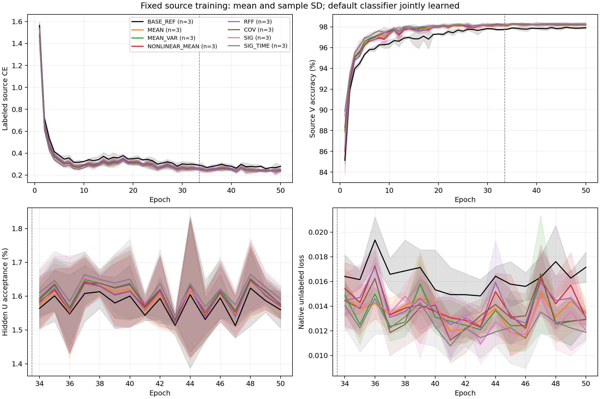
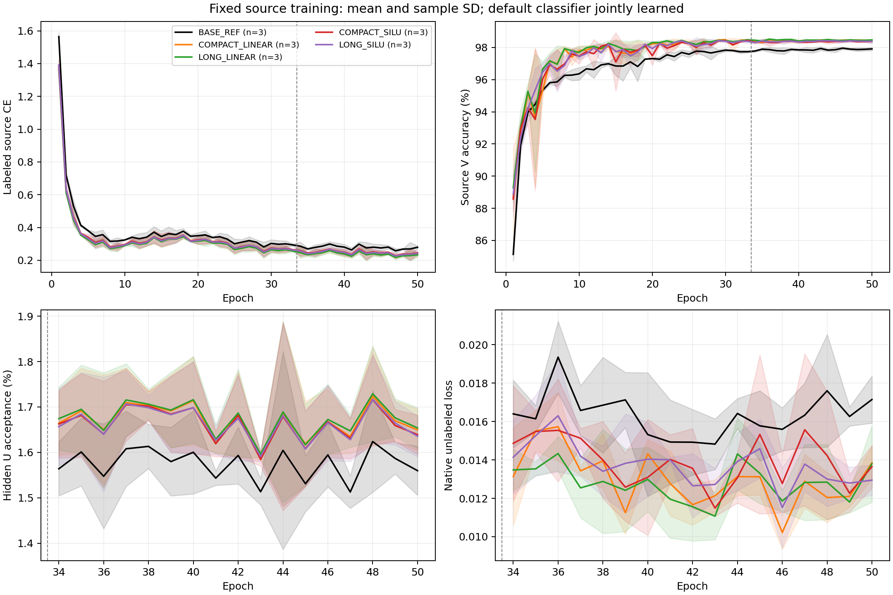
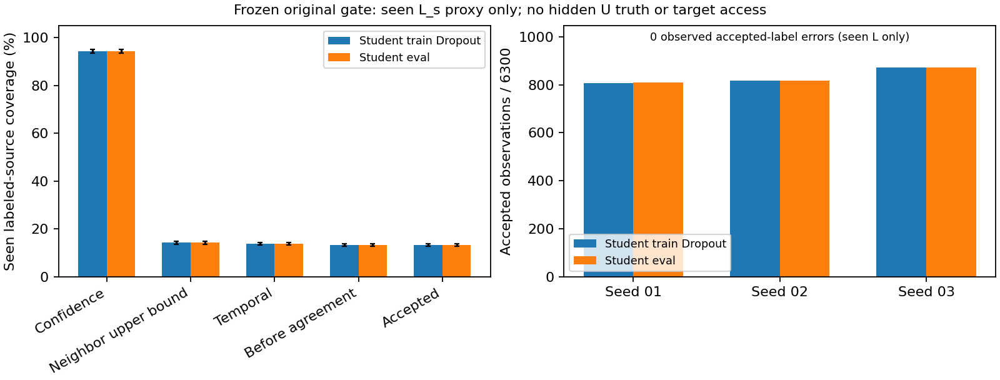
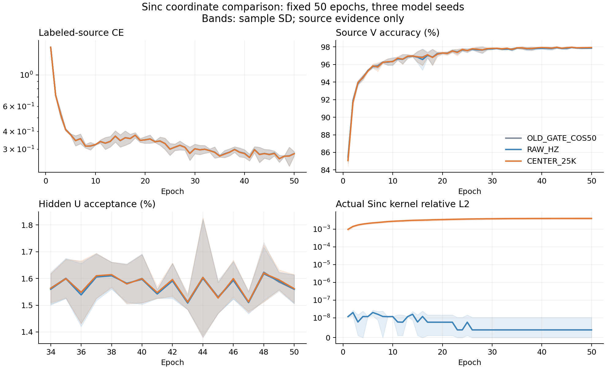
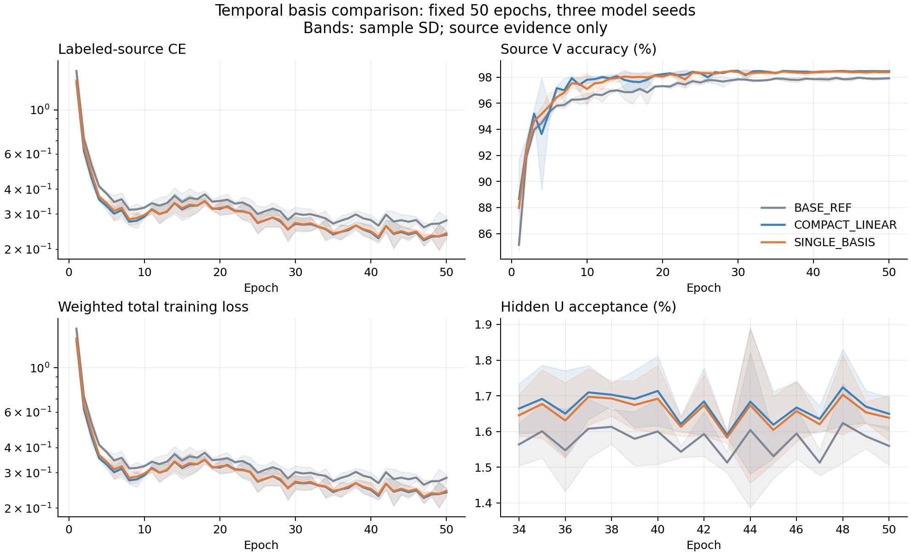

# Phase1 特征证据与完整实验复盘

当前主线为“跨 RX 个体参照关系＋CVS 增量证据响应”，按用户2026-10-14新材料实现并发布。全部合法隐藏U直接学习joint160的连续关系和PA/ref削弱后的有符号响应，无新增门控/类别头，原PAIR/ownEMA/33+17/50epoch配方保持。真实checkpoint与不重叠源L学习信号检查PASS，首seed A/B/C健康运行，D及后续seed由固定源判据推进。新机制实际泛化结果尚未返回；84%仍未达。先前切向平坦化首seed已完整：BASE80.6685%、ZERO80.7399%、RAW81.4405%、IDSAFE81.0298%，身份投影未优于RAW；ZERO/RAW/IDSAFE原样确认seed02/03已健康运行。详见本文末及各run报告。

当前研究目标仍是固定 ManySig clean 三种子默认头均值84%，尚未达到。本轮保留历史33标签＋17伪标签的batch_neighbor门控＋EMA＋普通cosine，不改成纯CE；分类头随骨干正常联合训练，禁止新增单独头训练、换头、原型替代或RX/day分类器。实际交接特征为joint160/id_feat_joint，W与特征归一化/融合增益边界分别核验。

已经闭合的近期主要结果：时间覆盖×分支内SiLU四条件完整三seed，主方案LONG_SILU81.8115%，距84%2.1885个百分点；Sinc居中坐标完整三seed80.7637%，比同路径RAW_HZ＋0.2425个百分点、3/3正，实际24核均学习，但没有新TX迁移证据。局部分布/路径实验co-primary分别RFF81.5742%、SIG_TIME83.0393%，均未达84%；对固定基线存在CUDA初始化随机流混杂，保留限制，不按较高目标分数选父权重或继续叠加。归一化/分支竞争、复频谱/功率关系和PA控制的完整负结果一并保留。

相近参数量单尺度残差控制已完整闭合：20261014-phase1-single-basis-residual-oldgate-e50-clean-manysig-m6-r01，执行a6d75a259949d66a7f8da80319ba904c1fc6d72a。3个新seed均完成固定50轮/11100更新及自动预测/独立评分，矩阵无失败；SINGLE均值81.2000%，对固定COMPACT81.2161%没有稳定净增益，距84%2.8000个百分点。SINGLE与COMPACT时间参数81744/81672、时间卷积MAC/包4905984/4898304（＋0.1568%）；单k5时间滤波基＋两层线性pointwise＋skip，最大卷积覆盖相同，preGN每输入核秩上界2对4。函数容量、优化参数化和初始时间函数仍有差异，不能把结果全归因于分支数。

以下保留各次研究时点的进度和证据，历史“待返回”“当前运行”只描述当时状态；各完整结果章节及本段当前摘要优先用于判断完成情况。所有新模型仅clean逐行自动预测、独立truth-last评分，固定源L6300/U56700隐藏TX/V27000及物理ID不变。未执行Phase2、新TX或星地部署验证，不将这些能力写成已完成。

## 证据范围与两分支

主分支 codex/report-physical-ssl-clean-delivery-20261011，本次审阅起点48325acd1f7781411cba214269fdf5353a2d6e9e，上游已独立核对一致。另一分支 codex/phase1-feature-challenge-20261013 审阅快照1f8814c046a8c68eba8a334e66a0aceb76e491e0，同上游一致，仅只读参照，不整体合并/改动其代码和实验。

复用两分支完整已提交汇总、源实际配置核验、既有全日志/原始confusion审计。当前没有重扫历史全部stdout，因此全日志PASS引用原审计，不称本次重新全量扫描。新直接证据为12份历史初始/末轮Sinc参数及optimizer状态核对、三份TIME_MS50真实source checkpoint等效核/数学fold检查。旧source权重的只读尺度撤除在当前新run中自动执行，与新训练统计分开。

完整同seed表见phase1_feature_evidence_seed_table_20261014.csv。不能跨配方合并：A为33标签＋17伪标签，B为32＋18。A基线mean80.5268%，B基线80.6454%，不能因为名字或head相同当成同基线。两者都保留历史batch_neighbor gate、EMA、cos、50epoch/11100步；数据契约L6300/U56700隐藏TX/V27000固定物理ID一致，TX6、sourceRX1/3/4/6/8×3day，目标clean168000，NoExplicitCFO。实际native wisig_train_days及day_i均为1/2/3；旧登记0/1/2描述错误已更正，角色物理ID保持。V只读，目标不参与训练/选择。

## 默认头完整结果

|实际配方|实验|条件|clean均值%|样本SD百分点|Macro-F1均值|最差RX均值%|
|---|---|---|---:|---:|---:|---:|
|A33/17|多尺度|OLD_GATE_COS50|80.5268|2.3776|0.800024|见同row分组记录|
|A33/17|多尺度|TIME_MS50|81.6905|0.6753|0.811841|见同row分组记录|
|A33/17|多尺度|PA_MS50|79.0032|1.3202|0.786648|见同row分组记录|
|A33/17|多尺度|JOINT_MS50|81.2895|0.7917|0.807658|见同row分组记录|
|A33/17|归一化/竞争|BASE_REF|80.5268|2.3776|0.800024|见同row分组记录|
|A33/17|归一化/竞争|ORDINARY|80.3075|1.8899|0.798284|见同row分组记录|
|A33/17|归一化/竞争|RESTORE|80.2532|2.0336|0.797431|见同row分组记录|
|A33/17|归一化/竞争|COMP|80.5663|1.6194|0.799939|见同row分组记录|
|A33/17|归一化/竞争|RESTORE_COMP|80.1298|1.5387|0.795943|见同row分组记录|
|B32/18|临时episodic|LEGACY50|80.6454|2.0918|0.801381|67.8611|
|B32/18|临时episodic|EPISODE_SAME_RX|80.6204|2.2619|0.801424|68.2847|
|B32/18|临时episodic|EPISODE_CROSS_RX|80.7494|1.3278|0.802724|69.4306|
|B32/18|频谱交互|LEGACY50|80.6454|2.0918|0.801381|67.8611|
|B32/18|频谱交互|POWER_RELATIONS|76.8591|2.3940|0.761218|62.2708|
|B32/18|频谱交互|COMPLEX_RELATIONS|79.3058|0.4940|0.787188|63.6903|

多尺度A的TIME相对原基线平均+1.1637个百分点、2/3 seed正向；PA −1.5236、0/3；JOINT +0.7627、1/3，相对TIME −0.4010。四模型都降低源末轮CE，TIME seed03源V更好而target差，故源拟合不能直接解释DG收益。身份参数含W基线177025、TIME237697、PA291585、JOINT352257；classifier W960是gW，norm/gain属于fθ。

归一化/competition A原始默认头相对基线 ORDINARY −0.2192、RESTORE −0.2736、COMP +0.0395、RESTORE_COMP −0.3970个百分点。已有普通容量控制和实际time/frequency/PA/reference sidepath，整体未形成稳定默认头提升，不把负结果改名再重跑。COMP的L几何RX-withinTX下降仅部分source证据，不证明纯RX shortcut。几何现有7row非完整15row，不能把effective rank约7.65直接解释为信息塌缩，更不能把卷积核秩与joint160特征秩混用。

频率上下文B：LOCAL_FREQ79.5353%、GLOBAL_FREQ79.4298%，相对同配方B基线都3/3负向（−1.1101/−1.2157个百分点）；仅导入恢复没有加训练。历史完整9模型450epoch/99900步审计U forward9185400、接受148082（1.6121%）、U真值可用0；低覆盖是需要诊断的现象，不能以覆盖低就放松原门控。

episodic B：CROSS_RX默认头+0.1040个百分点，仅1/3正向；同预算原头证据不足。历史prototype readout+1.2863且3/3正向，只能作为特征几何诊断，不替代实际默认头、不证明新TX。临时ridge系数无持久类W，gradient进入support/query实际joint160，但额外L曝光99900/model应披露。

cross-frequency B：complex相对power +2.4466个百分点且3/3正向，但complex相对原基线−1.3397、power−3.7863；只是matched机制相对证据，默认头尚无可靠增益。complex/power均新增45504参数，所有实际时频PA/reference路径保留。

## 历史readout诊断边界

保留已完成旧诊断，不再启动新head-only训练。A RESTORE历史sourceL cosine refit为10epoch AdamW lr.001 wd.0001、默认normalize eps1e−12、scale30；B episodic/cross-frequency为20epoch Adam lr.01 wd0、eps1e−4、scale30、Xavier seed+60013、500 W更新。它们不能合并。A基线refit78.5657%，B基线refit77.7637%，本身不构成θ好坏排序。原joint头11100更新且看L/U与refit仅L500更新的预算/信息差异，不能把原头—refit差全部归为W过拟合。

A leave-RX仅冻结θ重新拟合头，θ已看过全部source RX，属于读出头leave-RX压力，非真正held-out-RX骨干DG。所有旧refit只作为历史readout证据，本轮默认head禁止另训。已有目标错误“纠正/引入”逐物理ID配对完整跨分支表尚缺；本轮source V逐分支撤除将保存该类统计，目标group分数只在独立truth-last报告，不用于架构和下一候选选择。

## 新直接机制证据

TIME_MS50三个seed×t1/t2/t3真实训练后核：每输入通道的等效输出×偏移矩阵数值秩全部4，平均effective rank3.0682至3.1574；|τ|>2能量3.4190%至4.7954%。真实权重float64折叠max误差3.33e−15。说明多滤波基能力训练后没有退化成rank1，但远偏移能源较小也不代表无判别价值，均不能单独归因于TX信息。核可折叠的是preGN线性部分，GN的组内全序列依赖仍在。

原identity Sinc的12份真实初始/末轮权重和optimizer状态：24 band参数全部0变化、low仅1/24微变，10模型23核逐位不变、2模型24核逐位不变，最大kernel abs变化1.79e−7，实际moment非零/step11100。支持参数量纲/FP32更新问题的假设，尚不证明DG受它限制；当前四条件不修Sinc，避免混因。合成gradient smoke只能验证接线，不能替代这项真实数值证据。

## 可执行方向与当前取舍

1. 当前执行：时间覆盖×分支SiLU。作用于实际t1/t2/t3→fuse→默认joint160；四条件每新arm同81672时序参数、同对应初始tensor、CPU/CUDA随机流，BASE_REF固定旧基线只对照。回答在同多滤波基/投影下长覆盖和独立非线性的增量；失败解释为该fixed机制/预算不成立，不按target找最佳seed。
2. 后续source证据驱动：定位层位，先t1/t2多尺度＋原t3与全层/中层对照；t3承担47.2%新增参数且局部最长覆盖扩张最大。若source默认margin/撤除修正错误及参数使用支持，再做独立从零同预算小矩阵，别扫几十核。非线性正向需增加同类post-fusion额外SiLU控制，才能归因“位置”；普通卷积＋投影控制才进一步隔离滤波基和旁路。
3. 独立Sinc量纲假设：保持初始kernel和原head/门控，以固定二进制频率单位参数化改善真实filter更新，配同初始/同预算控制；不同时叠时间SiLU，不以现有target挑父权重。真实source filter不动是code/optimizer证据，不是结果已有效。
4. 机制诊断优先于改SSL：本轮记录epoch32/33/34/40/50 source及实际θ变化，全U RX/day接受、teacher weak/student strong一致度与预测类分布。不读U TX、不按targetgroup调gate。只能在允许sourceL做正确性代理；先看结构影响何时出现，再研究teacher反馈的单因素修改。

## 需求落实与状态

|要求|落实|当前证据/缺项|
|---|---|---|
|默认头joint、0另训head|native fitted RX/day/channel closure禁用；每row强制0head updates|本地和原native协议负例PASS|
|新增能力进入实际fθ/z|新t块安装在optimizer/EMA之前；保留PA/freq/ref/headnorm|实际全t参数数值更新、z变化PASS|
|W修改/删除不改z，pure export等于actual z|小范围复用另一分支纯特征接口，保留norm/gain|修改/删除W、strict checkpoint/teacher、actual native L/U路径PASS|
|匹配数据/预算/RNG|fixedroles、scratch50/33+17、native args，新增CPU-only独立初始化|CPU与实际CUDA RNG都逐armPASS；不声称GPU完全bitwise|
|无目标反馈|固定四条件和primary/源门槛；逐rowpredict固定后fresh CPU评分|自动管线/错误counts/IDs/extrahead拒绝PASS|
|已训练核、stage和scale证据|真实旧TIME kernel audit已VERIFIED；新/旧冻结V撤除自动接续|旧TIME三seed scale撤除与新source/target指标待真实运行返回|
|完整三seed/成本/负结果|12新scratch50＋3历史参考，600新增epoch＋150历史|未返回前不称结果完整或84%达标|

唯一新run为20261014-phase1-time-coverage-nonlinearity-oldgate-e50-clean-manysig-m15-r01，最小报告和15row单一矩阵见automation_reports。同GPU最多3总实验进程，保留所有健康旧任务。源gate通过后扩seed，不借已暴露target进行筛选或选择性重跑。本地checks/registry valid、唯一P0/P1及一次针对修复确认PASS；Git/release/PID独立证据由同run报告更新。未授权Phase2、head refit、kernel scan或同时Sinc变化。

2026-10-14发布更新：执行代码7b1e2fcbe1bf5d05f24bc91f86aa7d4b46d3ee95已commit/push并独立remoteOID一致；ordinary preflight、archive校验、remote compile、真实checkpoint noquery、实际PID/CWD/argv/GPU/log增长VERIFIED。第一seed四新条件健康训练，第1至2epoch；旧TIME seed01冻结source诊断已完成。剩余seed按固定source门槛自动扩展；目前不是完整三seed结果。

## 局部分布与路径实验：完整冻结结果

20261013-phase1-localdistribution-pathsignature-oldgate-e50-clean-manysig-m24-r01 已EXPERIMENT_COMPLETE，dispatcher及全部worker自然退出，独立进程/产物读回VERIFIED。实际训练commit c1bf3b74c7bc38b03e4e29931d9b90dc60f4a296。24行全部50epoch；21新scratch模型1050epoch/233100 optimizer及EMA更新，3历史基线150epoch/33300更新分开。4032000固定默认决定、432条原始CM/accuracy/F1独立重算一致。所有新增模型无另训头、U真值可用0、nonfinite/跳步0，完整stdout、50epoch、11100step逐行实际分析，未使用tail替代。

|条件|clean均值%|样本SD百分点|Macro-F1|每seed最差RX均值%|每seed最差day均值%|配对基线差百分点|正差seed|
|---|---:|---:|---:|---:|---:|---:|---:|
|BASE_REF|80.5268|2.3776|0.800024|67.9708|76.0556|—|—|
|MEAN|82.0734|0.8367|0.815588|68.4542|77.5865|1.5466|2/3|
|MEAN_VAR|82.4536|1.1572|0.819609|69.2875|78.7278|1.9268|3/3|
|NONLINEAR_MEAN|81.8990|1.3385|0.813819|68.6736|77.4286|1.3722|2/3|
|RFF|81.5742|1.3390|0.810201|67.6972|76.9659|1.0474|2/3|
|COV|82.5778|1.5350|0.820782|69.9583|78.3937|2.0510|3/3|
|SIG|82.8476|1.0954|0.822917|69.0986|79.0294|2.3208|3/3|
|SIG_TIME|83.0393|1.4557|0.825453|70.3431|79.3587|2.5125|3/3|

预登记co-primary分别报告：RFF81.5742%（相对BASE＋1.0474pp，2/3正），SIG_TIME83.0393%（＋2.5125pp，3/3正），均未达84%；SIG_TIME距目标0.9607pp。不能把单seed超过84%当达标。RFF低于MEAN/MEAN_VAR/NONLINEAR_MEAN，三种简单控制均3/3高于RFF，因此本轮不支持随机非线性分布读出比同参数简单池化更有价值。SIG_TIME相对COV＋0.4615pp、3/3正；相对SIG＋0.1917pp仅2/3正，仍是3模型seed证据，不泛化为新TX或普遍定理。

SIG_TIME相对同seed原基线纠正/引入错误：2026092701＝9483/4829，净4654；2026092702＝10400/4782，净5618；2026092703＝8259/5868，净2391。这些是预测全部冻结后独立CPU truth侧连接的报告，未反馈训练。完整逐RX/day/TX错误transition和分组表见本run analysis/paired_error_counts.json、group_metrics.csv。

机制与边界：21份真实initial/final模型的新增五类参数全部出现实际数值变化、固定omega/lift buffers不变；使用执行7b1e2fcbe1bf5d05f24bc91f86aa7d4b46d3ee95的纯特征接口严格加载原权重，actual joint160与feature-only一致，修改/删除W后z逐位不变。固定人工IQ下真实训练新分支Δz均值范数1.033至1.308，证明分支活跃，不是识别效果或新TX证据。真实source L几何21row和V27000/row顺序诊断已返回：RFF/COV置乱改变默认决定0，maxz差≤9.54e−7；SIG/SIG_TIME分别改变2647至4301、2062至2867个源V决定，说明有序分支在实际fθ中起作用。撤除/置乱会破坏共同适应，不能替代scratch消融。仅默认头收益，缺普通换头证据（当前用户禁止新增headfit），不宣称通用新类迁移。

公平性限制明确保留：原sequence初始化在CPU-only fork中调用torch.manual_seed，也改变CUDA RNG。7个新控制/候选之间新模块初始化与CUDA起点匹配，但对BASE_REF的新增参数和CUDA随机流仍混杂。不能将所有对BASE增益独立归因为descriptor。该健康run保持原注册计划、未重启/热改；当前TIME新矩阵已用CPU default_generator修正并验证CPU/CUDA RNG。参数匹配也不证明descriptor intrinsic rank相等。

源训练与成本：源码原loss_unlabeled是伪标签CE；CE权重0.16、熵权重0.01。原日志没有单独熵分量，表保留native伪标签CE和total−L差，不假造完整熵曲线。源CE下降/更新有限证据完整；对所有损失逐项重构仍有此观测缺项。每新模型U处理963900次物理观察（17×56700），全21模型20241900；weak teacher和strong student是两次前向，物理观察计一次。接受比例1.5829%至1.6301%，不能解读为精度。新模型source执行进程时间合计13.7878小时，含原验证/闭合且GPU并发负载不同，不是exclusive GPU时长或加速结论。source_curves.csv和静态source_training_curves.png保留全部50轮，33/17交界标明；不按50轮预算就断言已收敛。

## 另一分支的新完成证据与重叠发布

只读最新HEAD/upstream＝0b3c498b4695f8c6e435531b10b995a4323fc173。PA_CROSS_DELAY实际执行1f8814c046a8c68eba8a334e66a0aceb76e491e0，32＋18的9row已完整，3历史基线＋6新scratch50/300新增epoch/66600更新。baseline80.6454%，PA_CONV80.7738%，PA_CROSS_DELAY80.8133%；后者相对同容量CONV＋0.0395pp仅2/3正，不确认三阶机制收益。当前复用该owner完整audit/162CM报告，未称本次重新扫描其原始日志。其同源监督/伪标签配方与33＋17组分开。

另一owner已独立发布同构TIME：20261014-phase1-time-factorial-oldgate-cos-e50-clean-manysig-m15-r01，执行351e35cd0d298a6832c0865628bba28ab5a14cbe。该新发布在本次最新只读盘点才确认，存在研究问题重叠。它的CPU初始化offset62103、首seed门槛仅finalLCE≤.5、额外源V33/34共54000包及固定L720包/seed历史撤除；本run offset48213、加固定默认V总体/最差RX非劣门槛、5个阶段V共135000包及历史V27000撤除。两份各自内部4条件权重匹配，但不跨run合并成六个独立seed，也不从target择优。已发布健康任务全部保留，不再新增第三套同类矩阵；本对话后续只对本run完成闭环，并按明确配方单列另一owner证据。

当前最多两个动作：完成正在运行的TIME四条件及真实stage/参数/U反馈/尺度诊断；随后依据合法源证据明确是否需要post-fusion SiLU或层位对照，暂不发布新矩阵。Sinc坐标修复保留独立源证据，未混入当前运行。

补充机器表：phase1_feature_group_table_20261014.csv含所有已回收近期run/readout的1998条同row分组指标，配方分组和readout不合并；逐seed表补齐每seed Macro-F1、最差RX/day及三seed最差day均值。历史内容复用已验证CM汇总，未新增head拟合或历史原始日志重扫。

当前TIME进度：2026-10-14最新独立readback VERIFIED：首seed四条件source固定终轮及预测/评分闭合，通过LCE≤.5和默认V总体/最差RX非劣；全部15row已派发、7row闭合，8个seed02/03模型第33至34epoch，pending0、failure0、dispatcher和8worker实际live，GPU总进程max2。source首seed四arm finalCE分别0.250144/0.246923/0.253900/0.253468，默认V98.4037/98.4148/98.2593/98.2667%，0另训head。未读取partial target指标作候选判断，不称完整三seed结果。

## 时序机制的真实源证据更新

12份实际initial_smoke.pt已只读核对：每seed四条件的200个parameter/buffer tensors逐项相同，三seed全部通过，不仅是本地构造smoke。原头同样初始state，class W与feature norm/gain都保留；CPU/CUDA RNG的保留另有本地实际CUDA检查，不据此承诺GPU轨迹bitwise相同。

首seed四模型已完整50轮，epoch33→50的默认源V分别98.5000→98.4037、98.4370→98.4148、98.4593→98.2593、98.3667→98.2667%；按COMPACT_LINEAR/LONG_LINEAR/COMPACT_SILU/LONG_SILU顺序。第一seed的两SiLU条件没有表现出源V优于线性控制，阶段34后均出现不同幅度回落。固定L32的actual z在33→50改变均值范数1.702/1.616/1.783/1.548，说明半监督阶段仍改变fθ；固定L32只测数值变化，不是代表性准确率或因果分解。四模型U均处理963900次观察，接受15989/16016/15899/15910，weak EMA与strong student一致度98.8330/98.8358/98.7128/98.6963%，U TX真值始终不读。接受率不是精度，不能因此认定伪标签正确。全部源阶段/层更新和RX/day预测类别分布已保存；完整后两seed阶段证据待返回，不以此首seed排序/重跑。

旧TIME_MS50三seed、V各27000的九次branch撤除已完成且参数/buffers不变：t1长跨度branch2净纠正1904/544/532，t2为7/550/143，t3为121/211/72。它展示层位及seed相关的使用差异，不能按单seed t2较小便删掉中层，也不把source撤除性能当scratch消融。逐branch纠正/引入错误与margin见historical_time_source_branch_table_20261014.csv。当前仍不改已发布矩阵。

候选方向的预算/失败界限进一步明确（尚未发布）：层位控制的t1+t2版本新增32064identity参数，t2-only新增21312，比较全层新增60672，全部从零同50轮/11100步；最小先一seed同row源诊断，源CE非有限/预固定健康非劣不通过则不扩seed。分支SiLU若没有合法源一致改善，不直接进入层级结构；若源支持，再加不改变已有卷积参数的post-fusion SiLU位置控制。独立Sinc单位参数化不增加learned参数，初始核必须相同、同预算/原head/门控；真实filter仍不改变则证伪其优化机制，不靠target反复试单位。训练阶段/U反馈审计为源只读零参数方向，必要L代理精度额外前向成本单列；原gate不因覆盖低而放松。

真实终轮特征核验当前4/12模型通过：全部t1/t2/t3参数张量发生数值变化，actual joint160等于pure export，改写/删除W后export逐位不变，恢复W后所有特征参数/buffers与诊断前一致。真实initial/final权重在固定人工IQ上产生不同z，仅证明真实训练的功能变化，不称识别或迁移效果；没有source/target IQ读取、梯度、optimizer/headfit。另8模型继续固定50轮，待完整后补核验，当前证据范围见temporal_trained_export_progress_20261014.json。

## 时间覆盖×分支内非线性：完整三seed闭环

20261014-phase1-time-coverage-nonlinearity-oldgate-e50-clean-manysig-m15-r01 已EXPERIMENT_COMPLETE。执行7b1e2fcbe1bf5d05f24bc91f86aa7d4b46d3ee95，12新scratch50＝600epoch/133200 optimizer和EMA更新，3历史固定50基线成本150epoch/33300更新单列。15row/2520000原默认决定/270条原始CM均独立recount一致；所有source50epoch与11100step完整扫描、无nonfinite/skip/U真值暴露，0另训head，唯一review及问题针对性修复后没有热修改。

|条件|clean均值%|sample SD百分点|Macro-F1|每seed最差RX均值%|每seed最差day均值%|
|---|---:|---:|---:|---:|---:|
|BASE_REF|80.5268|2.3776|0.800024|67.9708|76.0556|
|COMPACT_LINEAR|81.2161|0.5591|0.806729|72.1611|77.7802|
|LONG_LINEAR|81.3268|0.4348|0.807956|72.4222|77.6341|
|COMPACT_SILU|81.4810|0.5040|0.810118|71.1278|77.4476|
|LONG_SILU|81.8115|0.5020|0.813831|72.1903|77.8310|

|固定因素配对|均值差百分点|配对SD百分点|正差seed|
|---|---:|---:|---:|
|LONG_LINEAR−COMPACT_LINEAR|0.1107|0.4655|1/3|
|COMPACT_SILU−COMPACT_LINEAR|0.2649|0.1404|3/3|
|LONG_SILU−LONG_LINEAR|0.4847|0.7068|2/3|
|LONG_SILU−COMPACT_SILU|0.3306|0.2570|3/3|

预登记primary LONG_SILU81.8115%，相对固定基线＋1.2847pp但仅2/3正；距84%2.1885pp。所有四新条件相对baseline都是2/3正，seed03都下降，不能把均值/低SD当作普遍改善。紧凑SiLU相对紧凑线性＋0.2649pp为3/3正；长线性扩大覆盖仅＋0.1107pp为1/3正；SiLU基础上长覆盖＋0.3306pp为3/3正。长SiLU相对长线性＋0.4847pp仅2/3正。交互效应(mean差中差)＋0.2198pp、seed差为＋0.7774/−0.4214/＋0.3036pp，不支持所有初始化共同强化。3个模型seed，未称统计充分或新TX迁移。

解释限制：四条件匹配参数/对应初始tensor/CPU和CUDA随机起点，保持旧门控、EMA、cos、PA/frequency/reference/Sinc/NoExplicitCFO。SiLU和dilation有意不同初始函数；compact t3长度5仍长于原t3长度3，且所有新条件含同样1×1投影/容量，所以对BASE增益仍未把容量、多滤波基、旁路分离。历史TIME_MS50旧初始化消耗CUDA RNG，新LONG_LINEAR修正该路径及private CPU init，旧81.6905%不能与新81.3268%拼接作完全同条件复现。新LONG_LINEAR/SILU没有以old最高target权重继承。

源阶段（各3seed平均）V33→V50分别COMPACT_LINEAR 98.4642%→98.4531%；LONG_LINEAR 98.4716%→98.4679%；COMPACT_SILU 98.4420%→98.3741%；LONG_SILU 98.3840%→98.3840%。对应固定L32 actual z平均改变1.981/1.822/1.743/1.680；它只测真实特征数值变化，不是独立因果归因。源V在33轮附近已高位，后17轮仍更新θ，但没有一致源V新增收益。四条件teacher弱/学生强一致率98.808%/98.841%/98.742%/98.735%，接受率1.6687%/1.6732%/1.6622%/1.6622%；一致不等于正确，U TX真值未读，不因覆盖小而改gate。60个阶段、180个RX/day组及预测/接受类别分布见机器表。

12份真实终轮权重t1/t2/t3全部参数张量更新；实际z=pure-export，改写/删除W不改z，诊断全部feature params/buffers保持。classifier base_norm/pa_norm/gain保留；仅W为类别读出。source V固定branch撤除、L geometry以及真实preGN kernel使用均回收；核秩不等joint160秩，nonlinear不能fold。人工IQ的真实final/initial feature差仅作功能核验。没有head-only/原型/新TX训练，本轮只确认默认原头结果与特征接线，不宣称普遍新类迁移。

新source执行进程时间合计7.9451小时，包含各自source验证/闭合，GPU并发不同，不称exclusive GPU成本或性能加速；12模型U观察11566800次（每次weak/strong两forward），source阶段额外V135000/模型及固定L32数值诊断单列。冻结branch诊断每模型V27000、9次撤除＋full，同3份历史TIME按原run单列，无更新。原native raw entropy未单独记录，已保留raw伪标签CE/total−L差，不补造熵曲线；其他曲线全50轮见source_curves.csv，终轮不等于已完全收敛。

当前结论与后续边界：本轮完成用户规定四条件归因，紧凑非线性和非线性后长覆盖有小幅同seed一致信号，但主指标未达84，base比较有剩余容量/投影因素，不能直接加深堆分支。后续最多两个源证据动作：补相同SiLU放在融合后的最小位置控制，或独立Sinc坐标修复（实际长期近静止权重/moment证据）；均需独立固定预算，不混合，不以target分数选父权重/参数/seed，不无限扫描。当前不发布第三套同构TIME矩阵，另owner健康run保留并单列。

## 实验身份与预算总台账

|实验|实际执行commit|来源|骨干成本|row/readout/决定/指标数|机制与head边界|
|---|---|---|---|---|---|
|多尺度A33/17|5fa536f9ca2d90e7d30d547d58503a41b612d57f|12scratch50|600ep/133200step|12/1/2016000/216|默认cos＋改time/PA blocks；所有scratch|
|恢复/竞争A33/17|d1c274d1276a080dcdd66e1d7588a63dbe547e59|12scratch50＋3固定基线参考|600新增ep/133200step＋150历史ep|15/2/5040000/540|默认cos＋t1统计/四实际路径；历史10ep refit单列|
|频率上下文B32/18|43bd20494aa470568a68553ce664dc76811b9707；eval修复9ea84c4d22076532dd613a28d1b2da3988591feb|9scratch50，导入恢复0训练|450ep/99900step|9/1/1512000/162|不扩大标签；仅归档恢复，无选择性重训|
|临时episodic B32/18|d001edf7c03c6c0831679ff37cfbaf1f9ed80eb7|6scratch50＋3历史参考|300新增ep/66600step＋150历史ep|9/3/4536000/486|16650临时episode/599400额外L；20ep refit和prototype历史|
|cross-frequency B32/18|9c171f9f13c7675eb06a4f2fc82d31105919becf|6scratch50＋3历史参考|300新增ep/66600step＋150历史ep|9/3历史/4536000历史/486历史|新CW/power均45504param；当前default162metrics，历史读出隔离|
|PA cross-delay B32/18|1f8814c046a8c68eba8a334e66a0aceb76e491e0|6scratch50＋3历史参考|300新增ep/66600step＋150历史ep|9/1/1512000/162|两路径均576新增param；只default，未确认三阶收益|
|局部分布/路径A33/17|c1bf3b74c7bc38b03e4e29931d9b90dc60f4a296|21scratch50＋3历史参考|1050新增ep/233100step＋150历史ep|24/1/4032000/432|7新路径各18976param；default-only；基线CUDA RNG混杂保留|
|本TIME四条件A33/17|7b1e2fcbe1bf5d05f24bc91f86aa7d4b46d3ee95|12scratch50＋3历史参考|600新增ep/133200step＋150历史ep|15/1/2520000/270|4path各60672新增；真初始state/RNGmatched；default-only|

各run同一物理SOURCE契约L6300/U56700(hidden)/V27000、6TX/5sourceRX×3day，targetclean168000，NoExplicitCFO；32/18与33/17分组、10/20epoch head配方不合并。所有新增骨干无未知ancestor、无target初始化/训练/选择，基线只作固定同seed比较。逐row resolved/native配置、source合同/初始化/freeze、原始log/weight/prediction路径在各run experiment.json，完整引用，不把索引状态代替实时证据。后续source/time run及另一owner重复发布路径均保持独立身份，不混成6seed。

## 后续源机制工作与重复派发保护

跨分支只读核对发现，另一 owner 已用提交0f81373c25ba69a6cb9deec5c7ca652880fd62af发布20261014-phase1-sinc-coordinate-oldgate-cos-e50-clean-manysig-m9-r01：RAW_HZ 与 CENTER_25K、原始基线，各三seed；实际初始核和joint160相同，33＋17/scratch50、默认头联合训练、0另训头。2026-10-14独立进程/产物读回VERIFIED，首seed两模型第3轮、0failure，后两seed仍等待固定源条件。未读取其partial target指标选方案。该居中缩放同时改变优化/权衰减/EMA坐标，不能称纯尺度因果测试。本对话尚未发布的固定二进制单位实现与局部检查移至本地保存，不并行启动另一单位试验，不停止或改动已有run。

当前独立动作是20261014-diagnostic-source-labeled-gate-oldgate-manysig-m3-r01：只读历史固定默认student/ownEMA，用合法已见L_s6300/seed测原门控代理精度、RX/day/TX覆盖以及相同元数据的可配对邻居上限，0训练/EMA/headfit，0target或U前向。原门控与健康Sinc训练保持。代理不能替代实际隐藏U精度或泛化验证；完整结果返回后在本主报告集中更新。预登记和3行路径见对应experiment.json/report.md。

源门控诊断r01读取数据前出现fresh-worker原生模块路径错误，实际L观察0。原进程自然退出，原产物保留；本地独立进程复现/修复路径问题后改用r02新root，原三seed/采样/零更新预算不变，不干预已有Sinc，不把失败计为完成。

## 有标签源门控代理：完整三seed结果

20261014-diagnostic-source-labeled-gate-oldgate-manysig-m3-r02已SOURCE_DIAGNOSTICS_COMPLETE/独立VERIFIED，执行41c55b237059b7af4ab6d4e943dd8663d7f2faae。三名义seed均完整6300个固定L_s样本、25批；合计18900次L观察（同一固定6300包×3模型seed）、56700次前向，1260个分组/阶段计数与全部25批进度日志复算一致。各自实际student和ownEMA均严格加载历史final50，全部参数/buffers诊断前后相同，0 backbone/headfit/EMA更新，0 U或target前向，3worker及dispatcher自然退出。实际过程时间合计22.77秒，含加载与诊断，不含传输/编译，不称exclusive GPU成本。

|源代理阶段|三seed覆盖均值%|覆盖sample SD百分点|对应教师标签精度均值%|
|---|---:|---:|---:|
|原EMA全部弱视图|100.0000|0.0000|99.4444|
|置信度通过|94.2804|0.8767|99.9889|
|盲元数据邻居可用上限|14.2011|0.5613|99.4049|
|原temporal通过|13.7196|0.5504|100.0000|
|confidence∩temporal|13.2222|0.5390|100.0000|
|再加训练Dropout学生一致|13.2011|0.5465|100.0000|

训练模式最终接受807/817/871，共2495，实际错误0；eval学生接受810/817/872，共2499，错误0。同一弱EMA和强噪声输入下，全部样本弱强一致率从训练模式98.8254%变为eval99.8624%，但在已有base gate后只多4次接受，即0.0212pp。冻结source代理的覆盖损失主要发生在可配对邻居约束；这支持检验随机batch的结构限制，不证明它就是实际U或泛化瓶颈，不因此放松gate。

训练模式分组接受覆盖：RX11.4286%至15.2381%，day12.0000%至14.5238%，TX9.6190%至16.2857%，RX×day9.0476%至17.1429%；各分组接受标签在本代理上均无观测错误。上述精度仅对应已见有标签训练source，可能乐观，不能称隐藏U精度100%、不能直接外推U覆盖，也不提供未见RX/新TX迁移证据。batch分布、pool大小、真实U与已见L的差异不能忽略；实际U真值保持隐藏。没有拟合头、改温度或补原型，模型/gate看不到L truth，仅下游计量连接合法L标签。

原native门控按同RX/day/eq的sig_i与base_index邻近再检验预测/置信；结构上限用同一元数据、恒定同类高置信预测计算，仍调用原函数。它是可能邻居的必要条件，不是修改后的训练gate。两个模式的confidence/temporal/base/structural计数和弱教师预测分布逐项相同，student差异只用于无梯度诊断。阶段数值表source_gate_proxy_seeds_20261014.csv、全部分组source_gate_proxy_groups_20261014.csv、身份/过程/聚合source_gate_proxy_summary_20261014.json已保存。

r01技术失败保留：fresh worker在原生模块路径引导前导入cvsrffi，L观察0。一次局部复现和仅该P1的针对性复核后使用r02独立root，实际完成，未覆盖旧根/停止他人/重复科学矩阵。修复不改变任何训练配方或数据权限。

源日期记载纠正：原native args为wisig_train_days=1,2,3，实际day_i也是1/2/3。部分早期登记的source_days=[0,1,2]为描述错误，现保留原字段值的更正记录并写明实际1/2/3；不能未经证据把它解释为索引/显示编号差异。EXACT_MATCH物理ID及已运行数据始终保持，不重训、不重验数据、不改科学协议。

当前后续仅回收已有Sinc坐标run。最新独立读回首seedRAW_HZ38轮/CENTER_25K37轮、健康无failure，后两seed仍按固定源阈值等待；该进度不代表完整三seed或84%目标达成。本对话未并行派发另一Sinc单位扫描。默认分类头联合训练、0另训头的限制继续有效。

Sinc进度更新：首seed RAW_HZ与CENTER_25K均完成固定50轮及本row自动预测/独立评分；固定源门槛通过，程序已释放后两个seed的4个预登记训练，最新均第2轮，pending0/failure0，独立PID/CWD/产物读回VERIFIED。当前仅更新源与执行状态，未读取partial target分数作方案判断，仍不称完整三seed结果或84%达成。具体快照见source_mechanism_handoff_20261014.json。

## Sinc 坐标对照：完整三种子与实际特征证据

截至本次独立回收，20261014-phase1-sinc-coordinate-oldgate-cos-e50-clean-manysig-m9-r01 的 9 行均完成固定终轮、默认头预测和 fresh CPU truth-last 评分。队列清空、无失败、全部 worker 退出。执行提交 0f81373c25ba69a6cb9deec5c7ca652880fd62af；6 个新增 scratch50 共 300 模型轮次、66600 次优化器/EMA 更新，3 个历史固定基线另计 150 模型轮次、33300 次更新。1512000 个固定决定、162 条混淆矩阵逐条独立复算一致，450 条完整 epoch 与66600条新增 step 全量核对，无跳步、nonfinite loss/grad 或 U 真值暴露，0另训头。

|条件|seed01 %|seed02 %|seed03 %|clean均值%|sample SD百分点|Macro-F1|最差RX均值%|最差day均值%|
|---|---:|---:|---:|---:|---:|---:|---:|---:|
|原固定基线|80.6685|78.0815|82.8304|80.5268|2.3776|0.800024|67.9708|76.0556|
|RAW_HZ|80.7381|78.1655|82.6601|80.5212|2.2552|0.799914|67.9764|76.0286|
|CENTER_25K|80.8964|78.5042|82.8905|80.7637|2.1962|0.802499|68.3472|76.3881|

CENTER−RAW逐seed差＋0.1583/＋0.3387/＋0.2304个百分点，均值＋0.2425、配对sample SD0.0908个百分点，3/3正；CENTER−原基线＋0.2369个百分点，3/3正；RAW−原基线−0.0056个百分点，2/3正。primary CENTER均值80.7637%，距84%仍差3.2363个百分点。CENTER相对RAW分别修正806/1287/851个错误，同时引入540/718/464个错误；没有用最好单seed代替主指标。

真实同seed初始 RAW/CENTER 的191个非坐标 state tensor一致，重建的物理Sinc核完全相同；原输入/下游结构/默认头/随机起点匹配。CENTER同时改变居中、尺度及 AdamW/weight decay/EMA 的坐标，因此是组合参数化修复，不能声称纯浮点精度或纯scale因果效应。两者均48个可学习坐标，另48个固定origin buffer；无新增骨干容量。

RAW终轮核相对L2为0/0/1.1708e−8，分别24/24/23个核位元不变；CENTER为0.003995/0.003487/0.004398，3个seed全部24个核改变。CENTER的最大实际low频率变化4140.83/3504.29/3931.20 Hz，最大high变化8321.40/7010.96/7858.15 Hz；源证据支持“原Sinc近静止，修复后确实学习”，不支持“它是全部泛化瓶颈”。最终源L CE为RAW0.287733/0.280714/0.271100，CENTER0.288681/0.280014/0.269651；各源V仍约97.8%至98.0%，没有一致大的源指标跃升。

固定合法源L720（每TX/RX/day首8个物理ID）、6模型的真实joint160导出与原前向严格一致，W置零/移除不改变导出，所有特征参数和buffers诊断前后相同，0 head/optimizer更新，0 U或target前向。在保留全部终轮下游权重和默认W、仅临时恢复初始Sinc的条件诊断中，CENTER的z平均L2改变0.08033/0.04343/0.08026，默认margin变化＋0.00774/＋0.00075/−0.00432；这720包的准确率均不变。该诊断表明新核作用进入真实z，也显示条件margin影响不统一；它不是独立从零消融或新TX迁移证据。

6模型每个U观察963900次，合计5783400次（弱teacher和强student两路）；接受数RAW15218/15101/15151，CENTER15248/15127/15192，覆盖都约1.57%。完整50轮源曲线、实际核变化和分组表见sinc_coordinate_source_curves_20261014.csv、sinc_coordinate_groups_20261014.csv；source过程时间合计3.3242小时，包含源验证/闭合、不同GPU并发，不称独占GPU工时或加速倍数。新增源诊断各2次V共54000观测/模型、L720读出边界/条件撤除，成本单列。

统计脚本口径修复保留：epoch的train_pseudo_total/selected本来就是每轮总计，旧辅助回收脚本又乘222导致历史基线计数断言失败。只改本地只读回收的这两处总计表达，再完整核对通过；没有改远端训练、预测、评分或他人工作树。

结论：完成实际参数更新修复，并有默认原头小幅3seed一致改善；没有达到84%，也没有独立新TX迁移证明。不继续扫描Sinc单位/温度/分类头。本对话未启动第二个Sinc坐标矩阵。

## 已发布的相近参数量单尺度残差控制

用户目标中仍未闭合的单尺度残差控制已实现、预登记并发布：20261014-phase1-single-basis-residual-oldgate-e50-clean-manysig-m6-r01，执行a6d75a259949d66a7f8da80319ba904c1fc6d72a，启动与远端版本/真实checkpoint无query smoke/进程日志增长均VERIFIED。3个新增scratch50，固定33＋17旧门控/EMA/default cosine；3个原基线复用，COMPACT_LINEAR历史三seed作为固定源健康及最终配对参照。新增时间参数81744对COMPACT81672（差72），k5 DW＋两层无中间激活pointwise＋skip；其他Sinc/频域/PA/参考/输入不变。preGN每输入时间核秩上界2对4，卷积最大覆盖一致，优化重参数化与不同初始函数作为限制披露。

独立审查仅发现发布归档漏factorial依赖，修复并针对该问题复核PASS；本地接线/梯度/数值更新/z变化/W不依赖/初始非时间state及RNG匹配PASS。最新首新seed第13轮、健康无failure；原seed01参考行已自动完成预测/评分。这是运行进度，尚无SINGLE完整默认头结果。首seed完成固定50轮后仅按合法源LCE≤0.5、V均值相对COMPACT下降≤1个百分点/最差RX≤2个百分点放行后两seed；其自动target评分可以并行，但分数及评分是否完成不作科学资格依据。完整矩阵未返回前不新增候选、不热改健康任务。默认分类头联合训练、0单独训练分类头限制继续有效。

单尺度残差计算成本补充（实际 CPU 前向 hook、两份256点合成零输入，无数据/权重/真值读取）：修改的t1/t2/t3卷积MAC/包为原基线1242624、COMPACT_LINEAR4898304、SINGLE_BASIS4905984。SINGLE相对COMPACT多7680 MAC/包（＋0.1568%），因此本控制不仅参数相近，修改模块的卷积乘加预算也接近。各层SINGLE为1855488/1830912/1219584，COMPACT为1849344/1829376/1219584。该计数排除不变的Sinc/频域/PA、FFT、归一化/激活/加法/池化及内存成本，不能替代整模型FLOPs或实测速率。实际身份模型参数确认177025/237697/237769；减去类别W的960个参数后fθ为176065/236737/236809。两模型函数族和优化参数化仍有明确差异，参数/MAC匹配并不证明等同函数容量。可复现入口tools/profile_time_basis_operations.py，逐卷积shape及乘加表time_basis_operation_counts_20261014.json。

首seed部分源阶段观测（不作为终轮结论/放行依据）：SINGLE_BASIS已到34轮；V32/33/34为98.3037%/98.3444%/98.4889%，最差源RX95.5556%/95.7037%/96.0000%。32/33轮未执行U训练；34轮观察56700个隐藏TX的U、接受921（1.6243%），U真值未读、门控未改、head-only更新0。后seed仍等待固定50轮源阈值，不能提前放行或把本部分阶段成绩当作clean泛化结果。完整阶段字段暂存time_basis_early_source_stages_20261014.json，最终用全50轮证据替代部分结论。

单尺度残差首seed完整源资格：终轮L CE0.248543，V98.3259%/最差源RX95.5185%，对已冻结COMPACT差−0.0778/−0.0556个百分点，均在预登记界限内。全部50轮/11100步及stdout完整核对，无nonfinite/跳步/U真值，U观察963900/接受15870；实际t1/t2/t3所有参数张量更新，每输入preGN核秩均2，L6300真实joint160导出与原前向一致、W删改不改z、诊断不改变特征state。L有效秩7.8712，TX间/RX-within-TX/组内方差比例82.9824%/5.7493%/11.2682%，仅描述已见源几何，不代表新的泛化结论。剩余两seed自动放行与firstseed预测评分状态分别核实，不把部分完成写成完整三seed。源资格及模型证据见time_basis_first_seed_source_summary_20261014.json；目标行指标留待全矩阵统一报告。

后两seed阶段32/33/34源记录补齐（仍非终轮结果）：seed02 V98.1963%/98.2963%/98.0630%，seed03为98.4519%/98.4111%/98.4370%。第34轮各观察56700个隐藏TX的U，接受970/908，teacher弱与student强一致55825/55908；U真值读取、head-only更新、门控改动均0。源阶段变化和接受率不替代完整默认头测试或伪标签精度，不因此改预算/配方。完整三seed阶段32/33/34的部分源证据保存在time_basis_early_source_stages_20261014.json，最终仍需50轮全量汇总。

## 相近参数量单尺度残差：完整三种子闭环

20261014-phase1-single-basis-residual-oldgate-e50-clean-manysig-m6-r01 已完整完成。执行提交 a6d75a259949d66a7f8da80319ba904c1fc6d72a；6个登记row全部固定50轮/默认头预测/fresh CPU独立truth-last评分，dispatcher及全部worker退出、队列清空、无失败。3新模型150轮/33300次optimizer及EMA更新，3原基线和3外部COMPACT历史模型各150轮/33300更新另列。登记矩阵1008000决定（新增504000、原基线复用504000）；外部COMPACT504000原决定再复用作配对，合计1512000固定决定、162CM独立逐条重算一致。全50轮及11100步/新增模型完整核对，无非有限值、跳步或U真值暴露，0另训分类头。

|条件|seed01 %|seed02 %|seed03 %|均值%|sample SD百分点|Macro-F1|最差RX均值%|最差day均值%|
|---|---:|---:|---:|---:|---:|---:|---:|---:|
|BASE_REF|80.6685|78.0815|82.8304|80.5268|2.3776|0.800024|67.9708|76.0556|
|COMPACT_LINEAR|80.9988|80.7982|81.8512|81.2161|0.5591|0.806729|72.1611|77.7802|
|SINGLE_BASIS|81.6173|79.5315|82.4512|81.2000|1.5039|0.806569|71.6208|76.7627|

SINGLE_BASIS81.2000%，距84%2.8000个百分点。相对原基线平均＋0.6732个百分点、配对SD0.9452、2/3正，seed差＋0.9488/＋1.4500/−0.3792。相对同覆盖/近参数/近MAC的COMPACT平均−0.0161个百分点、配对SD1.0831、2/3正，seed差＋0.6185/−1.2667/＋0.6000。SINGLE的3seed样本SD1.5039个百分点，COMPACT为0.5591，但3个seed不足以将波动差异推广成普遍稳定性结论。

SINGLE对COMPACT分别纠正5746/3014/4364个错误，同时引入4707/5142/3356个错误；对原基线纠正7754/8349/7333，同时引入6160/5913/7970。该表在所有预测固定后由CPU truth侧独立计算，不用于候选重排/重跑。逐RX/day/TX指标和误差表分别time_basis_groups_20261014.csv、time_basis_error_transitions_20261014.csv。

真实3seed初始与同seed原基线的179个非时间state tensor逐项一致；时间函数和tensor有意不同。全部新时域参数张量训练后更新，9个实际t1/t2/t3模块每输入preGN核秩均2；COMPACT的实际线性核秩4另有已完成证据。三个新模型在L6300上actual joint160与纯导出一致，W修改/删除不影响z，诊断没有改变特征参数/buffers。三seed L有效秩7.8712/8.2625/8.9392、RX-within-TX方差比例5.7493%/7.0930%/7.3734%，仅描述合法已见源几何，不当作TX迁移或RX捷径的因果证明。

参数81744/81672、时间Conv1d MAC4905984/4898304近似匹配，SINGLE最大局部覆盖与COMPACT同为k5 envelope；两层无中间激活pointwise保持单PW的可表达矩阵族，却改变了优化参数化。核秩2/4差异与初始化时间函数差异不能独立拆开。当前结果没有显示多滤波基相对该单尺度残差控制的稳定净增益；均值相近也不证明机制等价，不将原TIME对BASE的收益全归为多尺度。容量、旁路和优化参数化仍有剩余归因限制。

SINGLE三seed末轮源CE0.248543/0.239481/0.234405，V98.3259%/98.3037%/98.5222%。V33→V50三seed均值98.3506%→98.3840%，净＋0.0333个百分点；后17轮仍改变真实z，固定L32的33→50均值L2为1.4346/1.6000/2.4724。这只证明实际特征继续学习，不能把很小源V差异称为充分泛化提升。U每模型观察963900，接受15870/15900/16080，共47850/2891700约1.6547%；U真值未读，teacher/strong一致不是伪标签精度。15个source stage及765个RX/day/epoch反馈组已完整保存。

新source过程时间合计1.7149小时，含各自源验证/闭合，GPU并发及负载不同，不是独占GPU时间/加速倍数。每模型另有5次V源阶段前向135000观测、固定L32阶段数值对照，以及冻结后L6300特征诊断；推理/scorer与历史控制成本分开。time_basis_source_curves_20261014.csv保留全部50轮L CE/weighted total/native U CE/counts；原native独立entropy未记录，不补造该曲线。

本波结论：覆盖/分支SiLU的2×2、真实Sinc坐标修复、相近参数/MAC单尺度残差控制均已闭合；所有正负结果保留，84%仍未达。当前不继续扫描卷积核、初始化单位或分类头。后续最多两个源证据动作保持独立：检验原门控在合法源元数据下的邻居可用性（零headfit，不因覆盖低直接放松门控）；或在浅/中层研究身份保护的源风格扰动/梯度机制，先固定方法、数据角色与源失败判据，再做最小公平实验。现有目标分数只作本波报告，不用来选择父权重、机制参数或选择性重跑。

身份切向训练发布更新：20261014-phase1-identity-tangent-oldgate-e50-clean-manysig-s01-m4-r01 已 RUNNING/VERIFIED，执行 840be47b7d6b43dbb00ac2cf3864a4025fd41ca8。3新模型首读回第1至2轮，BASE_REF历史预测/评分复用，无失败。归档/compile/真实checkpoint noquery与3owned进程、GPU、日志增长核实；前5轮warmup尚未启用切向正则。不把接线/启动当泛化结果，当前84%目标保持未达。

## 2026-10-14 更新：有效学习信号优先

切向平坦化固定首种子完成：BASE_REF 80.6685%、ZERO 80.7399%、RAW_MATCHED 81.4405%、IDSAFE 81.0298%。所有预测先固定、独立 truth-last 评分；新模型均 50 epoch/11100 更新，分类头按原路径联合训练。IDSAFE 对等能量 RAW 低 0.4107 个百分点，投影优势未获首种子证据，三种子 84% 目标未完成。保留完整负证据，不依据目标分数修改候选。

最新用户要求将主线转向“教师可信度与学生学习价值分开”，先用 PAIR 2×2 区分强一致性硬否决和全局 U entropy。此前 PAIR 覆盖大幅增加而目标均值仅增约 0.0984 个百分点，不能以接纳率解释有效性。第一步固定 0.99 双弱视图信任、10% 数量/25% 原 CE mass 上限，在三冻结 PAIR seed 的完整源 V 上验证新纠错子集可靠性；源标签不进决策、不拟合阈值、无 U 真值和目标访问。详见 `automation_reports/CV-SincNet/20261014-diagnostic-trusted-correction-source-manysig-m3-r01`。可信纠错、证据支路教学、能力触发和跨 RX 更新效用分开检验，不能把普通一致性或修复原否决单独宣称为新算法。

## 2026-10-14 更新：关系与证据响应成为主线

用户新方案从“是否接受伪标签”转到“如何给全部合法U构造表征监督”。新矩阵固定PAIR原配方，ZERO/ALL_REL/CROSS_REL/CROSS_RESP逐项检验通用关系、跨RX组织及真实PA/ref增量响应。不经类别W，无新增头；全部参照为L个体，120/query、20/TX、7/7/6day构成匹配，bank180每222U更新刷新。对应注册 `20261014-phase1-evidence-relation-pair-oldgate-e50-clean-manysig-m12-r01`。

数学反例和native CPU辅助梯度/实际参数变化及Ucallback负测PASS，独立P0/P1reviewPASS。只是执行证据，尚无本方法实际训练或目标结果。普通关系学习已有RelationalKD/ReSSL/PAWS基础，贡献需D对C完整3seed证据。

可信纠错R02已完成完整源代理，3seed新接纳分别15/15/11，全41/41正确，但固定pool>=100/each>=20数量条件失败。保留负证据，未访问U/target、未拟合模型/阈值，不继续接受链。此前切向机制按预先源条件与用户最新授权原样扩剩余seed，三个控制全部保留，无目标选RAW；有效r02已发布，自动default预测/独立评分。

## 继续保留的正收益路线

已完成三seed的COMPACT_LINEAR81.2161%（SD0.5591pp）、LONG_SILU81.8115%、Sinc居中坐标相对同路径RAW_HZ＋0.2425pp且3/3正，保留各自实际配方和来源作为后续匹配验证路线，不因训练主线转向而删除或降格为失败。当前先验证关系目标的独立贡献；源学习信号与健康判据通过后，下一项组合验证固定用CROSS_RESP这一预定主项，分别与已核实正收益结构做同预算独立控制，不按新target评分择方法或父权重，也不一次叠加全部结构。SIG_TIME83.0393%等结果的历史CUDA随机流混杂继续明确保留，不能将其对BASE的全部增益当成已确认机制收益。

本轮新关系与切向确认发布PID/源日志/默认头边界均VERIFIED，尚无完整新3seed结果。历史小正收益、首seed候选增益与稳定三seed泛化证据分别陈述，未宣称达到84%。

关系矩阵实际A/B/C191个初始state tensor全部相同，native args除row身份/输出路径一致。U尚未启用的标签阶段出现从舍入量级开始的GPU轨迹差异，deterministic=false，保留完整可用prefix证据且不宣称bitwise匹配；不热改或重启。此为初始化/执行证据，不是泛化收益。

关系矩阵首seed A/B/C完整默认头结果：ZERO81.0488%、ALL_REL79.3310%、CROSS_REL79.5982%；B/C对匹配ZERO分别−1.7179/−1.4506pp，C对B＋0.2673pp，不称关系有效。实际3774次allU损失、浅中层梯度、4次AdamW、无W/gain辅助梯度与无跳步已核实；源健康判据在target汇总前通过并已自动启动D。保留负结果，不热改、停D或target调参；尚无完整四条件/3seed证据。
