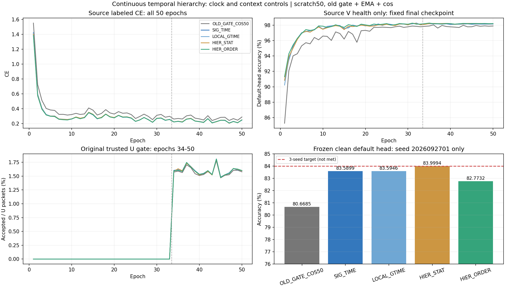

# 连续层级时序聚合：首种子完整结果

**预登记有序层级HIER_ORDER首种子未强化SIG_TIME。** HIER_ORDER82.7732%，同容量大窗统计HIER_STAT83.9994%，原SIG_TIME83.5899%；候选−统计控制−1.2262个百分点、候选−原SIG_TIME−0.8167个百分点。只有1个模型seed，样本SD无定义，完整三seed目标仍pending。

HIER_STAT精确83.9994047619%，低于84%（本row少1个正确包），不得四舍五入后宣称达标或按它的分数改primary。02/03的source-only PASS扩展决定先提交 63f59df3933c6fcb778c76d9b1eaed3087f4213c，再原样发布8新模型，之后才读取首seed新target分数。不改方法/取点/参数/seed、不选择性重跑。

| 方法 | 默认头clean／% | Macro-F1／% | 最差RX／% | 最差day／% |
|---|---:|---:|---:|---:|
| OLD_GATE_COS50 | 80.6685 | 80.1734 | 70.6167 | 75.4524 |
| SIG_TIME | 83.5899 | 83.1476 | 70.9708 | 79.1881 |
| LOCAL_GTIME | 83.5946 | 83.1489 | 71.6625 | 79.2452 |
| HIER_STAT | 83.9994 | 83.6571 | 69.6833 | 81.2429 |
| HIER_ORDER | 82.7732 | 82.2484 | 69.5000 | 79.3976 |

每row同一clean168000包、旧6TX/7目标RX/4day、seed2026092701；5row/840000固定默认决策/90个分组CM、accuracy与Macro-F1独立复算VERIFIED。预测先固定后truth-last；已暴露基准，不称独立盲测、新TX/Phase2或星地部署。全组指标在results.json。

| 固定配对 | 差／百分点 | 正差seed |
|---|---:|---:|
| SIG_TIME − OLD_GATE_COS50 | 2.9214 | 1/1 |
| LOCAL_GTIME − SIG_TIME | 0.0048 | 1/1 |
| HIER_STAT − LOCAL_GTIME | 0.4048 | 1/1 |
| HIER_ORDER − HIER_STAT | -1.2262 | 0/1 |
| HIER_ORDER − LOCAL_GTIME | -0.8214 | 0/1 |
| HIER_ORDER − SIG_TIME | -0.8167 | 0/1 |
| HIER_ORDER − OLD_GATE_COS50 | 2.1048 | 1/1 |

LOCAL_GTIME−SIG_TIME仅+0.0048个百分点（净8包）；大窗统计−局部GT为+0.4048个百分点（净680包）。单seed不证明稳定性或统计显著性。HIER_ORDER相对统计控制最差RX−0.1833个百分点、最差day−1.8452个百分点。原始描述子尺度/信息/内在秩和梯度条件未全部匹配，不能单独因果归咎于顺序、RX捷径或Dropout。

| 配对 | 修正错误 | 引入错误 | 净正确包 |
|---|---:|---:|---:|
| SIG_TIME − OLD_GATE_COS50 | 10257 | 5349 | 4908 |
| LOCAL_GTIME − SIG_TIME | 1607 | 1599 | 8 |
| HIER_STAT − LOCAL_GTIME | 4240 | 3560 | 680 |
| HIER_ORDER − HIER_STAT | 2162 | 4222 | -2060 |
| HIER_ORDER − LOCAL_GTIME | 3673 | 5053 | -1380 |
| HIER_ORDER − SIG_TIME | 3711 | 5083 | -1372 |
| HIER_ORDER − OLD_GATE_COS50 | 8679 | 5143 | 3536 |

SIG_TIME为四个8点localreset时间窗；LOCAL_GTIME只换成global32time，局部时间增量7/31。两HIER共享单6D Conv+tanh，四localGT28＋两adjacent16＋一个full32共196维→160/norm/gain.05上限.2。HIER_ORDER含3个边界增量，以一阶increment7＋二阶skewarea21连续4→2→1组合；HIER_STAT粗上下文为mean6/variance6/cov15经同fixed fullrank27→28lift。两HIER pool32416/fθ208481，初态trainable参数/nativebody/W一致；两local pool18976/fθ195041。classW960，默认6×160scale30 cosine与骨干按原流程联合训练。匹配粗窗口覆盖/输出/容量，不宣称所有信息与尺度相同；不是全阶signature。

t2完整postDropout取点、主干Dropout.1/t3/frequency/PA/reference/NoExplicitCFO及内部补偿保持；未叠加preDropout/Uweight/更多核/SiLU/Sinc。代数与梯度严格符合direct定义，没有近似省略bridge。此前固定源L720/135统计只提供机制依据，不替代性能。

| 新模型 | fθ参数量 | 实际变化元素 | 初态→终态源L720 joint160平均L2 |
|---|---:|---:|---:|
| SIG_TIME-s2026092701 | 195041 | 193460 | 12.913459 |
| LOCAL_GTIME-s2026092701 | 195041 | 193460 | 12.939043 |
| HIER_STAT-s2026092701 | 208481 | 206965 | 12.723735 |
| HIER_ORDER-s2026092701 | 208481 | 206643 | 12.856882 |

每个新增pool trainable张量真实更新；原前向joint160/id_feat_joint与独立导出逐值相同，maximumdiff0；置零W不改z，导出只丢类别W，保留cls_head norm/gain/reference/新pool。HIER_ORDER−HIER_STAT终态源zL2 2.944889。全部4新模型额外RX/day/channel拟合关闭（disabledcall1/headfitupdates0），没有单独训练/替换头；旧默认W正常学习。源fθ变化/接口独立不证明新TX能力，完整证据见source_features.json。

固定旧batch_neighbor门控/ownEMA.999/cos，scratch50/11100、33label＋17pseudo、AdamW2e−4→1e−6/wd1e−4、lambdaU.16/entropy.01/smoothing.01、fixedfinal-only。4新模型200model-epochs/44400updates＋1历史基线50轮单列复用，审计250epoch记录。L6300/U56700隐藏/V27000health-only、训练pool标注10%、split392005/sourceRX1/3/4/6/8/day1/2/3与旧6TX物理ID保持，无新增星地训练。

| 方法 | final L CE | final V／% | 累计U接受／% | epoch时间合计／秒 |
|---|---:|---:|---:|---:|
| OLD_GATE_COS50 | 0.288426 | 97.8852 | 1.5784 | 2334.8（历史） |
| SIG_TIME | 0.247587 | 98.1481 | 1.6022 | 2116.7 |
| LOCAL_GTIME | 0.247250 | 98.1926 | 1.6019 | 2194.2 |
| HIER_STAT | 0.250361 | 98.1852 | 1.5977 | 2243.4 |
| HIER_ORDER | 0.249816 | 98.1963 | 1.5990 | 2426.9 |

每新模型963900个U包，truthavailable始终0；完整step核对EMA.999/update11100，无非有限skip。源V后段稳定、LCE仍波动，固定预算不是最优收敛证明；时间受并发影响不声称加速。扩展只由四sourceLCE≤.5、真实更新/export/W独立/匹配初态和固定L720候选−统计L2≥1e−6决定；source PASS不是性能PASS。

实现588209f4186e3056a310458237f4e478c6c15a64，首seed执行7bdfdbf448b9c97ead5702f958bee293d646a09f；剩余实现d2b9e5a3ddee095d429b30db204ff826cc7e7d0e、执行63f59df3933c6fcb778c76d9b1eaed3087f4213c。入口experiments.cvs_hierarchy50.dispatch、cvs_hierarchy_seeds.dispatch；普通N607现有CVS-RFFI fullFP32/2threads。不可变run根为 /home/szu2070436088/2510044040/CV-SincNet/runs/20261014-phase1-hierarchy-oldgate-cos-e50-clean-manysig-s01-m5-r01 和 20261014-phase1-hierarchy-oldgate-cos-e50-clean-manysig-s0203-m10-r01。一次独立P0/P1、真实CP零IQsmoke/单archive比对/remotecompile/actualPID/CWD/argv/GPU/loggrowthPASS。首5row已真实完成，固定prediction与完整scalarlog独立复算，无新targetforward/参数或头拟合。历史同名SIG_TIME保留独立，不合并重复seed。

下一步回收原样02/03，形成5方法完整3seed/15row/2520000决策/270指标，全部正负结果保留。8新模型健康运行；不按首seed83.9994%挑控制作新primary/父权重。84%仍未达到。原IQ/weights/大日志/预测留既定remote根，仅聚合结果与代码/config/报告Git交付。
