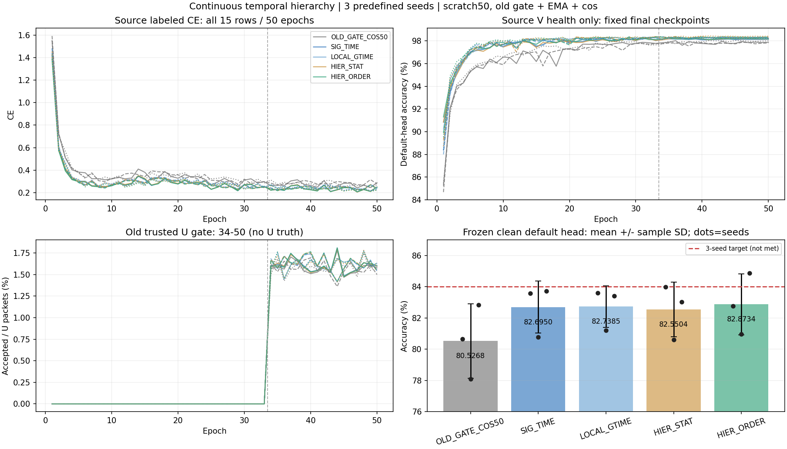

# 连续时序层级：完整三种子结果

预登记主方法 HIER_ORDER 三种子clean准确率均值 **82.8734% ± 1.9546个百分点**，相对同路径 SIG_TIME **+0.1784 ± 0.9861个百分点，2/3正差**，相对同容量 HIER_STAT **+0.3230 ± 1.5336个百分点，2/3正差**。平均有小幅收益，种子差异明显，不能宣称稳定提升；距84%均值目标1.1266个百分点，未达标。seed03为84.8762%，不能替代三seed主指标。

首run 20261014-phase1-hierarchy-oldgate-cos-e50-clean-manysig-s01-m5-r01，实际执行7bdfdbf448b9c97ead5702f958bee293d646a09f；剩余run 20261014-phase1-hierarchy-oldgate-cos-e50-clean-manysig-s0203-m10-r01，实际执行63f59df3933c6fcb778c76d9b1eaed3087f4213c；核心实现588209f4186e3056a310458237f4e478c6c15a64，剩余种子封装d2b9e5a3ddee095d429b30db204ff826cc7e7d0e。固定首seed source-only PASS决定在新首seed目标分数读取前提交并原样发布02/03，首seed未重训，无target反馈改参数、seed、配方、排序或选择性重跑。完整固定方案及发布状态历史见preregistration.md和首run报告。

| 方法 | seed01（%） | seed02（%） | seed03（%） | 均值 ± 样本SD（% / pp） | Macro-F1均值（%） | 各seed最差RX均值（%） | 各seed最差day均值（%） |
|---|---:|---:|---:|---:|---:|---:|---:|
| OLD_GATE_COS50 | 80.6685 | 78.0815 | 82.8304 | 80.5268 ± 2.3776 | 80.0024 | 67.9708 | 76.0556 |
| SIG_TIME | 83.5899 | 80.7744 | 83.7208 | 82.6950 ± 1.6646 | 82.1476 | 70.3250 | 78.5929 |
| LOCAL_GTIME | 83.5946 | 81.2065 | 83.4143 | 82.7385 ± 1.3298 | 82.2129 | 71.2292 | 78.4310 |
| HIER_STAT | 83.9994 | 80.6161 | 83.0357 | 82.5504 ± 1.7431 | 82.0607 | 69.9583 | 79.5913 |
| HIER_ORDER | 82.7732 | 80.9708 | 84.8762 | 82.8734 ± 1.9546 | 82.3384 | 70.7458 | 79.4460 |

| 配对 | seed01 / 02 / 03差（pp） | 均值 ± 样本SD（pp） | 正差seed |
|---|---:|---:|---:|
| SIG_TIME − OLD_GATE_COS50 | 2.9214 / 2.6929 / 0.8905 | 2.1683 ± 1.1125 | 3/3 |
| LOCAL_GTIME − SIG_TIME | 0.0048 / 0.4321 / -0.3065 | 0.0435 ± 0.3709 | 2/3 |
| HIER_STAT − LOCAL_GTIME | 0.4048 / -0.5905 / -0.3786 | -0.1881 ± 0.5242 | 1/3 |
| HIER_ORDER − HIER_STAT | -1.2262 / 0.3548 / 1.8405 | 0.3230 ± 1.5336 | 2/3 |
| HIER_ORDER − LOCAL_GTIME | -0.8214 / -0.2357 / 1.4619 | 0.1349 ± 1.1859 | 1/3 |
| HIER_ORDER − SIG_TIME | -0.8167 / 0.1964 / 1.1554 | 0.1784 ± 0.9861 | 2/3 |
| HIER_ORDER − OLD_GATE_COS50 | 2.1048 / 2.8893 / 2.0458 | 2.3466 ± 0.4709 | 3/3 |

| 配对 | 修正错误 | 引入错误 | 净正确 | 共同决策数 |
|---|---:|---:|---:|---:|
| SIG_TIME − OLD_GATE_COS50 | 27352 | 16424 | 10928 | 504000 |
| LOCAL_GTIME − SIG_TIME | 5656 | 5437 | 219 | 504000 |
| HIER_STAT − LOCAL_GTIME | 10979 | 11927 | -948 | 504000 |
| HIER_ORDER − HIER_STAT | 11394 | 9766 | 1628 | 504000 |
| HIER_ORDER − LOCAL_GTIME | 11675 | 10995 | 680 | 504000 |
| HIER_ORDER − SIG_TIME | 11972 | 11073 | 899 | 504000 |
| HIER_ORDER − OLD_GATE_COS50 | 26918 | 15091 | 11827 | 504000 |

相对旧门控＋cos，HIER_ORDER均值+2.3466pp、3/3正差；其中SIG_TIME本身+2.1683pp、3/3正差。新增层级的平均增量远小于SIG_TIME相对旧基线的增量。统一全局时间LOCAL_GTIME相对SIG_TIME仅+.0435pp、2/3正差；同容量大窗统计相对LOCAL_GTIME−.1881pp、1/3正差。所有正负结果保留，不将单seed统计83.9994%或最高84.8762%作均值达标。

结构：SIG_TIME四个局部8点/各自时间0..1；LOCAL_GTIME保持同四局部，改成32点全局时间。HIER_ORDER单6D Conv+tanh投影，三个7→8/15→16/23→24桥段，全局时间、4→2→1连续组合、一阶增量＋二阶反对称面积；4×28＋2×28＋1×28=196→160。HIER_STAT同局部GT、同两个半窗/全窗覆盖，粗窗以均值6/方差6/协方差15经固定27→28lift替换。不是完整全阶signature；统计与签名raw量级/信息/conditioning不同，不能据此单独断言顺序信息的纯因果收益。

SIG_TIME/LOCAL_GTIME pool18976、fθ195041；HIER_STAT/HIER_ORDER pool32416、fθ208481，四方法默认classW均960。所有12新模型pool5个trainable tensors全元素发生真实数值更新，进入真实joint160/id_feat_joint。独立feature-only导出与原forward差0，置零/移除classW不改变z；base_norm/pa_norm/gain/reference保留。全部默认cos6×160scale30随骨干正常联合训练，native拟合探针关闭，额外身份/RX/day/channel分类头训练0。

每seed HIER_ORDER/HIER_STAT全部trainable初态、nativebody及默认W一致；描述子不同所以不宣称初始函数一致。最终同源L720实际z平均L2分别2.944889、3.629342、4.719027，source分析不更新模型、不拟合头。12feature profiles与3matched pairs的全部分层/逐tensor记录保存在combined_three_seed_results.json。它证明机制进入实际特征，不证明丢弃W后的新TX迁移性能；按最新默认头要求未做换头实验。

固定scratch50/11100，33label＋17pseudo，原batch_neighbor/window2/confidence/strong一致门控、ownEMA.999、cos学习率，默认头正常联合；L6300/U56700隐藏TX/V27000health-only、split392005/sourceRX1/3/4/6/8/day1/2/3/旧6TX/物理ID不变。NoExplicitCFO显式坐标关闭，内部逐包补偿保留，无卫星训练增强。训练池标注率10%，原native train_ratio.07分母含V的实现约定保持。终轮固定，不按V微小涨分或目标成绩选模。

完整15row=12新＋3历史；600新增model-epochs/133200更新＋150历史epochs/33300历史更新单列复用。完整750epoch源记录/2520000默认预测/270分组指标/21配对错误表独立复算VERIFIED，无新增目标forward或模型更新。剩余10row复算88800新增step、500epoch、1680000pred、180metrics；与首5row复算合并。U每model17轮963900包，接受率约1.57%至1.63%；U真值不可用，未报告其伪标签精度。完整源CE/Vhealth/接受率曲线及41至45/46至50段均值保留，不以低末轮损失直接声称收敛。12新模型epoch时间累计8.686model-hours；受并发和硬件负载影响，不当作纯算法速度比。

发布一archive传输比较/remotecompile/真实checkpoint无查询smoke、PID/CWD/argv/GPU/日志增长及逐row自动predict→truthlast收尾均完成，原一次直接P0/P1 PASS复用，无重复审查。分析入口experiments.cvs_hierarchy50.audit与experiments.cvs_hierarchy_seeds.audit，只重读完整冻结日志/已有预测和truth评分数据。源feature witness由已登记source分析产生，不新增target访问。所有原weights/IQ/predictions/大日志留在两个immutable远端run；Git只存实现/config/聚合记录和报告。

ManySig clean为已暴露旧6TX/7目标RX/4day基准，不能称独立盲测、新TX或卫星部署。与既有其他run的SIG_TIME重训结果分开保留，不能拼成更多独立seed。84%仍未达标。报告路线四的有界stopgrad权重源代理已独立完成，尚未发布真实训练；下一真实实验将保留SIG_TIME、旧门控、默认联合头，并固定33/34/50实际梯度记录，不把新权重叠加到本层级矩阵。
