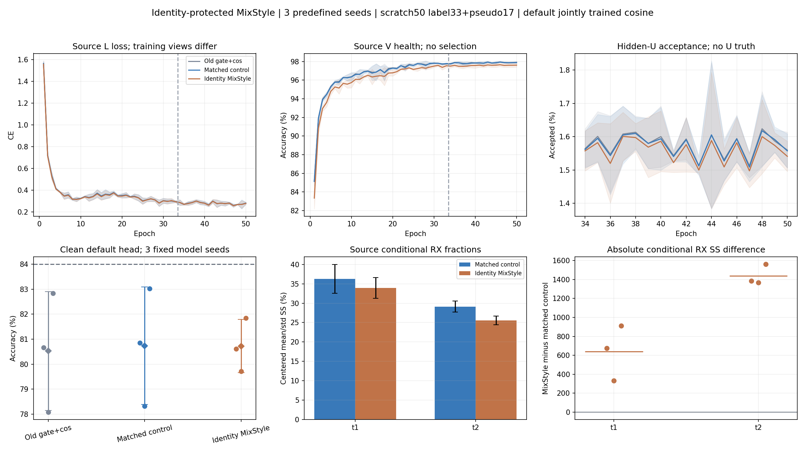

# 身份保护 MixStyle：三种子完整结果

固定 ManySig clean 默认头均值为 **80.7246%**，同路径对照为 80.7337%。配对差 −0.0091 个百分点，只有 1/3 个种子正差；没有证明稳定收益，距 84% 为 3.2754 个百分点。当前优先完成已冻结的 SIG_TIME 统计组合，不根据本轮目标分数改其配方。

**更正（2026-10-14）：** 此前“零拟合”的表述只适用于默认 TX 身份头和只读观察器。原 native 训练收尾为六个新模型各拟合 RX/day ridge 探针，共 12 次；channel 探针尝试因 invalid_input 失败。默认身份头未单独训练或替换，目标预测未使用探针，但这些源诊断仍违反用户当前禁止另训诊断分类头的要求。历史产物保留，不能标为完整满足当前零探针约束。新 SIG_TIME 组合入口已关闭这些拟合。详见剩余两种子报告中的 native_nuisance_probe_evidence.json。

## 完整比较

| 方法 | seed01 | seed02 | seed03 | 均值 ± 样本 SD（%） | Macro-F1（%） | 最差 RX 均值（%） | 最差 day 均值（%） |
|---|---:|---:|---:|---:|---:|---:|---:|
| OLD_GATE_COS50 | 80.6685 | 78.0815 | 82.8304 | 80.5268 ± 2.3776 | 80.0024 | 67.9708 | 76.0556 |
| MATCHED_CONTROL | 80.8500 | 78.3280 | 83.0232 | 80.7337 ± 2.3498 | 80.2240 | 68.4847 | 76.4571 |
| IDENTITY_MIXSTYLE | 80.6095 | 79.7190 | 81.8452 | 80.7246 ± 1.0678 | 80.1617 | 67.4792 | 76.3968 |

| 比较 | 各 seed 差（百分点） | 平均差 ± 样本 SD（百分点） | 正差种子 |
|---|---|---:|---:|
| MATCHED_CONTROL − OLD_GATE_COS50 | 0.1815 / 0.2464 / 0.1929 | 0.2069 ± 0.0347 | 3/3 |
| IDENTITY_MIXSTYLE − OLD_GATE_COS50 | -0.0589 / 1.6375 / -0.9851 | 0.1978 ± 1.3300 | 1/3 |
| IDENTITY_MIXSTYLE − MATCHED_CONTROL | -0.2405 / 1.3911 / -1.1780 | -0.0091 ± 1.3001 | 1/3 |

| 组合相对同路径对照 | 修正错误 | 引入错误 | 净修正 |
|---|---:|---:|---:|
| seed01 | 2588 | 2992 | -404 |
| seed02 | 4314 | 1977 | 2337 |
| seed03 | 1601 | 3580 | -1979 |

## 实际机制与成本

t1/t2 的主 L_s 前向按 p=0.5、alpha=0.1、strength=1 混合均值/标准差；供体同 TX/day、不同 RX 和物理 ID。U、EMA teacher 和 eval 不干预。没有新增参数或额外训练前向。f_theta 为 176065 个参数，默认 W 为 960 个；新增机制直接作用于 joint160。源导出与原特征一致，删除/置零 W 不改变 z，观察前后全部参数/buffer 不变。三个 seed 候选相对对照的固定 L720 特征 L2 为 6.0101 / 4.8779 / 6.1102；这是特征变化证据，不能单独证明迁移提高。

六个新模型从零训练，各 50 epoch / 11100 更新，总新增 300 model-epochs / 66600 更新；三个历史基线的 150 model-epochs 单列复用。所有模型采用 33 label + 17 pseudo、旧 batch_neighbor 门控、EMA 0.999、cosine、NoExplicitCFO，L6300/U56700/V27000、split392005 固定。默认 cosine6×160 scale30 随骨干正常联合训练。源 V 只作健康诊断，终轮固定，无目标选模或重跑。

| 方法 | 终轮 L CE 均值 | 终轮 V 均值（%） | U 接受率（%） | 50 轮训练秒均值 |
|---|---:|---:|---:|---:|
| OLD_GATE_COS50 | 0.279363 | 97.9099 | 1.5750 | 2295.67 |
| MATCHED_CONTROL | 0.279479 | 97.8815 | 1.5724 | 1955.49 |
| IDENTITY_MIXSTYLE | 0.277384 | 97.6086 | 1.5589 | 2147.79 |

完整 450 条 epoch 记录、66600 条新模型 step 记录和 162 组混淆矩阵已回收并独立复算，默认预测共 1512000 次，每行 168000。U 真值可用数始终为 0；训练秒仅日志 epoch 时间，包含不同 GPU 共载，不能作固定硬件速度结论。终轮低源损失不代表目标已达标。

全 L6300 的 t1/t2 条件 RX 均值/标准差方差占比在三个种子均下降，但绝对 RX 平方和均增加；不能解释为删除了 RX 信息或实现了域不变性。六个新模型源观察共 75600 次包前向，旧基线画像复用 12600 次；源观察器自身没有参数拟合、优化器更新、U 或目标读取。V 缓存曾被通用加载器物化后丢弃，观察器不前向 V。

## 证据与边界

首 seed 执行代码 b2a4146b7571d8713ddbd98cd096fb98b2b4c00c；剩余两 seed 执行代码 2b8371027c11cab4b80c17a8c2d0797fac00524a；只读复算代码 35f4dc861。源资格决策 9e79dc413967aee78fa87e5d0f6c7408c44e4efc 在读取首 seed 目标指标前冻结，后续 seed 参数不变。两个 run ID：20261014-phase1-identity-mixstyle-oldgate-cos-e50-clean-manysig-s01-m3-r01 和 20261014-phase1-identity-mixstyle-oldgate-cos-e50-clean-manysig-s0203-m6-r01。

本报告只验证当前暴露 ManySig clean 的旧 6 TX、7 个目标 RX、4 个日期。没有 satellite、Phase2 或未见 TX 迁移结论。保留所有正差和负差，不以 seed02 的提升替代三种子均值。读出为 checkpoint 默认身份头；没有为性能另训身份头，历史 nuisance 探针违规如上披露。

复算使用已经固定的预测及独立 truth-side scorer。checkpoint、IQ、原始日志、预测和物理 ID 保留在各 run 的既定远端产物目录，Git 仅交付实现、报告、曲线和必要聚合。详情见 [机器可读结果](results.json)、[源特征证据](source_features.json) 和 [历史探针事实](native_nuisance_probe_evidence.json)。
