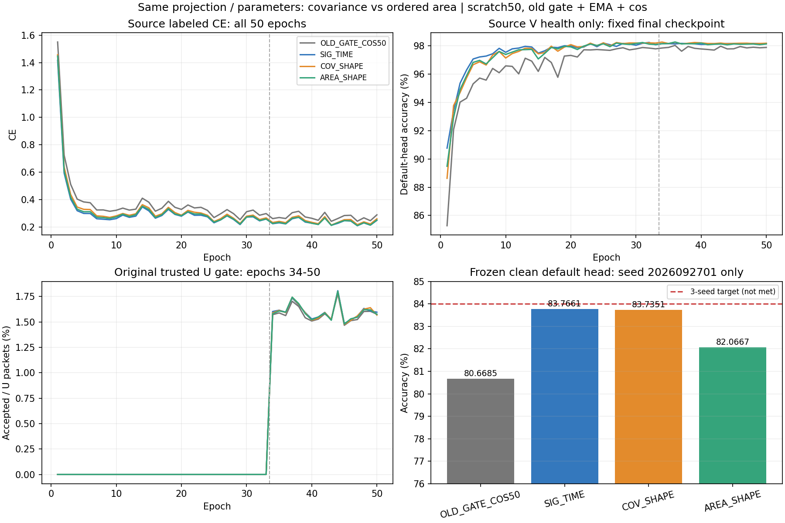

# 同投影统计形状与有序面积：首种子完整结果

**当前没有强化 SIG_TIME 的证据。** 固定 seed 2026092701 下，AREA_SHAPE 为 82.0667%，比同参数量 COV_SHAPE 低 1.6685 个百分点，比同路径 SIG_TIME 低 1.6994 个百分点。单种子不支持三种子结论或 84% 达标。剩余 seed 02/03 的原样发布决定已依据源 PASS 冻结并提交 8bd34db31787cd80c4ad53ee7327ff6a55daee72，读取本轮目标分数前已经发布；不会因这些结果停止、改参或筛除种子。

## 固定默认头结果

| 方法 | clean 准确率 | Macro-F1 | 最差 RX | 最差 day |
|---|---:|---:|---:|---:|
| OLD_GATE_COS50 | 80.6685% | 80.1734% | 70.6167% | 75.4524% |
| SIG_TIME | 83.7661% | 83.3369% | 71.3000% | 79.2643% |
| COV_SHAPE | 83.7351% | 83.3655% | 71.9167% | 78.9024% |
| AREA_SHAPE | 82.0667% | 81.5879% | 69.3500% | 77.5619% |

所有指标来自同一 clean 168000 包、旧六 TX／七目标 RX／四天、原默认联合训练 cosine 头，终轮固定。prediction 固定后独立 truth-last。没有另训或替换任何分类头。种子数为 1，样本标准差不定义；不能把 168000 包作为模型种子。

| 配对差（候选−控制） | 准确率差／百分点 | 修正错误 | 引入错误 | 净正确包 |
|---|---:|---:|---:|---:|
| SIG_TIME − OLD_GATE_COS50 | 3.0976 | 10509 | 5305 | 5204 |
| COV_SHAPE − SIG_TIME | -0.0310 | 4108 | 4160 | -52 |
| AREA_SHAPE − COV_SHAPE | -1.6685 | 2400 | 5203 | -2803 |
| AREA_SHAPE − SIG_TIME | -1.6994 | 3238 | 6093 | -2855 |
| AREA_SHAPE − OLD_GATE_COS50 | 1.3982 | 7427 | 5078 | 2349 |

AREA_SHAPE 相对 COV_SHAPE 的最差 RX 下降 2.5667 个百分点、最差 day 下降 1.3405 个百分点。不能把局部描述子顺序敏感、参数更新或源资格 PASS 当作性能提高。

## 实现和公平性

严格落实用户报告三·路线一：同一 6D 局部投影、四个八点窗口；共同 μ6 和 variance6，最后 15 槽由 offdiag covariance 替换为 skew area；同固定正交 27→28 lift、112→160 投影、LayerNorm 和有界 gain（初始 0.05、上限 0.2）。COV_SHAPE 与 AREA_SHAPE 全部初始 trainable 参数及 fixed lift 相同，各新增 18976 参数；三个新模型实际 fθ 为 195041 参数，W 为 960。

仍取 t2 完整 postDropout 输出，没有叠加 preDropout 取点、连续层级、更多卷积、SiLU、Sinc 改动或 U 权重。SIG_TIME 的原描述子包含净增量和时间有序面积；shape 两条件使用均值／方差，不宣称三者内在秩或信息相同。只将 COV 与 AREA 的 15 个关系槽位做严格同结构比较。

代码实现 3be0974b17e4e958475b25ab52ffe0a1fd1b85f3；实际首种子执行 512c10a267b5e654cfd2c983ab1debdeebc7f626。剩余两种子执行 8bd34db31787cd80c4ad53ee7327ff6a55daee72。入口 python -u -m experiments.cvs_moment_area50.dispatch，普通 N607 CVS-RFFI 环境；运行根 20261014-phase1-moment-area-oldgate-cos-e50-clean-manysig-s01-m4-r01 位于既定 /home/szu2070436088/2510044040/CV-SincNet/runs/ 下。归档、编译、真实 checkpoint 无查询 smoke、PID/CWD/argv/GPU/日志增长均 VERIFIED。

与历史 SIG_TIME 的 83.0393% 三种子均值分开保留：当前复现路径先 warm CUDA，池初始化使用私有 RNG，不能把不同运行路径当作严格相同随机训练轨迹，也不能与历史种子重复合并。COV 与 AREA 同一路径比较不受该跨历史合并问题影响。

## 训练和源证据

旧 batch_neighbor 门控＋自身 EMA0.999＋cos；每新模型独立从零 50 轮／11100 更新（33 label＋17 pseudo）。新增 150 model-epochs／33300 更新，旧 baseline 50 轮单列只读复用。L6300／U56700／V27000、split392005、原物理 ID 保持；U TX 真值隐藏。V 只健康监测，不选模、不训练。NoExplicitCFO、内部补偿和无新增星地训练保持。

| 方法 | final L CE | final V accuracy | U 接受率（17 轮合计） | 实际 epoch 时间之和／秒 |
|---|---:|---:|---:|---:|
| OLD_GATE_COS50 | 0.288426 | 97.8852% | 1.5784% | 2334.8（历史复用） |
| SIG_TIME | 0.248262 | 98.1519% | 1.6009% | 2100.7 |
| COV_SHAPE | 0.259459 | 98.1815% | 1.5975% | 2097.2 |
| AREA_SHAPE | 0.250530 | 98.1296% | 1.5966% | 2130.0 |

后三个源 V 曲线在固定 50 轮后段平稳，L CE 仍有波动；这只支持健康训练与固定预算描述，不能证明最优收敛。实测时间受并发 GPU 状态影响，不由不同旧运行时间推断算法加速。

真实固定 L720 特征检查：三个新增模块均有实际参数数值变化，初态与终态 joint160 全部 115200 个坐标发生变化。SIG_TIME／COV／AREA 的 fθ 参数变化元素数为 193460／193717／193782；AREA−COV 最终源 joint160 平均 L2 为 3.069351、余弦 0.949283。三个模型 feature-only 导出与原前向完全一致（最大差 0）；置零旧 W 不改变 z，导出删除 W 并保留归一化／gain／参考响应。真实 native RX/day/channel 诊断拟合关闭，零额外头拟合／零诊断优化步骤。

这些检查证明新增机制进入实际可交接 fθ，不能证明未见 TX、Phase2 或卫星部署收益。未将 RX 信息占比、秩或默认头性能解释为已验证的新类迁移。

## 完成证据和后续

独立复算 VERIFIED：完整 200 个 epoch 记录（150 新增＋50 历史）、33300 个新增训练 step、672000 个固定默认头决策、72 个分组混淆矩阵／accuracy／Macro-F1 记录全部对应。复算只读取已完成产物，无新目标前向、无训练或参数更新。三新模型关闭拟合探针的真实收尾证据通过。

results.json 保存完整源曲线、逐组指标、配对修正／引入错误和审计摘要；source_features.json 保存参数与特征聚合证据，completion_evidence.json 保存闭环身份。原始 IQ、weights、日志和大型预测留远端运行根，不上传 Git。

下一步只完成已经冻结的剩余两种子，再按三种子主指标报告全部正负结果。报告路线三的 t2 与 t2.pool 取点将另做合法源诊断，不依据本次目标错误调取点／Dropout 参数；路线二的连续层级和路线四的 U 权重保持后置。84% 目标仍未达到。

后续完整3seed已闭环，AREA82.0833%／COV82.6188%／SIG_TIME82.7931%；本文件仍保留原首seed结果，完整统计见 ../20261014-phase1-moment-area-oldgate-cos-e50-clean-manysig-s0203-m8-r01/final_analysis.md。
