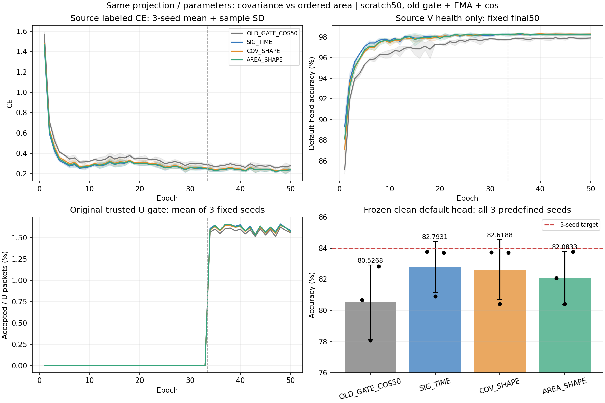

# 同投影统计形状与有序面积：完整三种子

**报告路线一未强化 SIG_TIME。** 固定三种子 AREA_SHAPE 均值为 82.0833%，相对同参数量 COV_SHAPE −0.5355 个百分点，相对同路径 SIG_TIME −0.7097 个百分点；两个比较均仅1/3种子为正差。距84%目标1.9167个百分点。该路线新增模块进入真实fθ并实际更新，但不能把执行成功或源PASS当作迁移性能提高。

首seed和剩余02/03共12固定row全部默认头clean闭环：9新模型／3历史基线。02/03原样扩种子决定在首seed目标分数读取前依据预登记源PASS冻结；不改变seed／参数／50轮预算，不选择性重跑。所有正负结果保留。独立2016000预测／216组指标复算VERIFIED。

## 默认头主指标

| 方法 | seed01／% | seed02／% | seed03／% | 均值／% | 样本SD／百分点 |
|---|---:|---:|---:|---:|---:|
| OLD_GATE_COS50 | 80.6685 | 78.0815 | 82.8304 | 80.5268 | 2.3776 |
| SIG_TIME | 83.7661 | 80.9119 | 83.7012 | 82.7931 | 1.6294 |
| COV_SHAPE | 83.7351 | 80.4101 | 83.7113 | 82.6188 | 1.9129 |
| AREA_SHAPE | 82.0667 | 80.4048 | 83.7786 | 82.0833 | 1.6870 |

| 方法 | Macro-F1均值／% | 各seed最差RX均值／% | 各seed最差day均值／% |
|---|---:|---:|---:|
| OLD_GATE_COS50 | 80.0024 | 67.9708 | 76.0556 |
| SIG_TIME | 82.2525 | 70.6944 | 78.6683 |
| COV_SHAPE | 82.0838 | 71.1111 | 78.3706 |
| AREA_SHAPE | 81.5574 | 69.7625 | 78.1770 |

三预定义model seeds为2026092701/02/03；每row同一clean168000包、旧6TX／7目标RX／4day、默认联合训练cosine头。每seed先找各自最差RX/day再取均值，不是合并群体的单一最差值；完整全部组混淆矩阵／accuracy／Macro-F1保存在results.json。预测固定后独立truth-last，没有另训／替换分类头、测试分数调参或quota/global reassignment。

| 候选−控制 | seed01差／百分点 | seed02差／百分点 | seed03差／百分点 | 均值差／百分点 | 差值样本SD／百分点 | 正差种子 |
|---|---:|---:|---:|---:|---:|---:|
| SIG_TIME − OLD_GATE_COS50 | 3.0976 | 2.8304 | 0.8708 | 2.2663 | 1.2158 | 3/3 |
| COV_SHAPE − SIG_TIME | -0.0310 | -0.5018 | 0.0101 | -0.1742 | 0.2844 | 1/3 |
| AREA_SHAPE − COV_SHAPE | -1.6685 | -0.0054 | 0.0673 | -0.5355 | 0.9818 | 1/3 |
| AREA_SHAPE − SIG_TIME | -1.6994 | -0.5071 | 0.0774 | -0.7097 | 0.9055 | 1/3 |
| AREA_SHAPE − OLD_GATE_COS50 | 1.3982 | 2.3232 | 0.9482 | 1.5565 | 0.7010 | 3/3 |

AREA_SHAPE相对COV_SHAPE的最差RX均值低1.3486个百分点、最差day均值低0.1937个百分点。相对旧基线AREA仍为正，但对本轮同投影控制及SIG_TIME无稳定强化证据；不由3个种子宣称统计显著性或RX捷径因果关系。

## 修正与引入错误

| 候选−控制 | seed | 修正错误 | 引入错误 | 净正确包 |
|---|---:|---:|---:|---:|
| AREA_SHAPE − COV_SHAPE | 2026092701 | 2400 | 5203 | -2803 |
| AREA_SHAPE − SIG_TIME | 2026092701 | 3238 | 6093 | -2855 |
| AREA_SHAPE − OLD_GATE_COS50 | 2026092701 | 7427 | 5078 | 2349 |
| AREA_SHAPE − COV_SHAPE | 2026092702 | 3784 | 3793 | -9 |
| AREA_SHAPE − COV_SHAPE | 2026092703 | 3538 | 3425 | 113 |
| AREA_SHAPE − SIG_TIME | 2026092702 | 3275 | 4127 | -852 |
| AREA_SHAPE − SIG_TIME | 2026092703 | 3860 | 3730 | 130 |
| AREA_SHAPE − OLD_GATE_COS50 | 2026092702 | 9478 | 5575 | 3903 |
| AREA_SHAPE − OLD_GATE_COS50 | 2026092703 | 5828 | 4235 | 1593 |

AREA−COV合计净正确包−2699，AREA−SIG_TIME为−3577，AREA−旧基线为+7845（各比较504000决策）。只保留汇总错误诊断，不依据目标分组错误更改结构／超参数／候选排序。

## 结构、初始化与来源

严格落实用户报告三·路线一：同6D局部投影、4个八点窗口，共同mean6／variance6，最后15交叉关系槽位为offdiag covariance或skew area。两条件同fixed full-rank27→28 orthonormal lift、112→160、LayerNorm/gain初始.05上限.2；每pool18976参数、fθ195041、W960。Cov/Area所有实际初始trainable参数和fixedlift一致，三new arms同seed的native body/W初态相同。SIG_TIME仍包含increment7/area21，不宣称它与shape两条件的信息或内在秩相同。

t2完整postDropout取点保持；没有叠加preDropout／跨窗层级／更多卷积／SiLU／Sinc／PAIR／U权重。不同数学描述子的原始量级、信息和梯度条件可能不同，同参数量不等于这些因素都被控制；本轮不单独确定负结果原因。

实现3be0974b17e4e958475b25ab52ffe0a1fd1b85f3；首seed执行512c10a267b5e654cfd2c983ab1debdeebc7f626；剩余执行8bd34db31787cd80c4ad53ee7327ff6a55daee72。入口experiments.cvs_moment_area50.dispatch与experiments.cvs_moment_area_seeds.dispatch，普通N607既有CVS-RFFI fullFP32/2threads。run根分别为 /home/szu2070436088/2510044040/CV-SincNet/runs/20261014-phase1-moment-area-oldgate-cos-e50-clean-manysig-s01-m4-r01 和 20261014-phase1-moment-area-oldgate-cos-e50-clean-manysig-s0203-m8-r01；checkpoint无父继承／target选模，historical baseline仅比较和无查询smoke复用。

历史sequence50 SIG_TIME三seed83.0393%保持独立。当前同路径anchor先warm CUDA、pool使用私有CPU RNG；不能仅凭公式和初始参数相同，认定它与旧训练随机轨迹逐位相同，也不能把同名重复seed合并当6个独立种子。当前SIG_TIME与历史或前一组合矩阵的差不单独归因于结构。

## 完整训练与源机制

旧batch_neighbor门控＋自身EMA.999＋cos、33label＋17pseudo、AdamW2e−4→1e−6/wd1e−4、lambdaU.16/entropy.01/smoothing.01；每新模型scratch50/11100/final-only。新9模型450model-epochs／99900optimizer updates，历史3模型150轮单列复用；审计600epoch记录不是600新增训练轮。

L6300/U56700/V27000、训练pool标注10%、split392005、sourceRX1/3/4/6/8与day1/2/3、旧6TX和physicalIDs保持；U真值隐藏，V健康不梯度或选模；NoExplicitCFO及内部逐包补偿保持，无新增星地训练。所有新9模型native额外RX/day/channel拟合探针实际关闭，闭环disabled-call1／head-fit-updates0，默认W随原流程正常学习。

| 方法 | seed | final L CE | final V／% | U接受／% | epoch时间合计／秒 |
|---|---:|---:|---:|---:|---:|
| OLD_GATE_COS50 | 2026092701 | 0.288426 | 97.8852 | 1.5784 | 2334.8（历史） |
| SIG_TIME | 2026092701 | 0.248262 | 98.1519 | 1.6009 | 2100.7 |
| COV_SHAPE | 2026092701 | 0.259459 | 98.1815 | 1.5975 | 2097.2 |
| AREA_SHAPE | 2026092701 | 0.250530 | 98.1296 | 1.5966 | 2130.0 |
| OLD_GATE_COS50 | 2026092702 | 0.279194 | 97.8222 | 1.5692 | 2274.6（历史） |
| SIG_TIME | 2026092702 | 0.240028 | 98.3481 | 1.6242 | 2512.0 |
| COV_SHAPE | 2026092702 | 0.241778 | 98.3074 | 1.6085 | 2339.2 |
| AREA_SHAPE | 2026092702 | 0.239161 | 98.2407 | 1.6172 | 2358.3 |
| OLD_GATE_COS50 | 2026092703 | 0.270470 | 98.0222 | 1.5773 | 2277.6（历史） |
| SIG_TIME | 2026092703 | 0.227328 | 98.2407 | 1.6188 | 2280.7 |
| COV_SHAPE | 2026092703 | 0.234511 | 98.3889 | 1.6009 | 2201.3 |
| AREA_SHAPE | 2026092703 | 0.227279 | 98.4148 | 1.6172 | 2333.3 |

每模型17个pseudo epoch累计963900个U包，真值available始终0；完整step记录确认EMA有效decay.999、每步成功更新计数、无非有限skip。源V后段平稳、LCE仍有波动；固定预算不等于最优收敛。实测时间受GPU并发影响，不用历史时间比较声称算法加速。

| 模型 | fθ参数变化元素 | 初态→终态源L720 joint160平均L2 |
|---|---:|---:|
| SIG_TIME-s2026092701 | 193460 | 12.924593 |
| COV_SHAPE-s2026092701 | 193717 | 13.321870 |
| AREA_SHAPE-s2026092701 | 193782 | 13.211914 |
| SIG_TIME-s2026092702 | 192492 | 14.580275 |
| COV_SHAPE-s2026092702 | 192879 | 14.511654 |
| AREA_SHAPE-s2026092702 | 192557 | 14.315318 |
| SIG_TIME-s2026092703 | 193347 | 15.116737 |
| COV_SHAPE-s2026092703 | 193282 | 15.168843 |
| AREA_SHAPE-s2026092703 | 193347 | 15.004809 |

新增pool每个trainable张量真实数值更新；9模型源L720初态→终态joint160坐标全变化，feature-only与原前向导出完全一致、最大差0，置零W不改变z，导出仅移除类别W并保留norm/gain/reference/new pool。三个seed AREA−COV最终源joint160平均L2分别3.069351／2.723430／3.254401。它们确认机制作用于实际可交接fθ，不证明新TX／Phase2或卫星部署收益。

## 完成证据和下一步

完整源scalar日志及固定prediction独立复算VERIFIED：99900新增step、600epoch记录、2016000默认头决策、216个分组CM/accuracy/MacroF1均对应。审计只读取已完成固定产物，无新目标forward、无参数/头拟合更新。首seed不重跑，已完成历史产物保留。

results.json包含全部三seed指标／源曲线／逐组CM／配对错误和审计摘要；source_features.json包含9模型参数与实际特征证据，completion_evidence.json包含两run完整身份。原始IQ／weights／logs／大型prediction留各不可变remote run根，不提交Git。

按原报告与源证据继续独立取点路线，20261014-phase1-read-position-oldgate-cos-e50-clean-manysig-s01-m3-r01已经在本轮完整目标分数读取前冻结发布；只改SIG_TIME descriptor hook t2→t2.pool，主干Dropout、公式、参数、默认头不变。其02/03准备已登记，仍须原首seedSOURCE PASS，不读目标成绩决定扩展。source Dropout诊断不是对本轮负结果的因果解释。保持R2连续层级和R4可信门控内U权重后置，不以负结果扫描述子参数或变更健康任务。84%仍未达到。
