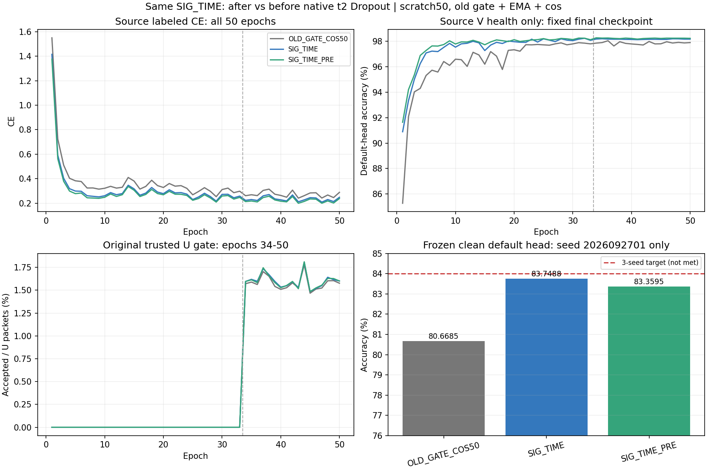

# SIG_TIME Dropout 前后取点：首种子完整结果

**首种子没有提升证据。** SIG_TIME_PRE（t2.pool）为83.3595%，同路径SIG_TIME（t2完整输出）为83.7488%，前取点−0.3893个百分点；原基线80.6685%。当前仅1个model seed，不能满足完整三seed84%目标或认定稳定效果。

原样02/03扩展决定依据SOURCE PASS在新target分数读取前冻结并提交038ec31397797e4631a969d0da8167de2ba861c3，随后发布4新scratch50。不会依据本次负结果停止健康训练、调Dropout概率／描述子／增益或换seed。

| 方法 | clean accuracy／% | Macro-F1／% | 最差RX／% | 最差day／% |
|---|---:|---:|---:|---:|
| OLD_GATE_COS50 | 80.6685 | 80.1734 | 70.6167 | 75.4524 |
| SIG_TIME | 83.7488 | 83.3332 | 71.2250 | 79.1881 |
| SIG_TIME_PRE | 83.3595 | 82.8774 | 69.5833 | 79.0429 |

seed2026092701，同clean168000物理包、旧6TX/7RX/4day，默认联合训练cosine头final50。单seed样本SD不定义。PRE相对POST修正2343个错误、引入2997个，净正确包−654；最差RX下降1.6417个百分点、最差day下降0.1452个百分点。全部54组CM/accuracy/F1及3个配对保存在results.json，不使用目标分组误差调参。

## 严格单因素实现

按用户报告三·路线三与源Dropout诊断固定：只改SIG_TIME descriptor hook t2→t2.pool。原主干t2 Dropout仍.1；其他上游随机层照原流程，不宣称pre输入完全无噪声。SIG_TIME净增量/feature-area/time-area、单96→6Conv/tanh、4×8窗、112→160/LN/gain .05上限.2均不变。两pool各18976参数，fθ195041，类别W960；无COV/AREA/层级/额外kernel/SiLU/Sinc/PAIR/U权重堆叠。

真实初始所有trainable参数相同，固定L720初始eval joint160逐坐标完全相同（9个分层记录L2=0/changed_elements=0）；训练时实际读取pre/post的本地native路径检查通过。teacher deepcopy与实际export保留取点设置；hook每次调用结束清除。新模块属于真实joint160，可移除旧W，未替换分类头。

实现087b3f61abb4444f05e7c22f4af6f631865188df；首seed实际执行b4d55dba50c8601017604a2a0eb0d037f8d835e8；剩余02/03实际执行038ec31397797e4631a969d0da8167de2ba861c3。入口python -u -m experiments.cvs_read_position50.dispatch；source/model/predict使用显式上下文和同一实际feature，defaulthead only。run根 /home/szu2070436088/2510044040/CV-SincNet/runs/20261014-phase1-read-position-oldgate-cos-e50-clean-manysig-s01-m3-r01。源方向依据用户报告及固定L720隔离Dropout回放；不加载目标高分权重或以目标分数选择checkpoint。

## 固定训练和真实源证据

2新模型各scratch50/11100、33label+17pseudo，共100新增model-epochs/22200updates；旧baseline50轮仅复用。旧batch_neighbor＋自身EMA.999＋cos/AdamW2e−4→1e−6/wd1e−4/lambdaU.16/entropy.01/smoothing.01；L6300/U56700/V27000、10%标注/split392005/原RX-day-TX/物理ID、NoExplicitCFO和内部补偿保持，无新星地训练。V只健康，不梯度/选模，U真值隐藏。默认cosine6×160scale30随骨干正常联合训练；两新模型实际关闭native RX/day/channel拟合探针，0额外分类器拟合、0诊断优化更新。

| 方法 | final L CE | final V／% | 17轮U接受／% | epoch时间合计／秒 |
|---|---:|---:|---:|---:|
| OLD_GATE_COS50 | 0.288426 | 97.8852 | 1.5784 | 2334.8（历史） |
| SIG_TIME | 0.248172 | 98.1556 | 1.6023 | 2118.7 |
| SIG_TIME_PRE | 0.238117 | 98.2185 | 1.6006 | 2148.0 |

PRE的源LCE较低、sourceV略高，而冻结目标默认头较低；这组观察不能单独证明过拟合或移除正则化是原因。源Dropout回放证明隔离扰动量级，不证明这些扰动有害，也不构成提升性能保证。两新曲线后段V平稳、LCE波动；达到50轮不等于最优收敛，未按目标重启或挑轮次。

实际新增pool每个trainable张量数值更新；两fθ参数变化元素各193460。固定L720初态→终态平均joint160L2为POST12.947156/PRE12.811137；最终PRE−POST L2=2.131700。feature-only精确导出差0，置零W后z不变，导出仅删W而保留norm/gain/reference/new pool。真实功能变化证明改动进入fθ，但不能当作跨未见TX或Phase2收益。

## 完成及后续

独立完整产物复算VERIFIED：150epoch记录（100新+50历史）、22200新step、504000固定默认头决策、54组指标一致。每新模型963900U包、EMA成功11100更新/decay.999、U truth available0，无非有限skip，source disabled probe calls1/head-fit0。审计使用已有日志/prediction，无新targetforward或训练。

results.json保存完整曲线/组指标/错误转换，source_features.json保存实际初态函数及参数/特征证据，completion_evidence.json保存闭环。原IQ/weights/rawlogs/大型prediction留远端run根。

剩余20261014-phase1-read-position-oldgate-cos-e50-clean-manysig-s0203-m6-r01已按读target前提交的SOURCE PASS原样发布；4新模型健康训练，默认头/50轮/自动clean/truthlast不变。完整三seed主指标未完成，84%未达。后续保留全部正负结果，不据首seed分数改方向、重排或选择性重跑；R2连续层级/R4门控内U权重仍为后置独立路线。

完整三种子已闭环：PRE82.5599%、POST82.6909%，配对−.1310±.2239个百分点、1/3正差。首seed保留，完整结果见 ../20261014-phase1-read-position-oldgate-cos-e50-clean-manysig-s0203-m6-r01/final_analysis.md，不将单seed当最终结论。
