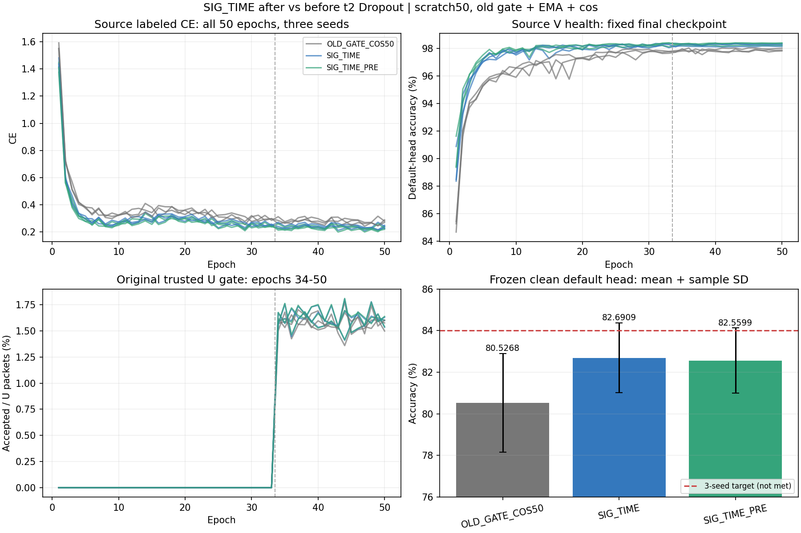

# SIG_TIME取点：完整三种子结果

**把描述子从t2完整输出移到末端Dropout之前，未带来稳定提升。** PRE三种子82.5599%±1.5656个百分点，POST82.6909%±1.6836个百分点；PRE−POST为−0.1310±0.2239个百分点，1/3种子为正差。预登记primary PRE距84%仍差1.4401个百分点。

9固定row全部完成：6新scratch50模型、3历史旧门控＋cos基线。首seed源PASS后，在读取该新目标分数之前冻结决定原样扩02/03；未因负分更改参数、种子或健康实验。默认头独立truth-last，1512000固定决策/162组CM、accuracy及Macro-F1复算VERIFIED。

| 方法 | seed01／% | seed02／% | seed03／% | 均值／% | 样本SD／百分点 |
|---|---:|---:|---:|---:|---:|
| OLD_GATE_COS50 | 80.6685 | 78.0815 | 82.8304 | 80.5268 | 2.3776 |
| SIG_TIME | 83.7488 | 80.7494 | 83.5744 | 82.6909 | 1.6836 |
| SIG_TIME_PRE | 83.3595 | 80.7560 | 83.5643 | 82.5599 | 1.5656 |

| 方法 | Macro-F1均值／% | 各seed最差RX均值／% | 各seed最差day均值／% |
|---|---:|---:|---:|
| OLD_GATE_COS50 | 80.0024 | 67.9708 | 76.0556 |
| SIG_TIME | 82.1438 | 70.6042 | 78.5492 |
| SIG_TIME_PRE | 82.0040 | 69.7264 | 78.3381 |

每row固定同一clean168000包、旧6TX/7目标RX/4day；2026092701/02/03。最差组先逐seed求最差再平均；全组混淆矩阵保留results.json。目标是已暴露固定基准，不称独立盲测、新TX、Phase2或星地部署。

| 候选−控制 | seed01差／pp | seed02差／pp | seed03差／pp | 均值差／pp | 差值样本SD／pp | 正差种子 |
|---|---:|---:|---:|---:|---:|---:|
| SIG_TIME − OLD_GATE_COS50 | 3.0804 | 2.6679 | 0.7440 | 2.1641 | 1.2470 | 3/3 |
| SIG_TIME_PRE − SIG_TIME | -0.3893 | 0.0065 | -0.0101 | -0.1310 | 0.2239 | 1/3 |
| SIG_TIME_PRE − OLD_GATE_COS50 | 2.6911 | 2.6744 | 0.7339 | 2.0331 | 1.1252 | 3/3 |

PRE相对POST最差RX均值−0.8778个百分点、最差day均值−0.2111个百分点。PRE相对旧基线+2.0331个百分点且3/3正差，主要SIG_TIME收益仍在；本轮不能认定移除描述子末端随机mask强化了它。三种子不足以证明统计显著性或具体因果失败原因。

| 候选−控制 | seed | 修正错误 | 引入错误 | 净正确包 |
|---|---:|---:|---:|---:|
| SIG_TIME − OLD_GATE_COS50 | 2026092701 | 10449 | 5274 | 5175 |
| SIG_TIME_PRE − SIG_TIME | 2026092701 | 2343 | 2997 | -654 |
| SIG_TIME_PRE − OLD_GATE_COS50 | 2026092701 | 11052 | 6531 | 4521 |
| SIG_TIME − OLD_GATE_COS50 | 2026092702 | 9828 | 5346 | 4482 |
| SIG_TIME − OLD_GATE_COS50 | 2026092703 | 7206 | 5956 | 1250 |
| SIG_TIME_PRE − SIG_TIME | 2026092702 | 2737 | 2726 | 11 |
| SIG_TIME_PRE − SIG_TIME | 2026092703 | 2052 | 2069 | -17 |
| SIG_TIME_PRE − OLD_GATE_COS50 | 2026092702 | 10990 | 6497 | 4493 |
| SIG_TIME_PRE − OLD_GATE_COS50 | 2026092703 | 8082 | 6849 | 1233 |

PRE−POST共504000配对决策，净正确包-660。不根据目标分组错误改后续方案。

## 同配方结构与真实特征

唯一改变为descriptor hook t2→t2.pool；主干t2原Dropout.1与t3、frequency、PA、reference、NoExplicitCFO和内部补偿保持。仍为6D投影/四个8点窗/SIG_TIME28/112→160/norm/gain.05上限.2，pool18976、fθ195041、类别W960。默认6×160scale30 cosine随骨干正常联合训练，禁止单独训练/重训/替换头；所有6个新模型native额外RX/day/channel拟合均关闭，disabledcall1、headfitupdates0。

三个seed实际初始参数及L720 eval joint160完全一致，初始化L2=0、变化元素0。最终PRE−POST源joint160平均L2为2.131700／2.830781／2.436427；每个新pool trainable张量均真实数值更新。feature-only与原前向z逐值一致，maximumdifference0；置零W不改z，独立导出只移除类别W，保留cls_head内norm/gain/reference与新增pool。

| 模型 | fθ参数变化元素 | 初态→终态源L720 joint160平均L2 |
|---|---:|---:|
| SIG_TIME-s2026092701 | 193460 | 12.947156 |
| SIG_TIME_PRE-s2026092701 | 193460 | 12.811137 |
| SIG_TIME-s2026092702 | 192492 | 14.618884 |
| SIG_TIME_PRE-s2026092702 | 191591 | 14.496377 |
| SIG_TIME-s2026092703 | 193347 | 15.231397 |
| SIG_TIME_PRE-s2026092703 | 193347 | 14.905474 |

这些证据说明实际可交接fθ受到影响，不能替代新TX迁移或性能收益。历史冻结换头诊断不在本轮，未拟合额外头。

## 完整训练记录

从零50轮/11100步，33label＋17pseudo，旧batch_neighbor门控/自身EMA.999/cos，AdamW2e−4→1e−6、wd1e−4、lambdaU.16/entropy.01/smoothing.01；固定final-only，无目标选模。6新模型300model-epochs/66600updates，3历史基线150轮单列复用。审计450epoch记录不是450新增训练轮。L6300/U56700/V27000、训练pool标注10%、split392005/sourceRX1/3/4/6/8/day1/2/3及旧6TX物理ID保持；U真值隐藏，V健康不参与梯度或选择；无新增星地训练。

| 方法 | seed | final L CE | final V／% | U接受／% | epoch时间合计／秒 |
|---|---:|---:|---:|---:|---:|
| OLD_GATE_COS50 | 2026092701 | 0.288426 | 97.8852 | 1.5784 | 2334.8（历史） |
| SIG_TIME | 2026092701 | 0.248172 | 98.1556 | 1.6023 | 2118.7 |
| SIG_TIME_PRE | 2026092701 | 0.238117 | 98.2185 | 1.6006 | 2148.0 |
| OLD_GATE_COS50 | 2026092702 | 0.279194 | 97.8222 | 1.5692 | 2274.6（历史） |
| SIG_TIME | 2026092702 | 0.240368 | 98.3407 | 1.6241 | 2307.0 |
| SIG_TIME_PRE | 2026092702 | 0.226443 | 98.4037 | 1.6283 | 2014.8 |
| OLD_GATE_COS50 | 2026092703 | 0.270470 | 98.0222 | 1.5773 | 2277.6（历史） |
| SIG_TIME | 2026092703 | 0.227744 | 98.2741 | 1.6211 | 2394.6 |
| SIG_TIME_PRE | 2026092703 | 0.219414 | 98.3630 | 1.6240 | 2316.6 |

每新模型17pseudo epochs累计963900个U包，truthavailable始终0；源V后段稳定、LCE仍波动，固定预算不证明完全收敛。时间受GPU并发影响，不用历史时间声称加速。完整450epoch/66600新增step记录、1512000预测及162组指标独立复算，未新增目标前向或拟合。

实现087b3f61abb4444f05e7c22f4af6f631865188df；首seed执行b4d55dba50c8601017604a2a0eb0d037f8d835e8；02/03执行038ec31397797e4631a969d0da8167de2ba861c3。入口experiments.cvs_read_position50.dispatch、experiments.cvs_read_position_seeds.dispatch；普通N607既有CVS-RFFI fullFP32/2threads。两个不可变run为20261014-phase1-read-position-oldgate-cos-e50-clean-manysig-s01-m3-r01及20261014-phase1-read-position-oldgate-cos-e50-clean-manysig-s0203-m6-r01。权重/原日志/大型固定prediction留remote既定run根，不上传Git；source_features.json为6模型实际证据，completion_evidence.json为两run完成及组合复算。历史83.0393%或其他同名SIG_TIME矩阵保留独立，不合并重复seed当更多独立seed。

## 下一步

按用户报告路线二和固定source层级几何证据继续单独检验4→2→1连续聚合，保留三个bridge及统一globaltime，并配globaltime-only局部和同容量大窗统计控制。源诊断20261014-phase1-source-hierarchy-geometry-manysig-s01-m1-r01在本轮完整target读取前完成并已交付；不以本轮负分选择取点或父权重，后续按原报告保持t2完整取点，不叠加U权重/更多核/SiLU。取点改动无稳定强化证据，84%目标仍未达。
