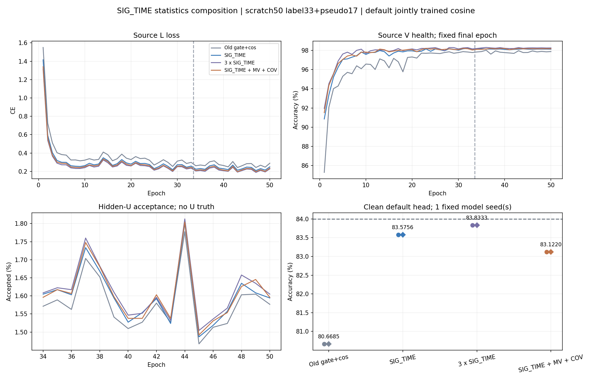

# SIG_TIME 统计组合：首种子完整结果

**首种子没有显示整体提升。** 组合为 83.1220%，单 SIG_TIME 为 83.5756%，同参数三路 SIG_TIME 为 83.8333%。这是 seed2026092701 的完整默认头结果，三种子均值及样本 SD 尚未齐全，不能宣称达到 84%。

| 方法 | clean（%） | Macro-F1（%） | 最差 RX（%） | 最差 day（%） |
|---|---:|---:|---:|---:|
| OLD_GATE_COS50 | 80.6685 | 80.1734 | 70.6167 | 75.4524 |
| SIG_TIME | 83.5756 | 83.1501 | 71.0292 | 78.9262 |
| SIG_TIME_X3 | 83.8333 | 83.3982 | 70.8458 | 81.0119 |
| SIG_TIME_MV_COV | 83.1220 | 82.6694 | 71.6958 | 79.8881 |

| 组合相对 | 差（百分点） | 修正错误 | 引入错误 |
|---|---:|---:|---:|
| SIG_TIME | -0.4536 | 3508 | 4270 |
| SIG_TIME_X3 | -0.7113 | 2893 | 4088 |
| OLD_GATE_COS50 | 2.4536 | 10514 | 6392 |

组合相对单 SIG_TIME 净引入 762 个错误，相对 X3 净引入 1195 个错误。组合最差 RX 较单分支高 0.6667、较 X3 高 0.8500 个百分点；分组改善不能替代整体主指标。全部 72 组 RX/day/TX/overall 混淆矩阵保留在机器可读结果。

## 实际特征和训练

三种机制都进入实际 t2 → 四窗描述 → joint160。单分支额外参数 18976，两个三视图模型各 55968；f_theta 分别 195041/232033/232033，默认 W 均为 960 个参数。实际数值改变的特征参数为 193460/230582/230517，各新增参数张量均更新。三个 native 骨干及 W 的初态相同，X3 和组合全部初始可训练参数相同。描述子内在秩不宣称匹配。

固定 L720 上组合与 X3 的 joint160 L2=2.240102。独立导出与原前向精确一致，删除/置零 W 不改变 z，保留 norm/gain/reference 与全部新分支；观察前后参数及 buffers 不变。默认 cosine6×160 scale30 只随骨干正常联合训练，三个新模型的 RX/day/channel 拟合探针均关闭（disabled closure 各一次、head_fit_updates=0）。历史 baseline 仅复用默认头产物。源观察器的通用加载器曾物化 V 缓存后丢弃，观察器不前向 V。

同路径 MEAN_VAR 可以由均值/COV 计算；候选的差异是独立学习的投影视图及描述方式，不能称新增独立原始信息。真实特征改变及 W 独立是接线证据，不足以证明域不变性或未见 TX 迁移。本轮按用户约束不另训读出头。

| 方法 | 终轮 L CE | 终轮 V（%） | U 接受（%） | epoch 秒合计 |
|---|---:|---:|---:|---:|
| OLD_GATE_COS50 | 0.288426 | 97.8852 | 1.5784 | 2334.84 |
| SIG_TIME | 0.248702 | 98.1370 | 1.6012 | 2024.43 |
| SIG_TIME_X3 | 0.227253 | 98.2630 | 1.6145 | 2084.08 |
| SIG_TIME_MV_COV | 0.233990 | 98.1852 | 1.6066 | 2036.20 |

三个新模型各 scratch50/11100，新增 150 model-epochs/33300 更新；历史 baseline 50 轮单列复用。完整 200 条 epoch 记录、33300 条新增 step 记录、672000 次固定默认预测及 72 组指标已独立复算。每模型半监督 U 包调用 963900，U 真值始终隐藏；约 1.6% 接受率和低源损失不等于目标达标。时间来自不同 GPU 共载的 epoch 日志，不作固定硬件速度声明。

旧 batch_neighbor 门控 + 自身 EMA0.999 + cos，33 label+17 pseudo、AdamW lr2e−4→1e−6/wd1e−4、lambda_U0.16/lambda_ent0.01/smoothing0.01；L6300/U56700/V27000、split392005、原角色及物理 ID 固定，V 仅健康诊断不选模，无新星地训练增强。NoExplicitCFO 及内部补偿保持。历史 baseline 与新统一 warm-CUDA 的初始化轨迹可能不同；描述子归因主要依赖本轮三个同执行路径控制。

## 交付和未完成项

训练代码 eda57144de34d479288f42d14c037eb7802c1ecd；只读复算代码 2d1af3b15a067fe1a3993074ac375bb315612749；run 20261014-phase1-sigtime-statistics-oldgate-cos-e50-clean-manysig-s01-m4-r01。原 IQ、checkpoint、日志、逐包预测留既定远端产物目录；Git 仅报告、曲线及聚合。

源条件 PASS 后，扩种子决定 85b3294db8416c81545eef1682ccfb576fe19f52 已在读取这些新目标分数前上传。剩余 run 20261014-phase1-sigtime-statistics-oldgate-cos-e50-clean-manysig-s0203-m8-r01 的六个新 scratch50 已按完全相同配置启动，首 seed 不重训、不替换、不筛除；最终合并三个固定种子共 12 行和 2016000 次默认决策。后续报告补全均值/SD/各 seed 配对差/正差数，保留此负结果。

只验证暴露 ManySig clean、旧六 TX、七个目标 RX、四个日期，预测固定后独立 truth-last。没有卫星部署、Phase2 或未见 TX 声明。用户现要求结合新报告开始下一步；剩余六个健康模型保持原计划，下一步结构设计以报告和源证据为依据，不根据此首种子目标分数改参数。

证据：[完整结果](results.json)、[源特征](source_features.json)、[源条件](source_qualification.json)、[扩种子决定](seed_expansion_decision.json)、[四行闭环](completion_evidence.json)。

完整三种子已回收：组合82.4972%，单SIG_TIME82.6655%，X383.1855%。本文件保留原单seed结果；完整均值/SD和配对结论见 [三种子报告](../20261014-phase1-sigtime-statistics-oldgate-cos-e50-clean-manysig-s0203-m8-r01/final_analysis.md)。
