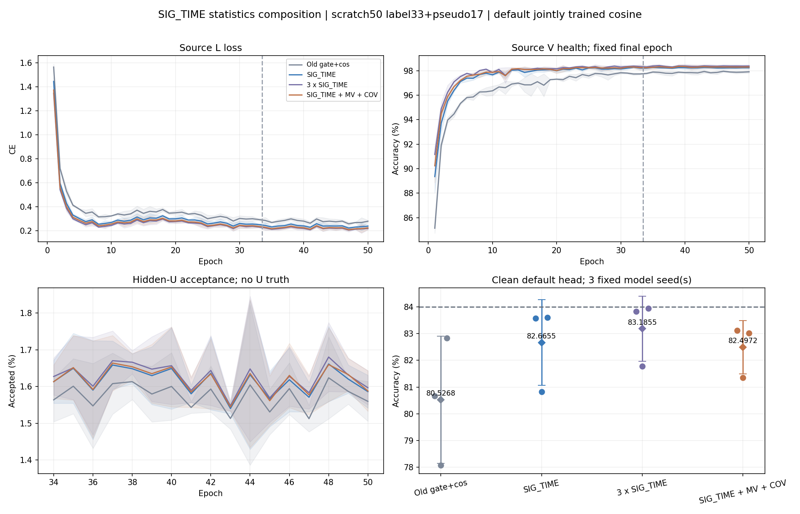

# SIG_TIME＋MEAN_VAR＋COV：完整三种子结果

**组合没有改善整体识别性能。** 固定三个模型种子 clean 默认头均值为82.4972%，距84%差1.5028个百分点；相对本轮单SIG_TIME低0.1683±0.6057个百分点（1/3正差），相对同参数X3低0.6883±0.2437个百分点（0/3正差）。没有按负差替换种子、改配方或选择性重跑。

## 完整匹配结果

| 方法 | seed01 | seed02 | seed03 | 均值 ± 样本 SD（%） | Macro-F1（%） | 最差 RX 均值（%） | 最差 day 均值（%） |
|---|---:|---:|---:|---:|---:|---:|---:|
| OLD_GATE_COS50 | 80.6685 | 78.0815 | 82.8304 | 80.5268 ± 2.3776 | 80.0024 | 67.9708 | 76.0556 |
| SIG_TIME | 83.5756 | 80.8196 | 83.6012 | 82.6655 ± 1.5986 | 82.1124 | 70.4333 | 78.4627 |
| SIG_TIME_X3 | 83.8333 | 81.7810 | 83.9423 | 83.1855 ± 1.2176 | 82.6957 | 71.8264 | 80.0651 |
| SIG_TIME_MV_COV | 83.1220 | 81.3470 | 83.0226 | 82.4972 ± 0.9973 | 81.9566 | 71.4667 | 79.0341 |

| 配对比较 | 各 seed 差（百分点） | 均值 ± 样本 SD（百分点） | 正差种子 |
|---|---|---:|---:|
| SIG_TIME − OLD_GATE_COS50 | 2.9071 / 2.7381 / 0.7708 | 2.1387 ± 1.1876 | 3/3 |
| SIG_TIME_X3 − SIG_TIME | 0.2577 / 0.9613 / 0.3411 | 0.5200 ± 0.3844 | 3/3 |
| SIG_TIME_MV_COV − SIG_TIME | -0.4536 / 0.5274 / -0.5786 | -0.1683 ± 0.6057 | 1/3 |
| SIG_TIME_MV_COV − SIG_TIME_X3 | -0.7113 / -0.4339 / -0.9196 | -0.6883 ± 0.2437 | 0/3 |
| SIG_TIME_MV_COV − OLD_GATE_COS50 | 2.4536 / 3.2655 / 0.1923 | 1.9704 ± 1.5926 | 3/3 |

这里的最差RX/day是先在每个模型seed内取最低准确率，再跨3seed平均；不是先平均每个RX再取最低。目标共旧六TX、七RX、四日期，每模型168000包。单SIG_TIME与X3的本轮比较显示增加视图/容量的配对信号；它不能支持新增MEAN_VAR/COV有互补收益，不能用容量控制的较高成绩替代预登记候选主指标。后续方法按用户报告和合法源证据执行，不根据这些目标分数改变结构、参数或选择父权重。

| 组合相对 | seed | 修正错误 | 引入错误 | 净修正 |
|---|---:|---:|---:|---:|
| OLD_GATE_COS50 | 2026092701 | 10514 | 6392 | 4122 |
| OLD_GATE_COS50 | 2026092702 | 11052 | 5566 | 5486 |
| OLD_GATE_COS50 | 2026092703 | 7710 | 7387 | 323 |
| SIG_TIME | 2026092701 | 3508 | 4270 | -762 |
| SIG_TIME | 2026092702 | 4362 | 3476 | 886 |
| SIG_TIME | 2026092703 | 2769 | 3741 | -972 |
| SIG_TIME_X3 | 2026092701 | 2893 | 4088 | -1195 |
| SIG_TIME_X3 | 2026092702 | 3426 | 4155 | -729 |
| SIG_TIME_X3 | 2026092703 | 2484 | 4029 | -1545 |

组合相对单SIG_TIME三个seed净修正−762/+886/−972，合计−848；相对X3为−1195/−729/−1545，合计−3469。组合比单分支的最差RX均值高1.0333、最差day高0.5714个百分点，但比X3分别低0.3597/1.0310个百分点。局部分组改善没有兑现为整体增益。

## 实现及真实特征证据

实际t2四窗、每视图6D局部投影→描述子28→公共投影joint160。单分支增加18976参数，X3与统计组合各55968；f_theta分别195041/232033/232033，默认类别W均为960。新模型原生骨干及W初态在每个seed内一致；X3/组合所有初始可训练参数相同，固定COV lift的buffer形状差异有意保留，不宣称描述子内在秩相同。

全部9个新模型的新增参数张量实际数值更新；原前向与独立feature-only导出精确一致，删除/置零W不改变z，保留norm/gain/reference和统计分支。固定L720上组合与X3特征L2分别为2.240102/2.820376/3.660480。观察前后参数/buffer不变、无拟合及优化器更新。源码源加载器曾物化V缓存后丢弃，特征观察器不前向V或读取U/query。边界正确和特征改变不能证明未见TX迁移或域不变性。

同一路径上MEAN_VAR可由均值/COV计算；本组合使用独立投影视图，差异是学习坐标与描述方式，不是新增独立原始信息。SIG已包含于SIG_TIME，无重复单加SIG。所有9个新模型默认cosine6×160 scale30按原流程与骨干联合训练，native RX/day/channel诊断拟合关闭、disabled closure各1次、head_fit_updates=0。历史baseline只读复用，未新增诊断拟合。

## 训练、预算和复算

| 方法 | 终轮 L CE 均值 | 终轮 V 均值（%） | U 接受率均值（%） | 50 轮时间均值（秒） |
|---|---:|---:|---:|---:|
| OLD_GATE_COS50 | 0.279363 | 97.9099 | 1.5750 | 2295.67 |
| SIG_TIME | 0.238719 | 98.2457 | 1.6147 | 2096.55 |
| SIG_TIME_X3 | 0.218934 | 98.3827 | 1.6257 | 2105.30 |
| SIG_TIME_MV_COV | 0.223990 | 98.3062 | 1.6183 | 2083.75 |

每个新模型scratch50/11100，33label+17pseudo，旧batch_neighbor门控、自身EMA0.999、cosine2e−4→1e−6、AdamW wd1e−4、lambda_U0.16/lambda_ent0.01/smoothing0.01。L6300/U56700/V27000、split392005及原RX/day/TX/physicalIDs保持，训练池标注率10%，U TX真值始终隐藏，V只eval健康诊断且不选模。NoExplicitCFO和内部逐包补偿保持，无新星地训练增强。

完整矩阵12行：9新模型共450model-epochs/99900更新，3个历史baseline150轮单列复用。独立复算完整600条epoch标量记录、99900条新step记录、2016000次默认决策和216组CM/accuracy/Macro-F1，全部精确相符。样本数不等于模型seed数，统计SD来自3个模型seed。每新模型半监督U包调用963900，接受率约1.6%；低LCE和V约98%不等于目标达标。epoch秒来自不同GPU共载，不作固定硬件速度结论。源LCE后期仍有随机波动，只声明固定预算完成，不保证数学意义收敛。

## 与原SIG_TIME历史报告的关系

原sequence50报告的SIG_TIME三seed均值83.0393%保持原记录；本轮新同路径anchor为82.6655%。两矩阵的CUDA初始化/随机流策略不同，本轮warm CUDA且私有feature初始化仅重设CPU generator，保留全局CUDA随机流。原单SIG_TIME初始化函数与当前单分支的合成检查精确相同，但这不能证明完整训练轨迹相同。不得混合两矩阵、冒充6独立seed，或把−0.3738个百分点直接归因于描述子数学性质。组合归因使用本轮同路径、同初态的单SIG_TIME和X3控制。

## 交付、边界和下一步

首seed执行eda57144de34d479288f42d14c037eb7802c1ecd，剩余02/03执行85b3294db8416c81545eef1682ccfb576fe19f52；只读完整复算代码2d1af3b15a067fe1a3993074ac375bb315612749。run IDs为20261014-phase1-sigtime-statistics-oldgate-cos-e50-clean-manysig-s01-m4-r01与20261014-phase1-sigtime-statistics-oldgate-cos-e50-clean-manysig-s0203-m8-r01。预登记source条件PASS及扩种子决定85b3294db8416c81545eef1682ccfb576fe19f52在读取首seed新目标分数前上传；参数/轮数/种子/终轮选择保持，firstseed没有重训。

实现和所有正/负结果保留；IQ、checkpoint、原始日志和逐包prediction留既定远端run目录，Git仅交付报告、曲线和必要聚合。只验证已暴露ManySig clean旧TX，不声称卫星部署、新TX或Phase2效果，不称新独立盲测。

用户已要求按新报告开始下一轮；同投影统计形状/有序面积实验20261014-phase1-moment-area-oldgate-cos-e50-clean-manysig-s01-m4-r01在读取本次完整三种子目标均值前已冻结并发布，当前保持原方法。下一步完成该固定首seed的源资格与自动评分；源PASS才按预定义02/03原样扩种子。Dropout前取点和连续跨窗层级均按报告顺序另行研究，不堆叠、扫参数或按此目标均值挑父权重。

证据：[完整机器可读结果](results.json)、[实际源特征](source_features.json)、[八行闭环与终止证据](completion_evidence.json)、[首seed独立报告](../20261014-phase1-sigtime-statistics-oldgate-cos-e50-clean-manysig-s01-m4-r01/final_analysis.md)。
