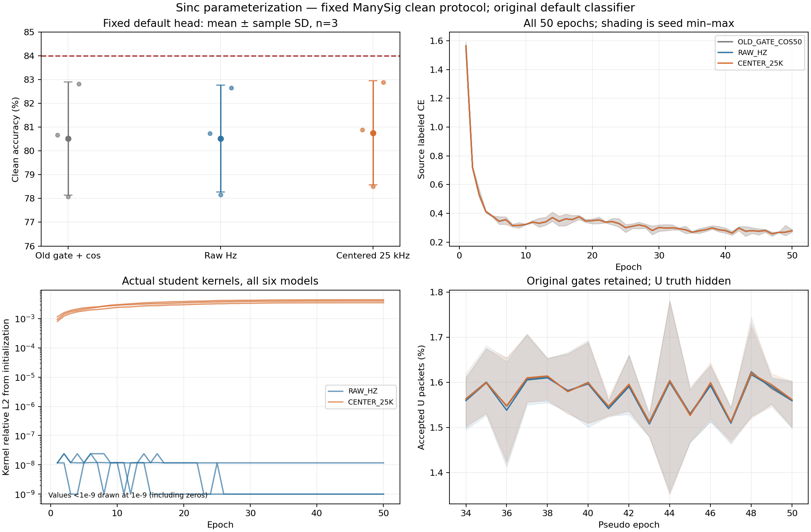

# Sinc 坐标探索完整三种子分析

状态 **ANALYZED**；run `20261014-phase1-sinc-coordinate-oldgate-cos-e50-clean-manysig-m9-r01`，实际执行代码 `0f81373c25ba69a6cb9deec5c7ca652880fd62af`。9 个 row 全部自然结束，6 个新模型全部固定 50 轮/11100 更新，失败与缺项为 0。唯一默认读出 ORIGINAL_HEAD，clean ManySig 每 row 168000 包，共1512000个决策；162 条混淆矩阵与指标已独立复算。

主候选 CENTER_25K 为 **80.7637% ± 2.1962 个百分点**，相对旧门控＋cos 平均提高 0.2369 个百分点，相对同路径 RAW 提高 0.2425 个百分点，两组配对均 3/3 正差。84% 尚未达到，差 3.2363 个百分点。原头联合训练保持，单独分类头拟合为 0；没有替换主候选或用最高单 seed 验收。

## 完整冻结指标

准确率及 F1 以百分数表示；配对差和样本标准差以百分点表示。最差 RX/day 是先在每个 seed 内取最小值，再平均，不能等同所有种子的同一接收机。

| 方案 | seed01 | seed02 | seed03 | 均值 ± 样本标准差 | Macro-F1 均值 | 最差 RX 均值 | 最差 day 均值 |
|---|---:|---:|---:|---:|---:|---:|---:|
| OLD_GATE_COS50 | 80.6685 | 78.0815 | 82.8304 | 80.5268 ± 2.3776 | 80.0024 | 67.9708 | 76.0556 |
| RAW_HZ | 80.7381 | 78.1655 | 82.6601 | 80.5212 ± 2.2552 | 79.9914 | 67.9764 | 76.0286 |
| CENTER_25K | 80.8964 | 78.5042 | 82.8905 | 80.7637 ± 2.1962 | 80.2499 | 68.3472 | 76.3881 |

| 配对 | seed01 差 | seed02 差 | seed03 差 | 平均差 ± 样本标准差 | 正差种子 |
|---|---:|---:|---:|---:|---:|
| RAW_HZ − OLD_GATE_COS50 | 0.0696 | 0.0839 | -0.1702 | -0.0056 ± 0.1428 | 2/3 |
| CENTER_25K − OLD_GATE_COS50 | 0.2280 | 0.4226 | 0.0601 | 0.2369 ± 0.1814 | 3/3 |
| CENTER_25K − RAW_HZ | 0.1583 | 0.3387 | 0.2304 | 0.2425 ± 0.0908 | 3/3 |

CENTER 相对 OLD 修正/引入错误分别为814/431、1298/588、764/663；相对 RAW 为806/540、1287/718、851/464。RAW 对 OLD 仅 2/3 正差、均值 −0.0056 个百分点，是保留的负结果。3 个模型种子不足以宣称统计显著；历史对照为严格核验的同33＋17配方复用，不承诺跨运行逐位训练轨迹相同。同路径 RAW−CENTER 是最直接的参数化对比。完整 overall/RX/day/TX 指标、9 组错误迁移计数在 [results.json](results.json)。这些目标分层结果只用于既定结果分析，不用于下一结构、超参数、父权重或重跑。

## 真实核和部署特征

| 方案/seed | 学生核相对 L2 | EMA 核相对 L2 | 学生−EMA 核相对 L2 | 恢复初始 Sinc 后源 z 平均 L2 改变 |
|---|---:|---:|---:|---:|
| RAW_HZ/2026092701 | 0.0000000e+0 | 3.3577803e-6 | 3.3577803e-6 | 0.0000000e+0 |
| CENTER_25K/2026092701 | 3.9949785e-3 | 3.9838781e-3 | 1.5040815e-5 | 8.0334142e-2 |
| RAW_HZ/2026092702 | 0.0000000e+0 | 3.3577803e-6 | 3.3577803e-6 | 0.0000000e+0 |
| CENTER_25K/2026092702 | 3.4871367e-3 | 3.4762563e-3 | 1.5858257e-5 | 4.3433130e-2 |
| RAW_HZ/2026092703 | 1.1708447e-8 | 3.3577803e-6 | 3.3577596e-6 | 3.1507316e-6 |
| CENTER_25K/2026092703 | 4.3980908e-3 | 4.3848781e-3 | 2.0216507e-5 | 8.0259755e-2 |

CENTER 三个模型均全部48坐标发生真实更新，物理滤波核相对 L2 为0.003487至0.004398；RAW 仅1个低频坐标微变、全部24个band不变，两个核完全不变，另一个约1.17e−8。每个新模型原生 optimizer 的全部183个参数顺序、保存moment形状与Sinc step11100核验通过；固定origin/window buffers没有改变。保存的最终真实核与50轮源诊断的末条记录精确一致。CENTER的EMA接近学生，RAW的EMA约3.36e−6漂移不能当作学生学到滤波器。

实际6模型各固定L720、joint160/115200个分量。feature-only 导出与原前向逐元素相同，临时W置零不改变z，独立导出只删除960个旧类别W，保留176065个实际fθ参数及全部归一化、gain、参考响应和输入补偿。所有检查均eval/frozen，无梯度、参数/buffer更新、头拟合或query读入。真实feature初末变化和恢复初始Sinc的RX/day分层敏感性见 [source_features.json](source_features.json)。恢复仅在临时final副本替换Sinc，其他下游与默认W保留，是条件敏感性，不是重新训练的因果消融，也不证明新TX迁移。整体小幅默认头收益与真实特征变化分别报告，不把数值可学习性直接等同泛化瓶颈。

## 完整源轨迹和成本

独立读完66600新step和450epoch，全部新step有序、有限、无跳过，EMA .999成功更新至11100；训练各轮target总数为0、源V27000，固定终轮选模。基线native epoch pseudo计数已是整轮合计；初版只读reader重复乘222触发断言，现按原计数校正并通过，无实验重跑或产物改写。

每模型17轮U共963900包；旧基线累计接收15214/15126/15204，RAW15218/15101/15151，CENTER15248/15127/15192，覆盖仍约1.57%。所有U TX真值保持隐藏，不能报告其伪标签正确率。额外源V仅33/34健康诊断，各模型2次，恢复模式与RNG，无选模/梯度/EMA更新。50轮source labeledCE曲线接近、末轮0.2697至0.2887，V末轮97.8222%至98.0222%；小幅波动不证明全部已收敛。首seed固定源CE与实际核阈值通过后才释放剩余四模型，未读取目标分数作放行。

6新模型=300model-epochs/66600更新；3历史对照150model-epochs单列复用。额外V12次/324000包，U额外前向0，单独头更新0；真实特征诊断6×L720另列。新6模型epoch日志累计11710.5秒（GPU工作量合计），不等于并行墙钟时间，历史与当前负载不同，不据此宣称速度比。

## 交付与下一动作

代码/config预登记、源首seed门槛、固定预测和truth-last的执行闭环见 [report.md](report.md)；无热改、停止、健康任务重启或目标反馈。完整输出留在既定N607 run根，原始IQ/权重/NPZ/step日志不上Git，Git只交付实现、配置、汇总和图。此为已暴露clean研究基准，不声明新独立盲测、星地部署或新TX。

下一候选的依据是独立source gate诊断：原uniform batch难见物理邻包。保留全部旧门控，单独测试物理邻包成对随机采样与同路径random order；先做合法L/V观察并固定失败条件，不叠加CENTER/TIME，不以本次目标分数选参数。
