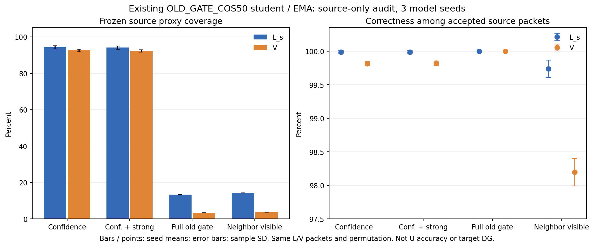

# 旧门控源诊断：完整三种子结果

固定 `20261014-phase1-source-legacy-gate-audit-manysig-m3-r01` 已 ANALYZED。三个现有 OLD_GATE_COS50 源终轮模型及各自真实 EMA 全部完成 L6300/V27000 诊断；参数、buffers、默认头与来源均保持，0 训练/头/优化器更新。执行提交 `0f514fa1ba4302bc7e5e25d0ad41337881acce7f`。

以下为三个模型 seed 的均值 ± 样本 SD。每个模型使用相同物理 L/V、相同固定排列；不是三份独立新数据，也不是 U 正确率。precision 为接收包中的源标签正确率。

|角色／门控|覆盖率 ± SD（百分点）|precision ± SD（百分点）|
|---|---:|---:|
|L／confidence|94.2804% ± 0.8767|99.9889% ± 0.0193|
|L／confidence＋strong|94.0899% ± 0.8355|99.9888% ± 0.0193|
|L／完整旧门控|13.3598% ± 0.1629|100.0000% ± 0.0000|
|L／仅邻包可见|14.2381% ± 0.0000|99.7399% ± 0.1287|
|V／confidence|92.5494% ± 0.7171|99.8173% ± 0.0328|
|V／confidence＋strong|92.2815% ± 0.6698|99.8221% ± 0.0335|
|V／完整旧门控|3.4099% ± 0.0252|100.0000% ± 0.0000|
|V／仅邻包可见|3.7630% ± 0.0000|98.1955% ± 0.2049|

V 的完整旧门控各 seed 接收 923/913/926 包，所观察子集错误均为 0；confidence＋strong 接收 25036/24708/25004 包，错误 54/41/38。不能将有限接收子集的零错误外推为未来绝对正确。完整旧门控平均拒绝 25515.7 个 EMA 已正确识别的 V 包；confidence＋strong 为 1564.7 个。具体每 RX/day/源类整数计数均在 results.json，360 条记录的比率、分层求和已独立复核。该复核检查保存聚合计数，不声称重放未保存的逐包代理预测。

分析几何与实测一致：uniform random B256、window2 下，源 L/V 的理论邻包可见性为 14.7888%/3.6978%，本次同固定排列实测为 14.2381%/3.7630%。U56700/cell630 的纯采样几何期望为 1.7807%，接近既有真实训练约 1.6% 的接收包次。这里没有读取 U IQ、标签、预测或解码 U ID；它是协议常数下的几何推断，不是实测 U 正确率或目标性能。批次物理邻包可见性是有源证据支持的门控限制；低接收率不能简单归因为老师不够准确。

下一步优先检验**随机批次中保留物理邻包对**，保持原 confidence/temporal/strong 门控，避免把结构研发变成取消安全条件或分类头调整。配对只用既有合法 rx/day/eq/sig/base_index，不使用隐藏 TX；与同执行路径随机采样做公平 source-only 小矩阵，先核对覆盖和真实 feature 梯度/变化，再按固定预算测试。该路线尚未实现/发布训练，不能宣称收益；本结果不改变正在健康运行的 Sinc 矩阵。

一次归档传输校验、远端 compile、真实默认 checkpoint 零 IQ smoke PASS；发布后读回实际 PID/CWD/argv 验证，日志从 0 增至 272 字节，最终三 row completion 和总 completion 已核实，进程自然退出，失败 0。CPU 明确执行，三 row 用时合计 104.59 秒；199800 源包次、786 批前向，未使用 GPU。完整原产物保留在同名 N607 run root；实现、配置、完整聚合结果、报告与图上传 Git。

此结果仅支持冻结默认网络的源门控机制判断。没有新增模型训练或分类头，没有目标访问、U 正确率、目标 DG 增量、卫星部署或新 TX 结论。

