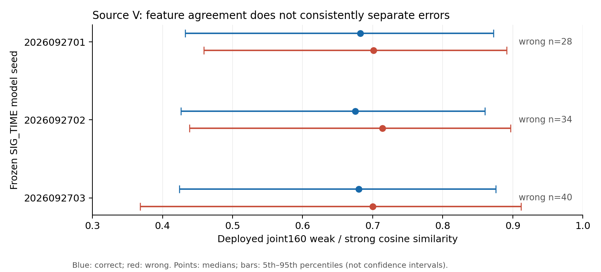

# 固定 SIG_TIME：源域伪标签错误与实际特征梯度结果

状态 ANALYZED，三模型全部完成，保存的1800条参数梯度向量及全部L/V特征组统计独立复算 VERIFIED。实现 d17f140c3528d8964ffedf464976532bc56e0760，执行 3bc96d53291ca3b2f1eeb0c19236e236a8d25866。这是0训练更新的源域机制诊断，不是新目标域性能结果；84%目标仍未达到。

|模型seed|角色|门控|接受/池大小|接受错误|覆盖率|观察精度|
|---|---|---|---|---|---|---|
|2026092701|L_s|CONFIDENCE_STRONG|6024/6300|0|95.6190%|100.0000%|
|2026092701|L_s|FULL_OLD|848/6300|0|13.4603%|100.0000%|
|2026092701|V|CONFIDENCE_STRONG|25332/27000|28|93.8222%|99.8895%|
|2026092701|V|FULL_OLD|935/27000|0|3.4630%|100.0000%|
|2026092702|L_s|CONFIDENCE_STRONG|6061/6300|0|96.2063%|100.0000%|
|2026092702|L_s|FULL_OLD|851/6300|0|13.5079%|100.0000%|
|2026092702|V|CONFIDENCE_STRONG|25442/27000|34|94.2296%|99.8664%|
|2026092702|V|FULL_OLD|928/27000|0|3.4370%|100.0000%|
|2026092703|L_s|CONFIDENCE_STRONG|6075/6300|0|96.4286%|100.0000%|
|2026092703|L_s|FULL_OLD|855/6300|0|13.5714%|100.0000%|
|2026092703|V|CONFIDENCE_STRONG|25473/27000|40|94.3444%|99.8430%|
|2026092703|V|FULL_OLD|940/27000|0|3.4815%|100.0000%|

两个范围在三个模型的 L 接受集合中均观察到0错误。75个L批、150个scope批、450个层scope统计的wrong梯度均为0；pseudoCE与同图同接受集合trueCE梯度一致是标签相同的必然结果，不是半监督学习有效的新证据。该设计没有获得可识别的错误梯度样本，不能推出U准确率或训练早期错误影响。保留全部零结果，不补跑阈值或换父模型。

V的CONFIDENCE_STRONG接受样本分别有28/34/40错误；FULL_OLD均观察0接受错误。V只作无梯度描述，不用来拟合/调参。

|模型seed|V confidence+strong 正确特征cos mean/median|错误特征cos mean/median|正确 .05至.95分位|错误 .05至.95分位|
|---|---|---|---|---|
|2026092701|0.670987/0.682370|0.689883/0.700940|0.432520至0.872534|0.459194至0.891487|
|2026092702|0.663895/0.675108|0.672492/0.713649|0.426565至0.860475|0.438368至0.896991|
|2026092703|0.668366/0.680247|0.650957/0.699859|0.423828至0.876002|0.368362至0.912002|

错误组的joint160一致性均值相对正确组方向不一致（前两模型更高，第三更低），三个错误组中位数反而都更高，分位区间大量重叠。本次观察不支持“特征更一致即可更可靠”的门控假设，不增加相关阈值或拟合可靠度分类器。错误组置信度均值约.984至.985，正确组约.9985至.9988；只保留描述，不按V或目标扫描新tau。

## 对下一步训练机制的含义

继续完成已经冻结的真实t1/t2梯度方差训练。半监督下一候选应有独立的表征学习假设与匹配成本控制，不能把提高接受数、整体放大U梯度、按joint160一致性设门槛或重训分类头当成机制。当前只读final50，无法确认训练早期错误反馈；不把诊断缺少错误误写成训练全程无害。

## 成本与权限

CPU串行三模型共122.132秒（不含发布、预检、独立复算），199800源包前向/786batch。75个L梯度批、150scope批、450层scope记录/1800原始向量；全部实际重新读取PT计算。L6300/V27000、split392005、源physical IDs保持；U/query访问0，V梯度0，模型/优化器/EMA/头更新0。原始PT/权重/日志留远端，Git只保存聚合JSON、图与报告。三模型复用同一源物理样本，不作为三独立数据集。默认cos头未单独训练或替换。

完整各批梯度摘要与组分位数见results.json；复算逐模型判定见independent_saved_artifact_recount。原假设的可识别性缺口与负结果保留，不额外重复运行。
