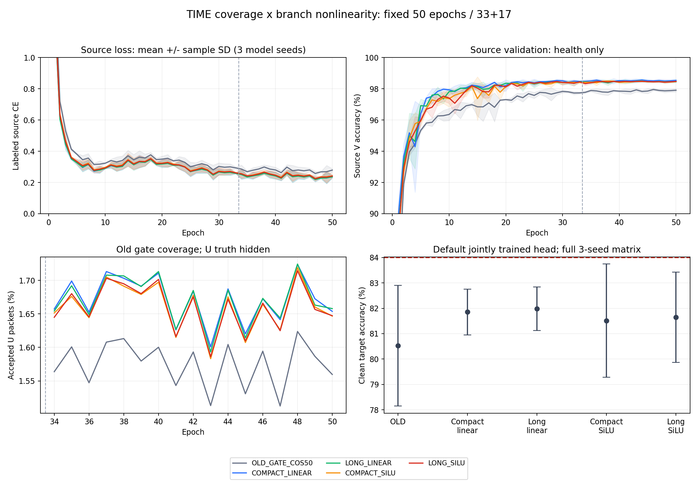

# TIME 覆盖范围 × 分支非线性：完整结果

状态 VERIFIED / ANALYZED。run_id：20261014-phase1-time-factorial-oldgate-cos-e50-clean-manysig-m15-r01；实际执行代码 351e35cd0d298a6832c0865628bba28ab5a14cbe；33 label＋17 pseudo，默认头普通cos正常联合训练，单独头训练0。预登记主候选 LONG_SILU 为81.6417%，距84%差2.3583个百分点；目标未达到。最高次要条件 LONG_LINEAR 为81.9819%，不替代预登记主指标。

|条件|clean 均值 ± 样本 SD|Macro-F1|最差 RX 均值|最差 day 均值|
|---|---|---|---|---|
|OLD_GATE_COS50|80.5268% ± 2.3776 pp|80.0024%|67.9708%|76.0556%|
|COMPACT_LINEAR|81.8536% ± 0.8979 pp|81.3736%|74.5347%|79.0429%|
|LONG_LINEAR|81.9819% ± 0.8566 pp|81.5256%|74.7931%|79.4270%|
|COMPACT_SILU|81.5135% ± 2.2298 pp|81.0106%|71.3833%|78.3016%|
|LONG_SILU|81.6417% ± 1.7807 pp|81.1547%|72.4500%|78.0873%|

|固定对比|均值差（pp）|三个 seed 差（pp）|正向 seed|
|---|---|---|---|
|LONG_LINEAR − COMPACT_LINEAR|0.1284|0.5970 / 0.1976 / -0.4095|2/3|
|LONG_SILU − COMPACT_SILU|0.1282|0.1857 / 0.6024 / -0.4036|2/3|
|COMPACT_SILU − COMPACT_LINEAR|-0.3401|0.1982 / -1.8589 / 0.6405|2/3|
|LONG_SILU − LONG_LINEAR|-0.3403|-0.2131 / -1.4542 / 0.6464|1/3|
|COMPACT_LINEAR − OLD_GATE_COS50|1.3268|1.4637 / 2.7679 / -0.2512|2/3|
|LONG_LINEAR − OLD_GATE_COS50|1.4552|2.0607 / 2.9655 / -0.6607|2/3|
|COMPACT_SILU − OLD_GATE_COS50|0.9867|1.6619 / 0.9089 / 0.3893|3/3|
|LONG_SILU − OLD_GATE_COS50|1.1149|1.8476 / 1.5113 / -0.0143|2/3|

覆盖×非线性交互为-0.0002 pp，三seed -0.4113 / 0.4048 / 0.0060 pp，样本SD 0.4081 pp。长覆盖两组平均增量都约0.128pp，仅2/3seed正；SiLU对紧凑/长覆盖分别−0.3401/−0.3403pp，正向2/3与1/3。没有稳定的分支SiLU收益，也没有明确交互。目标结果如实报告，不回流调参或选择最高TIME权重续训。相对外部OLD旧门控＋cos，四组均值提高0.987至1.455pp；它们同时改变容量/投影和初始化执行，不能把与OLD的差全部归因于覆盖或SiLU。主归因是相同初始state/RNG/参数预算的新四组配对。

完整逐seed、270条RX/day/TX混淆矩阵/accuracy/Macro-F1、24个纠错/新增错误对比、源50epoch曲线和RX/day预测类别门控计数见 results.json。长线性相对紧凑线性净纠错1003/332/−688包；长SiLU相对长线性−358/−2443/+1086包。改进不是全seed一致；不以最好单seed解释迁移。

## 真实特征与源机制

12个新模型21个TIME tensor全部从真实initial到final非零变化。固定L720包/模型（每TX/RX/day按物理ID排序前8个）实际initial/final z变化、independent feature-only导出与default id_feat_joint逐元素一致、临时克隆W置零不改变z、finalθ/全部buffers不变均 VERIFIED。236737导出θ参数，960个classW元素删除；保留base_norm/pa_norm/gain、reference和输入策略。零head fit/diagnostic optimizer。这里只证明新模块进入真实部署特征并且学到了不同特征，不证明可迁移性提升或新TX能力；最新用户禁止换头，本轮没有改用其他读出。

原TIME_MS50真实3seed的preGN等效核最大rank4、doublefold误差≤3.34e−15、外±4能量约3.4%至4.8%；source固定720包撤除各支影响joint160/default margin。该推理撤除不等于独立训练消融，核rank不等于特征rank，整块GN数据相关不能当线性层。新SiLU在DW之后、concat/fusion之前，原GN/ReLU/pool/dropout与PA/frequency/reference保持。

源末轮CE 0.2264至0.2486；V 98.3926%至98.6000%。源V后段接近平台，CE后段仍有波动，固定50轮预算不等于已证明充分收敛。33/34额外健康评估与原模式/Python/NumPy/Torch/loader RNG恢复都执行；不更新V，不选模。每新模型U包次963900，接收率约1.65%至1.68%；OLD约1.57%至1.58%。包次/预测类别分布不能当独立物理覆盖率或U准确率。strongstudent/weakEMA agreement明确视图不同，U真值始终隐藏。低门控覆盖值得在合法有标签源代理上另作无参数诊断，当前实验不改门控。

## 完整核验与成本

12个scratch50共600model-epochs/133200成功optimizer与EMA更新；OLD3个历史150epochs单列复用。四组identity参数237697，较OLD177025多60672，dilation/SiLU新增0参数。每seed四个真实initial checkpoint全部200个参数/buffer tensors逐项一致。历史TIME主RNG与此私有CPU初始化不同，因此新训LONG_LINEAR，未把历史TIME混入配对。

独立完整解析133200新step与750epoch记录，非有限跳过0，11100step/新模型、33＋17、EMA.999/versioned/nostartupaverage一致。U监控17epoch每epoch56700包、class直方图与step selected逐项相等；50epoch层运动及33/34两次V健康齐全。15行每行168000唯一ID，2520000默认决定/270指标从原NPZ与truth独立重计一致；baseline504000决定与历史原默认NPZ一致。prediction固定后才独立连接truth，all15worker自然退出，queue/failure为空。无classifier-only optimizer、新W/prototype/support调参。

额外源V诊断24pass/648000包，新增U诊断前向0。新模型epoch时间合计27274.47秒，单模型约2012至2505秒；共享GPU竞争不同，不宣称受控速度优势。NoExplicitCFO、内部逐包补偿、原L6300/U56700隐藏/V27000与split392005保持。当前仅clean旧6TX/7targetRX/4day，exposed benchmark，不是新盲测、newTX、Phase2或LEO部署。

图中源损失和V面板展示后段细节（CE0至1、V90%至100%）；完整50轮数值在JSON，误差带/误差棒为三个model seed样本SD，不是置信区间。target均值图只描述固定结果，不能用于下一方案选择。

## 下一步范围

下一候选按此前真实source Sinc证据做参数坐标单因素修复，独立旧门控＋cos控制，不加载目标最高TIME模型。9个source模型Sinc有完整11100步与47/48非零moments，学生kernelrelativeL2≤2.4071e−8；末端adaptive项小于半ULP，EMA核漂移可由固定初始参数的float32 EMA回放复现。它支持检验坐标方案，不证明因果瓶颈或性能收益。另一个动作最多为合法有标签source的门控覆盖/正确率诊断，不解封U，不拟合新头。避免kernel/dilation扫描、扩PA或叠加多个机制。
