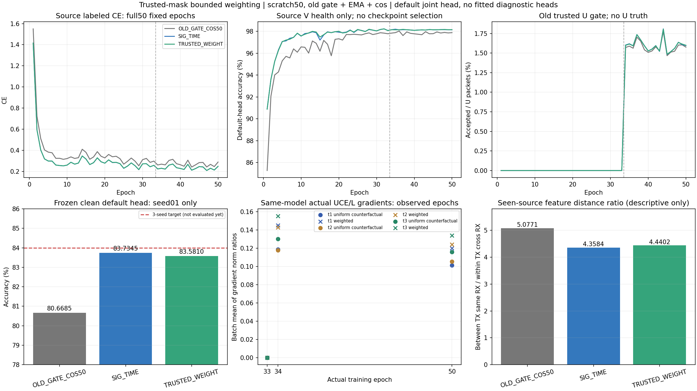

# SIG_TIME可信门控内有界权重：首种子完整结果

首seed2026092701候选TRUSTED_WEIGHT **83.5810%**，同路径SIG_TIME uniform **83.7345%**，配对**−.1536个百分点**，0/1正差。候选修正585个错误、引入843个错误、净正确−258/168000。原旧门控＋cos80.6685%，候选相对旧基线+2.9125pp，其中SIG_TIME自身+3.0661pp；新增权重未在本seed提供性能增量。当前没有样本SD或完整三seed结论，84%均值目标未达。

| 方法 | Accuracy（%） | Macro-F1（%） | 最差RX（%） | 最差day（%） |
|---|---:|---:|---:|---:|
| OLD_GATE_COS50 | 80.6685 | 80.1734 | 70.6167 | 75.4524 |
| SIG_TIME | 83.7345 | 83.3135 | 71.3083 | 79.3333 |
| TRUSTED_WEIGHT | 83.5810 | 83.1354 | 71.1625 | 79.0048 |

Run 20261014-phase1-trusted-weight-oldgate-cos-e50-clean-manysig-s01-m3-r01；实现23ea591bba17dd938d2b9a93f8b9d9dc5f02e97a，实际执行7708d4afcef141bb614e0c2171f2a9207c4469ff，保存产物分析964c53c2759b1327c46875d8bf1ab067052b2600。首source资格读取target summary数值前核实PASS，决定提交fcc252f3938a21b415f5354b2a2e9db7315934bd；随后原样发布剩余02/03四新模型，实际执行a8ff278fc8dd1b54b69279503c4cda9282795261，首seed未重训，target结果不影响weight/scale/seed/预算/扩展。sourcePASS不代表性能PASS。完整固定方案与首次发布记录见preregistration.md；剩余run 20261014-phase1-trusted-weight-oldgate-cos-e50-clean-manysig-s0203-m6-r01训练中。

单因素训练侧：原SIG_TIME t2完整postDropout/single6Dprojection/fourlocal28→112→160/pool18976/fθ195041/defaultclassW960保持；raw w=stopgrad(.75+.5×clip((1−p_studentstrong(teacher伪类别))/.1,0,1))，raw[.75,1.25]，按原接受权重和归一化CE。effective系数理论[.6,1.6667]与raw界不混称。原teacherconfidence/batch_neighborwindow2/strong一致门控、ownEMA.999、lambdaU.16、全Uentropy.01、cos与33label＋17pseudo不变；uniform返回native原CE tensor，weighted仅替换接受CE，门控算法保持但两模型实际接受集合可随学习变化。没有层级/PRE/Sinc/新kernel/SiLU叠加。默认cos6×160scale30随骨干正常联合，不冻结或单独拟合/更换头，native拟合探针关闭，额外头训练0。

真正训练33/34/50每轮全部222原L/U批，666批/1998层批记录每模型；仅autograd.grad retain_graph，不增加IQforward/RNG，不累积.grad，随后正常backward/optimizer/EMA。具体对象t1/t2/t3.pw.weight3456/6912/9216元素，与分类W不同。完整保存三轮vectors后独立重读复算3996记录；另逐项核对22200步trusted记录与native日志的实际loss/接受数。各模型11100updates/3774Usteps/963900U包，uniform接受15440、weighted15437，覆盖约1.60%，U真值不可用，未测其伪标签精度。3257个Ustep中raw权重非恒定，3237个Ustep的uniform/weighted CE差超过1e−8，两模型该计数相同，但接受总数不同。

下面是加权候选自身同批次的uniform反事实与weighted梯度比，包含空接受批的0；cos只平均有效批。不是跨模型同一权重状态比较，也不是整数据合并梯度。两个模型33轮启用前L梯度已有小幅差异，全部原记录保留，不把全部跨模型差异归给权重。

| Epoch | 对象 | Uniform λUCE/L 均值 | Weighted λUCE/L 均值 | Weighted（UCE＋entropy）/L | 两U梯度cos | cos有效批 |
|---|---|---:|---:|---:|---:|---:|
| 33 | t1.pw.weight | 0.000000 | 0.000000 | 0.000000 | 未定义 | 0/222 |
| 33 | t2.pw.weight | 0.000000 | 0.000000 | 0.000000 | 未定义 | 0/222 |
| 33 | t3.pw.weight | 0.000000 | 0.000000 | 0.000000 | 未定义 | 0/222 |
| 34 | t1.pw.weight | 0.118642 | 0.145096 | 0.148386 | 0.999603 | 190/222 |
| 34 | t2.pw.weight | 0.117885 | 0.142923 | 0.146263 | 0.999588 | 190/222 |
| 34 | t3.pw.weight | 0.130170 | 0.155382 | 0.160352 | 0.999451 | 190/222 |
| 50 | t1.pw.weight | 0.101187 | 0.120038 | 0.122375 | 0.999660 | 202/222 |
| 50 | t2.pw.weight | 0.105272 | 0.124204 | 0.126541 | 0.999632 | 202/222 |
| 50 | t3.pw.weight | 0.115893 | 0.134045 | 0.137874 | 0.999418 | 202/222 |

33轮U为0符合原阶段；34/50加权增强同层CE梯度，cos约.9994至.9997，主要观测到幅度变化，方向改变很小。该证据证明新机制确实作用到浅/中时域参数，不证明提取更可迁移信息或提升性能。Entropy另记录并保持.01。全部18层阶段聚合与1332批/3996层原统计在results.json，未提交rawvectors。不同层参数量不同，跨层norm排名不解释为重要性。

非阻塞的源特征几何使用固定L720（每TX/RX/day cell首8），实际joint160按单位范数计算同日无序样本对距离，不拟合任何classifier/prototype或产生替代预测。每模型四关系paircounts2520/11520/14400/57600，重读保存features复算VERIFIED，额外2160源包forward/0optimizer；V既有cache可materialize后discard，无V forward/U IQ/Utruth/query。

| 方法 | 同TX跨RX距离均值 | 异TX同RX距离均值 | 后者／前者 |
|---|---:|---:|---:|
| OLD_GATE_COS50 | 0.308663 | 1.567102 | 5.077058 |
| SIG_TIME | 0.182353 | 0.794759 | 4.358353 |
| TRUSTED_WEIGHT | 0.186168 | 0.826617 | 4.440158 |

Weighted ratio4.4402比uniform4.3584略大，但同TX跨RX距离也由.18235增加至.18617，不能整体宣称几何改善。旧基线ratio5.0771更高却目标性能更低，直接说明这个已见source几何比值不能当泛化能力排序。样本对重叠，不当独立seed或置信证据。该补充分析不进入源资格/结构/weight/选模或扩seed条件，没有另训分类头。

两新pool5个trainable tensors均真实更新，实际feature-only导出差0、置零/移除classW不改变z，base_norm/pa_norm/gain/reference保留；初始全部参数/nativebody/W及source函数同，最终源L720候选−control zL2 1.736686。完整逐tensor/分层feature witness保留。特征变化和W独立接口证明接线正确，不证明丢弃W后的新TX性能；按最新要求未做换头实验。

成本2新100model-epochs/22200updates＋1历史50epochs/11100updates单列复用；150完整epoch记录/504000固定默认预测/54分组指标独立复算VERIFIED。合法L6300/U56700隐藏/V27000health-only、split392005/sourceRX1/3/4/6/8/day1/2/3/旧6TX/physicalIDs/10%训练池标注率、native train_ratio.07分母含V、NoExplicitCFO及内部补偿保持，无星地训练增强。完整源曲线保留，终轮固定，不以末轮低loss声称收敛。

一次聚焦直接P0/P1 PASS/local真实模型update/RNG/state/33inactive/负配置及compile PASS；发布archive比较/remotecompile/真实historical CP2zeroIQ noquery smoke及PID/CWD/argv/GPU/loggrowth完成。每row自动预测后独立truthlast评分，固定产物分析没有新增targetforward或模型更新。回收第一次在本地路径读取前失败，修正后只回收已存产物，没有重复训练/目标预测；补充几何是源CPU分析。原IQ/checkpoints/gradvectors/predictions/大日志留在immutable N607 run与release，Git只保存实现/config/聚合证据和报告。

当前单seed负结果保留，剩余4新模型按sourcePASS及固定计划继续。不得从此结果改weight界/scale、选择性重跑或取消健康实验。ManySig clean旧6TX/7目标RX/4day为已暴露基准，不称独立盲测、新TX、Phase2或卫星部署；84%需要完整预定义三seed均值，当前未达标。
