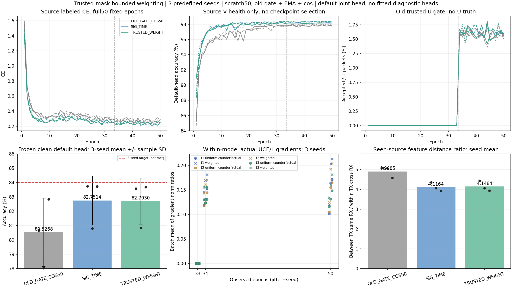

# SIG_TIME可信加权：完整三种子结果

预登记主方法TRUSTED_WEIGHT均值 **82.7030% ± 1.6081个百分点**，同路径SIG_TIME uniform **82.7514% ± 1.6961个百分点**；配对 **−.0484 ± .1039个百分点，1/3正差**。权重没有稳定强化性能，距84%均值目标1.2970个百分点，未达标。三个seed差分别−.1536/+.0542/−.0458pp，全部保留，无选择性重跑或按目标结果改配方。

| 方法 | seed01（%） | seed02（%） | seed03（%） | 均值 ± 样本SD（% / pp） | Macro-F1均值（%） | 各seed最差RX均值（%） | 各seed最差day均值（%） |
|---|---:|---:|---:|---:|---:|---:|---:|
| OLD_GATE_COS50 | 80.6685 | 78.0815 | 82.8304 | 80.5268 ± 2.3776 | 80.0024 | 67.9708 | 76.0556 |
| SIG_TIME | 83.7345 | 80.7929 | 83.7268 | 82.7514 ± 1.6961 | 82.2124 | 70.6792 | 78.6262 |
| TRUSTED_WEIGHT | 83.5810 | 80.8470 | 83.6810 | 82.7030 ± 1.6081 | 82.1642 | 70.4528 | 78.5302 |

| 配对 | seed01 / 02 / 03差（pp） | 均值 ± 样本SD（pp） | 正差seed |
|---|---:|---:|---:|
| SIG_TIME − OLD_GATE_COS50 | 3.0661 / 2.7113 / 0.8964 | 2.2246 ± 1.1638 | 3/3 |
| TRUSTED_WEIGHT − SIG_TIME | -0.1536 / 0.0542 / -0.0458 | -0.0484 ± 0.1039 | 1/3 |
| TRUSTED_WEIGHT − OLD_GATE_COS50 | 2.9125 / 2.7655 / 0.8506 | 2.1762 ± 1.1504 | 3/3 |

| 配对 | 修正错误 | 引入错误 | 净正确 | 共同决定数 |
|---|---:|---:|---:|---:|
| SIG_TIME − OLD_GATE_COS50 | 27608 | 16396 | 11212 | 504000 |
| TRUSTED_WEIGHT − SIG_TIME | 1771 | 2015 | -244 | 504000 |
| TRUSTED_WEIGHT − OLD_GATE_COS50 | 27460 | 16492 | 10968 | 504000 |

SIG_TIME相对旧门控＋cos +2.2246pp、3/3正差；TRUSTED_WEIGHT相对旧基线+2.1762pp、3/3正差。相对旧基线的收益主要已存在于SIG_TIME，新增权重不能据此宣称有效。它净引入244个错误/504000配对决定。不同run中的SIG_TIME复训结果分别保留，不能拼成更多独立seed或按target选择最高run。

首run 20261014-phase1-trusted-weight-oldgate-cos-e50-clean-manysig-s01-m3-r01，实际执行7708d4afcef141bb614e0c2171f2a9207c4469ff；剩余run 20261014-phase1-trusted-weight-oldgate-cos-e50-clean-manysig-s0203-m6-r01，实际执行a8ff278fc8dd1b54b69279503c4cda9282795261；核心实现23ea591bba17dd938d2b9a93f8b9d9dc5f02e97a，源扩展与远端预检实现fcc252f3938a21b415f5354b2a2e9db7315934bd。首sourcePASS决定在读取首target summary数值前冻结并提交fcc252f3938a21b415f5354b2a2e9db7315934bd，原样发布02/03四新模型；首seed未重训，没有target反馈到参数、weight/scale、seed、选模或扩种子。固定方案与实际发布历史见preregistration.md；首完整结果仍在首run报告。

单因素训练侧：SIG_TIME四局部8点、single6Dprojection、28×4→112→160、t2完整postDropout、pool18976/fθ195041/classW960保持，默认cos6×160scale30正常联合训练。raw w=stopgrad(.75+.5×clip((1−p_studentstrong(teacher伪类别))/.1,0,1))；只在原门控已接受集合中按权重和归一化CE，空accept0，raw[.75,1.25]/effective理论[.6,1.6667]不混称。原teacherconfidence、batch_neighbor窗口2、strong一致门控、ownEMA.999、lambdaU.16、全Uentropy.01/cos/33label＋17pseudo不变。均匀对照返回native原CE tensor；门控算法不变，实际两模型接受集合可随训练不同。没有层级/PRE/Sinc/新kernel/SiLU叠加，也没有冻结、重训、更换默认头或另训身份/RX/day/channel诊断分类器。

六新模型真正训练33/34/50每轮全部222原批记录t1/t2/t3.pw.weight（3456/6912/9216元素）LCE、lambdaU UniformCE/WeightedCE及lambdaEnt梯度；每模型666批/1998层批，合计3996批/11988层批。autograd.grad保留原graph，不增加IQforward/RNG抽样、不累积.grad，随后原backward/optimizer/EMA/defaulthead学习执行。33轮U为0；34/50候选同批加权使CE梯度/L比提高15.7%至29.5%，cos .9994至.9997，主要是已有方向的幅度变化，不能解释为新增可迁移信息。完整54层阶段聚合/有效批分母及每模型17轮权重/接受/hardness均值保存在combined_three_seed_results.json；全部逐批统计与rawvectors在immutable source目录，重读独立复算11988记录。并逐步核对66600个trusted/native原日志的实际loss、mask接受数与stage/budget。U真值隐藏，未报告其精度；空accept批梯度0，cos未定义的批不参与cos均值，比例均值包含这些0。不同层参数量不同，不以跨层norm排重要性。

六新pool5个trainable tensors全元素真实更新，实际feature-only导出差0、置零/移除classW不改变z；base_norm/pa_norm/gain/reference保留。三seed初始全部参数/nativebody/W与源z函数相同，最终candidate−control源L720zL2分别1.736686/1.700653/1.804470。完整逐tensor与分层witness保留。这证明方法改变了真实部署特征且接口不依赖旧W，不证明新TX或丢弃W后的识别性能；按最新用户约束未做换头实验。

源几何为非阻塞补充：每模型固定L720（每TX/RX/day cell首8），unitnormalized joint160计算同日无序pair distances，没有classifier/prototype拟合或替代预测。四关系paircounts2520/11520/14400/57600，保存features后复算VERIFIED，9模型6480额外源包forward/0optimizer，无U IQ/Utruth/query/V forward。三个seed的weighted ratio均略升，但同TX跨RX距离也全部升高；旧基线ratio更高而target更低，因此该源比值不能排序泛化能力。RX均为已见source，样本对重叠，不当独立seed或置信证据；它未进入选模、源资格或扩展条件。

| seed | SIG同TX跨RX距离 | Weighted同TX跨RX距离 | SIG异TX同RX／前者 | Weighted异TX同RX／前者 |
|---|---:|---:|---:|---:|
| 2026092701 | 0.182353 | 0.186168 | 4.358353 | 4.440158 |
| 2026092702 | 0.223638 | 0.224618 | 4.063948 | 4.068596 |
| 2026092703 | 0.247199 | 0.251766 | 3.926812 | 3.936464 |

成本：9row=6新＋3历史，300新增model-epochs/66600updates＋150历史epochs/33300updates单列复用，额外头fit0。450完整source epoch记录/1512000固定默认预测/162分组指标/9逐seed错误表独立复算VERIFIED，无新增targetforward或模型更新。每新11100updates/3774Usteps/963900U包，完整源CE/Vhealth/门控接受与权重曲线保留，终轮固定，不以末轮低loss宣称收敛。L6300/U56700隐藏/V27000health-only、split392005/sourceRX1/3/4/6/8/day1/2/3/旧6TX/physicalIDs/训练池10%标注、native train_ratio.07分母含V、NoExplicitCFO及内部补偿保持，无新信道/星地训练增强。

一次独立直接P0/P1 PASS复用，无重复候选审查；剩余实际contexts/sourcegate negatives/observer绑定、每release一次archive比较/remotecompile/真实CPnoquery smoke、实际PID/CWD/argv/GPU/loggrowth与逐row自动truthlast收尾全部完成。分析只读取完整已存日志、梯度和固定预测；补充geometry只使用合法冻结源模型。所有checkpoints/rawIQ/gradvectors/predictions/大日志留在两个既定N607 run及release；Git交付实现/config/报告和可核查聚合数据。

当前报告四条路线都已完成实际矩阵闭环，本权重路线不晋级为有效优化。84%仍未达；不是Phase2、新TX、卫星部署或独立盲测。下一步先整理合法源梯度方差/域分组证据，明确浅中层特征的独立机制和最小对照；不再扫描本权重的界、scale、lambda或按target挑父权重。后续新方案继续默认头联合训练、≤50轮、旧gatecos基线、预登记及逐row自动测试/Git交付。
