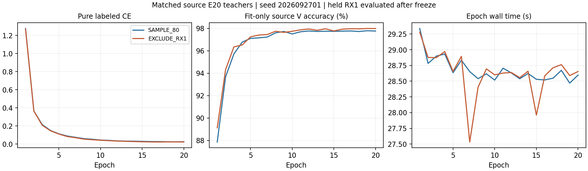

# 跨 RX 教师：等样本 E20 源域证伪结果

状态 **ANALYZED / 完整训练、冻结源 V 预测和独立产物分析 VERIFIED；预登记科学资格 FAIL**。固定 RX1 排除教师没有产生预期错误互补，因此关闭这一固定配方，不扩展五教师库、U 蒸馏或学生目标测试。完整研究目标仍 active。

| 教师 | 唯一训练 L | 训练 RX1 的 L | 末轮训练 CE | 拟合 RX 的 V 准确率 | 留出 RX1 V 准确率 | 留出错误 | 留出 CE |
|---|---:|---:|---:|---:|---:|---:|---:|
| SAMPLE_80 | 5040 | 1008 | 0.025326 | 97.768519% | 99.444444% | 30 | 0.023061 |
| EXCLUDE_RX1 | 5040 | 0 | 0.022362 | 97.990741% | 60.685185% | 2123 | 1.726076 |

两教师均从相同 seed 的完全一致 200 个初始 state 从零训练，L 总量均为 5,040，每个 TX×day 均为 280。SAMPLE_80 在 5 个源 RX 的每个 TX×RX×day 使用 56 个 L；EXCLUDE_RX1 在其余 4 个源 RX 使用原有 70 个 L。前者共使用 1,008 个 RX1 L，后者全部训练、校准、缓存和祖先均排除 RX1。两者共同的拟合 V 只含 RX3/4/6/8 共 21,600 个样本；原源 V_RX1 的 5,400 个包在固定 final20 冻结后才首次前向。L 与 V 物理角色分离，没有扩大有标签权限。

EXCLUDE_RX1 比 SAMPLE_80 净下降 -38.759259 个百分点，纠正 3 个、引入 2096 个错误；平均 CE 也明显升高。拟合 V 的准确率反而增加 0.222222 个百分点，两者末轮训练 CE 均低于 0.5。这排除了本次简单训练失败的解释，并说明较好的已见 RX 拟合表现不能代替跨 RX 证据。只对这两个固定 E20、单 seed 教师作此判断，不推广为所有交叉拟合方法无效。

| 固定 A0 门控区域 | 数量 | SAMPLE_80 准确率 | EXCLUDE_RX1 准确率 | 原 A0 EMA 准确率 | 纠正 / 引入 |
|---|---:|---:|---:|---:|---:|
| accepted | 892 | 100.000000% | 65.358744% | 100.000000% | 0 / 309 |
| rejected | 4508 | 99.334516% | 59.760426% | 99.423248% | 3 / 1787 |

原完整 BASE_SSL final20 的 ownEMA/强视图 student 在这批源 V 上重放原门控，固定拒绝 4508 个、接受 892 个。拒绝区原 EMA 准确率仍为 99.423248%；排除 RX1 教师在此区仅纠正 3 个、引入 1787 个错误。‘门控拒绝’在该源代理上主要不等于‘教师预测错误’，因此不能把拒绝数量当作等待跨 RX 教师补全的错误标签数量。该结论只适用于固定 A0 末态源 V 代理，不是实际 U 的正确率，也不代表训练早期状态。A0 权重只用于冻结重放，不是两个教师的祖先。

3 个源 day 均下降，6 个 TX 中 5 个下降、TX4 持平。TX5 从 99.888889% 降至 13.666667%，主要新增 TX5→TX4 共 567 个和 TX5→TX2 共 189 个错误；TX2→TX0 新增 436 个错误。完整 30 个真类/错类对以及 gate、day、TX 配对见 CSV，不选择局部正项挽救资格。

资格判定保持发布前条件：两者 L 健康，EXCLUDE_RX1 错误更少且 CE 不升，固定拒绝区非空且纠正大于引入。实际三个效果条件均未通过。没有阈值扫描、替换 RX、换 seed、延长轮次、换头、叠加 RDrop 或重新预测来挽救本次结果。已确认的 RDrop、CENTER25K、NONE 等正收益证据仍独立保留；本次负结果没有回写或停改任何旧训练。

独立 CPU 分析完整解析全部 8,880 条 step、40 条 epoch、两份训练 stdout 和比较 stdout，核对每步纯 CE、0 个非有限跳步、原生计数及实际角色、曝光、固定 final20 及空祖先。日志的 `a1_ema_successful_updates` 是原生成功更新计数名；实际 EMA 开关关闭、checkpoint 的 ema_model=None，不能由该计数名推断存在教师更新。主干和既有默认 W 均发生实际更新；16 个合成包前向确认部署 joint160 改变、feature-only 与 joint160 逐位相同、扰动 W 不改变 joint160。完整源 V 决定重算为 10,800 个教师预测和 5,400 个既有 A0 门控决定；本次分析新增真实 IQ 读取、优化、拟合头、checkpoint 改写和 target 访问均为 0。

两行实际成本为 40 model-epoch、8,880 次原生更新、1,136,640 次 L 训练前向；原始实验另有 10,800 次教师留出 V 前向和 10,800 次 A0 门控前向，拟合 V 的每轮前向已计入实测 epoch 时间。两行训练耗时分别 588.97 s 和 587.73 s，矩阵从首次准入至源比较完成 607.07 s。首轮各约 29.3 s，GPU0/1 每行约 2,928 MiB；全部原进程自然结束，资源已释放，未干预其他 owner。

本次是预登记的 source-only 证伪实验，未进行目标、卫星或 Phase2 测试。没有用源域结果宣称完整泛化目标完成。没有删除旧产物或重新登记同一行。后续新机制需要独立源证据，不能将本次已被否定的教师直接用于学生训练。

执行代码和固定配置提交：`73397488a1768ca783a4f2b4af1f0d911c4414fc`。完整预登记、命令、路径、一次 P0/P1 检查和启动证据见 experiment.json、review_evidence.json、launch_verification.json；独立完整复算见 results_analysis.json。
