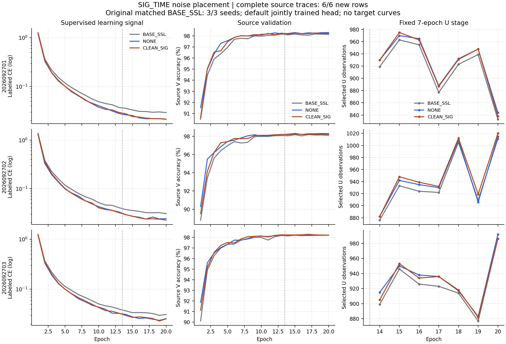

# SIG_TIME 训练噪声位置：正式默认头三种子验证

完整三seed结论：固定主方案 **CLEAN_SIG 81.309524% ± 0.940673pp**，距84%为2.690476个百分点，本轮未达标。相对匹配BASE_SSL均差+0.134722pp（2/3正）；相对NONE均差-0.136111pp（1/3正），本轮未建立签名保护分支的稳定独立增量。

| 固定clean默认头，均为3seed | accuracy mean ± sampleSD | Δ同seed BASE_SSL | Macro-F1 | 最差RX均值 | 最差day均值 |
|---|---|---|---|---|---|
| BASE_SSL | 81.174802% ± 1.077489pp | +0.000000pp | 80.728308% | 71.141667% | 77.032540% |
| NONE | 81.445635% ± 0.853798pp | +0.270833pp | 81.043313% | 71.626389% | 77.925397% |
| CLEAN_SIG | 81.309524% ± 0.940673pp | +0.134722pp | 80.836561% | 71.630556% | 77.278571% |

NONE保留明确的小幅固定基准正收益：+0.270833pp、3/3正，修正10927次错误、引入9562次，净减少1365次；此前真正源RX1留出seed02的负结果同样保留。主指标按预登记CLEAN_SIG解释；下一轮固定父仍是原BASE_SSL，不以本轮target排序选择新父。当前固定噪声位置配方收束，保留全部正负结果。

实际完成6×20epoch/26640更新、1008000条新clean决定、108项新分层指标；原BASE_SSL三seed的60epoch/13320更新与504000条既有决定另列。六行初始200state均与同seed原baseline逐项相同，完整日志与冻结评分独立复算，所属进程自然结束。默认头正常联合训练，0另训头；真实部署joint160的学习与边界检查通过。以上是已暴露固定clean基准结果，不证明未见TX、卫星或Phase2能力；84%与完整特征训练机制目标仍未完成。

发布前冻结方案与启动证据：

状态 **ANALYZED / 完整训练预测评分 VERIFIED**。下文保留预登记。完整源seed02三条件已ANALYZED/VERIFIED，固定资格{'CLEAN_SIG_primary_qualified': True, 'NONE_independent_confirmation_passed': False, 'all_source_healthy': True, 'main_run_launched': False, 'target_access': False}。本次固定arm NONE / CLEAN_SIG，主指标arm为CLEAN_SIG，每arm三个原定seed2026092701/02/03，所有row scratch20/13L+7U/4440真实更新；总6模型/120epoch/26640更新。CLEAN_SIG通过时必须保留NONE正式匹配控制，既保留正路线，也检验签名取点的独立增量；不在目标结果出来后决定要不要补控制。源资格证据见source_selection_evidence.json。本轮不继承四RX或旧全5RXcheckpoint，所有model从零。

实际L6300/U56700隐藏TX/V27000，RX1/3/4/6/8、day1/2/3、原六TX与物理角色/NoExplicitCFO及内部补偿不变。所有train/U/V/calibration都是原完整五RX，不调用fold helper。每row原U7轮396900重复观察，0额外训练IQ前向/新loss/参数/头拟合。原oldgate/ownEMA/Gaussian U/AdamW2e-4/wd1e-4/clip5/cosmin1e-6/LS0保持，无普通L或星地增强。默认头随骨干正常联合训练，不另训任何诊断头。固定FINAL学生，不用EMA或尾平均选读出。

原匹配BASE_SSL三个E20父只复用预测/评分（504000决定/54指标），原训练60epoch/13320步单列；新目标决定1008000、指标108。前置源探索两个seed各60epoch独立披露，不冒充本次训练成本。只有已完成源矩阵按固定规则确定arm，目标分数不回流选结构/父/seed/停止或重跑。

首seed所有必要arm完整训练冻结后，在源V健康上与同seed原BASE_SSL比较：final训练LCE≤.5，V drop≤1个百分点，最差源RX drop≤2个百分点；任一失败则全批0target，不改门槛。通过后逐row自动clean168000默认头预测，完整后独立新CPU scorer连接truth；第二/三个seed源健康仅报告不筛seed，训练预算/配置始终固定。最终汇总另启新CPU进程，报告每arm三seed mean/sampleSD/MacroF1/最差RX/day、逐seed修正及新增错误，若有CLEAN_SIG再与NONE逐包配对。所有结果保留，主指标不按target重排。

真实feature-only和主前向joint160相同；对原W做扰动也不改z，所有3seed/两支持mode的200初始state与原BASE_SSL逐位匹配。只证明导出边界/初始化，不替代性能证据。CLEAN_SIG只让签名读取t2.drop前、原pool后输入，不detach；主干mask/RNG保留，上游随机性仍在。签名池化和关闭失活有既有先例，当前是CVS训练噪声位置的待验机制；不宣称全球首创、未见TX或卫星/Phase2能力。最终正式目标仍是固定主arm三seed clean均值84%，尚未完成。

owner codex/root/SIGTIME-branch-noise-train20-20261015，actual Git commit以release_commit.txt固定。CWD `/home/szu2070436088/2510044040/CV-SincNet/releases/cvs_SIGTIME_branch_noise_train20_20261015_r01`，命令 `/home/szu2070436088/.conda/envs/CVS-RFFI/bin/python -u experiments/cvs_sigtime_noise_train20/runner.py experiments/cvs_sigtime_noise_train20/configs/matrix.json`，不可覆盖root `/home/szu2070436088/2510044040/CV-SincNet/runs/20261015-phase1-SIGTIME-branch-noise-e20-clean-manysig-m6-r01`。普通N607/CVS-RFFI Python，一GPU顺序pipeline，所有owner每GPU≤3，最少进程/最多空闲且>3072MiB，不停止或热改健康旧任务。一preflight/一archive SHA比较/remotecompile，每row初始真实scratch checkpoint no-query smoke PASS后直接继续；12聚焦检查、实际模型边界检查及本代码唯一独立P0/P1审查PASS，实际固定arm配置也须与生成函数逐项吻合。启动后独立PID/CWD/argv/GPU/log核验。技术停止、矩阵和路径以experiment.json为准，无额外审批或hash链。

启动独立核实：commit `0fe97397defa9c72cb238556f0facc8d56c55513`，ordinary GPU0所属PID/CWD/argv/GPU一致，所有owner进程1/3，日志增长、真实own scratch checkpoint no-query smoke PASS。首row NONE是必要对照，实际seed2026092701/LS0/13L+7U/t2p0；原完整5RX L6300/U56700hidden/V27000，无fold mask/旧权重。源资格固定主arm CLEAN_SIG，NONE独立确认失败的事实明确保留。首seed两arm健康通过前不访问target，后续自动逐row预测/新CPU评分；尚无正式结果或84%结论。

<!-- RESULTS_START -->

完整源训练6/6行，clean已预测评分6/6行；独立解析26640条连续step和120条epoch。所属进程自然结束。

| 源训练完成row | final训练LCE | V准确率 | 最差源RX | 与原baseline初始200state相等数 |
|---|---|---|---|---|
| NONE-s2026092701 | 0.02131456 | 98.303704% | 95.277778% | 200 |
| CLEAN_SIG-s2026092701 | 0.02144756 | 98.225926% | 95.388889% | 200 |
| NONE-s2026092702 | 0.02402953 | 98.303704% | 95.481481% | 200 |
| CLEAN_SIG-s2026092702 | 0.02243369 | 98.240741% | 95.314815% | 200 |
| NONE-s2026092703 | 0.02585703 | 98.200000% | 95.259259% | 200 |
| CLEAN_SIG-s2026092703 | 0.02571497 | 98.203704% | 95.351852% | 200 |

| 已完成clean row | accuracy | Macro-F1 | 错误数 | 最差RX | 最差day |
|---|---|---|---|---|---|
| NONE-s2026092701 | 82.120238% | 81.770680% | 30038 | 74.091667% | 78.285714% |
| CLEAN_SIG-s2026092701 | 82.185714% | 81.870821% | 29928 | 73.120833% | 78.626190% |
| NONE-s2026092702 | 80.485714% | 80.005625% | 32784 | 66.641667% | 77.302381% |
| CLEAN_SIG-s2026092702 | 80.315476% | 79.757463% | 33070 | 67.516667% | 76.254762% |
| NONE-s2026092703 | 81.730952% | 81.353634% | 30692 | 74.145833% | 78.188095% |
| CLEAN_SIG-s2026092703 | 81.427381% | 80.881398% | 31202 | 74.254167% | 76.954762% |

| 配对差 | seed | Δaccuracy | 修正错误 | 新增错误 |
|---|---|---|---|---|
| NONE minus BASE_SSL | 2026092701 | +0.182143pp | 3506 | 3200 |
| CLEAN_SIG minus BASE_SSL | 2026092701 | +0.247619pp | 2469 | 2053 |
| NONE minus BASE_SSL | 2026092702 | +0.543452pp | 4108 | 3195 |
| CLEAN_SIG minus BASE_SSL | 2026092702 | +0.373214pp | 3207 | 2580 |
| NONE minus BASE_SSL | 2026092703 | +0.086905pp | 3313 | 3167 |
| CLEAN_SIG minus BASE_SSL | 2026092703 | -0.216667pp | 2231 | 2595 |
| CLEAN_SIG minus NONE | 2026092701 | +0.065476pp | 2876 | 2766 |
| CLEAN_SIG minus NONE | 2026092702 | -0.170238pp | 2747 | 3033 |
| CLEAN_SIG minus NONE | 2026092703 | -0.303571pp | 2754 | 3264 |

| 配对统计 | 实际seed数 | 配对均差 | 配对差sampleSD | 正差seed |
|---|---|---|---|---|
| NONE minus BASE_SSL | 3/3 | +0.270833pp | 0.240849pp | 3/3 |
| CLEAN_SIG minus BASE_SSL | 3/3 | +0.134722pp | 0.310724pp | 2/3 |
| CLEAN_SIG minus NONE | 3/3 | -0.136111pp | 0.186876pp | 1/3 |

NONE实际3/3seed：mean=81.445635%，sampleSD=0.853798pp，相对同seed原BASE_SSL配对均差+0.270833pp，正差3/3。完整三seed。

CLEAN_SIG实际3/3seed：mean=81.309524%，sampleSD=0.940673pp，相对同seed原BASE_SSL配对均差+0.134722pp，正差2/3。完整三seed。

NONE-s2026092701：U总396900重复观察、被选观察6477.0，所有loss有限/Utruth0；F71初末参数位移10.63857，默认W位移0.60803516，正常联合训练。全部20epoch与两阶段数值保存在CSV/JSON；多次U观察不冒充不同U包覆盖。

NONE-s2026092701 单独的固定合成IQ检查：PASS，训练前后实际joint160输出L2变化20.102078；feature-only与部署joint160逐位相等=True，扰动默认W后joint160逐位不变=True。本检查仅作8个合成packet特征前向，实际IQ读取0、truth读取0、优化/拟合头/改写checkpoint均0；证明计算路径已学习及特征/头边界，不代表识别率或未见TX泛化。

CLEAN_SIG-s2026092701：U总396900重复观察、被选观察6472.0，所有loss有限/Utruth0；F71初末参数位移10.810148，默认W位移0.64027482，正常联合训练。全部20epoch与两阶段数值保存在CSV/JSON；多次U观察不冒充不同U包覆盖。

CLEAN_SIG-s2026092701 单独的固定合成IQ检查：PASS，训练前后实际joint160输出L2变化19.525664；feature-only与部署joint160逐位相等=True，扰动默认W后joint160逐位不变=True。本检查仅作8个合成packet特征前向，实际IQ读取0、truth读取0、优化/拟合头/改写checkpoint均0；证明计算路径已学习及特征/头边界，不代表识别率或未见TX泛化。

NONE-s2026092702：U总396900重复观察、被选观察6619.0，所有loss有限/Utruth0；F71初末参数位移10.446085，默认W位移0.61759595，正常联合训练。全部20epoch与两阶段数值保存在CSV/JSON；多次U观察不冒充不同U包覆盖。

NONE-s2026092702 单独的固定合成IQ检查：PASS，训练前后实际joint160输出L2变化20.504043；feature-only与部署joint160逐位相等=True，扰动默认W后joint160逐位不变=True。本检查仅作8个合成packet特征前向，实际IQ读取0、truth读取0、优化/拟合头/改写checkpoint均0；证明计算路径已学习及特征/头边界，不代表识别率或未见TX泛化。

CLEAN_SIG-s2026092702：U总396900重复观察、被选观察6652.0，所有loss有限/Utruth0；F71初末参数位移10.768182，默认W位移0.66217527，正常联合训练。全部20epoch与两阶段数值保存在CSV/JSON；多次U观察不冒充不同U包覆盖。

CLEAN_SIG-s2026092702 单独的固定合成IQ检查：PASS，训练前后实际joint160输出L2变化20.514025；feature-only与部署joint160逐位相等=True，扰动默认W后joint160逐位不变=True。本检查仅作8个合成packet特征前向，实际IQ读取0、truth读取0、优化/拟合头/改写checkpoint均0；证明计算路径已学习及特征/头边界，不代表识别率或未见TX泛化。

NONE-s2026092703：U总396900重复观察、被选观察6531.0，所有loss有限/Utruth0；F71初末参数位移10.399551，默认W位移0.71442551，正常联合训练。全部20epoch与两阶段数值保存在CSV/JSON；多次U观察不冒充不同U包覆盖。

NONE-s2026092703 单独的固定合成IQ检查：PASS，训练前后实际joint160输出L2变化19.374318；feature-only与部署joint160逐位相等=True，扰动默认W后joint160逐位不变=True。本检查仅作8个合成packet特征前向，实际IQ读取0、truth读取0、优化/拟合头/改写checkpoint均0；证明计算路径已学习及特征/头边界，不代表识别率或未见TX泛化。

CLEAN_SIG-s2026092703：U总396900重复观察、被选观察6514.0，所有loss有限/Utruth0；F71初末参数位移10.565023，默认W位移0.72063014，正常联合训练。全部20epoch与两阶段数值保存在CSV/JSON；多次U观察不冒充不同U包覆盖。

CLEAN_SIG-s2026092703 单独的固定合成IQ检查：PASS，训练前后实际joint160输出L2变化18.665386；feature-only与部署joint160逐位相等=True，扰动默认W后joint160逐位不变=True。本检查仅作8个合成packet特征前向，实际IQ读取0、truth读取0、优化/拟合头/改写checkpoint均0；证明计算路径已学习及特征/头边界，不代表识别率或未见TX泛化。

已复用的原BASE_SSL三seed源训练记录也完整解析：60epoch/13320连续step，所有数值loss有限、Utruth0，固定13L+7U、每row396900次U观察。此处是既有产物分析，不新增骨干训练；逐epoch对照见baseline_source_complete_curves.csv。

| 同seed源训练对照 | baseline final LCE | 变体 final LCE | baseline选中U观察 | 变体选中U观察 | Δ源V | Δ最差源RX |
|---|---|---|---|---|---|---|
| NONE-s2026092701 | 0.02925618 | 0.02131456 | 6409 | 6477 | +0.159259pp | +0.351852pp |
| CLEAN_SIG-s2026092701 | 0.02925618 | 0.02144756 | 6409 | 6472 | +0.081481pp | +0.462963pp |
| NONE-s2026092702 | 0.03051399 | 0.02402953 | 6580 | 6619 | +0.185185pp | +0.518519pp |
| CLEAN_SIG-s2026092702 | 0.03051399 | 0.02243369 | 6580 | 6652 | +0.122222pp | +0.351852pp |
| NONE-s2026092703 | 0.03137676 | 0.02585703 | 6471 | 6531 | -0.011111pp | +0.203704pp |
| CLEAN_SIG-s2026092703 | 0.03137676 | 0.02571497 | 6471 | 6514 | -0.007407pp | +0.296296pp |

NONE-s2026092701：启用U之前第13轮LCE为0.02805619，同seed基线为0.03721877；后续7轮选中U重复观察差为+68。这表明训练损失差异已出现在半监督阶段之前，不能只归因于接受更多伪标签；不据此断言特征迁移因果或改动后续计划。

CLEAN_SIG-s2026092701：启用U之前第13轮LCE为0.02941189，同seed基线为0.03721877；后续7轮选中U重复观察差为+63。这表明训练损失差异已出现在半监督阶段之前，不能只归因于接受更多伪标签；不据此断言特征迁移因果或改动后续计划。

NONE-s2026092702：启用U之前第13轮LCE为0.03308883，同seed基线为0.04062129；后续7轮选中U重复观察差为+39。这表明训练损失差异已出现在半监督阶段之前，不能只归因于接受更多伪标签；不据此断言特征迁移因果或改动后续计划。

CLEAN_SIG-s2026092702：启用U之前第13轮LCE为0.03197356，同seed基线为0.04062129；后续7轮选中U重复观察差为+72。这表明训练损失差异已出现在半监督阶段之前，不能只归因于接受更多伪标签；不据此断言特征迁移因果或改动后续计划。

NONE-s2026092703：启用U之前第13轮LCE为0.03300501，同seed基线为0.04027314；后续7轮选中U重复观察差为+60。这表明训练损失差异已出现在半监督阶段之前，不能只归因于接受更多伪标签；不据此断言特征迁移因果或改动后续计划。

CLEAN_SIG-s2026092703：启用U之前第13轮LCE为0.03325839，同seed基线为0.04027314；后续7轮选中U重复观察差为+43。这表明训练损失差异已出现在半监督阶段之前，不能只归因于接受更多伪标签；不据此断言特征迁移因果或改动后续计划。

选中U数是重复观察量，不能解释为独立U覆盖或伪标签正确率。源训练曲线与V仅解释已固定机制的训练行为，不回流目标选模，也不单独证明泛化提升。

完整源曲线（按seed分行，虚线后启用U；准确率轴为百分比）：

后续第三优先R-Drop的来源核对：既有阳性只来自原DRO的SIG_TIME final50/label smoothing .01首seed源梯度兼容性，未证明实际泛化训练收益。原报告指定父run `20261015-phase1-receiver-dro-oldgate-cos-e50-clean-manysig-s01-m4-r01` 的ordinary只读回读显示seed01目录/checkpoint/completion存在，seed02/03三者均不存在。原样02/03复核目前缺少指定父输入；若推进，须以已核实的固定E20父另行登记source-only诊断并披露配方差异。该核对0 IQ读取、0 checkpoint反序列化、0训练改动，仅证明指定路径可用性；不改变本矩阵候选、预算或主指标。事实见next_source_parent_availability.json。

六行全部完成，默认头固定主arm CLEAN_SIG；84%数值检查=False。完整可迁移性/创新机制目标不由单个数值或控制arm代替；goal状态另按完整要求审计。

完整产物分析读取全部训练日志、合法同契约checkpoint和已经冻结的truth-side混淆矩阵/正确性；重算18分层CM指标、分层合计和逐包配对，不新增IQ、truth读取、推理或训练。固定合成IQ特征检查另列实际前向量；不参与源健康门槛或训练选择。部分进度中的训练成本只统计已完成row，未含正在运行row的已消耗量。完整分组指标保存在results_analysis.json；默认头联合学习的变化不能直接称未见TX或丢弃W后的迁移提升。
