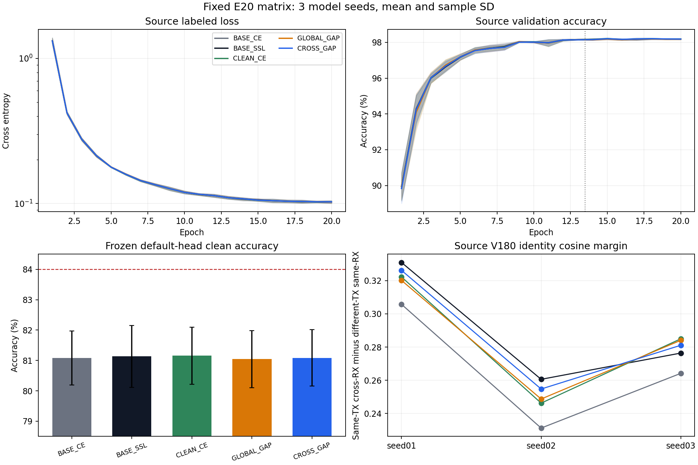

# E20 跨 RX 特征脆弱性完整结果

固定矩阵已完成 15/15 行、3 个模型种子；状态 VERIFIED。执行 commit `6693e4480ef990bc23c5021ff1440b547fe5fcaf`。每行 scratch20／4440 主更新／默认头 clean168000 决定及独立truth-last。

|方案|实际seed数|clean均值|SD（百分点）|Macro-F1|
|---|---:|---:|---:|---:|
|BASE_CE|3|81.0774%|0.8888|0.805631|
|BASE_SSL|3|81.1333%|1.0191|0.806057|
|CLEAN_CE|3|81.1573%|0.9407|0.806461|
|GLOBAL_GAP|3|81.0431%|0.9362|0.805158|
|CROSS_GAP|3|81.0853%|0.9254|0.805715|

CROSS_GAP 相对 BASE_SSL：-0.0480 个百分点。完整配对更正／引入错误见 paired_errors.csv；270个6×6混淆矩阵和300条源epoch已复算。只有完整三seed才检验84%数值门槛，本次结果为False。泛化机制结论需结合全部对照差，梯度非零和滤波器变化本身不证明识别收益。

源规则状态：EXPERIMENT_COMPLETE；原因：首seed预登记源条件通过。未启动行保留，不依据target重排、改参或选择性重跑。

全部条件保留SIG_TIME＋固定CENTER25K和原默认头联合训练。BASE_CE20L/0U，U与EMA实际关闭；其余13L＋7U，完整U曝光396900/model、旧门控ownEMA/entropy保留。普通L增强及星地训练关闭，U专用Gaussian保持。辅助仅17个部署feature参数，默认W/gain辅助梯度None，主损失正常联合训练；250scheduled/model，四actualprobe和一次真实更新核验通过。原seenL bank不称未训练holdout或未见RX。

历史CENTER/SIG_TIME正路线与全部负结果保留，不相加跨配方增益。该基准已暴露，不称新独立盲测或部署完成；不据target结果回流本矩阵。源曲线的缺测/关闭字段及nonfinite遥测计数如实保留，不把它们冒充实际loss非有限。

原预登记与发布记录如下。

---

**首seed源条件 VERIFIED／全部通过。** 五行已完成20轮／4440更新、默认头clean预测和独立truth-last，共840000决定。CROSS_GAP为250/250合法辅助调用、四个实际梯度探针活跃，GLOBAL为244/250正gap调用且四点活跃；每SSL模型完整U曝光396900，BASE_CE为0。默认头健康条件通过，后续10行按源规则继续，不使用目标成绩作扩展依据。当前仅首seed完整，尚无三seed泛化收益或84%达成结论。

**发布状态 VERIFIED，训练中。** 执行 commit `6693e4480ef990bc23c5021ff1440b547fe5fcaf`。远端compile和realcheckpoint/noquerysmoke PASS；单archiveSHA比较通过。独立回读确认首seed5行PID/CWD/cmd/GPU与日志增长，实际20轮config吻合，所有GPU总进程数未超过3。尚无冻结target结果；10行等待既定source规则，84%目标仍active。

# E20 跨 RX 特征脆弱性矩阵预登记

运行 `20261015-phase1-SIGTIME-center-crossRX-sharpness-e20-clean-manysig-m15-r01`。固定 BASE_CE、BASE_SSL、CLEAN_CE、GLOBAL_GAP、CROSS_GAP × modelseed2026092701/02/03，15 行全部从零训练20轮/4440实际更新。全部相同 SIG_TIME、固定 CENTER_25K、原6×160默认分类头联合训练，0新参数/分类头/额外真实优化步骤。BASE_CE为20L且U/EMA前向和迭代实际关闭；其余4行为13L＋7U，保留原batch_neighbor/ownEMA/entropy/cos，U TX真值隐藏。关闭普通L随机增强和星地训练，保留原U专用strongGaussian。13＋7预先固定为E20内原33＋17时序的压缩近似，不照搬超出预算的E50。历史原E20纯CE、CENTER和SIG_TIME结果保留，新匹配基线用于本矩阵的机制比较。

固定ρ=.05、coefficient=.1、eps1e−12。只选择17个部署参数张量：primarySinc/time_fuse/t1/t2/SIG_TIMEsequence_pool（除gain）。当前L每RX梯度生成detached归一方向；原seenL180（90cells×ordinal68/69）排除当前全部base_index/完整物理ID，在其他4RX计算relu(pertCE−cleanCE)，两项均对features留graph；默认W/gain/其他参数仅在辅助中detach，原主损失正常联合训练。GLOBAL用完整当前L一条方向，其余掩码相同；CLEAN用同bank额外CE；ZERO保持相同6functionalforwards成本。不是未训练holdout或未见RX测试。

前444步辅助关闭，之后every16步，共250scheduledcalls/model。缺当前/heldRX或空bank整次skip，固定5分母，采样器不改。functionalstate克隆buffer、临时eval、逐次清空并恢复参数cache，保留RNG/live模型状态。辅助加到完整nativeL＋实际U/entropy损失一次，真实优化一次。固定448/1776/3104/4432步核对feature梯度、辅助W/gainNone、同实际AdamW/moments/clip5的BvsB+aux以及唯一真实更新。记录原始完整epoch/step、额外L曝光、Sinc初末kernel、实际梯度和默认头健康。

先跑首seed5行；sourcefinal20/LCE≤.5，研究行相对本次BASE_SSL的Vmean下降≤1个百分点/worstRX≤2个百分点；scheduled250/eligible≥95%；GLOBAL/CROSS至少2个固定probe梯度活跃且positivegapcalls≥1%，才扩展另10行。仅源证据控制扩展，无target排序/调参/选择性重跑。每行冻结final20后自动clean168000默认头预测，固定后独立CPUtruth-last；18CM/row，完整15行为270CM/2520000decisions。科学条件失败保留已训练首5行及测试，剩余如实未启动。已暴露benchmark，不称新独立盲测；84%默认头三seed目标尚未达到。

代码/config唯一身份为release_commit.txt。CWD `/home/szu2070436088/2510044040/CV-SincNet/releases/cvs_SIGTIME_center_crossRX_sharpness20_20261015_r01`，普通项目Python，immutable输出 `\home\szu2070436088\2510044040\CV-SincNet\runs\20261015-phase1-SIGTIME-center-crossRX-sharpness-e20-clean-manysig-m15-r01`。发布命令 `python -X utf8 E:/type10-7/.codex_tmp/native_polyphase_runner.py experiments.cvs_crossrx_sharpness20.publish --output <local_artifacts/cvs_SIGTIME_center_crossRX_sharpness20_20261015_r01>`；逐行命令见experiment.json。唯一launchowner `codex/root/SIGTIME-center-crossRX-sharpness20-20261015`；GPU按共享容量锁分配，所有owner总进程每GPU≤3/free≥12000MB。首步聚焦协议negative＋一次合法真实checkpoint无querysmoke后直接启动；旧E50仅独立smoke使用，不进入任何训练worker。一个archiveSHA比较、remotecompile、独立PID/CWD/cmd/GPU/loggrowth核实。唯一独立P0/P1审查只覆盖下一次真实运行。只按登记的确切runowned技术失败停止，保留产物、不自动重启、不动健康旧进程。

跨RX源原型4/4通过，只证明信号可用与GLOBAL不同；仍未证明识别或泛化收益。SAM/SAGM/DISAM/DGSAM已有相关思想，当前候选的feature-only/fixedreadout/off-diagonalRX/current-packet-disjoint区别需要此消融检验。完整结果与方法依据见[机制分析](../../../analysis/phase1_crossrx_feature_sharpness_20261015.md)。不把历史CENTER与SIG_TIME增益相加。

独立 P0/P1 审查：PASS（sigtime_feature_path）。只读核对下一真实scratch20默认头训练/动态预算/完整U损失/辅助边界/唯一AdamW/源规则/15行发布/独立truth-last，未发现直接缺陷；0数据或权重字节/target指标访问，未追加重复测试或阻塞条件。本地结构核验PASS：参数总量、默认头初始权重、初始物理滤波器均保持，13＋7/U专用Gaussian=.015、BASE_CE实际U/EMA关闭、scheduled250与语法/发布入口一致。聚焦source mock更新/shadow检查和150项metadata负例PASS；真实checkpoint烟测由远端launcher首步执行。

数值证据限定：实际probe的shadow容差为1e−6×所有optimizer参数的最大绝对值，包含未参与梯度的大Hz参数，因此首seed为8.3271195。该容差过宽，不能凭PASS证明微小feature辅助增量精确落地；另seed已观察到最大shadow差约2.4e−5。一次真实AdamW计数、辅助17张量/默认W-gain梯度None、实际初末Sinc/特征变化与独立默认头测试需分别解读。保留原probe数值及判据，不热改或重跑健康任务，不新增发布阻塞。冻结后的feature-only/默认W不影响z核对作为源端结果证据，无头拟合/query。详见shadow_tolerance_limit.json。

真实冻结权重的接口核验 PASS：CROSS_GAP首seed final20，经原source proof后strict加载。在3个预定synthetic输入上，独立encoder.features的raw joint160与默认forward id_feat_joint严格相同；类别W清零或删除后z不变，恢复W后原logits严格恢复，全部feature参数/buffers不变。保留norm/gain/reference/NoExplicitCFO内部路径，没有另做feature归一化。15个synthetic网络前向，0source/U/V/queryIQ读取、0头拟合/optimizer更新；原训练产物和健康进程不变。auditcode commit `1facacabb92a520b86dddd59fcd2cb00dc95eb12`，training execution仍为 `6693e4480ef990bc23c5021ff1440b547fe5fcaf`。仅证明此真实CP的接口与W无关性，不证明新TX迁移或识别增益。见feature_boundary_evidence.json。

## 逐种子与配对结论

|方案|seed01|seed02|seed03|
|---|---:|---:|---:|
|BASE_CE|81.8054%|80.0869%|81.3399%|
|BASE_SSL|81.8667%|79.9696%|81.5637%|
|CLEAN_CE|81.9143%|80.1042%|81.4536%|
|GLOBAL_GAP|81.6827%|79.9685%|81.4780%|
|CROSS_GAP|81.6619%|80.0179%|81.5762%|

|配对|均差（百分点）|配对SD|正差seed数|更正错误|引入错误|
|---|---:|---:|---:|---:|---:|
|CROSS_GAP − BASE_SSL|-0.0480|0.1369|2/3|1398|1640|
|CROSS_GAP − GLOBAL_GAP|+0.0423|0.0598|2/3|1832|1619|
|CROSS_GAP − CLEAN_CE|-0.0720|0.1879|1/3|1492|1855|
|BASE_SSL − BASE_CE|+0.0560|0.1706|2/3|2248|1966|

CROSS_GAP为81.0853%，与84%相差2.9147个百分点。相对BASE_SSL更正1398个错误、引入1640个错误，净少判对242个；两个seed小幅正差不足以抵消首seed下降。GLOBAL_GAP、额外源CE和SSL相对纯CE的结果均如实保留；微小平均正差不能确认稳定收益。结束本版loss-gap路线，不调整rho/系数/启用时序继续追分。

SIG_TIME与固定CENTER25K此前各自正结果保留。它们的历史E50配方与本次E20/13＋7、普通L增强关闭的匹配家族不同，不相加增益，也不把历史成绩当当前同配方对照。

## 实际特征与证据边界

固定source V180：90个TX/RX/day源cell、每cell ordinal0/1，6TX/5已见源RX/3day；仅冻结后分析，不进入梯度或排序。使用真实同row initial_smoke与final20，所有checkpoint加载前均核对完整source provenance。15个模型选定17张量均真实变化，raw joint160初末RMS差约1.047至1.182。纯feature输出由部署API生成，余弦关系仅用于无拟合指标，没有改变导出，也没有训练诊断头。

|seed|BASE_SSL身份间隔|CROSS身份间隔|CROSS − SSL|
|---|---:|---:|---:|
|2026092701|0.330965|0.326208|-0.004757|
|2026092702|0.260560|0.254720|-0.005840|
|2026092703|0.276369|0.281073|+0.004703|

身份间隔为同TX/同day/跨RX平均cos减去不同TX/同day/同RX平均cos，固定1440/1800个有向关系；RX相似性超额再对照不同TX/跨RX的7200关系。source两降一升不支持一致身份结构改善；180个已见RX验证样本不证明未见RX或新TX迁移，也不用于追逐V微小准确率。

真实firstseed CP的feature-only／W清零／W删除检查PASS，保留全部feature变换与raw160输出；3个synthetic输入仅证明接口，不能替代实际识别结果。shadow全局容差8.3271195受unused Hz参数影响，过宽，既有PASS不证明微小辅助增量精确匹配；数值原记录保留。该限制不改变真实一次更新计数、源角色、默认头预测和独立CM结果。

## 下一步（最多两个动作）

1. 只做同身份跨RX分支证据重组的固定源原型：先检验真实部署分支能否产生身份保持的新组合、有效梯度及独立源特征信号；不按本轮target误差挑样本、父权重或参数。该机制是待证假设，尚未实现或发布新主训练。
2. 在下一实现中直接记录每个feature张量的真实更新，必要shadow使用实际optimizer梯度，避免混合单位的全局容差。历史训练和probe不覆盖、重跑或追溯改判。

完整实际成本：300model-epoch、66600真实更新、2520000clean决定、270CM、300源epoch；辅助extraL forward计数见result_evidence，另有180个source V读样本/5400feature观察前向与15个synthetic接口前向，0新增真实optimizer或头拟合。

以上追加结果属于同一固定矩阵的完整分析，原预登记与发布记录继续保留。

图中源loss/validation显示三seed均值和样本SD；13.5虚线为SSL固定阶段切换，BASE_CE始终L；84%虚线是未达到的研究门槛。V180身份间隔仅机制诊断，不能替代clean默认头性能或未见RX验证。
