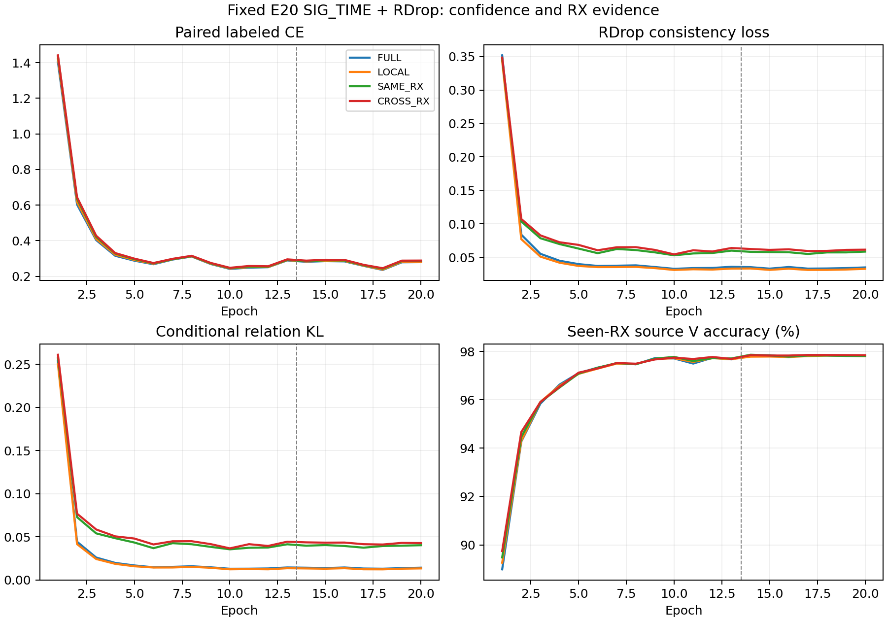

# SIG_TIME＋RDrop：置信度分离与跨 RX 混淆证据结果

**FAIL：未达到固定源域资格，关闭本次固定配方，不扩种子或访问目标。** 四组 fixed E20 已完成，完整独立核验 VERIFIED。只改变 RDrop 一致性对象与关系质量权重的梯度，SIG_TIME、默认分类头结构及联合训练、增强、U、EMA、优化器均保持原配方。

| 条件 | RX1 错误 /1260 | 准确率 | mean CE | final L CE |
|---|---:|---:|---:|---:|
| FULL | 335 | 73.4127% | 0.938535 | 0.280255 |
| LOCAL | 335 | 73.4127% | 0.908788 | 0.281640 |
| SAME_RX | 355 | 71.8254% | 0.904799 | 0.286234 |
| CROSS_RX | 364 | 71.1111% | 0.912743 | 0.289212 |

| CROSS_RX 相对对照 | 准确率差（百分点） | 修正 / 新增错误 | mean CE 差 |
|---|---:|---:|---:|
| FULL | -2.3016 | 19 / 48 | -0.025792 |
| LOCAL | -2.3016 | 17 / 46 | +0.003955 |
| SAME_RX | -0.7143 | 19 / 28 | +0.007943 |

本轮判断：跨RX关系比同RX关系多错9个、mean CE还高.007943，固定跨RX对象没有显示增益。LOCAL在错误数同为335的情况下将mean CE降低.029747，这项概率质量正向观察保留，但不作为识别收益或主方案晋级。CROSS相对FULL多错29个；CE总计下降.025792，主要由316个两组都错样本贡献−.082931抵消其余组恶化，不能把该CE下降解释成识别改善。day1/day2分别净多错20/9，day3净错误数不变。TX0/1/5分别多错15/11/9，TX2/3分别少错2/4，TX4不变。

预登记判据：所有源训练健康=True；有效配对覆盖达10%=True；最终资格=False。数据是单个固定模型seed2026092703的完全留出源RX1（1260合法L），不是目标测试。FULL为匹配原RDrop；LOCAL只分离关系权重梯度；SAME_RX和CROSS_RX再分别改变关系对象，每个有效anchor严格一个peer，两组采用同样anchor数和行列质量。没有差分投影或训练权重继承。

为区分错误率与概率质量，本次直接复用最终1260前向保存的逐包CE、真类概率和真类margin，按四种转移分解。最后一列按全体1260归一化，各组贡献之和已独立对齐总CE差；这是描述性源证据，不能单凭聚合或分组平均推断过置信、欠置信或新TX能力。

| 对照 | 样本转移 | 数量 | 对照 mean CE | CROSS mean CE | 对全体 CE 差的贡献 |
|---|---|---:|---:|---:|---:|
| FULL | 均正确 | 877 | 0.119829 | 0.186414 | +0.046345 |
| FULL | 均错误 | 316 | 3.248887 | 2.918211 | -0.082931 |
| FULL | 新增错误 | 48 | 0.619963 | 1.026621 | +0.015492 |
| FULL | 修正错误 | 19 | 1.108314 | 0.796764 | -0.004698 |
| LOCAL | 均正确 | 879 | 0.126194 | 0.187710 | +0.042914 |
| LOCAL | 均错误 | 318 | 3.100259 | 2.908542 | -0.048386 |
| LOCAL | 新增错误 | 46 | 0.667772 | 1.011221 | +0.012539 |
| LOCAL | 修正错误 | 17 | 1.032256 | 0.801539 | -0.003113 |
| SAME_RX | 均正确 | 877 | 0.160320 | 0.185445 | +0.017488 |
| SAME_RX | 均错误 | 336 | 2.856054 | 2.813045 | -0.011469 |
| SAME_RX | 新增错误 | 28 | 0.752833 | 0.937485 | +0.004103 |
| SAME_RX | 修正错误 | 19 | 0.985943 | 0.841459 | -0.002179 |

- FULL：4440 步，selected 207500 / 568320（36.5111%），transported 0，链式分解误差最大 2.38e-07；源 V 最高 97.8565%（E17），固定 E20 97.8148%。
- LOCAL：4440 步，selected 207500 / 568320（36.5111%），transported 0，链式分解误差最大 1.19e-07；源 V 最高 97.8333%（E18），固定 E20 97.8056%。
- SAME_RX：4440 步，selected 207500 / 568320（36.5111%），transported 207500，链式分解误差最大 1.19e-07；源 V 最高 97.8657%（E14），固定 E20 97.8194%。
- CROSS_RX：4440 步，selected 207500 / 568320（36.5111%），transported 207500，链式分解误差最大 2.38e-07；源 V 最高 97.8565%（E17），固定 E20 97.8472%。

全部17760步、80 model-epoch、四份stdout、八份初末CP、5040份默认头源决定和144个混淆矩阵单元已核验。原closed loss +0.5×(CE2−CE1)+实际consistency loss逐步重构最大误差2.38e-07；四组198个初态tensor逐位一致，特征与默认W均真实更新。源角色各L5040/U45360hidden/V21600，全部RX1排除；每行568320额外L身份前向、396368循环U观察，合计2273280/1585472。每行另读取1260heldL和144未使用fitL anchors；分析0额外真实IQ、0拟合头，最终核验另32合成包验证真实joint160导出边界；分析脚本旧完成标记修正前额外使用8合成包，本分析阶段共40包，0真实IQ或训练重启。TX分层指native tx_i/标签索引0至5，物理ID首列eq_i不是TX。完整默认头预测、逐包数据和CP留在原远端root，公开报告只存聚合。

执行提交`e1d244ca8048ad4d184c00a5367a785ead742a9d`，四行进程已结束，无技术失败、覆盖或重训。既有完整E50 RDrop三种子clean均值84.340079%作为历史里程碑保留。本源结果不与其跨数据口径直接比较，不增加target/星地/Phase2声明；创新机制仍需独立证据，goal继续ACTIVE。

同anchor数和单peer已匹配，但这些条件的实际KL量级及梯度范数不同，不能把结果概括成对所有跨RX关系的否定，也不通过调alpha补救本固定配方。GPU5同时承载本run的FULL/CROSS两进程，LOCAL/SAME分别位于GPU6/7；walltime只报告实际成本，不作为速度优劣证据。

下一轮最多两个优先动作：保留有已验证收益的同包RDrop目标，研究两次随机子网络的采样耦合，并保持单次dropout边际分布；任何新机制仍先取得合法源域资格，再单独固定E20/E50主实验。当前没有新采样候选的已实现或已启动声明，既有差分源识别正向证据与E50三seed84.340079%里程碑继续保留。

以下保留发布前机制、矩阵、成本与判据。

三种可执行方向：监督证据切空间投影（有通用梯度手术先例且局部约束不能保证实际 AdamW 行为，暂缓）；跨 RX 完整概率一致（可能强迫不同包置信度相同，暂缓）；本试的置信度分离与跨 RX 关系一致（优先）。新核心假设仅一个：可把自样本置信度一致与跨接收机身份混淆关系分开学习。

记 p 为六类概率，b=[p_y,1-p_y]，q 为排除真类后重新归一化的五类概率。KL 链式分解为 binary KL 加 (1-p_y)×conditional KL。本试二元项始终是同包两次 dropout 的双向 KL；关系项用各自 (1-p_y) 的停止梯度权重，交换同身份样本的 q。该关系项对真类原始 logit 的直接梯度为0，不保证训练后置信度、CE或AdamW位移不变。原 CE 与默认 W 始终正常联合训练，所有 KL 图也可更新 W；部署仍是原 joint160。

四条件：FULL 为精确原 RDrop；LOCAL 只分离关系权重梯度；SAME_RX 使用同身份同 RX 的关系；CROSS_RX 使用同身份其他 RX 的关系。每个身份选每个至少含2包的 RX 前2包，至少要有2个这样的 RX；同 RX 两包互换，跨 RX 将已选 RX 组按批内首次出现位置排序，将2M个索引中相隔M的位置配成一对（M为已选RX数）。其余样本保持自配对。每个有效anchor严格只有1个peer，两组配对均为对称置换，有效配对数量完全相同，关系矩阵行列和均为1，不抽额外随机数；数据集原生打乱决定批内顺序。RX 由实际 raw domain→compact map→rx_i 还原，并每步核对原 L batch 的 rx_i，不用domain除法猜测、不读U标签。

固定下一模型 seed2026092703，四行各从零20轮（13L+7原U）、222步/轮；不从前两源seed挑父。SIG_TIME/RAW_HZ/普通增强/LS.01/原cosine6×160/scale30/eps1e-4/AdamW lr.0002 wd.0001/旧门控自身EMA均不变。只复用增强后实际L128做第二次原生dropout前向，无增强重抽、无额外训练IQ。四RX有效角色L5040/U45360hidden/V21600，RX1在模型、U、EMA、calibration、cache和初始化中先排除，最终1260合法held L只在fixed E20读默认头。

科学资格在首次训练前固定：所有行final L CE<=.5；CROSS_RX selected anchor fraction>=10%；它在RX1的错误严格少于另外三组，mean CE均不高于对照。V只健康诊断，不选终点。PASS仅允许另行登记主实验；FAIL关闭固定配方，不扫alpha、seed、层或轮次救跑，也不访问target。

预算4×20=80model-epoch、17760更新，每行568320额外L身份前向、396368 U循环观察（物理U45360），共2273280和1585472；每行1260 held前向和1404额外L读取，其中144fit anchors未使用。另8合成包用于各own初始CP无query smoke。最终在同一次1260前向保存逐包CE、真类概率、真类margin，用于判断错误率与CE权衡，无另训头或新增评价前向。

CPU/CUDA各57负例、5资格否决、198相同初态、实际原CE/logits/RNG/增强后IQ复用、浅中层与SIG/defaultW有限非零梯度PASS；KL链式分解与原loss/gradient一致、binary项不变、关系真类raw logit梯度0、类/RX置换及配对质量守恒PASS。最终通过检查的每次调用使用每设备1024合成包，0真实IQ/CP/优化/头拟合。这些是实现检查，尚无训练收益。

最小发布：一次聚焦P0/P1；Git提交推送及远端OID；一个新root；一次ordinary N607 preflight；单archive传输SHA比较和remote compile；worker首步own CP无query smoke后继续。八卡资源锁考虑全部owner/preCUDA，每GPU最多3进程、CPU2/loader0。技术错误保留产物、停pending，不重复Popen、不杀健康或无关进程；低分不重训。原始预测、CP与日志留远端，公开报告只保留聚合。

环境ordinary N607 CVS-RFFI，CWD PROJECT/releases/cvs_SIGTIME_rdrop_RX_evidence_source20_20261015_r01；命令 CVS-RFFI/bin/python -u experiments/cvs_sigtime_rdrop_evidence20/runner.py experiments/cvs_sigtime_rdrop_evidence20/configs/matrix.json；唯一owner codex/root/SIGTIME-RDrop-RX-evidence-20261015；root PROJECT/runs/20261015-phase1-SIGTIME-rdrop-RX-evidence-sourcefold-s2026092703-m4-r01。执行commit在release_commit.txt；模型代码依赖b3ac442e2d33a5b315fb3251c30e0ad7083566bc，仅代码，不继承已评分模型。

文献边界：[R-Drop](https://arxiv.org/abs/2106.14448)已有同包双随机子模型KL；[DKD](https://arxiv.org/html/2203.08679v2)已有真类/非真类KL分解及质量权重耦合分析。本试不把该代数分解宣称为创新，具体待证贡献是平衡跨RX身份关系传输、自包二元置信度与配对质量控制，也不声称全球首创。只读原文已核实，有限检索不能排除全部先例。

发布前修正一个直接对照混杂：原草稿 CROSS 多peer平均、SAME单peer，现统一为单peer置换；发生在任何真实IQ或训练前，不改变预算/科学门槛。唯一初审PASS后仅请求该项定向复核，不重做未变全审。

独立next-run P0/P1初审PASS；单peer修复后只做一次该项定向检查PASS，覆盖2/3/4个有效RX的对称置换、身份/RX合法性、质量与RNG，无P0/P1。当前代码具备发布条件。
