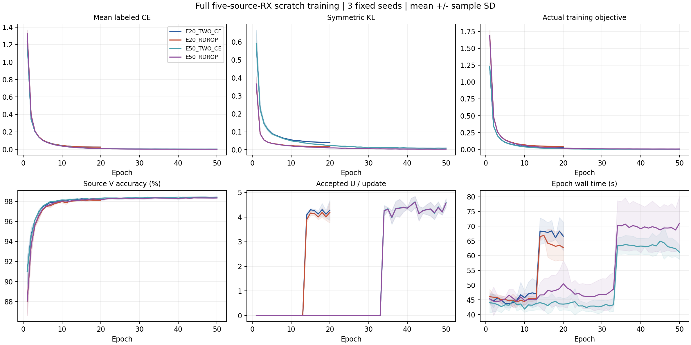

# RDrop 全源 E20 / E50 三种子预算比较

状态 **ANALYZED / 全12行训练、clean预测、独立truth-last评分与完整产物分析 VERIFIED**。E20/E50各TWO_CE和RDROP三种子，均使用从零训练后固定final默认头。目标仍active；本轮结果按以下预登记4组和4个配对完整报告，不按最高target分数换主条件。

| 条件 | seed01 | seed02 | seed03 | 均值±样本SD | 最差RX均值 | MacroF1均值 |
|---|---:|---:|---:|---:|---:|---:|
| E20_TWO_CE | 81.140476% | 80.668452% | 81.114881% | 80.974603% ± 0.265443pp | 71.119444% | 0.805352 |
| E20_RDROP | 83.493452% | 81.843452% | 82.149405% | 82.495437% ± 0.877741pp | 73.695833% | 0.821111 |
| E50_TWO_CE | 80.487500% | 80.838095% | 82.125595% | 81.150397% ± 0.862548pp | 72.723611% | 0.807393 |
| E50_RDROP | 82.282143% | 81.658333% | 82.368452% | 82.102976% ± 0.387483pp | 73.887500% | 0.817155 |

| 预登记配对 | 平均差 | 配对样本SD | 正收益种子 |
|---|---:|---:|---:|
| E20_RDROP minus E20_TWO_CE | +1.520833pp | 0.724072pp | 3/3 |
| E50_RDROP minus E50_TWO_CE | +0.952579pp | 0.784312pp | 3/3 |
| E50_TWO_CE minus E20_TWO_CE | +0.175794pp | 0.831862pp | 2/3 |
| E50_RDROP minus E20_RDROP | -0.392460pp | 0.737376pp | 1/3 |

主条件E50_RDROP clean三seed均值为82.102976%，84%检查=False；E20_RDROP预算条件为82.495437%，84%检查=False。这两项属于已暴露benchmark上的默认头验证，不证明未见TX、卫星或Phase2能力；完整研究目标未据此自动完成。

独立CPU分析完整解析12份step压缩日志的全部93240条更新、420条epoch、全部12份stdout、24份初末checkpoint、2016000个既有默认头决定和216个分层混淆矩阵。每行实际更新等于epochs×222，13L+7U/33L+17U，原始物理角色6300/56700/27000、scratch空祖先、ownEMA、固定final、headfit0均核实。全部四条件的每seed初始200state一致：{'2026092701': 200, '2026092702': 200, '2026092703': 200}。源V与L健康仅诊断，未回流择轮/配方或选择性重跑。

真实目标逐步核验：native已含CE1，实际额外项为.5(CE2−CE1)+alphaKL；最大绝对重构误差2.38e-07，全部相关损失有限。原生熵没有独立日志标量，表中`derived/original_weighted_U_entropy`是closedloss扣除CE1与weightedU后的派生量，不能当作独立观测。U真值读取0，接受数只反映覆盖量，不能推断真实U正确率。

全部模型实际特征参数和默认W均更新；96个合成packet前向进一步确认初始化至末态joint160改变、feature-only等于部署joint160逐位一致，临时扰动W不改变joint160。该分析新增真实IQ读取0、优化/头拟合0、checkpoint改写0、新target预测0；truth只在全row完整预测验证后独立读取复算。特征路径检查不等于迁移泛化证明。

总训练成本420modelepoch/93240更新/11934720额外L前向，主L前向同量、8164800次U重复观察。矩阵从首次worker准入至12行评分汇总完成墙钟2936.84s，实测吞吐14.710模型/小时；受共享GPU上其他owner负载影响，不冒称单模型独占成本。各stage/row训练与预测耗时见training_stage_cost/summary。初期12worker分散8卡、各3348MiB；所有进程自然结束，原路径完整保留，没有干预其他任务。

E20与E50差异同时包括cosine学习率终点和13+7/33+17阶段分配，因此预算效果不能解释为同一20轮轨迹继续训练。两次L前向在TWO_CE和RDROP中匹配；KL的隔离效应只读同预算配对，跨预算主条件直接比较不能替代该消融。固定alpha1/0，LS0、原生dropout、SIG_TIME/CENTER25K/默认头/旧U配方不变，没有额外候选、换头或测试反馈调参。

此前源RX1留出单seed的+5.873016pp是开展依据，不等同本轮目标泛化结论。NONE默认头E20三seed小幅正收益、CENTER25K等历史正证据和全部负结果继续独立保留；本轮没有把它们或交叉拟合教师/权重平均叠加。RDrop为已有方法，不宣称全新训练理论；创新机制仍需实际源因果/互补证据和后续完整验证。

完整训练曲线，阴影为三seed样本SD：

配置、数据权限、停止条件、逐行命令和预登记主条件见experiment.json；发布前检查/独立P0P1及启动证据保持原文件。完整统计见results_analysis.json和CSV。

<!-- ORIGINAL_SIGTIME_RECIPE_CLARIFICATION_20261015 -->
用户追问后已只读核实历史 SIG_TIME 三行与本次 E50 两条件六行的 actual_native_args、actual_feature_extractor、完整源角色数量。两者均有 SIG_TIME，但旧版实际为标签平滑0.01、普通增强开启、RAW_HZ；本次为标签平滑0、clean L、CENTER25K。旧83.0393%高于本次E50_RDROP82.1030%，本次未超过旧结果；+0.952579pp只表示当前配方内相对双CE的KL增量，不能称为胜过旧SIG_TIME，也不能把跨配方差距单独归因于RDrop。默认头结构、E50的33+17和源角色一致不能消除这些混因。新授权的[旧配方完整匹配验证](../20261015-phase1-originalSIGTIME-rdrop-e20e50-clean-manysig-m18-r01/report.md)从零训练ORIGINAL/TWO_CE/RDROP，保留E20/E50和三个seed；历史结果保留，不当作新配对控制或加载其权重。只读证据见historical_SIGTIME_recipe_comparison.json，0新IQ/预测/训练/头拟合/目标truth读取。
