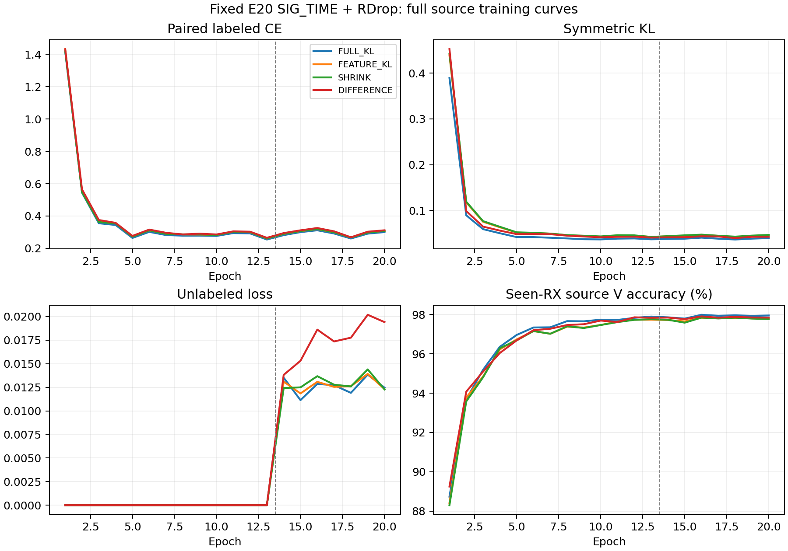

# SIG_TIME＋RDrop：差分梯度机制源 RX 留出结果

**FAIL：差分组未达到预登记源域资格，关闭本次固定算子，不扩种子或访问目标测试。** 四行均完成固定 E20，独立完整分析 VERIFIED。本轮仅改 RDrop 的 KL 反向，SIG_TIME、默认分类头结构及 CE 联合训练、增强、U、EMA、优化器和日程保持原配方。四组的前向等价指相同参数、输入和随机状态下的算子检查；训练轨迹分开后不要求损失数值相等。

| 条件 | RX1 错误 / 1260 | 准确率 | mean CE | final L CE |
|---|---:|---:|---:|---:|
| FULL_KL | 284 | 77.4603% | 0.773861 | 0.299870 |
| FEATURE_KL | 291 | 76.9048% | 0.801720 | 0.307053 |
| SHRINK | 286 | 77.3016% | 0.807683 | 0.307370 |
| DIFFERENCE | 247 | 80.3968% | 0.816843 | 0.310338 |

| DIFFERENCE 相对对照 | 准确率差（百分点） | 修正 / 新增错误 | mean CE 差 |
|---|---:|---:|---:|
| FULL_KL | +2.9365 | 58 / 21 | +0.042982 |
| FEATURE_KL | +3.4921 | 60 / 16 | +0.015123 |
| SHRINK | +3.0952 | 54 / 15 | +0.009160 |

准确率收益保留为正向线索：相对 FULL_KL，差分组修正 58 个错误、新增 21 个错误。但收益分布不均，ManySig TX 索引 2 的错误从 76 降至 30，TX 索引 5 从 57 升至 70，TX 索引 3 从 82 升至 87；day1/2/3 分别净少错 2/11/24 个。这里 TX 指原数据集 tx_i（与模型标签索引一致），不把物理 ID 的 eq_i 列误作 TX。该结果支持继续研究 RDrop 梯度作用位置，尚不足以晋级这个固定算子。mean CE 变差的具体来源未由聚合值确定。

固定资格结果：四行健康=True；差分共同梯度信号达到 1%=True；最终资格=False。这是单个预定模型种子 2026092702、一个完全留出的源 RX1、1260 个合法 L 样本的证据，不能替代多种子目标泛化结论。未查看或生成任何目标预测，未读目标 truth。

| 条件 | 输入梯度共同能量占比 | 实际输出能量减少比例 | 特征参数 L2 变化 | 默认 W L2 变化 |
|---|---:|---:|---:|---:|
| FULL_KL | 6.2013% | 0.0000% | 11.335204 | 0.875539 |
| FEATURE_KL | 6.9563% | 0.0000% | 11.481367 | 0.828152 |
| SHRINK | 7.0045% | 7.0045% | 11.447425 | 0.823411 |
| DIFFERENCE | 5.7333% | 5.7333% | 10.736540 | 0.917151 |

FULL/FEATURE 的“共同能量占比”只描述输入梯度，其输出仍保留共同分量。DIFFERENCE 的实际共同输出梯度为零；SHRINK 保留原方向并在自己的轨迹上匹配投影范数，最大相对误差 7.1e-08。这些量不能证明不同轨迹的 AdamW 参数位移匹配，也不能保证编码器均值不变。

完整解析覆盖四行 × 4440 步、四行 × 20 epoch、四份 stdout、八个 own 初末 checkpoint、四份默认头留出预测和 144 个混淆矩阵单元。损失按原 closed loss + 0.5×(CE2−CE1) + KL 重建，最大误差 2.38e-07。四组 198 个初始化 state tensor 全部逐位一致，实际特征参数和默认 W 均发生变化。每行额外 L 身份前向 568320、隐藏 U 观察 396368，合计分别为 2273280 和 1585472；U 物理样本每行为 45360，日志观察含循环重复。每行另读 1260 held L 和 144 个未使用的合法 fit L anchors。分析仅复用已固定源预测，新增 32 个合成包作特征导出检查，没有额外实际 IQ、头拟合或参数更新。

曲线摘要（峰值仅诊断，最终模型一律 E20）：

- FULL_KL：源 V 峰值 97.9907%（E16），固定 E20 为 97.9537%；E13→E14 配对 CE 0.254254→0.281480，KL 0.036847→0.037610。
- FEATURE_KL：源 V 峰值 97.8380%（E16），固定 E20 为 97.8009%；E13→E14 配对 CE 0.260363→0.288957，KL 0.042229→0.043391。
- SHRINK：源 V 峰值 97.8472%（E16），固定 E20 为 97.7685%；E13→E14 配对 CE 0.260741→0.289407，KL 0.042102→0.043826。
- DIFFERENCE：源 V 峰值 97.9074%（E16），固定 E20 为 97.8472%；E13→E14 配对 CE 0.264914→0.294165，KL 0.040647→0.041269。

逐 day/TX、配对修正/新增错误、全程损失统计及混淆矩阵见同目录 CSV，完整核验见 results_analysis.json 与 completion_verification.json。执行提交 `c4bc8ef402d9f6ab6e7b52f2043ae65f37347455`；四行进程均已退出，无技术失败或重训。旧完整 E50 RDrop 的三种子均值 84.340079% 作为历史已核实性能保留，本源实验不继承其模型、也不将两种数据口径直接比较。总目标仍 ACTIVE：84% 数值里程碑已达到，新的 RDrop 泛化机制仍需证据。

以下保留发布前的机制、矩阵、判据和成本约定。

唯一新假设：RDrop的KL同时推动W、两次特征的共同方向和随机差分；只对随机差分反传，可能更直接降低dropout敏感性。设KL到joint160的梯度g1/g2，将其替换为(g1-g2)/2与(g2-g1)/2，局部共同分量为0。它等价于对特征中心停止梯度的surrogate；不保证实际AdamW更新后中心不动。

四条件只有KL反向不同：FULL_KL原RDrop；FEATURE_KL仅在KL计算中detach W，CE仍正常joint更新原W；SHRINK把FEATURE的梯度缩至其自身差分投影范数；DIFFERENCE执行差分投影。四条件前向CE和KL逐位相同，均alpha1、普通增强后同IQ两次native dropout、LS0.01、RAW_HZ、默认cosine6×160/scale30/eps1e-4。SIG_TIME、CFO内部处理、U、ownEMA、日程和dropout率均固定。SHRINK只匹配本地feature-gradient范数，不匹配不同训练轨迹的参数位移，不能单凭此声称纯方向因果归因。

固定模型seed2026092702为既定种子序列的下一独立源种子；四行各scratch20/13L+7U/222steps，共80model-epoch、17760更新。拟训练RX3/4/6/8，有效L5040/U45360隐藏/V21600；RX1从训练、U、teacher、calibration、probe和cache均先排除，再建立模型。只在fixed final20用默认头读1260合法RX1 L。144额外fitL anchors由既有fold代码读取但不用于本试，单列成本。U为每轮56624重复观察、每行396368；物理U仍45360。总额外L前向2273280、U观察1585472、held默认决定5040；另8个合成ownCP smoke包。

预登记科学资格：四行final L CE<=.5；DIFFERENCE累计移除共同梯度能量至少1%；它在1260 held L上的错误严格少于FULL、FEATURE和SHRINK，meanCE均不高于对照。V只健康诊断，不选终点。PASS才另行登记main；FAIL关闭固定算子，不扫alpha/层/seed/配方/轮次救跑，不访问target。

CPU和CUDA检查各51负例、5资格布尔情形、1024合成identity包PASS，198初始化state匹配；原默认头logits、前向目标和native RNG逐位相同。模型浅中层/SIG/W均有CE梯度，FEATURE/SHRINK/DIFFERENCE的CE W梯度逐位相同。差分共同梯度为0；SHRINK范数相对误差CPU4.8011e-8/CUDA1.5178e-8。0真实IQ、CP加载、优化或头拟合。这不是训练收益。真实checkpoint无query smoke在每worker首步，PASS立即训练。

最小流程：一次聚焦P0/P1、实际Git提交推送及OID读回、一个新root、一次ordinary N607 preflight、单archive SHA比较和remote compile；每GPU所有owner含preCUDA最多3进程，CPU2/loader0。先留PID再有限2s观测，不重复Popen。技术错误保留产物、停pending、不杀健康或其他任务；科学低分不重训。运行代码commit写release_commit.txt。模型结构代码依赖b3ac442e2d33a5b315fb3251c30e0ad7083566bc，仅代码，不加载旧模型。

环境ordinary N607 CVS-RFFI；CWD PROJECT/releases/cvs_SIGTIME_rdrop_difference_gradient_source20_20261015_r01；命令CVS-RFFI/bin/python -u experiments/cvs_sigtime_rdrop_route20/runner.py experiments/cvs_sigtime_rdrop_route20/configs/matrix.json；唯一owner codex/root/SIGTIME-RDrop-difference-gradient-20261015；root PROJECT/runs/20261015-phase1-SIGTIME-rdrop-difference-gradient-sourcefold-s2026092702-m4-r01。逐row配置/seed/路径/命令唯一维护于experiment.json。

文献边界：[RDrop](https://arxiv.org/abs/2106.14448)已提出dropout子模型双向KL；[Fraternal Dropout](https://arxiv.org/abs/1711.00066)已约束两次pre-softmax预测差；[CR-Aug](https://arxiv.org/abs/2205.12461)已使用一致性stop-gradient。本试的具体问题是默认cosine头下，保持同KL前向，通过joint160共同/差分梯度分解和范数控制检验跨RX学习，不声明global首创。检索是有限原文核对，不是排除全部先例的证明。

预期输出包括完整step/epoch/source角色/初末checkpoint/ownEMA/冻结、route backward审计、1260默认预测和逐day/TX/配对错误。完成后独立只读完整分析；本试明确source-only，无目标clean、practical或Phase2发布。

Independent next-run P0/P1 review: PASS. No direct defects found. Scope and checked execution paths are recorded in review_evidence.json.
