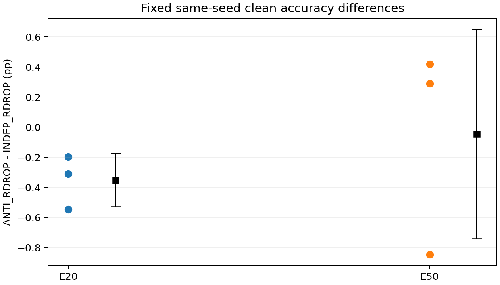
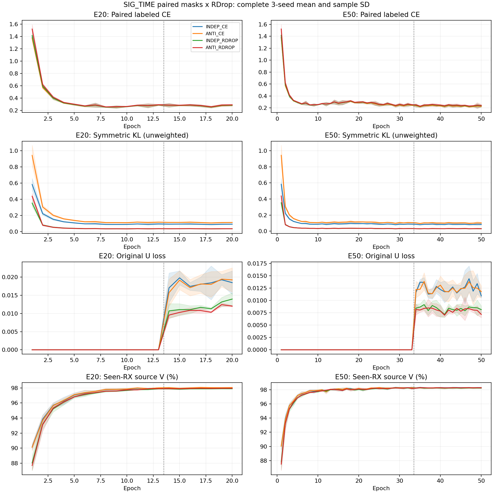

# SIG_TIME＋配对RDrop：E20/E50三种子完整结果

**FAIL：完整E50主判据未达到，关闭此固定配方，不用目标反馈调参或选择性重跑。** 本轮12次从零训练、逐row自动clean预测与独立truth-last评分均完成，独立核验VERIFIED。与12个完整匹配历史独立采样对照形成24行固定2×2比较。主结论只涉及联合默认分类头的已见TX跨RX clean泛化，不是新盲测、新TX迁移或卫星部署结论。

| 预算/条件 | seeds | 准确率均值±样本SD | MacroF1均值 | 最差RX均值 | 最差day均值 |
|---|---:|---:|---:|---:|---:|
| E20_INDEP_CE | 3 | 82.486111% ± 1.428440 pp | 81.975903% | 71.698611% | 78.400794% |
| E20_ANTI_CE | 3 | 82.050198% ± 1.162310 pp | 81.496637% | 70.822222% | 78.058730% |
| E20_INDEP_RDROP | 3 | 83.942857% ± 0.928437 pp | 83.638501% | 74.437500% | 80.541270% |
| E20_ANTI_RDROP | 3 | 83.592262% ± 0.967675 pp | 83.282758% | 73.373611% | 80.332540% |
| E50_INDEP_CE | 3 | 81.986111% ± 1.366180 pp | 81.413710% | 66.804167% | 77.692857% |
| E50_ANTI_CE | 3 | 81.575595% ± 1.374525 pp | 80.950677% | 66.181944% | 77.349206% |
| E50_INDEP_RDROP | 3 | 84.340079% ± 0.838539 pp | 83.979720% | 71.486111% | 80.319048% |
| E50_ANTI_RDROP | 3 | 84.295040% ± 1.335927 pp | 83.986626% | 72.927778% | 80.850000% |

| 条件 | seed01 | seed02 | seed03 |
|---|---:|---:|---:|
| E20_INDEP_CE | 83.049405% | 80.861905% | 83.547024% |
| E20_ANTI_CE | 82.475595% | 80.735119% | 82.939881% |
| E20_INDEP_RDROP | 82.926786% | 84.154762% | 84.747024% |
| E20_ANTI_RDROP | 82.616071% | 83.609524% | 84.551190% |
| E50_INDEP_CE | 82.655952% | 80.414286% | 82.888095% |
| E50_ANTI_CE | 82.211905% | 79.998214% | 82.516667% |
| E50_INDEP_RDROP | 83.923214% | 83.791667% | 85.305357% |
| E50_ANTI_RDROP | 83.077976% | 84.082738% | 85.724405% |

E50新配对RDrop相对原RDrop：均值-0.045040个百分点，样本SD 0.695940个百分点，正差2/3。E20对应-0.350595±0.178084个百分点，正差0/3。两预算各自同训练成本对照；E50和E20总训练成本不同，不冒充等成本。

| 主比较 | seed | 准确率差（百分点） | 修正 / 新增错误 |
|---|---:|---:|---:|
| E20 ANTI−INDEP RDrop | 2026092701 | -0.310714 | 1341 / 1863 |
| E20 ANTI−INDEP RDrop | 2026092702 | -0.545238 | 1793 / 2709 |
| E20 ANTI−INDEP RDrop | 2026092703 | -0.195833 | 1434 / 1763 |
| E50 ANTI−INDEP RDrop | 2026092701 | -0.845238 | 2030 / 3450 |
| E50 ANTI−INDEP RDrop | 2026092702 | +0.291071 | 2985 / 2496 |
| E50 ANTI−INDEP RDrop | 2026092703 | +0.419048 | 2538 / 1834 |

预登记主判据逐项：E50新RDrop均值≥84%=True；相对原RDrop均值严格正=False且至少2/3正差=True；E50平均错误交互项严格负=True。交互项为(E_ANTI_RDROP−E_INDEP_RDROP)−(E_ANTI_CE−E_INDEP_CE)，三个固定seed依次为E20：-442/703/-691，均值-143.333错误；E50：674/-1188/-1328，均值-614.000错误。交互项可由CE对照恶化驱动，不能把它当作主路线净修正量；实际修正/新增必须看上表。E20为发布前固定的次要预算比较，没有按目标成绩挑预算、模型、层或alpha。

只改变13处成对L特征dropout的联合采样：每次原p保持，第一次丢弃的位置第二次保留，U/teacher/domain/eval保持原生；原双CE均值和对称KL、alpha0/1、旧SIG_TIME/RAW_HZ/普通增强/LS.01/默认6×160 cosine头联合训练/AdamW/cosine/原U门控自身EMA不变。没有增加部署可训练参数或身份前向次数，但mask缓存与审计有额外开销，不能承诺相同墙钟时间；GPU共享负载亦不支持直接速度排序。

全部新93240步、420 model-epoch、12份完整stdout、24份新初末CP、13×12处mask审计均完成。原closed loss＋0.5×(CE2−CE1)＋alpha×对称KL逐步重构最大误差3.58e-07，无U真值或新增头拟合。每个新模型与同seed原版scratch初态一致，t1/t2/SIG及默认W均实际更新；真实joint160初末改变，feature-only逐位对齐，临时扰动W不改z。后一项证明导出边界，不能单独证明通用特征质量或新身份迁移。12行分析共96合成包，0额外真实IQ、0额外目标模型前向、0checkpoint写入。全部4032000个旧新保存决定、432同row分层、42逐seed比较及756分层配对由合法truth独立核验；原始预测与truth不进Git。

图为全部三个固定seed的源曲线均值±样本SD，不使用V最高点选模。完整每步loss统计、每轮曲线、U观察/选择量、mask边际/交集、逐seed与RX/day/TX分层、全部混淆矩阵、成本见同目录CSV及results_analysis.json。新模型使用完整源L6300/U56700hidden/V27000，E20=13L＋7U、E50=33L＋17U，固定final student；不继承4RX源折模型。旧控制的模型/日志/特征审计复用已完成原18行独立分析，实际12行来源与配置已核实，不重复训练旧对照。

成本单列：新增420 model-epoch／93240更新／11934720额外L身份前向／8164800 U观察／2016000新clean决定；旧匹配控制此前也训练420 model-epoch。比较总24行/840 model-epoch，另有源探索80 model-epoch。不能把复用历史控制称为零训练成本，也不把源探索当成父模型。每个新骨干只训练20或50轮。

本轮执行提交`0e11057172191b61470599bf5a52010bf385ab89`；源mask代码`c803f2b13e74bd6d721c3795e64cb1c12ec377cc`、原网络代码`b3ac442e2d33a5b315fb3251c30e0ad7083566bc`。所有本轮训练、预测和评分进程已结束，无健康任务重启或热修改。原版RDrop与所有正负结果保留。三seed差值是描述性证据，不自动构成统计显著性；反相关Bernoulli已有ARM/DisARM先例，不能据此宣称全球首创。研究范围继续仅SIG_TIME＋RDrop，完整目标是否达到须按本报告证据再核对，goal尚未在此自动标完成。

历史路线与本轮结果台账：

| 路线与范围 | 已核实观察 | 当前结论 |
|---|---|---|
| [Original SIG_TIME + standard RDrop E20](../20261015-phase1-originalSIGTIME-rdrop-e20e50-clean-manysig-m18-r01/report.md)；full-source/fixed exposed clean target168000,three model seeds | clean均值83.942857%，相对ORIGINAL same budget/seed +0.827183个百分点，2/3正 | POSITIVE_MATCHED_TARGET_EVIDENCE |
| [Original SIG_TIME + standard RDrop E50](../20261015-phase1-originalSIGTIME-rdrop-e20e50-clean-manysig-m18-r01/report.md)；full-source/fixed exposed clean target168000,three model seeds | clean均值84.340079%，相对ORIGINAL same budget/seed +1.418056个百分点，3/3正 | POSITIVE_MATCHED_TARGET_EVIDENCE |
| [Difference-gradient RDrop E20](../20261015-phase1-SIGTIME-rdrop-difference-gradient-sourcefold-s2026092702-m4-r01/report.md)；true held source RX1,1260 legalL;not target | 相对FULL_KL +2.936508个百分点，错误-37，CE +0.042982 | SOURCE_FAIL_FIXED_RECIPE_CLOSED |
| [Cross-RX conditional-evidence RDrop E20](../20261015-phase1-SIGTIME-rdrop-RX-evidence-sourcefold-s2026092703-m4-r01/report.md)；true held source RX1,1260 legalL;not target | 相对FULL -2.301587个百分点，错误+29，CE -0.025792 | SOURCE_FAIL_FIXED_RECIPE_CLOSED |
| [Paired masks RDrop source screen E20](../20261015-phase1-SIGTIME-rdrop-paired-masks-sourcefold-s2026092701-m4-r01/report.md)；true held source RX1,1260 legalL;not target | 相对INDEP_RDROP +0.396825个百分点，错误-5，CE -0.029638 | SOURCE_PASS |
| [Paired masks RDrop full-source E20 E20](E20_summary.md)；fixed exposed clean target168000,three model seeds | clean均值83.592262%，相对INDEP_RDROP same budget/seed -0.350595个百分点，0/3正 | NEGATIVE_VS_STANDARD_RDROP |
| 配对RDrop E50完整主验证；目标clean，3种子，每行168000 | clean均值84.295040%，相对原RDrop -0.045040个百分点，2/3正 | 主条件FAIL，关闭固定配方 |

源折结果仅与各自同row控制比较，不跨seed或数据口径合并。标准RDrop的既有正收益与已关闭机制的全部观察均保留；本候选的源筛选成本80 model-epoch不包含此前其他关闭假设的成本。

E20源日志的KL、CE和U接受量描述性对照另见[source_diagnostics_E20.md](source_diagnostics_E20.md)，不用于改变本轮方案。

以下保留发布前的机制、固定矩阵、预算与判据。

本试不新增假设，固定使用13处原生p的“不重复丢弃”配对：第一视图已丢弃位置第二视图必保留，其他位置以p/(1−p)丢弃，每次边际失活率保持p；只作用成对L。U、teacher、domain与eval保持原生，真实增强后L128复用，不重抽增强。原双CE均值和对称KL不变，CE对照alpha0、RDrop alpha1。具体数学与实际13处位置见[源域结果](../20261015-phase1-SIGTIME-rdrop-paired-masks-sourcefold-s2026092701-m4-r01/report.md)，直接复用其代码提交`c803f2b13e74bd6d721c3795e64cb1c12ec377cc`。

| 条件 | E20三种子 | E50三种子 | 本轮动作 |
|---|---|---|---|
| INDEP_CE | 原TWO_CE | 原TWO_CE | 复用6个完整历史产物 |
| ANTI_CE | 3次从零 | 3次从零 | 新增6个模型 |
| INDEP_RDROP | 原RDROP | 原RDROP | 复用6个完整历史产物 |
| ANTI_RDROP | 3次从零 | 3次从零 | 新增6个模型 |

固定模型seed2026092701/02/03；E20=13L＋7U、E50=33L＋17U，每轮222步、独立从零，不把E20当E50的中间checkpoint。恢复完整源RX1/3/4/6/8与day1/2/3，L6300/U56700hidden/V27000。源折checkpoint的RX训练集合不一致，禁止拿来初始化、教师或EMA。默认6×160 cosine头scale30/eps1e−4与骨干原流程联合训练；RAW_HZ、普通增强、LS.01、batchL128/U256、AdamW lr.0002/wd.0001、cosine、原门控自身EMA、NoExplicitCFO均不变，不另训头。

历史12行已对当前实际config、native args、物理角色和完整预测/评分产物只读匹配VERIFIED；三行来自历史技术恢复root，其余原root，详见historical_input_verification.json与登记reused_fixed_rows。历史原run不完整/观察失败记录仍保留，按实际row定位合并，不覆盖。输入核验未读目标IQ、truth或分数值、未加载模型；复用的是完整固定结果，不从这些模型继承参数。历史原SIG_TIME不加RDrop的对照及全部负结果仍保留在原报告。

所有12行固定终轮冻结student checkpoint，V只作健康诊断。每row冻结后同worker自动clean默认头逐包预测168000个既有物理样本，不等其他row；该row全部clean预测写完后，新CPU进程才连接独立truth评分。只测clean，星地工作后置；既有VALIDATED_ONCE clean capsule、物理ID、split和六TX映射复用。没有新盲测、新TX、卫星或Phase2声明。target结果不会改变任何健康训练、参数、剩余seed、停止规则或选模。

主判据发布前固定：E50_ANTI_RDROP三seed clean均值≥84%；相对同预算原INDEP_RDROP均值严格为正且至少2/3 seed正差；E50三seed平均错误交互项(E_ANTI_RDROP−E_INDEP_RDROP)−(E_ANTI_CE−E_INDEP_CE)<0。E20是预算比较，不根据目标分数挑预算或改配方。完整报告逐seed配对差、样本SD、正差种子数、MacroF1、最差RX/day、修正与新增错误、源曲线和掩码审计。旧预测未保留目标CE，不补做不对称目标CE前向。

成本：新增12次从零，共420 model-epoch、93240更新、11934720额外L身份前向、8164800 U观察、2016000新clean决定/216同row指标。复用12个控制此前也花费420 model-epoch，比较总24行/840 model-epoch/4032000决定/432指标；另单列已完成源探索80 model-epoch，不混作父训练或隐藏。每个新模型骨干仅20或50轮。首步own初始CP无query smoke共24合成包，预测前另24合成包；CPU/CUDA局部检查各1024合成包，0真实IQ/CP/优化/头拟合。

CPU/CUDA各144协议负例、4资格否决、198相同初始张量、真实t1/t2/SIG/defaultW有限非零梯度PASS。复用已验证原算法，不重做不变掩码全套检查。一次主验证新增接线P0/P1审查、实际Git提交与远端OID、一个immutable root、一次ordinary N607 preflight、一个archive的本地/远端SHA比较、remote compile、首步own CP smoke后立即训练，之后核验PID/CWD/argv/GPU与日志增长。无额外权限链或门槛。

环境ordinary N607 CVS-RFFI；CWD PROJECT/releases/cvs_SIGTIME_rdrop_paired_masks_main20_50_20261015_r01；命令`CVS-RFFI/bin/python -u experiments/cvs_sigtime_rdrop_masks_main/runner.py experiments/cvs_sigtime_rdrop_masks_main/configs/matrix.json`；root PROJECT/runs/20261015-phase1-SIGTIME-rdrop-paired-masks-e20e50-clean-manysig-m12-r01；唯一owner `codex/root/SIGTIME-RDrop-paired-masks-main-20261015`。全部owner/preCUDA计入每GPU最多3实验进程，CPU2/worker、loader0，scorer的CUDA为空。技术失败保存产物并停pending，不杀健康/其他owner，不自动重复Popen。低分不重训。代码/config身份在release_commit.txt，初末CP、原始日志/逐包数据留远端，不进Git。

本次目标仍是验证一个具体RDrop训练机制能否稳定改善实际联合特征与默认头泛化。反相关Bernoulli本身已有ARM/DisARM先例，配对覆盖假设不等于降低非线性梯度方差，也没有匹配KL或AdamW位移；有限文献检索不支持全球首创声明。
