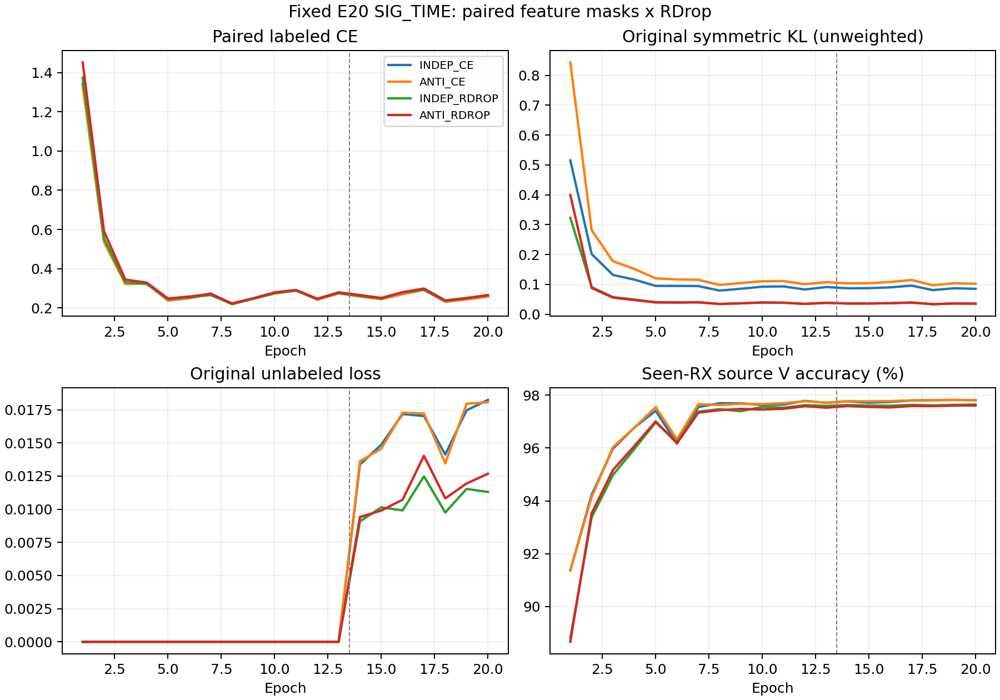

# SIG_TIME＋RDrop：双视图失活配对结果

**PASS：达到固定源域资格，允许另行登记主实验。** 四组 fixed E20 已完成，完整独立核验 VERIFIED。本试改变成对L的13处特征dropout掩码关联；每次失活率和原始双CE/对称KL公式保持。SIG_TIME、默认头结构及联合训练、增强、U、EMA、优化器按原配方执行。

| 条件 | RX1 错误 /1260 | 准确率 | mean CE | final L CE |
|---|---:|---:|---:|---:|
| INDEP_CE | 284 | 77.4603% | 0.790681 | 0.260264 |
| ANTI_CE | 319 | 74.6825% | 0.845898 | 0.259054 |
| INDEP_RDROP | 192 | 84.7619% | 0.631321 | 0.265341 |
| ANTI_RDROP | 187 | 85.1587% | 0.601683 | 0.266929 |

| ANTI_RDROP 相对对照 | 准确率差（百分点） | 修正 / 新增错误 | mean CE 差 |
|---|---:|---:|---:|
| INDEP_CE | +7.6984 | 109 / 12 | -0.188998 |
| ANTI_CE | +10.4762 | 142 / 10 | -0.244215 |
| INDEP_RDROP | +0.3968 | 21 / 16 | -0.029638 |

预登记判据：所有源训练健康=True；错误交互项为-40，要求严格小于0；ANTI_RDROP对三组都少错且CE不升=True；最终资格=True。交互项为(E_ANTI_RDROP−E_INDEP_RDROP)−(E_ANTI_CE−E_INDEP_CE)。这是一组固定seed2026092701、完全留出源RX1的1260合法L决定，不是目标测试，不能据此宣称新目标成绩或统计显著性。CE对照仍保留旧U机制。

- INDEP_CE：13处各4440次配对，融合层第一/第二失活率0.450013/0.449909，双重丢弃率0.202476，不一致率0.494969；源V固定E20 97.8102%。
- ANTI_CE：13处各4440次配对，融合层第一/第二失活率0.450013/0.449901，双重丢弃率0.000000，不一致率0.899914；源V固定E20 97.8102%。
- INDEP_RDROP：13处各4440次配对，融合层第一/第二失活率0.450013/0.449909，双重丢弃率0.202476，不一致率0.494969；源V固定E20 97.6481%。
- ANTI_RDROP：13处各4440次配对，融合层第一/第二失活率0.450013/0.449901，双重丢弃率0.000000，不一致率0.899914；源V固定E20 97.6111%。

全部13处边际失活率与原p差≤.005，anti双重丢弃计数严格为0，缓存每对清空；完整52条site汇总见mask_audit.csv。负相关掩码只改变视图覆盖，不保证非线性梯度方差、KL强度或实际优化器位移相同。未测量的梯度方差不得作为收益解释。

为区分错误率与概率质量，复用最终1260前向保存的逐包CE，按四种转移分解。最后一列按1260归一化，贡献和已独立对齐总CE差；这些描述性均值不单独证明过置信或欠置信。

| 对照 | 样本转移 | 数量 | 对照 mean CE | ANTI_RDROP mean CE | 对全体 CE 差的贡献 |
|---|---|---:|---:|---:|---:|
| INDEP_CE | 均正确 | 964 | 0.139234 | 0.127767 | -0.008773 |
| INDEP_CE | 修正错误 | 109 | 1.331007 | 0.594551 | -0.063709 |
| INDEP_CE | 均错误 | 175 | 4.054104 | 3.188869 | -0.120172 |
| INDEP_CE | 新增错误 | 12 | 0.624064 | 1.007982 | +0.003656 |
| ANTI_CE | 均正确 | 931 | 0.143032 | 0.115682 | -0.020209 |
| ANTI_CE | 修正错误 | 142 | 1.435385 | 0.565305 | -0.098057 |
| ANTI_CE | 均错误 | 177 | 4.080624 | 3.164571 | -0.128684 |
| ANTI_CE | 新增错误 | 10 | 0.657328 | 1.001879 | +0.002735 |
| INDEP_RDROP | 均正确 | 1052 | 0.163707 | 0.164378 | +0.000560 |
| INDEP_RDROP | 均错误 | 171 | 3.438653 | 3.232513 | -0.027976 |
| INDEP_RDROP | 修正错误 | 21 | 1.009328 | 0.716525 | -0.004880 |
| INDEP_RDROP | 新增错误 | 16 | 0.877410 | 1.086762 | +0.002658 |

全部17760步、80 model-epoch、四份stdout、八份初末CP、5040份默认头源决定与144个混淆矩阵单元核验完成。原closed loss＋0.5×(CE2−CE1)＋alpha×原对称KL逐步重构最大误差2.38e-07；alpha为CE两组0、RDrop两组1。四组198个初态tensor逐位一致，特征与默认W均实际更新。源角色各L5040/U45360hidden/V21600，held RX1全路径先排除；每行568320额外L身份前向、396368循环U观察，合计2273280/1585472。每行另读取1260held L和144未使用fit L anchors；分析0额外真实IQ/另训头，另32合成包验证实际joint160特征导出不依赖默认W。TX分层指native tx_i/标签索引0至5，物理ID首列eq_i不是TX。原始预测、CP、日志留原远端root，公开产物只存聚合。

执行提交`c803f2b13e74bd6d721c3795e64cb1c12ec377cc`，四行进程已结束，无技术失败、覆盖或重训。历史原版E50 RDrop三种子clean均值84.340079%保留，与本次不同数据口径不直接横比。当前只继续SIG_TIME＋RDrop机制研究，goal仍ACTIVE。

因子作用均为“前者减后者”：配对方式比较ANTI−INDEP；RDrop作用比较RDROP−CE。交互项必须严格负，同时仍要满足主条件对三组的错误数和CE要求，不能只据单个正差称机制有效。

| 因子作用 | 错误数差 | 准确率差（百分点） | mean CE差 |
|---|---:|---:|---:|
| 配对方式：双CE | +35 | -2.7778 | +0.055217 |
| 配对方式：RDrop | -5 | +0.3968 | -0.029638 |
| RDrop：独立采样 | -92 | +7.3016 | -0.159360 |
| RDrop：不重复丢弃 | -132 | +10.4762 | -0.244215 |

需要保留的限制：新配对相对原RDrop的直接增益只有5/1260，即+0.3968个百分点，修正21个、引入16个错误；交互项−40主要由双CE恶化35个与RDrop改善5个共同形成，不能把它当作主路线净少错40个。第3天多错6个，TX索引0多错7个，收益并不均匀。默认头的平均真类margin从3.70794降到3.00541，mean CE却降低，说明单个margin均值也不能替代逐包损失与错误转移。此结果只支持继续验证，不支持统计显著性、目标性能提升或机制已定论。

本seed/fold达到固定资格。下一步可另行预登记E20/E50三种子主验证，当前尚无新目标结果，fold checkpoint不得用作全源域初始化。

以下保留发布前假设、矩阵、成本、实现检查与判据。

假设：独立 dropout 会在两次前向中同时丢弃部分身份坐标；固定每次失活率，改用不重复丢弃的配对，可能让一致性约束覆盖更互补的特征证据。它也可能制造过强的视图差异，妨碍真实身份学习，因此必须与原版直接比较。可选的连续相关性扫描会引入额外调参；本次只固定一个边界方案并做2×2消融。

第一视图保留原生 Bernoulli dropout。第二视图：第一视图已丢弃的位置一定保留，其他位置以p/(1−p)丢弃；所有13处p<.5，故每个视图边际失活率仍为p，双重丢弃率为0。融合p=.45时独立双重丢弃率理论为20.25%，本方案为0；两视图不一致率从49.5%变为90%。这不是完全相反的两个掩码，也不保证非线性梯度方差更低、KL强度相同或AdamW更新长度相同。

实际13处身份路径为t1/t2/t3（.1）、f1/f2/f3（.05）、freq_stats_proj（.1125）、pa_b1/b2/b3（.08）、pa_proj/pa_stats_proj（.1125）、fuse（.45），包含浅中层与最终融合。仅成对L前向启用；domain骨干、原U、教师、V、推理均使用原生dropout。每处每次仍只消耗一次原生失活随机抽样，增强后的实际L128不重抽；两次结束后掩码缓存立即清空。无新增可训练参数、无优化器额外步、无头拟合。

| 条件 | 第二视图采样 | KL系数 | 损失 |
|---|---|---:|---|
| INDEP_CE | 独立 | 0 | 两次CE均值＋旧U |
| ANTI_CE | 不重复丢弃 | 0 | 两次CE均值＋旧U |
| INDEP_RDROP | 独立 | 1 | 两次CE均值＋原对称KL＋旧U |
| ANTI_RDROP | 不重复丢弃 | 1 | 两次CE均值＋原对称KL＋旧U |

原SIG_TIME、RAW_HZ、普通增强、LS=.01、原6×160 cosine默认头scale30/eps1e-4、AdamW lr.0002/wd.0001、cosine日程、旧门控自身EMA保持。默认头与骨干照原流程联合训练。CE对照不是纯CE基线：它仍保留本次旧SIG_TIME的U机制。四行均从零E20（13L＋7U），固定第一预定义seed2026092701，222步/轮；不选择历史源域checkpoint、不拿RX1训练。

有效fit RX3/4/6/8的L5040/U45360hidden/V21600；RX1在模型、U、教师、calibration、cache和初始化前排除。最终1260合法held L仅fixed final20后用checkpoint内默认头预测一次，并同时保存逐包CE、真类概率、margin，供同row分析；无target或另训诊断头。每行144个fit L anchors由复用helper读取但未用于训练。source V只健康诊断。

科学资格固定：所有行final L CE≤.5；ANTI_RDROP在held RX1错误数严格少于另外三行且mean CE均不高于对照；错误交互项(E_ANTI_RDROP−E_INDEP_RDROP)−(E_ANTI_CE−E_INDEP_CE)<0。后一条避免把单纯双CE采样收益当作RDrop改进。实际13处边际失活率与原p差≤.005，anti双重丢弃严格0，计数与真实4440步一致且缓存为空。PASS仅允许另行登记主实验；FAIL关闭固定配方，不扫耦合、层、alpha、种子或轮次救跑，不接触target。

预算4×20=80 model-epoch、17760更新；每行568320额外L身份前向、396368循环U观察，四行2273280及1585472；held决策5040。另8合成包用于own初始CP无query smoke。每设备最终实现检查1552合成包和每种p的262144掩码元素，0真实IQ/CP/优化/头拟合。此前本地失败诊断不作为性能证据。

CPU/CUDA各58协议负例、5资格否决、198相同初始张量、实际增强IQ复用、浅中层与SIG/defaultW有限非零梯度、掩码边际与缓存清空、U/eval原生行为、教师控制器隔离PASS。独立采样的输出/损失/RNG逐位复现；CPU梯度逐位一致。GPU原版自身重复有约4.47e−8归约波动，最终对照梯度最大绝对差4.47e−8、相对范数<2.76e−7，通过atol1e−7/rtol1e−5且relativeNorm<1e−6；不声称GPU全网梯度逐位一致。

最小发布只执行一次聚焦P0/P1、实际Git提交与远端OID、一个新root、一次ordinary N607 preflight、单archive传输SHA比较、remote compile、worker首步own CP无query smoke后立即继续。全部owner及preCUDA计入每GPU≤3、CPU2/loader0；技术错误保留产物并停pending，不自动重发Popen，不杀健康或无关进程。科学低分不重跑。原始CP、日志与逐包预测不进Git。

环境ordinary N607 CVS-RFFI，CWD PROJECT/releases/cvs_SIGTIME_rdrop_paired_masks_source20_20261015_r01；命令 `CVS-RFFI/bin/python -u experiments/cvs_sigtime_rdrop_masks20/runner.py experiments/cvs_sigtime_rdrop_masks20/configs/matrix.json`；唯一owner `codex/root/SIGTIME-RDrop-paired-masks-20261015`；root `PROJECT/runs/20261015-phase1-SIGTIME-rdrop-paired-masks-sourcefold-s2026092701-m4-r01`。实际提交写release_commit.txt；原模型代码依赖b3ac442e2d33a5b315fb3251c30e0ad7083566bc，仅代码复用，不继承训练状态。预期产物见experiment.json。

文献边界：[R-Drop](https://arxiv.org/abs/2106.14448)已有同包双随机子模型对称KL；[ARM](https://arxiv.org/abs/1807.11143)与[DisARM](https://arxiv.org/abs/2006.10680)已有用于随机二元变量梯度估计的反相关采样。不能把反相关Bernoulli本身宣称创新。本试待证点是固定失活率的成对特征覆盖如何影响RDrop泛化；不声称全球首创，有限检索不能证明不存在相同先例。

<!-- INDEPENDENT_REVIEW -->
一次独立next-run P0/P1审查PASS：掩码阶段与缓存、原生反向、教师deepcopy、U/eval隔离、四行配置、RX1全路径源折与默认头、启动依赖、不可变输出、全部owner共享cap3准入。未重跑全套检查，未增加发布门槛。
