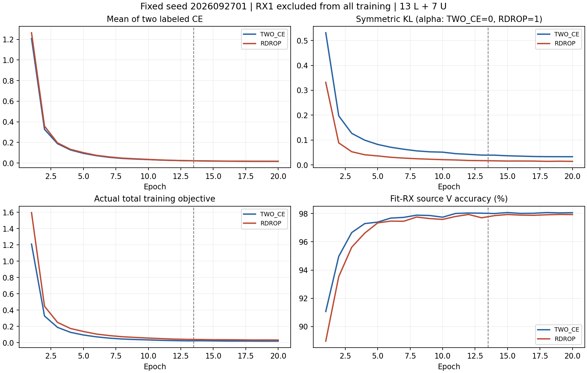

# R-Drop 真正 RX1 留出训练证伪

状态 **ANALYZED / 完整源训练与独立产物分析 VERIFIED；科学资格 PASS**。固定 seed2026092701 的真正 RX1 留出训练已完成。RDROP 相对匹配 TWO_CE 的准确率差 +5.873016 个百分点，meanCE差 -0.335138417；修正 104 次错误、引入 30 次。两组各1260相同未参与训练的合法 RX1 L 包、均使用原联合训练的默认头。

| 固定 FINAL 默认头 | RX1 准确率 | RX1 错误数 | RX1 meanCE | final pairedCE | final KL | 单行墙钟 |
|---|---:|---:|---:|---:|---:|---:|
| TWO_CE | 69.285714% | 387 | 1.492366164 | 0.016669676 | 0.033100051 | 917.04 s |
| RDROP | 75.158730% | 313 | 1.157227747 | 0.016357354 | 0.014533960 | 926.68 s |

本轮通过预登记单 seed 训练资格，只允许另行登记独立 source seed 确认；尚未进入三 seed/全五 RX/target 正式实验。

实际完成2×20epoch/8880连续优化更新、两组各568320额外L identity packet前向（共1136640，主L前向同量）、各396368次U重复观察、各1260 held-L最终前向及2合成CP smoke packet。独立分析完整读取8880条step、40条epoch、两份初末CP和两份1260默认预测；200state初始匹配数为200，末态均有实际特征与默认W更新。所有U真值读取0，另训头/拟合头0，target访问/预测/评分0。父模型训练没有继承，本轮两组均从零。

CPU2分析复算全部损失、实际目标公式、源角色/继承边界、RX1物理包覆盖、配对错误及day/TX分层。实际总目标与 mean两CE+alphaKL+原U项最大绝对误差：TWO_CE=1.19e-07，RDROP=2.38e-07。源V只诊断；资格完全按发布前固定FINAL规则。完整数值见CSV/JSON。

另做16个固定合成packet特征前向：两模型实际joint160从初始化到训练后均变化，feature-only与部署joint160逐位一致，临时扰动默认W后joint160逐位不变。0真实IQ读取、0优化/头拟合/CP改写。该检查证明已学习计算路径及特征/头边界，不证明未见TX迁移或识别率。

两行分别GPU0/1并行，发布后独立PID/CWD/argv/GPU/log增长已核实，实测各约2950MiB；所属worker与dispatcher自然结束，完整stdout无fatal、两row/root完成产物一致。矩阵墙钟931.63s，完成吞吐7.728模型/小时（仅本两行，非八卡饱和吞吐）。其余空卡未保留或填充未经授权任务，未停止/重启/热修改任何其他owner。

此前 NONE 正式三 seed +0.270833 个百分点正收益与所有负结果继续保留。最新跨 RX 交叉拟合教师为独立来源机制，peer 当前 E50/不同标签子集结果不能冒充本 E20 对照或直接成为本侧学生父权重；首轮纠正−破坏和拒绝区域风险结果仍待独立核实。R-Drop不与该教师、权重平均或噪声位置组合。84%与完整创新/泛化目标仍未完成。

<!-- MECHANISM_OBSERVATIONS -->
机制观察：final pairedCE 两组接近（TWO_CE 0.016669676，RDROP 0.016357354），但随机两次输出 KL 从0.033100051降至0.014533960，降低56.091%。RDROP 接受的U重复观察为7797，对照8035，减少238；该源折收益没有伴随接受量增加，U真值仍不可见，不能据此推断伪标签精度或单独归因因果。fit-V准确率反而下降0.134259个百分点，最差fit-RX下降0.277778个百分点；保留这项代价，不按V选择终点。

三个held day均改善，分别净少21、12、41次错误。类别收益不均匀：TX索引0和5分别净少32、43次错误，TX索引1新增5次错误；TX索引5即使改善后也只有31.428571%准确率。不得将总体阳性说成所有TX都更好。源RX1折已有历史研究使用，本次从零且无全源继承，但不声称新的独立盲测。

复算读取器首次遇到原生未单独记录的entropy字段后停止，尚未进入模型/CP分析。修正后以保存的原closed loss加 .5*(CE2−CE1)+alphaKL 直接复核实际总目标；weighted U entropy只作明确标注的派生量。训练/预测没有重跑，原产物保持。

完整源训练曲线（竖虚线之后启用原U阶段）：

发布前冻结方案与启动证据：

状态 **RUNNING / 两行启动 VERIFIED**。三个原 BASE_SSL E20/LS0/clean L 源梯度父均通过后，用固定 seed2026092701 检验真实训练收益。TWO_CE 和 RDROP 均从零 E20，使用原 SIG_TIME/CENTER25K、默认 cosine6×160 scale30，默认头正常联合训练。不会继承全源或四 RX 权重，不组合 NONE/CLEAN_SIG、权重平均或交叉拟合教师。

两组都对同一 clean L128 做两次原生随机 dropout 前向。目标为 mean(CE1,CE2)，RDROP 独立加 alpha1 对称 KL，两个概率均可微、LS0；原 native 已有 CE1，hook 加 .5*(CE2−CE1)+alphaKL，避免双计数。原日志 CE1 与真实 pairedCE/KL 分开记录。固定 alpha1、全部4440步启用，不扫描系数或按暴露 target 调整。R-Drop 是[已有方法](https://proceedings.neurips.cc/paper/2021/hash/5a66b9200f29ac3fa0ae244cc2a51b39-Abstract.html)，本轮检验 CVS 中的训练效力，不宣称其全球创新。

复用 VALIDATED_ONCE 原载体角色与 split；在任何模型/教师构建之前，将 RX1 从 L/U/V、校准、probe/cache 的实际输入全部排除，保留静态域编号。fit RX3/4/6/8：L5040/U45360 hidden TX/V21600，六 TX 全覆盖。原 helper 读取144个 fit-L anchor 后丢弃；1260个 RX1 L 保存为固定 FINAL 评价，仅训练冻结后前向。V 只诊断，不参与梯度。0 target IQ/truth/prediction。没有继承全源教师或缓存来泄漏 RX1。

每组 scratch20/4440实际更新，13轮 L +7轮原 oldgate U/ownEMA，lr0.0002/weight decay0.0001、cosine、batch128、L无信道增强，U原配方保持。每组新增568320次 L identity packet前向，L主前向同量；396368次 U重复观察，1260 held-L final前向和2合成 smoke packet另计。两组总40 modelepoch/8880更新，不把同更新预算说成同一次前向成本。独立教师/跨RX教师路线不与本轮混合。

科学门槛：两组源健康（final训练CE1≤0.5），RDROP 在1260 held-L上的错误数严格少于 TWO_CE，meanCE不更高。只读固定 final20 默认头，不读EMA/平均权重或择轮。PASS 只允许另行登记独立 source seed 确认；FAIL 收束固定配方，不救援调参。当前不发布全五RX/三seed/target矩阵。技术失败保留所有产物并停止未启动行，无自动重跑；健康已启动行和其他 owner不受干预。

ordinary N607/CVS-RFFI；CWD `PROJECT/releases/cvs_SIGTIME_rdrop_sourcefold_train20_20261015_r01`；命令 `CVS-RFFI/bin/python -u experiments/cvs_rdrop_fold20/runner.py experiments/cvs_rdrop_fold20/configs/matrix.json`；owner `codex/root/SIGTIME-rdrop-sourcefold-20261015`；不可覆盖root `PROJECT/runs/20261015-phase1-SIGTIME-rdrop-sourcefold-s2026092701-m2-r01`。CPU dispatcher CUDA为空，两个独立就绪row至多并行2张卡，按空闲优先考虑全部8卡。在既有 `PROJECT/runs/receiver_residual_capacity4.lock` 内读所有owner的GPU和pre-CUDA占用、选卡、Popen并记录。每GPU总进程≤3，空余≥12000MiB；计划估计每row约3GiB并非实测承诺，实测占用/耗时另报告。每worker CPU2/workers0。用户三方协调已经查看另外两对话队列；urban方负责首轮跨拟合教师，不重复训练，新路线方RDrop将按实际来源/契约去重。不会为填满8卡新增候选/扩seed。

发布前一次聚焦负例和实际模型合成检查、唯一独立下一运行P0/P1；一次N607 preflight、单archive SHA比较和remote compile；各row launcher首次checkpoint无查询smoke通过即继续；发布后独立PID/CWD/argv/GPU/log增长核实。预期产物包含初末CP、有效源契约、完整step/epoch记录、paired目标进度、1260物理ID/标签/默认预测、matrix资格与实际预算；全部列表在experiment.json。完成后仅在CPU独立读保存产物分析，不做额外头拟合。

本轮与用户最新跨RX交叉拟合教师方案独立并行：教师首轮由既定 owner 在 RX1 源 V 检验排除RX与全RX80%等规模CE教师的纠正−破坏，A复用其记录，不增加第二套教师。未来外层heldRX必须在所有教师及继承来源中排除。相关方向已有[DomED](https://proceedings.mlr.press/v306/song26af.html)互补域训练/蒸馏分配先例，CVS的创新和收益需要实际教师互补性及最终学生验证。

REJECTED_EXTRA_GATE：通用独立设计审批/spec链、report-only重复审查、额外hash和新调度平台均不进入最小流程。84%及可迁移特征目标仍未完成。

跨对话来源边界补充：urban 方当前教师实现为 20261015-phase1-crossfit-RX1-teachers-e50-manysig-s2026092701-m2-r01，E50/11100 更新、教师 L4464、独立 L_dev720（RX1=144），与本侧 E20 和源角色不同。本侧仅复用其教师互补性的科学证据；不当成本 E20 同预算对照，不继承其权重到本侧学生，也不宣称已经完成该教师训练。尚未启动状态以独立运行产物核实。

<!-- IMPLEMENTATION_READY -->
本地聚焦数学/导数等价、11负例、实际默认模型骨干和W导数检查通过；两次检查各256合成L前向，共512，0真实IQ/CP/更新。八卡选择fixture通过。最终9个Python文件与2段remote脚本编译通过，登记/运行矩阵一致；唯一独立下一运行P0/P1审查PASS。尚未发布或消费实际训练预算。

<!-- LAUNCH_VERIFIED -->
代码 `fb47a598bf983eb8f482cd1ae636e1610deccdeb` 已提交推送，远端 OID 独立匹配；一次发布 archive 比较和 remote compile VERIFIED。两组通过实际初始化 checkpoint 无查询 smoke，并从零继续训练。共享锁临界区容量记录显示启动时八卡均空，第二行计入第一行 pre-CUDA 预约，实际分散到 GPU0/1；独立 /proc 核对 PID/CWD/argv/启动时间/GPU，后续日志增长、无fatal，实测每行约2950MiB。有效源角色均L5040/U45360/V21600。此时 TWO_CE 完成5轮、RDROP完成4轮，仅进度证据，不是最终收益。其余卡未保留，已向另外两个授权对话同步使用情况，不新增候选填卡。
