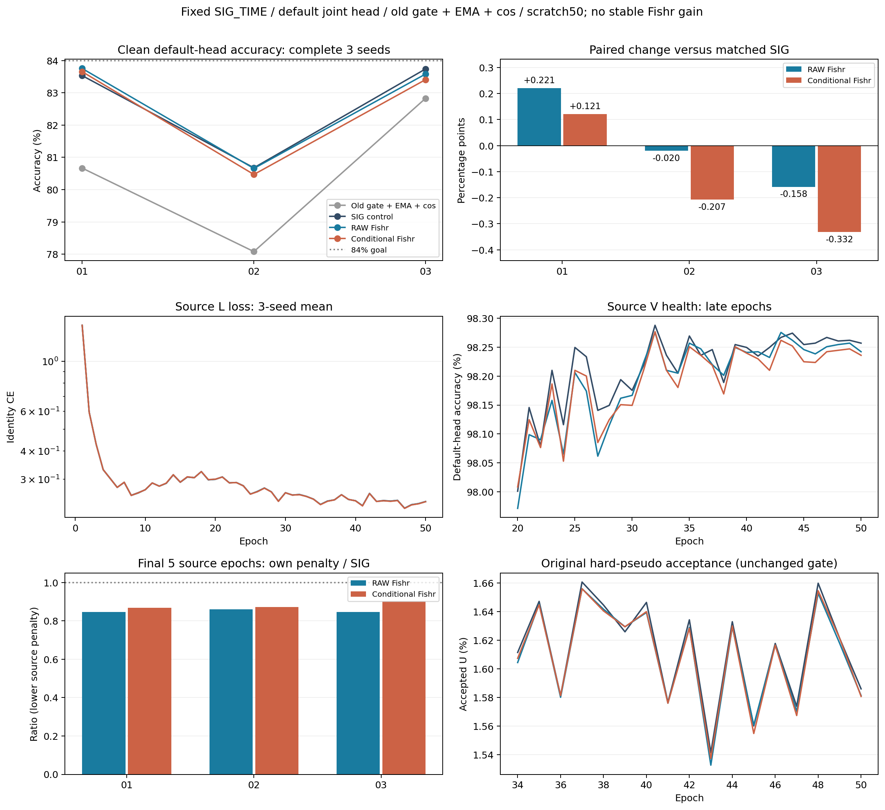

# 固定 SIG_TIME 骨干 Fishr：完整三种子结果

**ANALYZED / VERIFIED；没有稳定新增收益，84%目标未达到。** RAW 82.6647% ±1.7402 pp，对匹配 SIG_TIME 82.6504% ±1.7118 pp 仅+0.0143 ±0.1918个百分点，1/3正；TX_DAY_CENTERED 82.5113% ±1.7719 pp，对 SIG −0.1391 ±0.2340个百分点，1/3正。条件化对RAW三seed均下降（−0.1534 ±0.0473个百分点，0/3正）。不得把首seed+.2208/.1214个百分点继续写作稳定增益，也不因此扫描更大权重、更多辅助批或选择性重跑。

## 范围与运行身份

first run 20261014-phase1-backbone-fishr-oldgate-cos-e50-clean-manysig-s01-m4-r01：实现9c981766a0727cf072755ddd46cd5b639bae89ce、执行600afeeefe84e0d9f50f07c38ae0767bf1cabf07；剩余02/03 run 20261015-phase1-backbone-fishr-oldgate-cos-e50-clean-manysig-s0203-m8-r01：wrapper b69d6ffbbd229284c4cfde35124db10bf871fe07、共享技术import修复729c01e878a0df790c1056d00d1b547f709a57be、实际发布/源扩展决定3c052b2d36903e28694674a39e232a73acd8b6a6。源决定先于这一路线新增目标数值回收，01不重训，02/03没有因目标分数改参、取消或重排。8行扩展自然结束、failure0，逐row训练→final50默认头clean168000预测固定→独立truth-last评分已闭环。

固定3seed2026092701/02/03，4arms共12行；源码/config/命令/CWD/环境/owner/immutable paths见两run原登记。当前只测ManySig clean，旧门控+自身EMA+cos基线，不是纯CE；33label+17pseudo/222step、scratch50/11100updates，L6300/U56700隐藏TX/V27000、sourceRX/day/TX/physicalID/split392005及NoExplicitCFO不变。SIG_TIME实际joint160/fθ195041与默认cos6x160 scale30正常联合训练，无新分类器、另训头、星地增强或Phase2开发。

## 完整性能

均值±模型seed样本SD，pp为百分点。最差RX/day先逐模型取最差分组再三seed平均。已暴露基准结果，不声称新的独立盲测或卫星部署性能。

|方法|clean accuracy均值±SD|Macro-F1均值|最差RX均值|最差day均值|
|---|---|---|---|---|
|OLD_GATE_COS50|80.5268% ± 2.3776 pp|80.0024%|67.9708%|76.0556%|
|SIG_TIME|82.6504% ± 1.7118 pp|82.1020%|70.4264%|78.5175%|
|BONE_RAW_FISHR|82.6647% ± 1.7402 pp|82.1198%|70.5708%|78.5651%|
|BONE_COND_FISHR|82.5113% ± 1.7719 pp|81.9447%|70.0583%|78.3063%|

旧基线是外部历史基准；本次训练机制的直接归因对照为同SIG_TIME、同采样/轮数/额外源前向预算的SIG控制，不能把相对旧架构的约2个百分点全部归给Fishr。

|seed|SIG_TIME|RAW|TX_DAY_CENTERED|RAW−SIG（pp）|COND−SIG（pp）|
|---|---|---|---|---|---|
|2026092701|83.5333%|83.7542%|83.6548%|0.2208|0.1214|
|2026092702|80.6774%|80.6577%|80.4702%|-0.0196|-0.2071|
|2026092703|83.7405%|83.5821%|83.4089%|-0.1583|-0.3315|

|预登记配对|均值差±样本SD（pp）|正向seed|净正确决策数/504000|
|---|---|---|---|
|BONE_COND_FISHR − BONE_RAW_FISHR|-0.1534 ± 0.0473|0/3|-773|
|BONE_COND_FISHR − SIG_TIME|-0.1391 ± 0.2340|1/3|-701|
|BONE_COND_FISHR − OLD_GATE_COS50|1.9845 ± 1.2537|3/3|10002|
|BONE_RAW_FISHR − SIG_TIME|0.0143 ± 0.1918|1/3|72|
|SIG_TIME − OLD_GATE_COS50|2.1236 ± 1.0595|3/3|10703|

RAW对SIG修正2109、引入2037错误，净+72；COND对SIG修正1685、引入2386，净−701；COND对RAW修正1325、引入2098，净−773。分母是相同168000物理决策×3模型seed，不将504000样本当作504000独立模型试验。全部逐seed/分组CM与配对错误见results.json、independent_three_seed_statistics.json、three_seed_error_transitions.json。

## 机制确实优化，但源优化不等于目标收益

实际每包身份CE对t1PW3456/t2PW6912的导数构成矩阵，按RX分组（每组36样本、方差分母35）比较梯度方差；TX_DAY_CENTERED先减同TX/day跨RX均值。5warmup/10ramp至固定.01，L180平衡cohort、每16原step执行一次（每轮13批），当前默认W仅作为辅助计算常量，主CE照常联合更新默认头。这是项目骨干梯度方差变体，并非原Fishr标准复现。不是在最终头上另训分类器；全局模型模式/RNG按原机制恢复。具体normalized variance/floor、cohort和真实梯度对象见既有实现与登记。

三seed最后5轮RAW的直接源penalty/control比分别0.8458/0.8605/0.8463，COND的centered penalty/control比0.8691/0.8720/0.9016，均下降；RAW还同时降低centered项。所有候选在17/33/50的t1/t2/SIG三个实际对象均13/13批有效梯度非零，对照有效辅助梯度0。保存矩阵和导数统计已独立重开复算，机制并非只实现未接线。

9新模型fθ数值变化192170至193460个元素，默认W960元素按原主损失更新；全部实际feature-only导出与原joint160逐值一致，清零旧类别W不改z，新SIG五类参数均更新，诊断没有更新参数/buffer或拟合头。这证明机制进入实际特征，不能替代未验证的新TX/丢弃头后迁移能力，更不能把源penalty下降解释成RX捷径消除或稳定DG收益。

|方法|源L CE：41–45→46–50|源V：41–45→46–50|17轮U硬门累计接受率（3seed）|原生epoch秒合计（3模型）|
|---|---|---|---|---|
|SIG_TIME|0.241859 → 0.233820|98.2558% → 98.2605%|1.6010% / 1.6243% / 1.6185%|20286.37|
|BONE_RAW_FISHR|0.241710 → 0.233816|98.2514% → 98.2484%|1.5989% / 1.6183% / 1.6162%|20640.69|
|BONE_COND_FISHR|0.241409 → 0.233416|98.2356% → 98.2385%|1.5988% / 1.6194% / 1.6159%|21206.57|

源CE末段仍缓慢下降，V接近平稳；达到50轮不等于已证明收敛。U旧硬门约1.6%接受、真值始终隐藏；本机制没有直接增加U暴露/改变伪标签筛选。源V的小差异仅健康信息，未用来追微小涨分或更改预算。全50轮而非抽样曲线、所有实际coefficient/loss/梯度摘要和参数变化见complete_three_seed_source_curves.json、three_seed_mechanism_summary.json。

## 完整性与成本

独立完整审计：扩展8行/400源epoch记录（含100历史）、66600新step、1344000固定默认头决策/144指标；合并首seed后12行、600被记录epoch（其中150历史复用）、99900新updates、2016000决策/216指标。另用独立算式从全部216个保存6x6CM重计accuracy/F1、逐seed均值/样本SD、最差RX/day、配对差与净决策，逐项一致。

9个从零新模型各50轮，共450新增epoch/99900更新，另3个历史baseline共150轮/33300历史更新；不把600记录epoch称为600新增训练。全9模型5850个L180辅助批/1053000额外源包次、1404层导数记录、936保存参数梯度矩阵。参数和额外源前向预算相同不代表Hessian反传时间完全相同；表中实测nativeepoch时间已含auxiliary，不能再加aux秒重复计数。GPU并发/owner不同，不宣称算法速度倍数。

单一代码/config提交、一次聚焦P0/P1、必要负例/真实CPnoquery smoke、ordinary账户preflight、单release archive SHA比对/remotecompile、PID/CWD/argv/GPU/loggrowth均按原登记完成；未增加seal/receipt/重复审批。checkpoints/原始矩阵/PT/预测/日志留immutable run，Git只交聚合JSON/报告/图。主矩阵完成不等于84%研究目标完成。

下一步仅两项：完成独立的置信度门控feature-consistency固定首seed（20261015-phase1-confidence-feature-oldgate-cos-e50-clean-manysig-s01-m3-r01），先冻结source资格/02/03决定commit+push再读取其新目标数字；重新提出DG候选前，先在合法源域检验跨RX身份特征差异与身份导数是否提供新的可检验约束，不扫Fishr权重、不直接堆叠损失。目前没有发布第三个训练假设。
