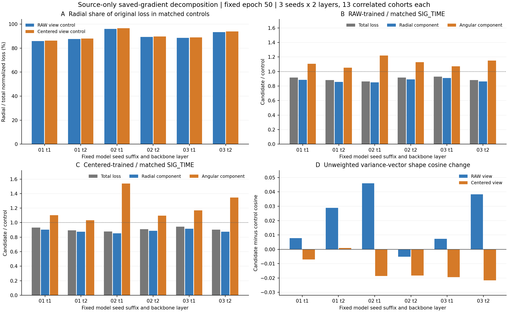

# 骨干梯度方差约束：保存源梯度的幅度与形状拆分

**原目标主要优化了各RX方差向量的幅度一致性，未证明形状一致性全面改善。** 原目标已做可微分尺度归一化，本次全部1872个方差视图的分母floor均未激活，不能把源loss下降直接说成整体梯度缩小；也不应把“再归一化一次”当成未经验证的修复。

状态VERIFIED，分析代码 2c4c5e367f561cde8805dc305d6254854815abaa。复用首seed 20261014-phase1-backbone-fishr-oldgate-cos-e50-clean-manysig-s01-m4-r01 和02/03 20261015-phase1-backbone-fishr-oldgate-cos-e50-clean-manysig-s0203-m8-r01 原保存的9个scratch模型、4个预定诊断轮1/17/33/50、每轮13个L180cohort、t1/t2共936个实际梯度矩阵；同时重算RAW与TX_DAY_CENTERED得到1872条源统计/144个分组。源数据分组和物理ID在每seed配对模型间逐值相同，原保存loss全部恢复。只读已有矩阵/源统计，无模型/IQ/预测/truth加载，无新前向/梯度计算/参数更新/头拟合/optimizer步骤，未写入原不可变run根。

## 拆分与检查

每RX方差向量记为v_i（36个真实L样本，无偏分母35），原J=mean((v_i-v_mean)^2)/mean(v_mean^2)，分母可微，floor=1e-30。每对平方距离精确满足：||v_i-v_j||²=(||v_i||−||v_j||)²+2||v_i||||v_j||(1−cos(v_i,v_j))。五RX的10对距离均值乘4/10再除坐标数恢复原分子；两部分使用相同原分母，分别记径向幅度项和角向形状项。角向项仍含两RX幅度乘积，不等同纯cos损失，另独立报告无幅度权重的形状cos。

合成恒等式/纯径向/纯角向/尺度不变性/非法输入检查PASS。实际1872条分解恢复归一化J的最大绝对差2.665e-15；最小原分母2.2134e-11，floor激活0。正常范围下整体G缩放λ使方差乘λ²、分子分母同乘λ⁴，J不变。第二次聚合核实9模型、144组、每组13cohort完整。936是矩阵数，不是独立模型seed数。

## 固定终轮50的配对结果

表中均为同seed/同层/相同13cohort的候选聚合除匹配SIG_TIME对照聚合。RAW比较RAW视图，COND比较TX_DAY_CENTERED视图；不把两类统计混为相同对象。全4期结果均保留在JSON，终轮为原冻结终轮，不按目标或本分析结果选择。

| seed尾号 | 层 | 训练约束 | 总J比 | 径向项比 | 角向项比 | 形状cos差 |
|---|---|---|---:|---:|---:|---:|
| 01 | t1 | RAW | 0.9169 | 0.8858 | 1.1065 | 0.0077 |
| 01 | t1 | COND | 0.9311 | 0.9039 | 1.1027 | -0.0070 |
| 01 | t2 | RAW | 0.8817 | 0.8574 | 1.0517 | 0.0289 |
| 01 | t2 | COND | 0.8935 | 0.8742 | 1.0337 | 0.0010 |
| 02 | t1 | RAW | 0.8649 | 0.8499 | 1.2220 | 0.0459 |
| 02 | t1 | COND | 0.8778 | 0.8540 | 1.5395 | -0.0186 |
| 02 | t2 | RAW | 0.9170 | 0.8914 | 1.1297 | -0.0052 |
| 02 | t2 | COND | 0.9102 | 0.8889 | 1.0951 | -0.0183 |
| 03 | t1 | RAW | 0.9291 | 0.9106 | 1.0715 | 0.0073 |
| 03 | t1 | COND | 0.9438 | 0.9155 | 1.1698 | -0.0194 |
| 03 | t2 | RAW | 0.8820 | 0.8628 | 1.1504 | 0.0383 |
| 03 | t2 | COND | 0.9048 | 0.8760 | 1.3454 | -0.0217 |

对照总J的径向贡献占85.92%至96.54%。12个seed×层×约束配对的径向项均下降（比0.8499至0.9155），RX方差范数CV也12/12降低；原归一化角向项却12/12升高（比1.0337至1.5395）。独立形状cos在RAW中5/6提高、COND中1/6提高，因此不能把“加权角向项上升”直接等同为全部方向角恶化，也不能把降低总J当作形状已对齐。

这给出原损失优化对象的具体解释，并未证明导致目标错误或保证某个新约束有效。原目标结果仍按已完成三seed报告：RAW−SIG +0.0143pp/1正，COND−SIG −0.1391pp/1正；它们只是已有结果的上下文，不参与本源分析的矩阵/轮次/参数选择。

## 下一步边界

新DG候选首先需要源端检验一个明确问题：直接约束方差向量的角度，是否能在实际t1/t2图上传递稳定梯度、保留默认CE监督并改善源端形状统计。当前仅为待证伪假设，尚无此候选代码、训练、资格或性能结果；不能通过调大原Fishr系数、重复归一化或按目标差重排父模型来替代验证。默认头继续原流程联合训练，SIG_TIME不加分支。当前在跑的置信门控SSL扩展保持原配方，按固定50轮完成后自动独立评分。

复现：在既有CVS-RFFI Torch环境，用analysis/backbone_variance_decomposition_20261015.py --project PROJECT，只stdout输出；CPU2线程，实际分析25.93s。全聚合source_variance_decomposition.json与独立摘要source_variance_decomposition_summary.json随本报告提交；原PT矩阵留原run/source目录，不入Git。此为同一已完成BF实验的源域后验分析，没有另行启动训练或新增数据权限。

