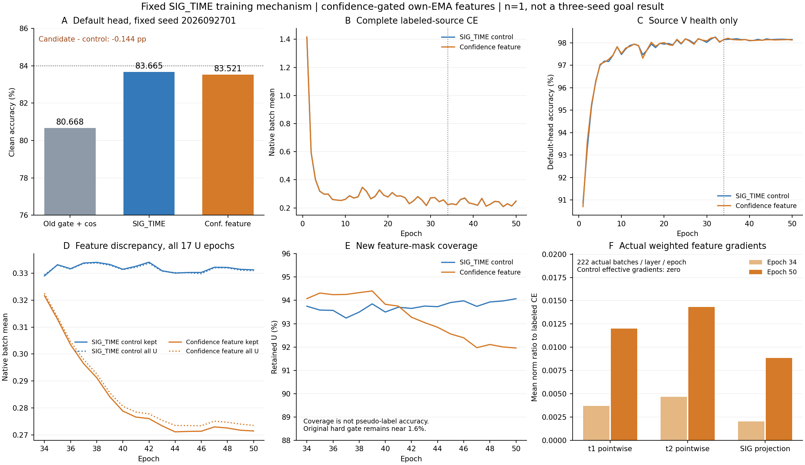

# 固定 SIG_TIME 置信度门控特征一致性：首种子完整结果

**首种子没有提升。** ManySig clean168000、默认 ORIGINAL_HEAD、seed2026092701、固定final50：CONF_FEATURE_MT 83.521429%，SIG_TIME配对对照83.665476%，差−0.144048个百分点。新机制修正766例并引入1008例错误，净减少242个正确预测。n=1，不能代替固定三种子84%目标，也不据此调整阈值、权重或取消已冻结的02/03扩展。

状态 ANALYZED / VERIFIED，run 20261015-phase1-confidence-feature-oldgate-cos-e50-clean-manysig-s01-m3-r01。实际执行 704cf37536d3cb6b8764af2131547db4a9939480，代码/config 325d113dff08206cb2f174e74d33e48f3e0b2ad5；源资格及固定扩展决定 3b0b38c708029570cd1d6327cd4db96e2752a6ad 已在新目标数值读回前push并独立核对远端OID。源PASS与目标负结果均完整保留。

| 方法 | clean准确率（%） | macroF1（%） | 最差RX（%） | 最差day（%） |
|---|---:|---:|---:|---:|
| OLD_GATE_COS50 | 80.668452 | 80.173353 | 70.616667 | 75.452381 |
| SIG_TIME | 83.665476 | 83.231003 | 70.695833 | 79.161905 |
| CONF_FEATURE_MT | 83.521429 | 83.082870 | 70.466667 | 79.002381 |

基线为旧门控+ownEMA+cos，同物理角色和原默认头。CONF对OLD增加2.852976个百分点，但SIG对OLD本身已增加2.997024个百分点，不能把包含骨干变化的整段增益算给新训练机制。配对SIG控制才隔离本轮机制差异。

## 完整训练与机制检查

两新模型各50轮/11100更新、33label+17pseudo、U963900包；源native50轮全部解析（含历史对照共150epoch记录），全部22200新step与对应feature日志已检查。三row504000预测先固定再独立truth-last；54条overall/RX/TX/day指标均从混淆矩阵再次复算，分组求和与overall一致，配对错误变化独立核对。旧任务自然完成、failure0，无目标模型重训/重预测。仅clean，无卫星、新TX或Phase2结论。

固定feature mask为detach FP32 teacherweak maxsoftmax>=studentstrong（ties保留、差0），loss=sum(mask*halfL2(unitjoint160))/完整batchN。原U CE.16/entropy.01、旧硬门控、EMA.999、默认cos头正常联合训练保持；34轮系数.02、38轮起.1。无新参数/模块/投影器/额外前向或头拟合。完整mask总覆盖：对照903487/963900，候选898910/963900；这不是伪标签正确率。旧硬门控仅接受15436/963900（1.601411%）与15350/963900（1.592489%），和新feature mask是两个不同量。

源资格按事前规则PASS：finalLCE对照0.246968、候选0.248933；最后5轮保留样本feature均值候选/对照0.820886（降低17.9114%），全U未门控feature均值比0.828006（降低17.1994%），候选覆盖92.0871%。它证明损失确实被优化，不证明跨域身份可分性改善。完整100条feature epoch聚合见complete_source_curves.json，附batchmean与packetmean的明确字段；原训练损失按native批次均值，不把全批分母改成保留数。

实际源梯度：33/34/50每轮222batch×t1/t2/SIG投影×2模型，feature3996条层记录、原SSL3996条，共7992条层记录/23976保存向量，由另一进程复算。候选34/50三对象effective梯度均222/222非零，对照effective为0；原U损失对象保留，辅助classW梯度不存在。50轮候选有效feature梯度/LCE范数均值比分别0.012007/0.014320/0.008842，L/U为不同批次时的cos均值−0.023717/−0.014819/−0.005860。该结果不表示同样本冲突因果或累计AdamW贡献，也没有证明置信度规则消除所有冲突。

真实特征检查：两模型f_theta195041，initial→final分别改变193460/193525个元素；默认W960个元素都随原CE更新，五个SIG变换张量发生变化。720个合法L样本的导出joint160与实际部署特征逐值相同，清零classW不改变特征；诊断不拟合头/更新模型/读取query。该接口独立性与参数变化不冒充头丢弃后新TX/Phase2迁移性能。

实际初始198个张量/864924状态元素相同，但cudnn_deterministic=false，34轮前小幅CE/V波动已在原报告说明，不能归因新机制。最后5轮LCE均值对照0.228240、候选0.229233，前5轮0.233904/0.234720，V均值98.1570%/98.1370%（健康观察、无选模）。50轮内CE仍下降，不能仅因到达预算宣称完全收敛。native训练epoch耗时合计2241.58s/2416.36s，包含观测且运行时共享负载不一致，不据此宣称算法加速。

## 已冻结扩展与边界

源决定 3b0b38c708029570cd1d6327cd4db96e2752a6ad：在读该run新目标数字前固定02/03，每seed SIG_TIME与CONF_FEATURE_MT独立scratch50，所有机制/超参数不变；首种子不重训，默认头不另训。扩展run 20261015-phase1-confidence-feature-oldgate-cos-e50-clean-manysig-s0203-m6-r01，实际发布 55ff29d676eb5f02afa8b3869ed4818122f09d9a，逐row自动clean/独立评分，训练状态见其report.md。三种子完成前只报告实际n与缺项，不选最佳seed，不按本目标差扫描权重。

完整结果results.json；第二次聚合复算independent_statistics.json；机制与特征边界mechanism_summary.json；150条native源epoch和100条feature epoch在complete_source_curves.json。原PT/原始日志/IQ/预测保留原不可变目录，不入Git。

技术收尾说明：远端完整audit成功，completed_results.json已保存为VERIFIED；本地打印摘要曾因误取嵌套models字段发生KeyError。已读取并核对保存产物，无重跑训练、预测、评分或远端audit，不将摘要打印错误记为实验失败。

