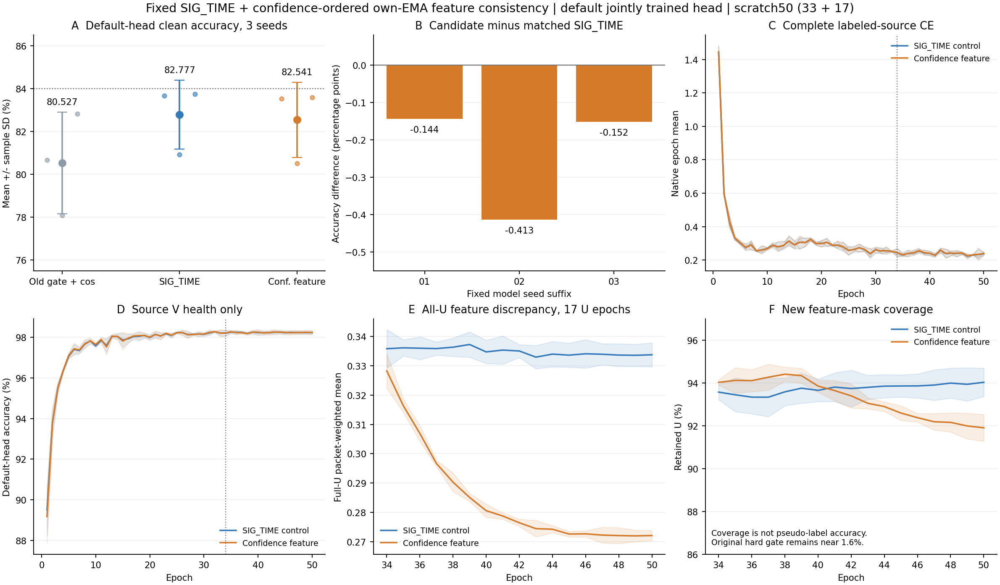

# 置信度门控特征一致性：固定三种子完整结果

**没有提升。** ManySig固定clean协议、既有默认ORIGINAL_HEAD、终轮50：CONF_FEATURE_MT三种子82.540675%±1.760937个百分点，配对SIG_TIME82.776984%±1.607961个百分点；配对差−0.236310±0.153150个百分点，0/3正。新机制修正1837例、引入3028例，净减少1191/504000个正确预测。距预定义84%均值目标1.459325个百分点，未达标，不换头/换读出/挑最高seed补结论。

状态ANALYZED / VERIFIED。首run 20261015-phase1-confidence-feature-oldgate-cos-e50-clean-manysig-s01-m3-r01 与剩余run 20261015-phase1-confidence-feature-oldgate-cos-e50-clean-manysig-s0203-m6-r01 合并；固定三seed2026092701/02/03。首seed不重训，原头/原预测保存。首source资格与02/03扩展决定在 3b0b38c708029570cd1d6327cd4db96e2752a6ad 已push并核对远端OID，早于首seed该候选新目标数值读回。剩余适配器代码fe2d8287ef1f9c167c5b68ee395e8bfe01b08360，实际不可变release cvs_confidence_feature_seeds_20261015_r01 执行55ff29d676eb5f02afa8b3869ed4818122f09d9a；所有row自然完成，没有目标反馈改配方、选择性重跑或停止。

| 方法 | 准确率均值（%） ± 样本SD（百分点） | macroF1均值（%） | 每seed最差RX的均值（%） | 每seed最差day的均值（%） |
|---|---:|---:|---:|---:|
| OLD_GATE_COS50 | 80.526786 ± 2.377572 | 80.002386 | 67.970833 | 76.055556 |
| SIG_TIME | 82.776984 ± 1.607961 | 82.239960 | 70.577778 | 78.677778 |
| CONF_FEATURE_MT | 82.540675 ± 1.760937 | 81.990912 | 70.201389 | 78.382540 |

| modelseed | 配对SIG_TIME（%） | CONF_FEATURE_MT（%） | 差（百分点） |
|---|---:|---:|---:|
| 2026092701 | 83.665476 | 83.521429 | -0.144048 |
| 2026092702 | 80.920833 | 80.507738 | -0.413095 |
| 2026092703 | 83.744643 | 83.592857 | -0.151786 |

正式外部基线为旧batch_neighbor门控+ownEMA+cos，非纯CE。CONF对OLD +2.013889±1.104544个百分点、3/3正；但SIG自身对OLD +2.250198±1.159619个百分点，不能将结构本身已有收益归因于新增训练机制。新增机制是否有效以同SIG配对ZERO控制判断，三个seed均负。原全U FEATURE_MT既有独立匹配实验也为0/3正（−0.244643pp）；两条各自配对结果均不支持半监督特征一致性增益，不直接用不同运行上下文的候选均值排名或宣称置信筛选已恢复收益。

## 训练与测试覆盖

六新模型均scratch50=33label+17pseudo、222step/轮、11100更新；新增300模型epoch/66600更新，另共享三历史OLD50/11100各一，总代表450源epoch。六新模型原U采样总5783400包（各17x56700），TX真值一直隐藏；V只健康观察、无梯度或选模，NoExplicitCFO/内部补偿与原source角色/物理ID/split392005保持。无新星地增强、模块、参数、投影器、分类器、identity/RX拟合探针或额外头训练。

矩阵九模型、每模型clean168000决策，合计1512000默认头决策/162条overall、7RX、6TX、4day指标；各row训练→final50→全部prediction固定→独立truth-last评分自动串联。首54条既已独立核实，剩余108条本轮独立核实；全162个CM再次复算accuracy/F1/分组总和，三seed均值/样本SD/配对差和全部gross错误变化均一致。仅clean，非卫星部署、Phase2或新TX性能；已暴露研究基准，不称独立盲测。

## 源优化有效，但未带来默认头泛化收益

新规则复用现有ownEMAweak/studentstrong，detach FP32 maxsoftmax(teacher)>=maxsoftmax(student)，差0、ties保留；halfL2(unitjoint160)乘mask后sum/完整batchN，不除保留数。原U CE.16/entropy.01、旧硬门、EMA.999、L smoothing.01及cos/optimizer/增强/采样不改。feature系数34轮.02、38轮起.1；对照系数0。机制本身增加模型前向0，诊断/源导出额外工作另记，不将其说成全run没有分析前向。

| seed | 最后5轮保留样本feature均值比（候选/对照） | 全U未门控feature均值比 | 候选feature mask覆盖（%） |
|---|---:|---:|---:|
| 2026092701 | 0.820886 | 0.828006 | 92.0871 |
| 2026092702 | 0.797840 | 0.805066 | 92.5866 |
| 2026092703 | 0.806085 | 0.814137 | 91.7009 |

保留样本差异降低17.91%至20.22%，全U差异降低17.20%至19.49%，并非只缩小mask分母；但三个目标配对差均负。这些是源代理优化结果，不能推断U正确率或跨接收机身份可分性。新feature mask覆盖约92%，与旧硬伪标签门的约1.6%是两种不同量。新六模型中SIG旧门接受46698/2891700，CONF接受46404/2891700；门控函数与原U损失对象保持，计数差可随模型/EMA预测改变，不是修改了原门规则。

所有50轮native源曲线和11100步预算全覆盖，新增feature epoch聚合300条；33/34/50各222batch、三对象t1/t2/SIG投影，feature11988层记录与原SSL11988层记录共23976层记录/71928保存向量，已逐产物独立复算。候选34/50有效feature梯度每对象均222/222非零，对照effective为0；辅助classW无梯度依赖，默认W仍按原CE联合训练。L/U导数来自不同实际批次，不冒充同样本冲突或累计AdamW更新贡献。

六模型真实f_theta均195041，initial→final改变192170至193525个特征参数元素，默认W960个元素均正常更新。L720实际导出joint160与部署特征逐值相同，清零旧W不改变特征，特征/头分界和同seed实际初始化检查通过。三seed配对模型的实际初始body/head相同，末态L720部署特征L2差分别2.414608/2.881819/2.548154；这支持改动确实作用于实际特征，但不将随机轨迹差全部归因新损失。没有头丢弃后新TX或Phase2实验，不能据此证明通用迁移。原cudnn_deterministic=false，不宣称预启用阶段轨迹逐步数值完全一致。

最后5轮源LCE均值SIG0.233366、CONF0.234564，前5轮0.241331/0.242432；V均值98.2378%/98.2365%，接近平台。源CE仍下降，50轮是固定预算，不能因此声称完全收敛。native epoch耗时总和SIG6471.25s、CONF6507.36s，包含观测且跨release/GPU负载不同，不据此宣称速度优势；训练更新数相同不等于所有诊断/反传开销相同。

## 收尾与产物偏差

原调度器完成六row后正常结束，failure0。局部结果读取器曾在worker均退出而父调度器尚未写整批completion的短间隙停止；随后独立核实原run已EXPERIMENT_COMPLETE，再首次执行完整audit，保存结果VERIFIED。没有重训、重新预测、重评分或重复完整audit，旧读取器日志保留本地作技术记录。

原预登记继承多列了独立source_qualification.json路径，剩余矩阵没有生成该不被runner消费的文件。实际扩展源资格已在release/preflight.json#source_qualification、首run/source_qualification.json及本地first_source_qualification.json保留，状态PASS；artifact_reference_readback.json核实原独立路径缺项与实际证据位置。这里如实记录，不伪造补齐，不把额外资格文件变成新门槛。剩余seed的源loss比较是描述性分析，不重新决定已冻结测试或扩种子。

实现、prereg、源决定及launch已先行提交；本次完整results.json、independent_three_seed_statistics.json、three_seed_error_transitions.json、complete_three_seed_source_curves.json、three_seed_mechanism_summary.json与图表随Git交付。原CP/PT/原始日志/IQ/预测留原不可变run根，不上传。

下一步最多两项：保留当前负结果，停止此变体的目标追分式参数扫描；按新源证据推进已固定的方差形状02/03同900L只读诊断（首seed源资格已PASS且决定已push，尚未实施），先验证真实身份梯度兼容性和幅度问题，不自动开启新训练、改SIG_TIME骨干或专门训练头。84%目标保持，当前未达成。

补充源机制分析（2026-10-15）：只读两组12旧模型已保存的源训练梯度，7992批/143856向量，不增加训练或访问目标。完整报告见source_gradient_geometry.md；终轮有效特征项相对监督梯度平均约0.9%至1.9%，无新增CE方向反转。此结果不能证明目标下降原因，也不支持仅凭冲突频率就追加投影/裁剪或提高系数。
