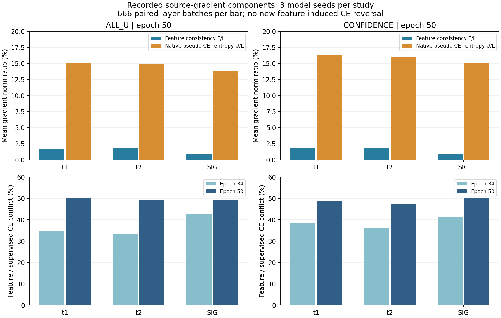

# 已保存源梯度：半监督各分量的方向与幅度

状态：VERIFIED。只读分析代码提交 `d2e88339c7e6261df231a6c6722d78a998f84aac`。不增加训练实验、模型前向、自动微分、参数更新或分类头拟合；不读取IQ、checkpoint、目标预测或truth。

结论：终轮特征一致性梯度与监督CE在约47%至50%批次夹角为钝角，但其相对范数在三模型合并后仅0.870%至1.934%，从未大于监督梯度，未造成任何新增CE方向反转。因此，现有证据不支持把失败直接归因为“特征辅助项过强”，也不足以据此安排投影/裁剪权重扫描。小且近似正交的梯度仍可能改变累积轨迹；此分析不能证明其无害或证明泛化下降的原因。

口径：ALL_U与CONFIDENCE是两个独立的既有三seed对照，各含SIG_TIME和候选，共12个保存模型；不是12个独立种子。仅读取epoch33/34/50的全部222个训练批次，共7992配对批、23976层批对、143856个已保存向量。诊断对象为实际部署骨干t1 pointwise、t2 pointwise与SIG local projection，未拟合新的头。所有CE参考有效，双文件CE参考相对差最大3.5942e−7。原始33轮及SIG控制的有效特征增量均严格为0。

F是实际ramp后加权的特征一致性梯度，U是原生0.16×UCE＋0.01×entropy梯度，L是原生有标签身份CE。epoch34的F使用既有ramp .02，epoch50为.1，没有新系数。表中每格合并三个模型的666批，批次相关，不能把666视为独立seed。

| 机制 | epoch | 层 | F/L 平均范数比 | 原生U/L平均范数比 | F与L冲突批次 | F新增方向反转 |
|---|---:|---|---:|---:|---:|---:|
| ALL_U | 34 | t1 | 0.496% | 14.884% | 34.83% | 0 / 666 |
| ALL_U | 34 | t2 | 0.541% | 14.167% | 33.48% | 0 / 666 |
| ALL_U | 34 | SIG | 0.231% | 14.386% | 42.94% | 0 / 666 |
| ALL_U | 50 | t1 | 1.711% | 15.123% | 50.15% | 0 / 666 |
| ALL_U | 50 | t2 | 1.845% | 14.892% | 49.10% | 0 / 666 |
| ALL_U | 50 | SIG | 0.937% | 13.824% | 49.40% | 0 / 666 |
| CONFIDENCE | 34 | t1 | 0.504% | 15.253% | 38.59% | 0 / 666 |
| CONFIDENCE | 34 | t2 | 0.540% | 14.562% | 36.19% | 0 / 666 |
| CONFIDENCE | 34 | SIG | 0.215% | 15.191% | 41.44% | 0 / 666 |
| CONFIDENCE | 50 | t1 | 1.827% | 16.298% | 48.80% | 0 / 666 |
| CONFIDENCE | 50 | t2 | 1.934% | 16.044% | 47.30% | 0 / 666 |
| CONFIDENCE | 50 | SIG | 0.870% | 15.103% | 50.00% | 0 / 666 |

逐seed的终轮F/L平均范数比为0.833%至3.007%，U/L为11.065%至19.082%；单批F/L最大15.606%，仍小于1。合并终轮t1/t2三分量CE方向出现ALL_U各2批、CONFIDENCE各1/2批反转；这些反转在加入F前的L＋U中已经存在，F没有新增反转。不能把这些少数批的局部方向当成U错误标签的证据。

方向定义为〈L,L＋U＋F〉/||L||²；该值为负表示三个记录分量之和对当前L的一阶方向为反向。它不包含AdamW预条件、weight decay、完整其他目标、历史动量或EMA，不能当成实际优化器步或全网方向。仅三个对象、三个固定epoch的现有向量，不外推未保存时期或目标域。

方法选择影响：保留两组既有三seed负结果和全部产物，不提高特征一致性系数或借目标数据挑层。当前独立泛化路线继续按已冻结接收机风险规则评估；新的SSL机制须提出与已有全U/置信mask特征回归不同的源域可证伪假设，不能以辅助loss下降替代识别提升。

数学检查覆盖已知平行/正交/反转/零参考及5个非法输入；独立聚合复算确认108组、所有预算、零控制及0新增反转。此只读分析不产生新的运行权限、发布门或数据重验。完整统计见source_gradient_geometry.json，逐模型及合并表见source_gradient_geometry_summary.json，检查与独立复算分别单列。

