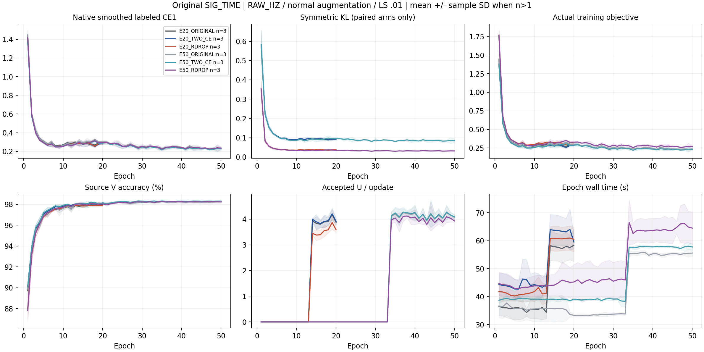

# 旧 SIG_TIME 叠加 RDrop：E20/E50 三种子匹配验证

状态 **ANALYZED / 逻辑矩阵 18/18 行训练、clean 预测、独立 truth-last 评分与完整产物分析 VERIFIED**。18 行完整，两个预算各三个条件、三个种子。全研究目标保持 active。

**预登记主条件 E50_RDROP 达到三种子 clean 均值 84.340079% ± 0.838539 pp，超过84%均值门槛。相对同配方 ORIGINAL 为 +1.418056 pp、3/3正；相对同两次随机前向 TWO_CE 为 +2.353968 pp、3/3正。** 这支持当前配方中对称KL的增益；单纯两次前向平均CE在两个预算均三seed下降。不是每个seed都超过84%，三seed结果也不代替统计显著性证明。

物理执行分为原运行14行与技术恢复4行。原调度器在启动后瞬时进程观测失败，原failure和未记录一个worker的缺口保留；已有14行自然完成且未重训。新不可变root仅补四个原未启动行，配方、seed与预算不变。所有最终训练/预测/评分进程已结束；原物理run仍为PARTIAL，逻辑矩阵18行完整，不将其改写为原调度器正常完成。

| 条件 | seed01 | seed02 | seed03 | 实际种子数 | 均值 ± 样本 SD | 最差 RX 均值 |
|---|---:|---:|---:|---:|---:|---:|
| E20_ORIGINAL | 83.641071% | 81.361310% | 84.344643% | 3/3 | 83.115675% ± 1.559519 pp | 73.416667% |
| E20_TWO_CE | 83.049405% | 80.861905% | 83.547024% | 3/3 | 82.486111% ± 1.428440 pp | 71.698611% |
| E20_RDROP | 82.926786% | 84.154762% | 84.747024% | 3/3 | 83.942857% ± 0.928437 pp | 74.437500% |
| E50_ORIGINAL | 83.325595% | 81.402381% | 84.038095% | 3/3 | 82.922024% ± 1.363415 pp | 69.863889% |
| E50_TWO_CE | 82.655952% | 80.414286% | 82.888095% | 3/3 | 81.986111% ± 1.366180 pp | 66.804167% |
| E50_RDROP | 83.923214% | 83.791667% | 85.305357% | 3/3 | 84.340079% ± 0.838539 pp | 71.486111% |

| 固定配对 | 平均差 | 配对样本 SD | 正收益种子 |
|---|---:|---:|---:|
| E20_RDROP minus E20_ORIGINAL | +0.827183 pp | 1.792038 pp | 2/3 |
| E20_RDROP minus E20_TWO_CE | +1.456746 pp | 1.722152 pp | 2/3 |
| E20_TWO_CE minus E20_ORIGINAL | -0.629563 pp | 0.152676 pp | 0/3 |
| E50_RDROP minus E50_ORIGINAL | +1.418056 pp | 0.905302 pp | 3/3 |
| E50_RDROP minus E50_TWO_CE | +2.353968 pp | 1.056482 pp | 3/3 |
| E50_TWO_CE minus E50_ORIGINAL | -0.935913 pp | 0.244393 pp | 0/3 |
| E50_ORIGINAL minus E20_ORIGINAL | -0.193651 pp | 0.203324 pp | 1/3 |
| E50_TWO_CE minus E20_TWO_CE | -0.500000 pp | 0.140276 pp | 0/3 |
| E50_RDROP minus E20_RDROP | +0.397222 pp | 0.693934 pp | 2/3 |

预登记主条件 E50_RDROP 的完整三种子 84% 检查为 True；E20_RDROP 为 False。种子不足三时不作完整目标达成判断。该研究沿用已暴露的固定 ManySig clean 基准，不声明新的独立盲测、未见 TX、星地或 Phase2 能力。

本次直接保留旧 SIG_TIME 的 RAW_HZ、普通训练增强、0.01 标签平滑、NoExplicitCFO、默认 6×160 cosine 头联合训练以及原 U/ownEMA 配方。E20 为13L+7U，E50 为33L+17U，分别从零训练并固定 final。ORIGINAL 保留原单 CE 路径，无辅助 hook；TWO_CE 与 RDROP 都在同一增强后 IQ 上做两次随机前向，CE 取均值，只有 RDROP 添加固定 alpha=1 的对称 KL。没有第二次增强重抽、另训头、新参数或新 U 一致性。

兼容旧配置时继承的描述字段 `updates=11100` 和 `cost_claim=21 new scratch50...` 仍出现在不可变 config 中，前者对 E20、后者对本矩阵已过时，均不控制执行。实际 native args、训练器预算、计数、完整日志和 completion 共同核实 E20 为4440更新、E50为11100更新，18行全部从零训练；本报告成本采用这些实际证据。没有热改正在运行的配置或覆盖旧产物。

两类比较分别回答不同问题：RDROP−ORIGINAL 是整个组合的净效果，RDROP−TWO_CE 隔离一致性项，TWO_CE−ORIGINAL 反映增加随机前向与平均 CE 的影响。E50−E20 同时改变总轮次、cosine 日程终点与 U 阶段轮次，不能解释为同一 E20 轨迹的单纯续训。三条件每 seed 的初始 state 相同，ORIGINAL 的后续随机数消耗因单前向而不同，不声称训练轨迹逐位相同。

历史 SIG_TIME 83.0393% ±1.4557 pp 是保留的非配对背景。本次的新 ORIGINAL 才是同配方对照；此前 RDrop E50 82.1030% 属于 CENTER25K/cleanL/LS0 配方，不能据此判断对旧 SIG_TIME 的因果增益。没有继承任何历史高分权重，也没有按测试成绩选择父模型、轮次、主条件、种子或重跑。

| 预算源资格 | 判定 | L 健康 | KL 正值调用比例 |
|---|---|---|---:|
| E20 | PASS | True | 100.000000% |
| E50 | PASS | True | 100.000000% |

每预算首 seed 的三个条件先完成 source freeze，固定源规则只读取最终 L CE、源 V 均值/最差 RX 和 KL 信号，两个预算独立决定其余六行。完整分析重算判定并核对扩展 launch 时间晚于所需 source freeze；target_metrics_read=False。实际跳过行：无。

独立 CPU 分析解析全部 139860 条 step、630 条 epoch、实际各行训练和评分 stdout，核对 36 份初末 checkpoint、3024000 个既有决定及 324 个分层混淆矩阵。每行物理角色为 6300 L、56700 隐藏 U、27000 V，空祖先、ownEMA、固定 final、headfit=0；各 seed 初始 state 核对为 {'2026092701': {'tensors': 198, 'rows': 6}, '2026092702': {'tensors': 198, 'rows': 6}, '2026092703': {'tensors': 198, 'rows': 6}}。

实际损失逐步重构的最大绝对误差为 2.38e-07。paired 条件只在 native CE1 上补 .5(CE2−CE1)+alphaKL，标签平滑保持0.01；ORIGINAL 无额外项。所有相关损失有限。原生熵未独立记录，`derived/original_weighted_U_entropy` 是 closed loss 扣除 CE1 和加权 U 损失的派生量。U 接受数不是 U 真实正确率，U 真值读取为0。

全部实际模型的特征参数和默认 W 均更新。额外 144 个合成 packet 前向核对初末 joint160 改变、feature-only 与部署 joint160 逐位相同，以及扰动 W 不改变 joint160。该分析新增真实 IQ 读取、新预测、优化、拟合头和 checkpoint 改写均为0；全行 prediction 完整验证后才独立读 truth 复算。特征路径检查本身不代替泛化效果证据。

预登记完整预算为630 model-epoch/139860更新；实际完成 630 model-epoch/139860 更新、11934720 次额外 L 前向、12247200 次 U 重复观察。矩阵首次准入至评分汇总墙钟 7620.77 s，实测吞吐 8.503 模型/小时，受共享资源负载影响。原普通增强、每轮源 V 和预测成本保留于实测时间，分阶段见 CSV。所有自有训练与评分进程自然结束，原调度失败历史保留，未干预其他任务。

旧 RDrop、CENTER25K、NONE 等正证据和所有负结果独立保留；未发布的残差交换原型没有叠加本轮。RDrop 是已有方法，本次验证与旧 SIG_TIME 的实际结合效果，不声明全球方法创新。研究目标不会仅凭一个最高分自动关闭。

执行代码与冻结配置提交：`b3ac442e2d33a5b315fb3251c30e0ad7083566bc`。完整预登记、一次 P0/P1、本地验证与启动证据见 experiment.json、review_evidence.json、local_verification.json、launch_verification.json；完整结果与配对分层见 results_analysis.json 和 CSV。

技术恢复run为 20261015-phase1-originalSIGTIME-rdrop-e50-technical-clean-manysig-m4-r02，调度代码 33f6171a0fec6ac432df672d0c6f542b8d71434c；18行实际模型代码均为 b3ac442e2d33a5b315fb3251c30e0ad7083566bc。metadata仅run_id/output_root/launch_owner变化。原E50_TWO_CE seed02无launch receipt，完整分析用其own初始checkpoint时间核对源freeze先于训练，不伪造PID或启动receipt。完整18行E20重算与此前已提交E20汇总完全相同。矩阵墙钟包含故障与发布等待；原failure至新四行首次准入间隔 2465.11 s，训练本身时间另见各行/各阶段CSV。两个不可变root及逐行归属见results_analysis.json和summary_by_seed.csv。

E50_RDROP 相对 E20_RDROP 的overall均值 +0.397222 pp（2/3正），但最差RX均值由 74.437500% 降至 71.486111%（-2.951389 pp）。保留这项取舍，不按终点评分重选预算、源候选或重跑。性能里程碑已完成；RDrop为已有方法，全球机制创新尚未证明，后续研究目标保持active。六幅完整训练曲线已目视检查，字段、单位、图例与均值/样本SD可读，完整源数据见CSV。
