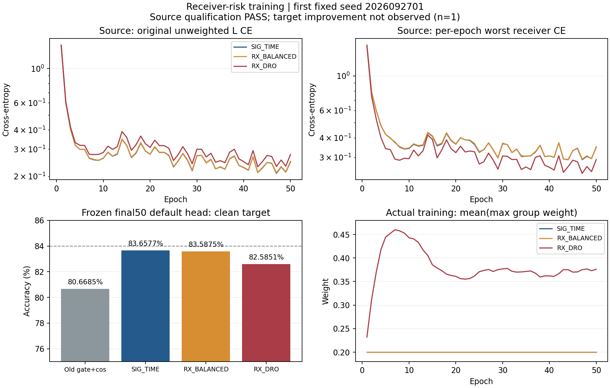

# 固定 SIG_TIME 接收机风险训练：首种子完整结果

状态：ANALYZED / VERIFIED。三新模型固定50轮/11100步及各自默认头clean预测已完成，672000个决策、72个逐层指标独立truth-last与混淆矩阵重算一致。当前只有seed2026092701，不能报告三seed稳定收益或完成84%目标。

本seed RX_DRO为82.5851%，相对同矩阵SIG_TIME83.6577%降低1.072619个百分点；相对RX_BALANCED83.5875%降低1.002381个百分点。RX_BALANCED相对SIG_TIME降低0.070238个百分点。源最差RX训练CE改善没有转化为目标clean识别收益。相对旧门控+cos历史基线80.6685%，DRO仍高1.916667个百分点，但不能把SIG_TIME结构已有收益归给新的风险机制。

| 方法 | clean准确率 | macro-F1 | 最差RX | 最差day |
|---|---:|---:|---:|---:|
| OLD_GATE_COS50 | 80.6685% | 80.1734% | 70.6167% | 75.4524% |
| SIG_TIME | 83.6577% | 83.2297% | 71.2583% | 79.1357% |
| RX_BALANCED | 83.5875% | 83.1455% | 70.2750% | 78.9119% |
| RX_DRO | 82.5851% | 82.0778% | 66.2208% | 77.2571% |

同row条件：split392005，既定clean168000物理样本/行，6类原身份决策，固定final50 checkpoint和原默认cosine头，未另训、冻结后重训或替换头；目标接收机/day及物理ID沿用登记，不包含新的TX/Phase2或星地部署声明。历史OLD_GATE_COS50仅复用合法固定默认头，不作为新训练或纯CE对照。

错误转移：DRO相对SIG纠正2471、新增4273、净少1802个正确；DRO相对BALANCED纠正2404、新增4088、净少1684；BALANCED相对SIG纠正899、新增1017、净少118。四种计数与168000及逐row正确数完全一致，不把纠正数单独当收益。

源机制：原risk q每步与实际消费损失回放33300步，全部一致。原始未加权CE与真正优化的风险加权CE分开记录；DRO源资格最后5轮最差RX CE0.259813，BALANCED0.317823，比值0.817476；DRO平均max(q)=0.374303。该worst是先跨末5轮分别求每个RX平均、再取最大值，不等于逐轮max的平均。原先固定源规则PASS，只证实源风险训练生效和基本健康。

| 方法 | 41–45轮所用L CE | 46–50轮所用L CE | 46–50轮原始未加权L CE | 末5轮源V准确率 | 原门控U接受率 |
|---|---:|---:|---:|---:|---:|
| OLD_GATE_COS50 | 0.268284 | 0.265659 | 历史原CE | 97.8889% | 1.5784% |
| SIG_TIME | 0.233893 | 0.228458 | 0.228458 | 98.1385% | 1.6010% |
| RX_BALANCED | 0.234181 | 0.230048 | 0.229871 | 98.1511% | 1.6000% |
| RX_DRO | 0.259888 | 0.255550 | 0.252918 | 98.1215% | 1.5981% |

三臂源V约98.1%且相近，仅作健康诊断，不以V微小差异选模。最后5轮CE仍比之前5轮低，固定预算训练完成不等于已证明优化收敛；不追加轮次、选最佳epoch或根据目标调q/正则化。所有U保持隐藏TX，17轮共963900包/模型，原batch_neighbor门控、ownEMA.999、UCE.16与entropy.01不改。门控接受约1.6%不能视为伪标签正确率。

实际机制进入部署fθ：195041个特征参数保持同结构，初末变化元素SIG193460/BALANCED193590/DRO193525；默认W的960个元素随原流程正常联合变化，无额外头更新。相同seed的真实初态骨干与默认头逐项一致；两个候选在L720上实际joint160相对SIG的平均L2差2.362777/2.691193。特征导出逐元素相同，置零旧W不改变导出，诊断不更新模型。不能据此推断新TX少样本能力，实际CUDA轨迹也不承诺位级确定性。

四个固定时期1/17/33/50、每期13批、t1/t2/SIG/普通W四对象，每模型208层记录/624向量，三新共624层/1872向量已重算。两个候选真实风险增量在要求的三骨干对象17/33/50均非零，ERM增量严格0；不是仅改最终分类头。新增训练前向0，无额外训练样本/新头/额外优化器。source检查及诊断前向另列，不用于速度承诺。

新训练成本150模型轮次/33300更新；历史复用50轮/11100更新另列，共200条完整源epoch。不同GPU及并发负载下各模型训练约2015至2330秒，不作为风险机制加速证据。所有50轮曲线、完整步骤重算、source特征及错误转移均保留，原始日志/PT/IQ/权重/预测不入Git。

源决定及扩展：`a283291279cb01b939325cf5ccba1d0a671b28c4` 已先commit/push并独立remoteOID核实，之后才回收本run新数值。源资格PASS后预先固定三臂原样扩seed2026092702/03，未因首seed目标负结果中止或重新挑选。剩余运行`20261015-phase1-receiver-dro-oldgate-cos-e50-clean-manysig-s0203-m8-r01`，实际执行`a283291279cb01b939325cf5ccba1d0a671b28c4`，6个新50轮模型已核实启动。第一seed不重训，待全部默认头自动clean评分完成再合并三seed；此处不提前声称完整矩阵完成。

产物：results.json保存逐row全部指标，independent_statistics.json为独立混淆矩阵与计数复算，native_recount.json保留原生全源日志和预测复算，full_source_curves.json覆盖全部200源epoch及实际风险/梯度，feature_mechanism_evidence.json记录实际fθ和默认头边界。
