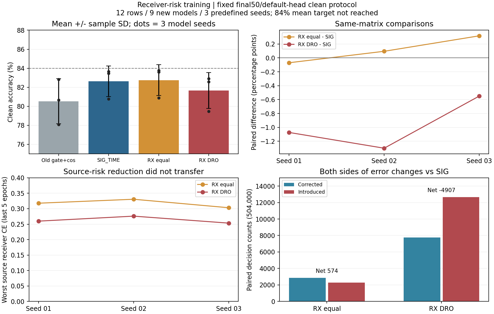

# 接收机风险训练：完整三种子结果

状态：ANALYZED / VERIFIED。固定12行、9个新scratch模型及3历史旧门控+cos模型的默认头clean决策共2016000个、216指标，训练/逐row自动预测/独立truth-last评分与本次全量复算均完成。首seed保留，原样02/03扩展完成，没有选择性重跑或取消。

RX_DRO相对同矩阵SIG_TIME均值降低0.973611个百分点，0/3种子为正；相对RX_BALANCED降低1.087500个百分点，0/3为正。该固定动态风险配方不形成提升，结束原样扩展，不根据目标扫描step_size/WD或改父。等权RX_BALANCED相对SIG_TIME均值增加0.113889个百分点、2/3为正，但小于配对SD0.194466个百分点，且最差RX/day均值略低，不能称稳定提升或默认晋级。其均值82.743056%距84%仍差1.256944个百分点，目标未达成。

| 方法 | clean均值±样本SD | macro-F1均值 | 最差RX均值 | 最差day均值 |
|---|---:|---:|---:|---:|
| OLD_GATE_COS50 | 80.5268% ± 2.3776个百分点 | 80.0024% | 67.9708% | 76.0556% |
| SIG_TIME | 82.6292% ± 1.6065个百分点 | 82.0754% | 70.3500% | 78.4889% |
| RX_BALANCED | 82.7431% ± 1.6224个百分点 | 82.1912% | 70.2708% | 78.4714% |
| RX_DRO | 81.6556% ± 1.8920个百分点 | 80.9666% | 67.6569% | 76.9103% |

| 方法 | seed01 | seed02 | seed03 |
|---|---:|---:|---:|
| OLD_GATE_COS50 | 80.668452% | 78.081548% | 82.830357% |
| SIG_TIME | 83.657738% | 80.777976% | 83.451786% |
| RX_BALANCED | 83.587500% | 80.872619% | 83.769048% |
| RX_DRO | 82.585119% | 79.478571% | 82.902976% |

样本SD基于3个预定义模型种子2026092701/02/03，非物理包或RX数。每行固定final50、original default cosine readout、clean168000/6类，split392005和既有目标物理ID/分组不变；不能将clean称Phase2、新TX或卫星部署证据。所有目标预测完成后独立truth-side评分，实际原始prediction/label重算和6x6混淆矩阵标准公式复算一致。

| 比较 | 三seed配对差（个百分点） | 均值±样本SD（个百分点） | 正差seed | 修正/引入/净正确 |
|---|---|---:|---:|---:|
| RX_DRO−RX_BALANCED | -1.002381 / -1.394048 / -0.866071 | -1.087500 ± 0.274087 | 0/3 | 7373/12854/-5481 |
| RX_DRO−SIG_TIME | -1.072619 / -1.299405 / -0.548810 | -0.973611 ± 0.384968 | 0/3 | 7749/12656/-4907 |
| RX_BALANCED−SIG_TIME | -0.070238 / 0.094643 / 0.317262 | 0.113889 ± 0.194466 | 2/3 | 2868/2294/574 |
| RX_DRO−OLD_GATE_COS50 | 1.916667 / 1.397024 / 0.072619 | 1.128770 ± 0.950841 | 3/3 | 26981/21292/5689 |
| SIG_TIME−OLD_GATE_COS50 | 2.989286 / 2.696429 / 0.621429 | 2.102381 ± 1.290874 | 3/3 | 27328/16732/10596 |

每组转移基于504000个配对决定。DRO修正7749同时引入12656，净少4907；等权修正2868、引入2294，净多574。相对历史OLD_GATE_COS50的正差包含SIG_TIME结构既有收益，不能全部归因于新风险训练；历史旧门控+cos不是纯CE基线。不同研究中的SIG控制不混合成更多独立seed，也不挑较高者替代当前配对控制。

源机制与失败边界：动态群权logq每步加.01×detached RX风险、归一化，原默认身份CE在三个源模型中确实改变；99900个实际风险步骤与原生所用loss、q、群计数均独立回放一致。两个候选对真实t1/t2/SIG和正常W有增量导数，ERM控制增量严格0。

| seed | SIG原始L CE | 等权原始L CE | DRO原始L CE | 等权最差源RX CE | DRO最差源RX CE | 比值 | DRO平均max(q) |
|---|---:|---:|---:|---:|---:|---:|---:|
| 2026092701 | 0.228458 | 0.229871 | 0.252918 | 0.317823 | 0.259813 | 0.817476 | 0.374303 |
| 2026092702 | 0.243753 | 0.245132 | 0.270976 | 0.330616 | 0.275966 | 0.834703 | 0.359007 |
| 2026092703 | 0.227858 | 0.227951 | 0.248414 | 0.303167 | 0.253386 | 0.835796 | 0.361634 |

最差源RX指标是先对最后5轮每个RX求平均、再取最大；三模型DRO/等权比值约0.817至0.836，即源最差接收机CE都下降，但目标准确率全下降。原始平均L CE在DRO反而更高，不能把“源风险下降”概括为所有源监督指标改善。V末5轮约98.1%至98.35%，仅作健康诊断，不选epoch/模型/机制。完整600条epoch曲线及9模型50轮群风险均保留；末5轮与前5轮loss变化列入source_rows，固定50轮不等于已证明收敛，不追加预算追分。

全部9新模型保持50轮/11100原生更新、33有标签+17旧门控半监督、L6300/U56700隐藏TX/V27000角色。每模型实际U963900包，门控接受15404至15716（约1.6%），原ownEMA.999/UCE.16/entropy.01及cos保持，U TX真值未可用。无新增星地增强/显式CFO身份坐标，内部补偿不变。源监督重加权无新增训练前向/模块/头/优化器，5个q是非训练状态，不是模型参数。

部署特征证据：9新模型fθ仍195041参数，全部实际数值更新，变化元素191848至193590；默认W960元素按正常联合身份训练变化，没有单独拟合/重训/替换头或接收机诊断头。六个候选相对对应seed SIG在真实L720的joint160平均L2差：等权2.362777/2.206321/1.902494，DRO2.691193/2.631356/2.810757。同seed原始骨干+默认头初态一致，feature-only导出逐元素一致，置零旧W不改变z。真实改变与接口正确不等于更可迁移，且CUDA轨迹不承诺位级确定性。

每新模型在1/17/33/50各13诊断批、t1/t2/SIG/默认W四对象，共208层624向量；9模型合计1872层5616向量，原保存梯度全部重算。新训练450模型轮次/99900更新，历史复用150轮/33300更新另列；合计600完整源epoch。L720特征边界与synthetic smoke等诊断成本另列，不当训练包或加速收益。不同GPU/并发负载下时间差不作性能/速度因果证明。

版本与执行：首实现`341d0dc0bdab44fce88e0af3d8fc29eb50b39912`、首执行`977d4fb609436bac23621ef8e32c2017495acef7`；剩余实现`8522fb75680c7b51c7d3d631f67c1b2b212eba8b`、剩余执行`a283291279cb01b939325cf5ccba1d0a671b28c4`。源扩展决定`a283291279cb01b939325cf5ccba1d0a671b28c4`先提交推送并独立remoteOID核实，再读取首run新目标数值；六个剩余训练按照原方案自然结束。余批全产物完成后才回收目标结果与独立复算，没有借新target取消、热改、重排或选择性重跑，已暴露基准不称盲测。

输出与复现：原入口`experiments.cvs_receiver_dro50.dispatch`和`experiments.cvs_receiver_dro_seeds.dispatch`，不可变release/run根见experiment.json；归档、真实no-query CP smoke、普通预检、PID/CWD/argv/GPU/日志增长记录保留。rawIQ/CP/预测/PT/日志不入Git，必要聚合结果与实现已提交。results.json包含全部逐seed分组CM和配对表；native_recount.json为两run完整源/预测/向量复算；full_source_curves.json覆盖全部600epoch与风险观察；feature_mechanism_evidence.json为实际fθ/defaultW边界。

下一步最多两项：停止该固定DRO配方原样扩展，保留等权的小幅不稳定信号但不凭target调参；独立实现已由三个源模型和RSC一般方法支持的时序自挑战首seed对照，固定SIG_TIME/defaultjointhead/旧U/50轮。该假设已在`84579f608289b6c103b503be816c16807ae4ddb7`记录，源挑战不是训练收益，不把挑战梯度大或sourcePASS当性能验收。

