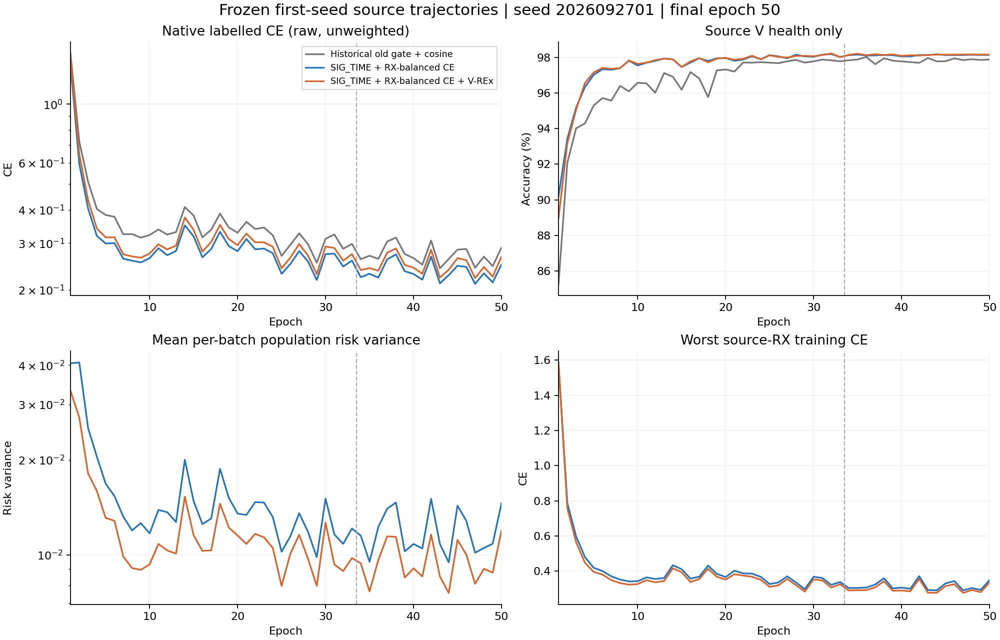
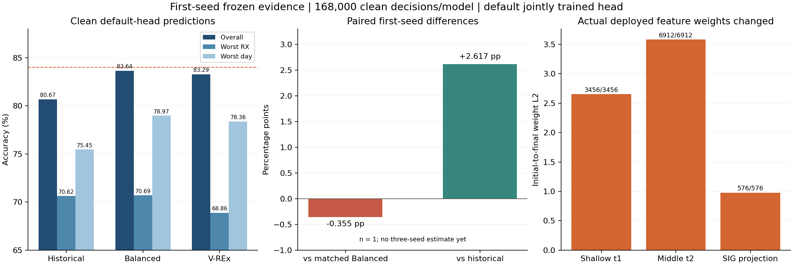

# 固定 SIG_TIME 的 V-REx：首种子结果

V-REx 首种子 clean 默认头准确率为 **83.2851%**，同路径均衡 CE 对照为 **83.6405%**，配对差 **−0.3554 个百分点**。本轮尚未证明目标域提升，84% 三种子均值目标未完成。

|方法|准确率|Macro-F1|最差目标 RX|最差目标 day|
|---|---:|---:|---:|---:|
|历史旧门控＋cos|80.6685%|80.1734%|70.6167%|75.4524%|
|SIG_TIME＋RX_BALANCED|83.6405%|83.2120%|70.6917%|78.9667%|
|SIG_TIME＋RX_VREX|83.2851%|82.8162%|68.8625%|78.3571%|

均为模型种子2026092701、同固定clean测试168000样本、原checkpoint默认cosine头，终50轮。n=1不计算模型种子标准差。V-REx相对历史参考的+2.6167个百分点包含SIG_TIME结构与均衡目标等差异，不能归因于方差项。

对匹配均衡对照，V-REx修正1127个错误、引入1724个错误，净少597个正确决策；最差目标RX下降1.8292个百分点。三行合计504000固定默认决策、54分层指标已独立完整复算。

## 机制确实执行，但源风险下降未等于泛化收益

两新模型相同初始参数、相同初始eval特征，均scratch50=33L+17U/11100更新，原batch_neighbor门控、ownEMA .999、U损失和cos保持，默认头正常联合训练。无头拟合、额外分类头、额外训练模型前向或新增参数；U真实TX保持隐藏。

终5轮控制/候选原始L CE为0.229504/0.233319；最差源RX训练CE为0.316722/0.302652；平均批风险方差为0.0117801/0.00956631。源资格按原规则PASS：方差比0.812076、最差源RX训练CE比0.955575。该资格只支持按源证据继续固定矩阵，不证明DG。两新模型共22200个native步和416参数层/1248保存梯度向量已复算。

候选真实f_theta中193460/195041个参数元素相对初始化改变，t1/t2/局部投影权重均发生数值更新。实际导出joint160与原前向精确一致，清零旧类别W不改z，诊断不改变特征参数/buffers。两最终模型在合法源L720上的joint160均值L2差2.696216，说明变更进入部署特征；不能据此声称丢弃W后性能提升或新TX迁移，未另训头。

完整隐藏U观察均为963900次：控制接收15436，候选15404。sourceV仅健康诊断，无选模；采用固定终轮，不将达到预算称为收敛。完整150行源epoch曲线、100行RX风险曲线、分层指标及错误转移见results.json；原完整日志与大型预测留在既有run根。

## 成本、恢复与下一步

两新模型100个epoch/22200更新；源epoch耗时求和分别2735.931秒、2401.062秒，含V健康诊断，不含输入读取、特征检查、预测评分。历史50轮2334.840秒单列。两卡并发情况不同，不能将耗时差当V-REx速度收益。

训练、预测、独立评分均完成。旧聚合因重复GPU反传的逐位检查退出；离线修复保持原allclose容差，在独立analysis_recovery_r01复用旧产物，不重训、不重预测、不重评分。

在读取本轮新目标数值前，源PASS及原样02/03扩种子决定已上传 **4056e9fb618fa92af5486c6d3670fc73bcc4194d**。因此继续完成已冻结的两seed×两新臂，每模型50轮、共4个scratch模型/44400新更新；不按首seed负分取消、调参或选择性重跑。实施/预算/数据契约保持，待完整三种子后再报告均值、样本标准差和配对差。

训练执行b7987055f7ad9e95f5fe65f2d368ce528dbac017；修复分析0416c8c4f7865b7bb879f9e1dba69a95dde9878d。当前仅clean、已暴露固定基准；不作卫星、Phase2或新类能力结论。

## 完整曲线与结果图

下图使用全部 150 条原生 epoch 记录和两臂共 100 条源域风险记录。虚线标记原有半监督阶段起点；V 仅作健康诊断，不参与 checkpoint 或候选选择。

首种子目标结果和实际部署特征权重变化如下。右图证明参数确实更新，不代表抛弃默认头后的新 TX 迁移性能已经提高。相对历史基线的差值同时包含 SIG_TIME 和接收机均衡训练影响，不能单独归因于 V-REx。

