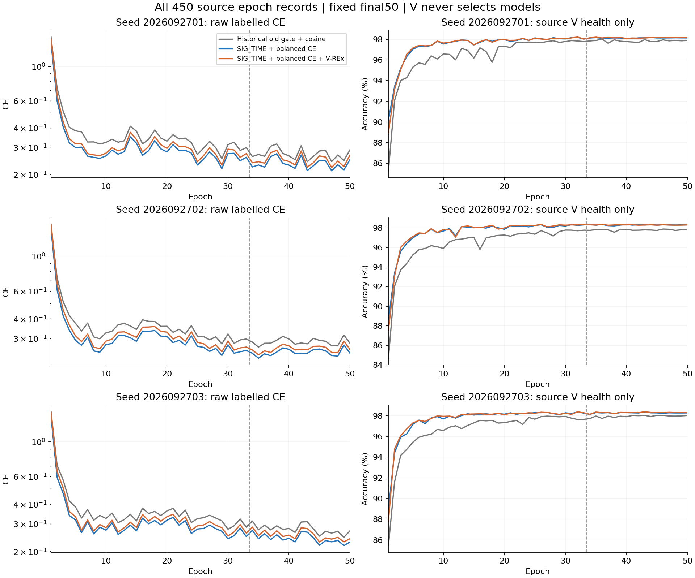
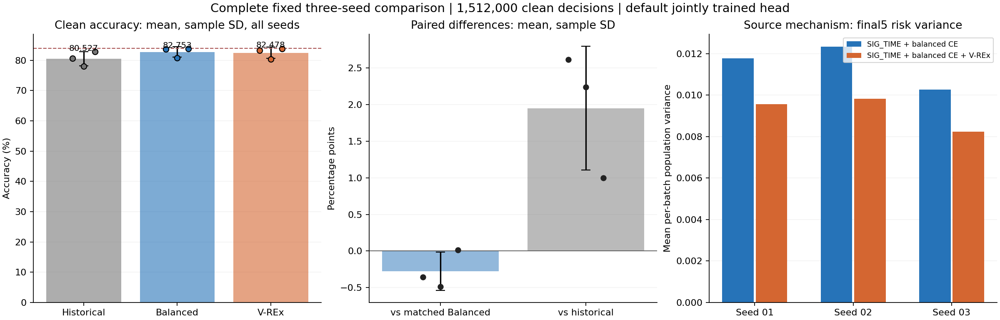

# V-REx 三种子完整结果

固定 ManySig clean、最终第 50 epoch、原默认分类头联合训练。完成 9 行、1,512,000 条固定预测与 162 条独立 truth-last 指标记录，其中 6 个新训练模型，3 个历史旧门控 + cos 对照复用。

| 方法 | Seed 01 | Seed 02 | Seed 03 | 均值 ± 样本标准差 | Macro-F1 均值 | 最差 RX 均值 | 最差 day 均值 |
|---|---:|---:|---:|---:|---:|---:|---:|
| OLD_GATE_COS50 | 80.6685% | 78.0815% | 82.8304% | 80.5268% ± 2.3776 个百分点 | 80.0024% | 67.9708% | 76.0556% |
| RX_BALANCED | 83.6405% | 80.8048% | 83.8143% | 82.7532% ± 1.6896 个百分点 | 82.2051% | 70.2319% | 78.5246% |
| RX_VREX | 83.2851% | 80.3185% | 83.8298% | 82.4778% ± 1.8898 个百分点 | 81.9170% | 69.2153% | 78.1048% |

| 配对比较 | 均值差 ± 样本标准差（百分点） | 正收益种子 |
|---|---:|---:|
| RX_VREX − RX_BALANCED | -0.2754 ± 0.2603 | 1/3 |
| RX_VREX − OLD_GATE_COS50 | +1.9510 ± 0.8457 | 3/3 |
| RX_BALANCED − OLD_GATE_COS50 | +2.2264 ± 1.0832 | 3/3 |

84% 三种子均值目标：未达到。V-REx 均值 82.4778%，距离 84% 为 +1.5222 个百分点。V-REx 相对同配方对照的独立效应以配对差 -0.2754 个百分点和 1/3 正收益为准。历史对照同时存在 SIG_TIME 与接收机均衡训练差异，不能将历史差值全部归因于 V-REx。

## 实际训练和部署特征证据

两臂各按原配方从零训练 50 epoch（33 L + 17 U）、每轮 222 步、总计 11,100 次更新。保留旧 batch_neighbor 门控、各自 EMA、原 U 目标、默认 6×160 cosine 分类头及 cosine 学习率。V-REx 只在现有 L 前向中加入接收机 CE 风险的总体方差，不增加网络参数、分类头或额外训练前向。所有新模型各观察 963,900 个 U 包，U 的 TX 真值始终隐藏。

6 个模型均已核实实际初始化与冻结权重：浅层 t1、中层 t2 和 SIG_TIME 投影进入真实 joint160 特征并更新；保留特征归一化、增益与缓冲区。独立特征导出与实际 joint160 完全一致，置零分类权重不会改变导出特征。未冻结骨干单训头、未另拟合诊断分类头。这些检查证明机制触达 f_theta，不构成新 TX 或 Phase2 少样本迁移性能证据。

首种子只依据预登记的源域风险和实际梯度通过扩种子条件；扩种子决定已在读取新增目标结果前上传。剩余 4 模型按原决定完成，未根据首种子负结果改变系数、分组、种子、轮次或停止规则。V 始终仅作健康观察，最终固定 epoch 50。

## 完整轨迹

## 成本与边界

本路线新训练 6×50 = 300 epoch、66,600 次更新；3 个历史对照的 150 epoch 单列，未重复训练首种子。epoch 时间仅计原生日志内训练与源 V 检查，不含启动、I/O、导出诊断、预测和评分；各卡并发背景不同，不能据此宣称机制加速。

| Row | 历史复用 | Epoch 时间合计（秒） | U 包观察数 | 接受 U 数 |
|---|---:|---:|---:|---:|
| OLD_GATE_COS50-s2026092701 | True | 2334.84 | 963900 | 15214 |
| RX_BALANCED-s2026092701 | False | 2735.93 | 963900 | 15436 |
| RX_VREX-s2026092701 | False | 2401.06 | 963900 | 15404 |
| OLD_GATE_COS50-s2026092702 | True | 2274.57 | 963900 | 15126 |
| RX_BALANCED-s2026092702 | False | 2050.87 | 963900 | 15644 |
| RX_VREX-s2026092702 | False | 2021.61 | 963900 | 15617 |
| OLD_GATE_COS50-s2026092703 | True | 2277.62 | 963900 | 15204 |
| RX_BALANCED-s2026092703 | False | 2083.89 | 963900 | 15644 |
| RX_VREX-s2026092703 | False | 2074.98 | 963900 | 15567 |

本报告为已暴露测试基准上的冻结配方比较，不声称独立新盲测。仅测 clean，没有新增星地增强或 Phase2 实验；逐行完整物理 RX/day/TX 结果、错误转移、完整源曲线和实际特征证据见 results.json。无目标结果回流调参、选模、重排或选择性重跑。

## 源域改善与目标结果的区别

三个种子的最后 5 轮源域风险方差及最差 RX 训练 CE 均下降，但目标域配对结果只有 1/3 正收益，且均值为负。源域代理条件通过、机制梯度非零和实际特征发生改变，均不足以证明目标泛化改善。本候选没有达到 84%，不将其记为成功晋级。

| Seed | 对照方差 | V-REx 方差 | 方差比值 | 对照最差 RX CE | V-REx 最差 RX CE |
|---:|---:|---:|---:|---:|---:|
| 2026092701 | 0.011780 | 0.009566 | 0.8121 | 0.316722 | 0.302652 |
| 2026092702 | 0.012325 | 0.009823 | 0.7971 | 0.331132 | 0.312682 |
| 2026092703 | 0.010256 | 0.008234 | 0.8029 | 0.304305 | 0.288654 |

相对同配方对照，三个种子的预测决策合计纠正 4489 个错误、引入 5877 个错误。这是跨种子的预测决策合计，不代表额外独立物理样本。

本轮按预登记矩阵完整结束，不根据目标结果调系数、挑种子、选择 epoch 或选择性重跑。实现、所有负结果、完整训练曲线与默认头评分一并保留。
