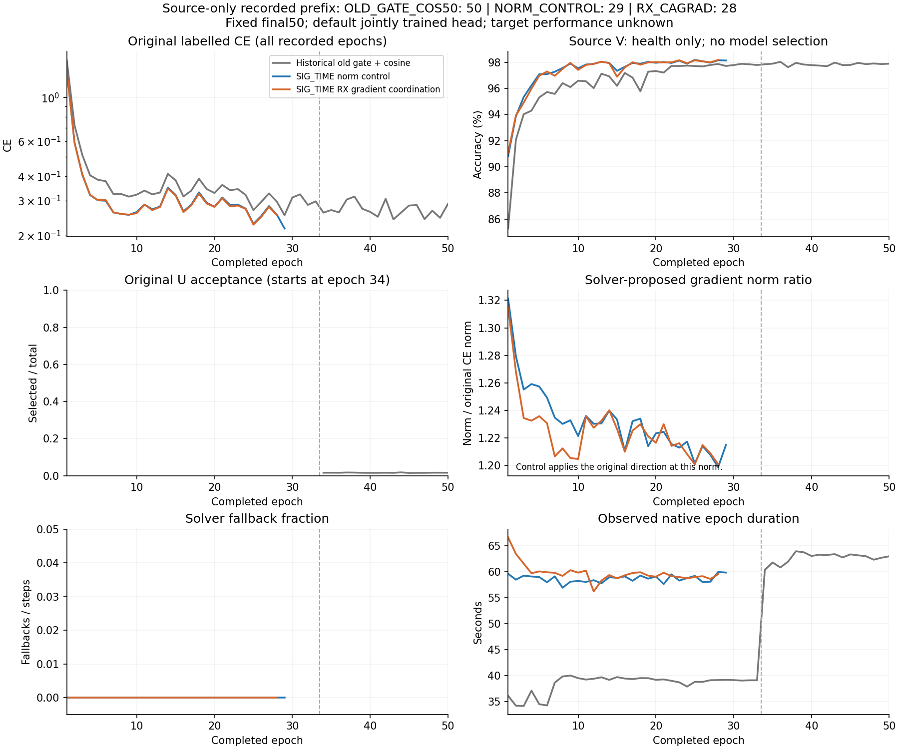

# 完整骨干源 RX 梯度协调：首种子公平训练

状态：PREREGISTERED。实现提交 d5fc594eaf419d2a2e3affb258adff8328739aee；网络固定 SIG_TIME，部署 joint160，不新增分类头或输入特征。

假设：逐坐标多数符号不能保证所有 RX 的完整梯度向量协调（上一900L源检验最差余弦−0.02688，对照+0.01731）。本轮按 CAGrad 原理对五源 RX 梯度构造 Gram，以原样本均值 CE 梯度 g0 为中心，在半径 0.5||g0|| 的范围内最大化最差局部下降。参考从论文的等权均值改为原生样本数量加权均值；使用原 AdamW，不宣称论文收敛或 DG 保证。

固定矩阵：2026092701；NORM_CONTROL 和 RX_CAGRAD 两个新模型各从零50轮，OLD_GATE_COS50 为完整匹配历史只读参考。总新增100源epoch／22200updates；历史50epoch另计。原33L+17U、222step/epoch、U963900、LS.01、原strong.015、旧batch_neighbor+ownEMA+cos、AdamW.0002/WD.0001、全局clip5均保持。每个实际 L 前向增加最多5次全骨干 VJP，两个新臂均执行相同求解和统计，不新增模型前向、参数或头。

同范数控制：在其自身相同 Gram 计算的候选范数上，只缩放原 CE 骨干方向；候选使用协调方向。两臂初始参数相同。校正仅作用于真实 f_theta 全部195041参数；只排除960个 class_W，保留 base_norm/pa_norm/gain/参考响应。零值线性梯度项不改变原 CE 数值，默认 W 接收原 CE/U 梯度；原 U 损失、全局裁剪、optimizer 与 EMA 正常执行。

求解器固定 SLSQP／解析导数／double归一化Gram／最多100iter／ftol1e-10；相对原始-对偶差≤1e-4。失败、非有限、非法单纯形或间隙检查失败时，本步明确记录并退回原 CE 方向；固定源扩种子要求回退比例≤1%，不因回退而中断健康训练，不扫描系数。

源扩种子规则：两臂完整50轮/11100次更新/U963900、最后5轮原L CE≤0.5；实际参数与部署特征改变，默认W无附加校正；每个预定实际梯度样本公式复算通过；候选相对同范数原方向的最差局部下降增益≥−1e-4容差且方向确实改变；fallback≤1%。原样扩02/03的决定须在回收本轮新目标汇总前冻结并上传。固定源V仅健康，不按V/target选epoch。源资格不是泛化证明。

数据：复用当前 VALIDATED_ONCE ManySig 物理契约，L6300／U56700隐藏TX／V27000，标注率10%，源RX1/3/4/6/8和day1/2/3；原split392005不变；不新增星地增强，NoExplicitCFO且保留内部逐包补偿。新训练不继承任何旧权重，教师仅由自身从零student产生。预检只读固定原SIG_TIME源checkpoint并source_proof；历史基线在复用前按同契约确认来源。

执行：普通N607现有CVS-RFFI环境、FP32、每worker CPU2线程。CWD=PROJECT/releases/cvs_rx_cagrad50_20261015_r01；命令 python -u -m experiments.cvs_rx_cagrad50.dispatch；owner=codex/root/rx-cagrad50-20261015；runroot=PROJECT/runs/20261015-phase1-rx-cagrad-oldgate-cos-e50-clean-manysig-s01-m3-r01。使用现有receiver_residual_capacity4锁，所有owner每GPU总进程≤3、空闲≥12000MiB，包含启动保留；不修改健康旧任务。

本地发布：通过受验证原生runner执行 experiments.cvs_rx_cagrad50.publish --output LOCAL_ARTIFACTS/rx_cagrad50_delivery_r01。一次archive SHA对比/远端编译，真实源checkpoint无query smoke PASS后立即继续。逐行训练冻结后自动clean预测，行内全部预测固定后独立truth-last评分。3row共504000默认头决策、54条指标，原头整体/每RX/day/TX、MacroF1、配对差及错误修正/引入如实报告；n1不当作84%三种子目标完成。

停止：仅run-owned数据/来源不符、非有限/跳过更新、非法U真值/目标/头操作、实际梯度公式/保存复算失败或输出冲突。保留产物、不自动重启、不停止其他任务。预算固定50，无目标分数早停/重跑/调参。

预期工件：preflight/submit/launch/queue；逐行初始化、resolved config、50轮曲线、11100步原生指标和Gram私有日志、e1/17/33/50真实梯度私有向量、最终checkpoint、实际f_theta/W边界和feature-only导出、逐包固定prediction、独立scores、completion；全局source_features/source_qualification/analysis/completion。数据、权重、原始预测和日志不进Git。

验证：18负例、完整195041梯度公式、同状态同范数、原生hook、U原样返回、默认W梯度原样、两臂实际数值更新和joint160变化/W清零不改z均PASS；新增同范数原理100组针对性检查PASS。一次独立直接P0/P1审查PASS；不重复未变化测试或审查。

本轮尚无真实训练/性能结果，84%仍未达成。

来源：[CAGrad 原论文](https://proceedings.neurips.cc/paper/2021/file/9d27fdf2477ffbff837d73ef7ae23db9-Paper.pdf)；[官方实现](https://github.com/Cranial-XIX/CAGrad)。本项目为接收机梯度改编，不是原论文实验复现。

实际运行更新：执行提交 22de3258841f6068688885ba99d8ceeb866be17c 已核验远端。真实源checkpoint no-query smoke PASS；两新worker的PID/CWD/argv/GPU/resolved/loggrowth核实，最新epoch={"OLD_GATE_COS50-s2026092701":50,"NORM_CONTROL-s2026092701":4,"RX_CAGRAD-s2026092701":3}，failure为空。首轮104层记录/416向量独立复算VERIFIED，实际selected=原CE+校正且符合设计，默认W附加梯度逐元素为0；最大相对L2误差5.14e-7。所有已落盘源前缀共843步（444/399），QP回退0、同范数局部方向指标检查通过。这些是源机制前缀证据，训练/新目标性能尚未完成。控制臂Gram中的候选方向统计仅作求解器观测，实际施加的是原CE方向同范数缩放。

条件扩种子准备：四个02/03模型的实际原生上下文已检查，仅seed/run_id/candidate_id/output_dir不同；同seed两臂初始state逐元素相同、不同seed不同，原Observer L/U路径与默认W边界通过，11项适配负例PASS，未重复核心checks。适配实现尚未最终审查/登记/发布，源决定为PENDING；不因早期曲线扩展，不重训首seed。

第17轮机制复核：两臂本epoch共104层/416向量，连同首轮共208层/832向量独立复算VERIFIED；selected公式相对L2最大8.67e-7，默认W附加梯度严格为0，浅层/中层/SIG的39个采样均非零校正。读取截至19轮的全部完整落盘前缀4173/4084步，共8257步，QP回退0，同范数最差局部方向增益检查全部通过。仍是源域机制证据，完整50轮、原U阶段和目标性能待完成。

完整已记录源曲线快照：历史对照50轮、新控制29轮、候选28轮，共107个epoch记录与12654个新模型L步骤。完整原训练stdout均可访问，未发现Traceback/OOM/Killed/警告/数值NaN或Inf损失，所有已记录轮次的非有限跳过更新计数为0；nonfinite关键词为日志中的零值计数字段，不是数值错误。新模型在这些轮次尚未执行U，符合预定34轮启用。L CE有同步起伏、源V约98%平台，仅说明源端健康；不称收敛、DG或84%证明，不按曲线改预算。运行时长为各自显卡/并发状态实测，不作方法速度因果比较。

聚合数据为source_curve_prefix_e29_28.json；plot_source_curves.py可从该文件独立重绘，不读取数据集、权重或目标指标。

L/U阶段切换实证：两臂完整epoch33各222步均U曝光0；epoch34各222步读取56700个U，接受909/910个，U真值标记全为0。实际33+17、λU=.16、λentropy=.01、自身EMA=.999与原设置一致，从零初始化且checkpoint_sources为空。熵没有独立日志，total−L−.16U只记录为推算残差，不冒充直接熵测量。第33轮另104层/416向量复算VERIFIED，连同1/17轮总312层/1248向量；默认W校正严格0，向量公式最大相对L2误差2.14e-6，满足原atol1e-6/rtol1e-5。新适配的唯一直接P0/P1检查PASS，未重复核心审查/检查；source决定仍PENDING，未发布02/03。

终轮源决定：两臂均完成50轮、11100步和预定U963900，源资格PASS，QP回退均0；最后5轮原L CE为0.228393/0.224799。全部预定梯度采样416层/1664向量复算通过，默认W附加校正为0；真实joint160差异L2均值2.95647，导出与原特征逐元素一致。仅根据原源规则冻结原样扩02/03：4个新模型、各50轮、c=.5，首seed不重训。此决定在读取本轮新目标成绩前上传；源PASS不等于泛化或84%达成。详见source_expansion_decision.json。
