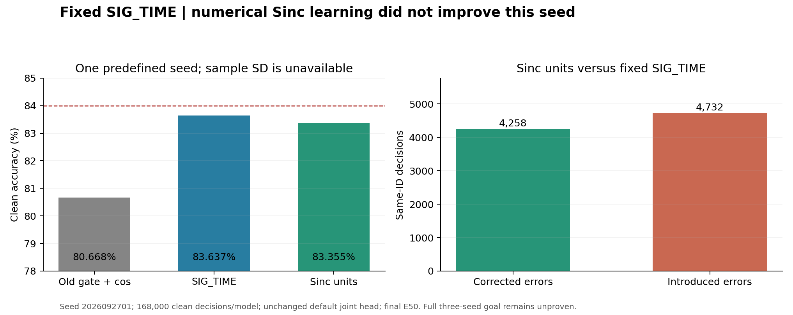
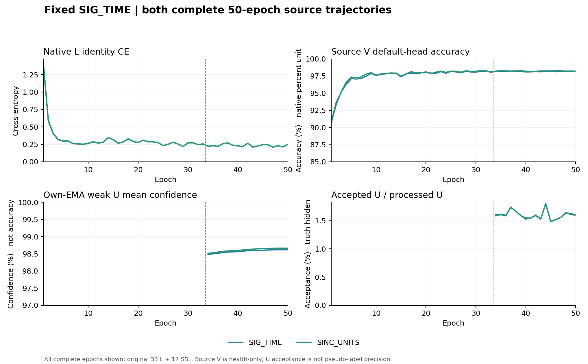

# 固定 SIG_TIME 的 Sinc 优化器单位：首种子完整结果

**首种子未得到泛化增益。** SINC_UNITS clean为83.354762%，同路径SIG_TIME为83.636905%，配对下降0.282143个百分点；修正4258个错误、引入4732个错误，净减少474/168000个正确决策。原48个Sinc参数已真正学习、source资格PASS、部署特征已改变，这些机制事实没有转成本种子的性能提升。n=1不计算模型种子样本SD，不能代替完整三种子≥84%目标。

## 固定对比与完整独立评分

运行`20261015-phase1-sinc-units-oldgate-cos-e50-clean-manysig-s01-m3-r02`，模型种子2026092701。ManySig固定split392005，旧6TX×7目标RX×4days，clean168000/row。3模型含2次新scratch50、1份既有旧门控+cos默认头结果复用。终轮final50冻结后自动预测，所有行prediction固定后独立truth-last评分；504000个模型决策、54条整体/RX/TX/day指标和6×6混淆矩阵均已完整重算。既有基准已暴露，不声称新的独立盲测。

| 方法 | clean准确率（%） | Macro-F1（%） | 最差RX（%） | 最差day（%） |
|---|---:|---:|---:|---:|
| OLD_GATE_COS50 | 80.668452 | 80.173353 | 70.616667 | 75.452381 |
| SIG_TIME | 83.636905 | 83.203323 | 70.920833 | 78.921429 |
| SINC_UNITS | 83.354762 | 82.867223 | 67.150000 | 78.833333 |

| 配对 | 准确率差（百分点） | 修正错误 | 引入错误 | 净正确数 |
|---|---:|---:|---:|---:|
| SINC_UNITS − SIG_TIME | -0.282143 | 4258 | 4732 | -474 |
| SINC_UNITS − OLD_GATE_COS50 | 2.686310 | 10597 | 6084 | 4513 |
| SIG_TIME − OLD_GATE_COS50 | 2.968452 | 10467 | 5480 | 4987 |

与历史旧门控+cos的+2.686310个百分点包含SIG_TIME网络差异，不能归为本优化器机制收益；其机制比较为SINC_UNITS−同路径SIG_TIME。完整指标和配对见 [results.json](results.json)、[independent_statistics.json](independent_statistics.json)。最差RX指标下降3.770833个百分点；不把单个seed或某个分层波动宣称为普遍规律。

## 单因素优化器机制与网络边界

网络保持原SIG_TIME195041参数和joint160/id_feat_joint，原Sinc Hz参数化和前向核构造不变；默认6×160、scale30普通cosine头正常随骨干联合训练。没有冻结骨干后另训、重训、替换分类头，也没有新拟合的TX/RX诊断头。两臂原W的960个元素均正常联合更新。

仅原低频/带宽各24个Sinc参数采用固定采样率Fs=25000000的单位映射：lr_sinc=Fs×lr_native，eps_sinc=eps_native/Fs，wd_sinc=wd_native/Fs。其他参数保持原AdamW。原cos日程覆盖group lr后，真实step前恢复该固定映射。原Hz全局clip5保持，因此不声称完整优化器坐标不变性；局部同已裁剪梯度条件下的映射已验证。没有倍率扫描、新损失、新参数、额外训练前向或额外optimizer更新。

原batch_neighbor门控、ownEMA0.999、UCE0.16、entropy0.01、smoothing0.01、lr0.0002、wd0.0001、33label+17pseudo、11100更新、L128/U256、NoExplicitCFO和无卫星训练保持。新模型从零开始，不继承旧checkpoint/EMA/optimizer。两臂同初态；真实checkpoint仅在既定无query smoke中只读，不作为训练初始化。

L6300/U56700（TX隐藏）/V27000，训练池标注率10%；源RX1/3/4/6/8、days1/2/3和物理ID角色均不变。V只健康诊断，没有源/目标checkpoint选择。

## 真实数值更新和部署特征

| 模型 | student Sinc核相对L2变化 | ownEMA Sinc核相对L2变化 | student低频/带宽改变元素 |
|---|---:|---:|---|
| SIG_TIME | 1.198752209e-8 | 3.357780315e-6 | 1/24；0/24 |
| SINC_UNITS | 3.071704209e-1 | 3.064143658e-1 | 24/24；24/24 |

单位臂实际低频最大变化451235.5Hz、高频边界最大变化2165874.5Hz；ownEMA分别449541Hz、2159300.5Hz。对照student近乎静止；对照EMA存在微小数值漂移，不能据此当作student学到了新滤波器。原代码曾将Sinc置于统一Hz步长，而真实48参数非零moment及亚ULP更新已有源证据，故本研究检验优化单位；当前结果不支持把“能更新”当作泛化充分条件。

真实fθ元素中，控制/单位臂分别改变193460/193959；L720实际joint160平均L2差3.697698355。两模型feature-only导出与原前向最大差0，清零或删除旧W不改变z；base_norm、pa_norm、gain和参考响应等特征变换保留，诊断不改变参数/buffers。见 [源特征](source_feature_mechanism.json)、[源资格](source_qualification.json)。这些是实际特征学习与接口证据，不证明新TX或Phase2能力。

## 实际梯度、完整训练与成本

每新模型E33/34/50全部222批，共666批、1998层记录、5994个保存输入向量，覆盖真实t1/t2/SIG参数的主L CE、加权UCE及UCE+entropy。两模型合计3996层/11988向量已独立重算。E33 U梯度为0，E34起U、teacher、原门控和原损失实际执行。下表为E50各臂自身状态下的均值；它不是同包对照、全fθ或累计AdamW贡献。

| 模型 | 参数 | 加权UCE/L范数比 | 余弦 | UCE+entropy/L范数比 | 余弦 |
|---|---|---:|---:|---:|---:|
| SIG_TIME | t1 PW | 0.103152 | -0.010055 | 0.105623 | -0.015414 |
| SIG_TIME | t2 PW | 0.105463 | -0.023469 | 0.107960 | -0.026777 |
| SIG_TIME | SIG projection | 0.102603 | -0.005146 | 0.104533 | -0.000330 |
| SINC_UNITS | t1 PW | 0.123081 | -0.010306 | 0.125073 | -0.008447 |
| SINC_UNITS | t2 PW | 0.120311 | -0.010283 | 0.122490 | -0.005559 |
| SINC_UNITS | SIG projection | 0.117366 | 0.002644 | 0.118873 | 0.006357 |

另外，每模型E1/17/33/50共52个实际Sinc pre/poststep批、104参数记录和完整11100个group lr已核实；两模型合计104批/208记录。Sinc梯度是原总loss经原全局clip后的梯度，含actual Adam一二阶矩和数值更新；与上述L/U诊断的时点有重合，不能相加冒充独立样本或模型种子。

| 模型 | 50轮原生秒数之和 | U接纳/处理 | 接纳率 |
|---|---:|---:|---:|
| OLD_GATE_COS50-s2026092701 | 2334.840 | 15214/963900 | 1.578379% |
| SIG_TIME-s2026092701 | 2030.523 | 15422/963900 | 1.599959% |
| SINC_UNITS-s2026092701 | 2013.379 | 15426/963900 | 1.600373% |

2个新模型共100 model-epochs、22200更新和L上下文；U为1927800包-模型观测，额外训练前向0、另拟合头0，U真值读取0。另列复用历史50轮/11100更新。11100-step native计数、ownEMA更新、有限性、禁用原诊断头拟合和3行独立score均已核对，见 [native_recount.json](native_recount.json)。原始日志、权重、预测和gradient PT仍在既定run/release目录；本报告只提交必要聚合。

全部150轮源记录见 [full_source_curves.json](full_source_curves.json)，图示两个新模型完整50轮。源L末段大体平稳并有小波动，V健康通过；达到50轮不等于已证明收敛。高置信度与约1.60%U接纳均不是伪标签准确率。epoch秒数不含整套发布/最终诊断/评分开销，共享资源条件不同也不作速度因果比较。真实L720特征边界检查另有7.952秒的已记录调用成本。

E33/E34原生entropy重构的范围与边界保留在[预登记及过程主记录](report.md)、[U梯度数据](source_U_entropy_e33_e34.json)。其结论不升级为完整尾段或全部参数的因果判断。

## 版本、原样扩展与未完成项

原机制代码00132f7d54aff45b6e52fc41f89d7705a043bc71，发布依赖恢复7221e39e0301e0de68231c3526e6c755295270d8，执行9fc348bc4be71f498a7684484fd86de81e3e4870。R01在preflight导入前训练未启动、0更新，归档与失败证据保留；本结果来自R02自然完成，无选择性重跑。

源资格和原样扩展决定1a3be6d2568939ff56c38c8bc8dc9a879b7abe76已先提交推送并核验远端OID，随后才于2026-10-15T01:14:15.557Z解析本候选首个新目标数值。源健康最后5轮L CE0.228386190/0.229129431、实际Sinc/ownEMA核与L720变化等原规则全部PASS；决定已冻结，见 [source_expansion_decision.json](source_expansion_decision.json)。

后续`20261015-phase1-sinc-units-oldgate-cos-e50-clean-manysig-s0203-m6-r01`按该决定真实发布：两臂×02/03共4个新模型，代码03fd8a8c7b64663bc52edb83359d3e610cfeb361，执行1a3be6d2568939ff56c38c8bc8dc9a879b7abe76；不重训01。普通N607预检、归档传输比较、remote compile、真实checkpoint无query smoke通过；4个真实PID/CWD/argv/GPU以及日志增长均核实，当前观察轮次15/16/14/16，无failure。结果和配置不会因当前首种子负差而修改，剩余健康任务原样继续，最终完整三seed报告配对差、样本SD、F1、最差RX/day和正负错误转移，见 [扩展运行](../20261015-phase1-sinc-units-oldgate-cos-e50-clean-manysig-s0203-m6-r01/report.md)。

当前只有完整首种子结果，84%三种子目标未完成；无新TX、Phase2、卫星部署或head-free分类性能声明。
