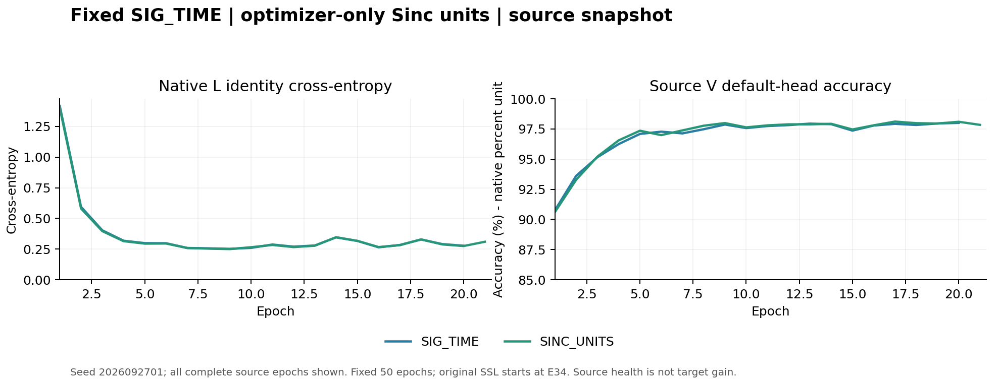

# 固定 SIG_TIME：Sinc 优化器单位消融预登记

本轮只改变原 Sinc 参数的优化器单位设置，检验历史源训练中“存在梯度和 AdamW 状态，但实际频率步长几乎低于浮点分辨率”的现象能否被纠正。SIG_TIME 网络、原始 Hz 参数化、前向滤波器构造、部署 joint160、默认 cosine 头和原半监督流程保持。数值学习恢复不等于泛化有效；所有正负结果按完整矩阵保留。

## 固定方案与依据

代码提交：`00132f7d54aff45b6e52fc41f89d7705a043bc71`；分支：`codex/phase1-feature-challenge-20261013`。方案、源资格判据及完整实现已在剩余 RSC 新目标数值回收（2026-10-15T00:20:27.595Z）之前固定。依据来自真实 9 份历史源 checkpoint/AdamW/EMA 状态和 3 份现有 SIG_TIME 初末状态记录，详见 [源证据与本地组件验证](../../../analysis/sinc_unit_optimizer_preparation_20261015.md)。没有根据目标分数选择频率倍率、父权重或学习日程。

原 Sinc 低频和带宽各 24 个参数；只在它们的 AdamW 参数组上固定设置：lr_sinc=Fs×lr_native、eps_sinc=eps_native/Fs、wd_sinc=wd_native/Fs，Fs 为原采样率 25000000 Hz。保留每轮原生 cosine 日程；原生代码覆盖所有组 lr 后，在真实 step 前恢复上述固定单位关系。其他参数（含默认 W）保持原 AdamW 设置。保留原 Hz 梯度全局 clip5，因此只声称在相同已裁剪梯度条件下的单位映射，不声称完整优化器坐标不变性。无新参数、损失、网络、前向或额外优化器更新。

| 行 | 模型种子 | 新训练 | 优化设置 | 评价 |
|---|---|---:|---|---|
| OLD_GATE_COS50 | 2026092701 | 0；复用原50轮 | 历史旧门控+ownEMA+cos | 原默认头 clean |
| SIG_TIME | 2026092701 | scratch50 | 原 AdamW | 原默认头 clean |
| SINC_UNITS | 2026092701 | scratch50 | 仅原48个Sinc参数按固定采样率映射 | 原默认头 clean |

两个新模型同种子初态、相同原数据与随机顺序，分别训练 33 label+17 pseudo，11100 更新/模型，U963900 包/模型。原 L128/U256、batch_neighbor、ownEMA0.999、UCE0.16、entropy0.01、smoothing0.01、cos、lr0.0002、wd0.0001、NoExplicitCFO 和无卫星训练保持。默认 6×160/scale30 cosine 头按原流程随骨干联合训练，禁止另训、冻结骨干后重训或替换分类头，也不拟合诊断头。单模型训练不超过 50 epoch。

## 数据、冻结与自动评分

复用既有 VALIDATED_ONCE ManySig source contract 与 clean capsule；split392005、物理角色、TX/RX/day、L6300/U56700（TX隐藏）/V27000保持不变。源 RX1/3/4/6/8、days1/2/3；V只作健康诊断。新模型从零初始化，模型/EMA/优化器不加载任何父权重。真实 checkpoint smoke 只读预定 DRO SIG_TIME 首种子 final50，先核对其合法 source_proof，再用 2 个零 IQ 包作无 query eval，不对该 checkpoint 作 optimizer 更新。

固定 final50/11100 后立即自动 clean168000 预测/行；旧6TX×7目标RX×4days，只有 ORIGINAL_HEAD。全部预测固定后独立 truth-last scorer 连接真值。报告整体准确率、Macro-F1、最差RX/day、所有登记分层和混淆矩阵、配对错误转移；n=1不代替预定三种子≥84%目标。既有目标基准已暴露，不声称新的独立盲测，无 Phase2、新TX或卫星部署声明。

## 唯一源资格与扩种子规则

在读取本候选任何新目标数值前完成并提交/推送源决定：两臂最后5轮原生L CE均≤0.5；原11100更新/U963900/0额外前向、隐藏U、默认头、真实fθ更新和feature-only导出证明完整；候选低频和带宽各至少12/24参数实际改变，student和ownEMA的实际Sinc滤波器相对L2均≥1e−6；候选与控制在真实L720的joint160 L2差≥1e−6。PASS才将两个臂原样扩展至2026092702/03；FAIL保留首种子所有结果，不扩种子，不扫倍率/epsilon/日程/父模型。目标数值不得改变扩展、训练、选择、排序或重跑。

记录 E1/17/33/50 每16批一次的真实 Sinc pre/post step、实际裁剪后总原生梯度和 Adam 一二阶矩，每模型52批/104参数记录；全部11100个实际group lr；原生L/U特征梯度E33/34/50沿用原观察器。Sinc梯度为L+原U/entropy总梯度，不冒充单目标归因。保存初末student/ownEMA滤波器差、真实部署特征、原默认W联合更新、实际epoch时间和全部U预算。只读诊断没有额外前向/更新；全部成本如实报告。

## 发布路径、环境与停止规则

唯一launch owner：codex/root/sinc-units50-20261015。普通N607既有CVS-RFFI环境，FP32、每worker CPU2线程；不改环境/账号/服务。运行根目录 `PROJECT/runs/20261015-phase1-sinc-units-oldgate-cos-e50-clean-manysig-s01-m3-r02`，release/CWD `PROJECT/releases/cvs_sinc_units50_20261015_r02`；本地私有产物 `LOCAL_ARTIFACTS/sinc_units50_delivery_r02`。每GPU所有owner总计最多3实验进程，且启动时可用显存≥12000MiB；共享容量锁动态分配GPU并记录实际值。禁止停止、重启或热改其他健康任务。

发布命令：`python -u -m experiments.cvs_sinc_units50.publish --output LOCAL_ARTIFACTS/sinc_units50_delivery_r02`；远端入口 `python -u -m experiments.cvs_sinc_units50.dispatch`。一次普通账号/容量/不可变路径预检；一次release归档与一次本地/远端SHA传输比较；一次远端compile；launcher先执行聚焦负例和真实checkpoint无query smoke，PASS立即继续，不设置smoke令牌或额外审批。启动后独立核对PID/CWD/argv/GPU与日志增长。

只因本run的系统性技术失败停止：数据权限/隐藏U/默认头不符、缺失真实更新或原loss、数值非有限、固定单位映射不成立、不可变产物冲突。保留部分产物，不自动重新提交，不终止无关进程；科学源资格FAIL只阻止扩种子，首矩阵按固定预算完成并自动评分。源/目标分数不作为热改或提前停止依据。

聚焦本地组件7负例、实际原生参数和L路径、STANDARD与原AdamW精确一致、候选第一步全部非Sinc/W精确一致、原EMA和cos覆盖处理已PASS。两个真实新行原生上下文各16个合成联合step和原U loss对象保留检查PASS，见 [组件检查](local_checks.json)、[入口检查](pipeline_checks.json)。这些是合成机械验证，不是训练性能。唯一独立P0/P1审查发现缺少release依赖，已直接补齐并定向确认PASS；无第二轮全审，见 [审查](p0p1_review.json)。完整canonical配置仅恢复PROJECT前缀，3行全等工厂配置且嵌套source_config保留，见 [配置核对](canonical_roundtrip.json)。

预期真实产物以 [experiment.json](experiment.json) 为准，包括初末checkpoint、resolved/native config、冻结记录、Sinc真实step/梯度/矩和初末滤波器证据、实际部署特征、全部prediction、独立scores及same-row报告。代码/配置与本预登记提交推送后才发布；训练完成、评分完成、源资格与84%目标分别报告，不互相替代。所有成功与负结果均上传Git；不提交IQ、权重、原预测、私有机器状态或原始日志。

R02恢复：原始完整机制提交00132f7d54aff45b6e52fc41f89d7705a043bc71保持。实际release修复提交7221e39e0301e0de68231c3526e6c755295270d8只增加缺失间接运行时包与新run/release编号。R01在preflight导入阶段失败，独立远端证据确认0工作进程/0更新；原目录和归档保留。隔离包用python -I导入实际preflight/dispatch/publish三入口PASS，无checkout回退；唯一问题定向复核PASS。新的全部canonical配置与R01仅输出ID变化，源资格、参数组公式和预算完全一致。

## R02 启动与首轮实测

RUNNING_VERIFIED。执行提交9fc348bc4be71f498a7684484fd86de81e3e4870；普通N607预检、单归档传输比较、远端compile与真实checkpoint无query smoke均通过，smoke对真实checkpoint的optimizer更新为0。独立核对dispatcher和两个真实worker的PID/CWD/argv，GPU1/2各1个实验进程；两行实际epoch记录均为2，日志从6502/6518增长至16829/16854字节，无failure。真实运行继续原固定50轮，未读取本候选新目标数值。

E1每行13个真实Sinc pre/poststep诊断批：控制的low/band梯度均非零（均值范数1.182845e−7/6.805956e−8），但每批0/24参数发生数值更新；单位修正臂两组均13/13批24/24更新，最大单次绝对更新5577.609375/5528.984375Hz。实际数据重现了旧Hz优化步长问题并验证本方案产生学习更新。这些是52个真实参数组观测，不能代替全部11100步、最终特征证据或泛化结论。源资格仍PENDING；最后5轮源健康、完整预算、初末student/EMA滤波器和L720部署特征尚待训练完成后核实。见 [启动证据](launch_verified.json)、[真实首轮更新](source_progress_e1.json)。

## 中期源证据（完整已完成前缀）

独立读取时，SIG_TIME完成20轮、SINC_UNITS完成21轮；全部41条已完成轮次的源loss、学习率、默认头V和阶段记录保存在 [中期源数据](source_progress_e17.json)，图见下。两行仍处于原label阶段；U从E34开始，尚不能评价本轮SSL效果。

E17预定13批中，对照low/band均有非零梯度（均值范数1.806702e−7/9.364124e−8），每批数值更新0/24；单位臂两组均13/13批24/24更新，最大单次绝对变化3300/3259.6953125Hz。数值学习持续到中期；这些是实际保存批的梯度/更新证据，不冒充全11100步、不作为源资格PASS或泛化收益。最终student/ownEMA滤波核和部署L720特征仍待50轮完成后核实。

原样扩展02/03的适配器和条件预登记已准备，代码03fd8a8c7b64663bc52edb83359d3e610cfeb361。4个实际原生上下文、15项负例、隔离包入口和唯一独立P0/P1审查通过；[扩展预登记](../20261015-phase1-sinc-units-oldgate-cos-e50-clean-manysig-s0203-m6-r01/report.md)仍为未启动状态，只有原首种子源资格PASS及提交推送决定后才发布。当前健康R02的release未被改动。

## 原生半监督阶段接线与熵项分解

实际运行两臂均已观察到E35、原pseudo阶段；该轮各处理56700个U，接纳915/910个。进程真实存活且身份匹配，无failure。E33（最后label轮）和E34（首pseudo轮）的全部预定222批/行已保存；本次只读分析2模型×2轮，共888批、2664个特征层记录、7992个输入向量，没有新模型前向、梯度调用、optimizer/head更新，也未读取IQ、checkpoint或truth。源资格仍PENDING，50轮预算不变。

原生代码核对确认：UCE只对原mask接纳样本计算，entropy为整个U student批的均值；原组合实际为L+.16UCE+.01entropy，muse关闭。分析代码9c8e88efb0fc2a08110d0d4161bf6f49f650efb6先提交推送，再按固定E33/E34、固定t1/t2/SIG参数坐标读取实际保存向量。E=grad(.16UCE+.01entropy)−grad(.16UCE)用float64重构；它受原float32保存舍入影响，不是重新独立反传的纯entropy梯度。E33所有U及entropy向量为0，E34三层均222/222批有非零熵增量，与原日程一致。

| 模型 | 参数 | 熵梯度/L范数：均值（%） | P95（%） | 熵/UCE范数中位数* | UCE为0仍有熵（批） | UCE加入熵后对L变负（批） | L+U下降方向被熵反转（批） |
|---|---|---:|---:|---:|---:|---:|---:|
| SIG_TIME | t1 PW | 0.775019 | 1.642198 | 0.156408 | 32/222 | 8/222 | 0/222 |
| SIG_TIME | t2 PW | 0.803443 | 1.785385 | 0.155336 | 32/222 | 8/222 | 0/222 |
| SIG_TIME | SIG projection | 0.593916 | 1.266458 | 0.137580 | 32/222 | 8/222 | 0/222 |
| SINC_UNITS | t1 PW | 0.711592 | 1.478909 | 0.129708 | 31/222 | 3/222 | 0/222 |
| SINC_UNITS | t2 PW | 0.762650 | 1.561256 | 0.141831 | 31/222 | 4/222 | 0/222 |
| SINC_UNITS | SIG projection | 0.583841 | 1.240915 | 0.121336 | 31/222 | 9/222 | 0/222 |

*熵/UCE只在UCE非零的190/191批上计算。32/31个零UCE批是同一批在三参数上的观测，不能三倍计为独立批。熵在U内部有可测作用，但相对L平均范数约0.584%至0.803%；本范围未观察到总L+U方向被熵反转。结果不支持直接把entropy称为已确认的主导破坏因素，也不因此开启熵系数/门控扫描。数据仅一个模型种子、E33/E34和三个真实特征参数张量，不能外推全部fθ、尾段全程、AdamW预条件后或累计贡献、伪标签准确率与泛化因果。详细分位数、原始两行聚合和范围见 [数据](source_U_entropy_e33_e34.json)。

本轮方案核对还排除了两项无充分依据的训练改动：已有完整源诊断显示额外特征梯度较小、未反转身份CE，因此不以负余弦频率单独启动统一投影/限幅；PCGrad原论文也明确冲突本身并不充分，参见 [原论文](https://papers.neurips.cc/paper_files/paper/2020/file/3fe78a8acf5fda99de95303940a2420c-Paper.pdf)。现有physical_pairs验证的是同RX/day/eq内相邻sig索引，**不是跨RX同步的同次发射ID**；仅凭这些索引不能构造跨RX同事件正样本，故未启动该伪监督或使用隐藏TX映射。现有PAIR只用于既定采样/门控的历史语义保持。

## 冻结后的源资格与原样扩展决定

SOURCE_PASS。两臂均完成固定50轮/11100更新、每模型U963900；最后5轮L CE为SIG_TIME 0.228386190、SINC_UNITS 0.229129431。候选low/band各24/24参数改变，student实际滤波核相对L2=0.307170421，ownEMA=0.306414366，候选与控制在真实L720的joint160 L2差=3.697698355。原判据逐项通过，见 [源资格](source_qualification.json)。

实际195041个fθ参数元素中，对照/候选数值改变193460/193959；两模型feature-only输出与原joint160逐元素一致，最大差0，清零或删除旧W均不改变z，诊断不修改参数/buffers，无拟合头、U真值或query读取。详见 [部署特征证据](source_feature_mechanism.json)。这证明数值优化作用进入真实部署特征，不证明泛化、新TX或Phase2收益。

按事先固定规则，决定原样扩展SIG_TIME与SINC_UNITS至2026092702/03，01不重训。源决定将先提交推送并独立比较远端OID，随后才回收本候选新目标数值；当前未读取这些数值。[扩展决定](source_expansion_decision.json)及[后续矩阵](../20261015-phase1-sinc-units-oldgate-cos-e50-clean-manysig-s0203-m6-r01/report.md)保留全部固定行，任何后续分数都不改变该决定、训练预算或参数组。原自动测试已生成完整3行504000个默认头决策并独立truth-last评分；性能数值与全量核对将在决定推送后回收。

完整首种子结果已回收并独立核实，见 [final_analysis.md](final_analysis.md)。SINC_UNITS83.354762%，同路径SIG_TIME83.636905%，差−0.282143个百分点；目标数字在源扩展决定1a3be6d2568939ff56c38c8bc8dc9a879b7abe76推送后读取，既定02/03健康扩展不因该差值改变。
