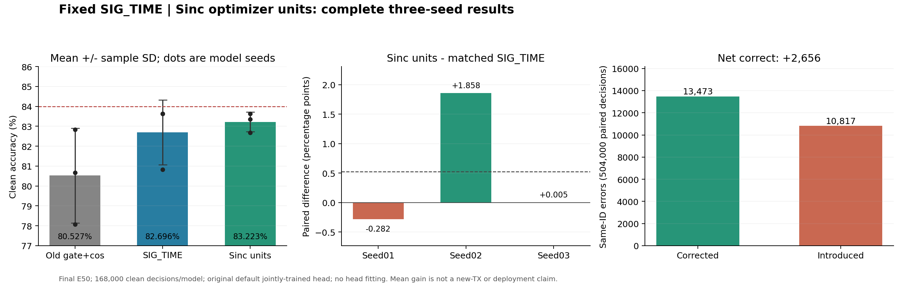
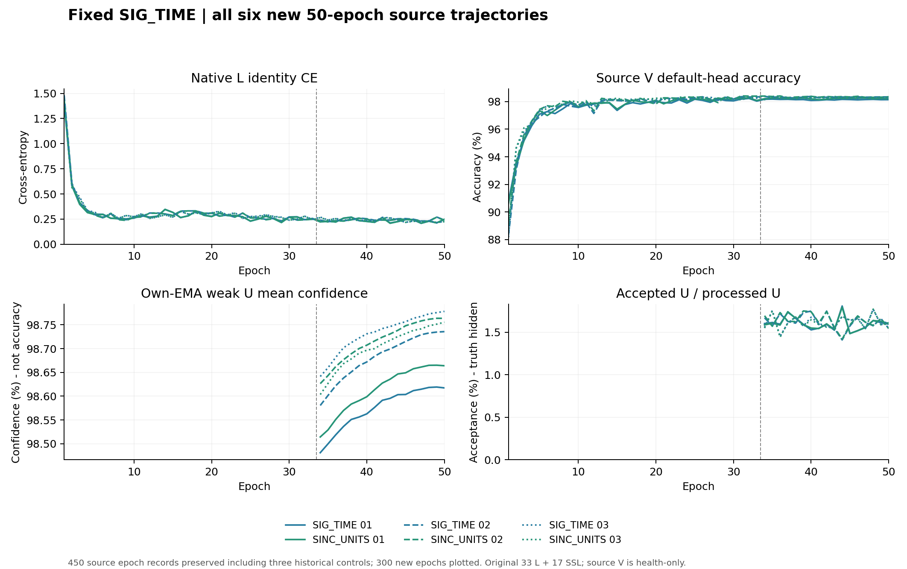

# 固定 SIG_TIME 的 Sinc 优化器单位：完整三种子结果

SINC_UNITS 的默认头 clean 三种子均值为 **83.223214% ± 0.492234 个百分点（样本标准差）**，同配方 SIG_TIME 为 **82.696230% ± 1.624144 个百分点**。逐 seed 配对差均值 **+0.526984 ± 1.161397 个百分点**，2/3 为正；距84%还差0.776786个百分点。主要增益来自 seed02，seed01负差、seed03仅+0.005357个百分点；这是有均值收益但种子差异明显的结果，不能称稳定越过84%或新类迁移已证实。

## 运行与固定比较

首run `20261015-phase1-sinc-units-oldgate-cos-e50-clean-manysig-s01-m3-r02`（R02）与本run `20261015-phase1-sinc-units-oldgate-cos-e50-clean-manysig-s0203-m6-r01` 合并为预定义三个模型seed2026092701/02/03。每seed：历史旧门控＋EMA＋cos基线、固定SIG_TIME同路径标准优化器、只更改Sinc优化器单位的候选。共9模型、6新训、3历史基线复用；首seed未重训，完整162指标/1512000默认头clean决策。首seedR01因发布依赖在训练前失败，0更新且原产物保留，R02只修依赖与输出身份。

核心实现 `00132f7d54aff45b6e52fc41f89d7705a043bc71`，直接依赖修复 `7221e39e0301e0de68231c3526e6c755295270d8`，剩余seed适配器 `03fd8a8c7b64663bc52edb83359d3e610cfeb361`。首run执行 `9fc348bc4be71f498a7684484fd86de81e3e4870`；剩余run执行和首源PASS扩展决定均为 `1a3be6d2568939ff56c38c8bc8dc9a879b7abe76`。源决定在首候选新目标数值读取前已推送；首数值读取时间2026-10-15T01:14:15.557Z。剩余完整回收始于2026-10-15T01:54:41.860Z，本对话解析完整结果于2026-10-15T01:55:29.169Z；没有据首种子负差取消、改参、重训或选择性遗漏。

全臂scratch50，33label＋17pseudo、每轮222步、每模型11100次AdamW更新；原batch_neighbor门控、ownEMA0.999、UCE0.16、entropy0.01、smoothing0.01和cos学习率保持。基线不是纯CE。源L6300/U56700隐藏TX/V27000及原物理split保持；本次6新模型NoExplicitCFO和内部补偿保持，无新增星地训练增强。仅固定终轮默认学生头clean测试，每模型168000样本；prediction固定后独立truth-last。已暴露研究基准不称新的独立盲测。

复现：既定release的 `python -u -m experiments.cvs_sinc_units_seeds.dispatch`，CWD为`PROJECT/releases/cvs_sinc_units_seeds_20261015_r01`；逐行配置和路径在同目录experiment.json。完成后回收入口 `analysis/collect_sinc_optimizer_remaining_20261015.py`，本地独立合并入口 `analysis/combine_sinc_optimizer_results_20261015.py`（提交`e5b55d5c32f8c3af78ca270c0be571420684cf51`）。这些回收不重新训练或生成目标预测。

## 默认头完整结果

全部准确率单位为%，差值/标准差为百分点。样本标准差基于3个模型seed，不把样本数当seed数。

| model seed | 旧门控＋cos | SIG_TIME | SINC_UNITS | 单位 − SIG 差值 |
|---|---:|---:|---:|---:|
| 2026092701 | 80.668452 | 83.636905 | 83.354762 | -0.282143 |
| 2026092702 | 78.081548 | 80.820833 | 82.678571 | 1.857738 |
| 2026092703 | 82.830357 | 83.630952 | 83.636310 | 0.005357 |

| 方法 | 准确率均值 ± 样本SD | Macro-F1均值（×100） | 每seed最差RX均值 | 每seed最差day均值 |
|---|---:|---:|---:|---:|
| OLD_GATE_COS50 | 80.526786 ± 2.377572 | 80.002386 | 67.970833 | 76.055556 |
| SIG_TIME | 82.696230 ± 1.624144 | 82.146796 | 70.368056 | 78.478571 |
| SINC_UNITS | 83.223214 ± 0.492234 | 82.754896 | 70.702778 | 79.348413 |

| 配对 | 均值差 ± 配对样本SD | 正差seed | 修正错误 | 引入错误 | 净正确数 |
|---|---:|---:|---:|---:|---:|
| SINC_UNITS − SIG_TIME | 0.526984 ± 1.161397 | 2/3 | 13473 | 10817 | 2656 |
| SINC_UNITS − OLD_GATE_COS50 | 2.696429 ± 1.895556 | 3/3 | 30648 | 17058 | 13590 |
| SIG_TIME − OLD_GATE_COS50 | 2.169444 ± 1.190983 | 3/3 | 27628 | 16694 | 10934 |

每组配对为同物理ID的504000个模型×样本决策。相对历史旧门控的+2.696429个百分点包含SIG_TIME结构及优化器两部分，不能全部归于本机制；隔离机制的主比较是相对本矩阵SIG_TIME的+0.526984个百分点。最差RX/day均值是各模型各自最差组再平均，不能当作固定同一RX/day的配对差。

| seed | 配对 | 修正错误 | 引入错误 | 净正确数 |
|---|---|---:|---:|---:|
| 2026092701 | SINC_UNITS − SIG_TIME | 4258 | 4732 | -474 |
| 2026092701 | SINC_UNITS − OLD_GATE_COS50 | 10597 | 6084 | 4513 |
| 2026092701 | SIG_TIME − OLD_GATE_COS50 | 10467 | 5480 | 4987 |
| 2026092702 | SINC_UNITS − SIG_TIME | 6133 | 3012 | 3121 |
| 2026092703 | SINC_UNITS − SIG_TIME | 3082 | 3073 | 9 |
| 2026092702 | SINC_UNITS − OLD_GATE_COS50 | 12727 | 5004 | 7723 |
| 2026092703 | SINC_UNITS − OLD_GATE_COS50 | 7324 | 5970 | 1354 |
| 2026092702 | SIG_TIME − OLD_GATE_COS50 | 9927 | 5325 | 4602 |
| 2026092703 | SIG_TIME − OLD_GATE_COS50 | 7234 | 5889 | 1345 |

全部按RX/day/TX的混淆矩阵、准确率与F1见results.json；162条记录均与原评分、独立原始prediction/truth复算和本地CM算术吻合。图已渲染查看。

## 机制：参数确实更新并进入实际导出特征

仅对原48个Hz Sinc参数设置 lr×Fs、eps÷Fs、wd÷Fs（Fs=25000000）；原始参数化、全部其他参数（含默认W）的优化设置、原Hz空间全局clip5保持。原cos日程每轮覆盖组lr，step前按固定规则恢复Sinc单位映射。等价性仅限于相同的已裁剪梯度；不是整个AdamW/clip轨迹的坐标不变性，也未扫描倍率、初始化或核数。

| 模型 | student低截止改变 | student带宽改变 | student核相对L2变化 | ownEMA核相对L2变化 |
|---|---:|---:|---:|---:|
| SIG_TIME-s2026092701 | 1/24 | 0/24 | 1.198752e-8 | 3.357780e-6 |
| SINC_UNITS-s2026092701 | 24/24 | 24/24 | 3.071704e-1 | 3.064144e-1 |
| SIG_TIME-s2026092702 | 1/24 | 0/24 | 1.170845e-8 | 3.357780e-6 |
| SINC_UNITS-s2026092702 | 24/24 | 24/24 | 3.666645e-1 | 3.661509e-1 |
| SIG_TIME-s2026092703 | 1/24 | 0/24 | 1.198752e-8 | 3.357780e-6 |
| SINC_UNITS-s2026092703 | 24/24 | 24/24 | 3.799430e-1 | 3.801744e-1 |

标准组每seed只有一个低截止有极微小改变、带宽0/24；单位组48参数全改变。原标准EMA的小核漂移不能直接当学习，其量级与此前固定参数EMA舍入回放一致。候选student/EMA核均明显改变，说明更新尺度问题在实际训练中得到修正，但不能因此推断Sinc是全部泛化瓶颈。

三个seed初始同参数/默认头，源L720的候选与控制最终实际部署joint160差异如下：

| seed | raw joint160平均L2差 | 平均cosine |
|---|---:|---:|
| 2026092701 | 3.697698 | 0.923888 |
| 2026092702 | 3.097486 | 0.947076 |
| 2026092703 | 3.350734 | 0.939744 |

所有6个新模型的真实fθ为195041参数，类别W为960参数；feature-only导出与原joint160逐元素一致，最大差0，清零/删除旧W不改变z。base_norm、pa_norm、gain和参考响应保留在fθ；默认6×160/scale30头原方式联合训练。实际fθ数值变化、W正常更新和学生/EMA参数记录已保存；诊断不更新参数/buffers、不拟合新头。证据表明作用进入实际特征，不证明丢弃W后新TX识别能力或Phase2效果。按用户最新要求不另训分类头，也不用历史换头指标替代本比较。

实际native L/U梯度回放覆盖E33/E34/E50各完整222批、6新模型：3996批观察/11988层记录/35964输入向量，逐层计数不是独立模型seed。实际Sinc更新观察是E1/E17/E33/E50各13批，共312snapshot批/624参数记录；时间上可能与L/U观察重叠，不能简单相加为独立样本。native配置、更新数、U曝光、EMA和关闭新拟合探针均完整核对。

## 完整训练曲线与成本

| 新模型 | 最后5轮L CE均值 | 最后5轮源V准确率均值（%） |
|---|---:|---:|
| SIG_TIME-s2026092701 | 0.228386 | 98.142963 |
| SINC_UNITS-s2026092701 | 0.229129 | 98.228889 |
| SIG_TIME-s2026092702 | 0.244665 | 98.334815 |
| SINC_UNITS-s2026092702 | 0.242088 | 98.335556 |
| SIG_TIME-s2026092703 | 0.227248 | 98.272593 |
| SINC_UNITS-s2026092703 | 0.225559 | 98.295556 |

所有50轮均保留；源V仅作健康观察，没有据它或目标选中途checkpoint。末段L CE约0.226至0.245，源V约98.14%至98.34%；到预算不等于已经证明收敛，不延长或择优重跑。原U接受率约1.6%，teacher均值置信度不是伪标签精度，U真值未解封。

| 模型 | 来源 | epochs / 更新数 | U处理 / 接受 | epoch秒之和 |
|---|---|---:|---:|---:|
| OLD_GATE_COS50-s2026092701 | 历史复用 | 50 / 11100 | 963900 / 15214 | 2334.840 |
| SIG_TIME-s2026092701 | 本次新训 | 50 / 11100 | 963900 / 15422 | 2030.523 |
| SINC_UNITS-s2026092701 | 本次新训 | 50 / 11100 | 963900 / 15426 | 2013.379 |
| OLD_GATE_COS50-s2026092702 | 历史复用 | 50 / 11100 | 963900 / 15126 | 2274.569 |
| SIG_TIME-s2026092702 | 本次新训 | 50 / 11100 | 963900 / 15657 | 2342.346 |
| SINC_UNITS-s2026092702 | 本次新训 | 50 / 11100 | 963900 / 15729 | 2084.680 |
| OLD_GATE_COS50-s2026092703 | 历史复用 | 50 / 11100 | 963900 / 15204 | 2277.616 |
| SIG_TIME-s2026092703 | 本次新训 | 50 / 11100 | 963900 / 15610 | 2349.272 |
| SINC_UNITS-s2026092703 | 本次新训 | 50 / 11100 | 963900 / 15555 | 2061.951 |

本次6模型累计300新训练轮、66600optimizer更新、5783400个U包观察；3历史基线另150轮/33300更新已存在，不新增训练。无新增训练模型前向、额外优化更新或头拟合；实际诊断梯度、源feature witness、预测及评分成本单独存在，不与epoch秒混算。共享GPU/运行并发不同，epoch耗时不用于宣称此机制获得因果加速。原始日志/CP/预测保留于各PROJECT/runs/<run>/<row>，只上传实现、配置、报告和聚合证据。

## 判断与后续

本机制实际解除了原Sinc参数近乎静止的问题，完整三种子有均值收益，且在本小样本中样本SD较低；由于配对差离散且seed03近零，不能断言稳定或显著改善方差。保留全部正负seed，不根据目标重调Sinc倍率、择父或补跑。84%目标未完成。

另一独立候选的来源、固定父和公式已在读取本剩余目标数值前写入并上传：`cvs_source_rdrop`源检验只测同输入两次dropout前向的一致性，不改变SIG_TIME或头。下一步按其独立预登记和源结果处理，不能把本Sinc目标分数回流为新机制选模。全部新训练仍≤50/model，默认头正常联合训练。
