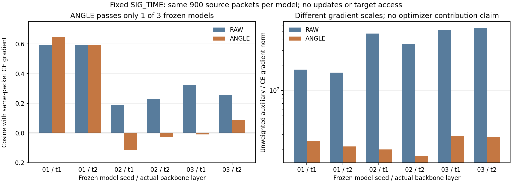

# 固定 SIG_TIME 方差方向源检验：三模型结果

**结论：原固定 ANGLE 公式未通过三模型源端判据，不进入训练实验。** 本次执行与独立产物复算 VERIFIED，科学资格 FAIL，二者区分记录。

| 模型种子 | t1：ANGLE/CE 梯度余弦 | t2：ANGLE/CE 梯度余弦 | 固定源资格 |
|---|---:|---:|---|
| 2026092701 | 0.646206 | 0.593616 | PASS |
| 2026092702 | -0.111682 | -0.024725 | FAIL |
| 2026092703 | -0.009819 | 0.087680 | FAIL |

所有模型均在相同五组 L180、900 个唯一源物理样本上检验；第一模型保留原结果，本次仅新增 seed02/03。六个层对象的 ANGLE 梯度均5/5非零，模型/缓冲区未变，但只有3/6层的聚合余弦非负。seed02两层和seed03浅层与身份CE梯度冲突，所以不是数值退化或缺样本导致失败。原RAW六层余弦均为正；ANGLE不能因去掉幅度权重就被默认视为更合适的身份泛化约束。

这是固定终轮模型、固定900-L子集的局部导数证据，不能推导早期训练或全源数据的普遍结论，也不是目标性能结果。未加权ANGLE梯度范数约为同批CE的16.48至28.65倍，RAW为162.63至552.06倍；这些不是优化器实际累计贡献，不比较新训练性能。

本次新增2模型观测、1800模型样本次、10梯度批、20实际逐样本矩阵、20层记录与60向量；跨三模型共2700模型样本次、15批/30矩阵/30层记录/90向量，物理样本仍只有900个。每行由第二进程从保存矩阵/向量重算损失、梯度统计和样本覆盖；本地独立重算三模型固定判据一致。没有新增训练轮数、优化器/头更新、U真值读取、V前向或query访问。

实现 `5cc440c08feba25ce127cbcf73f489bf04b93e5d`；实际执行 `e493b3e28c6ffb2824a52f7d6d71028c00015077`。源扩展决定 `cc2409be311c416c7cf4ed3d0ea6409b79f3f973` 保持原样。一次普通预检、归档比对、远端编译和真实checkpoint无query smoke通过；实际启动PID/CWD/argv匹配，日志从0增至1139字节，原进程自然结束，失败文件为空，最终完整产物 VERIFIED。

后续停止该固定公式，不调整标准、换父权重、扫系数或挑seed重跑。SIG_TIME和默认联合头保持，下一机制另行依据合法源证据设计；84%目标仍未完成。

