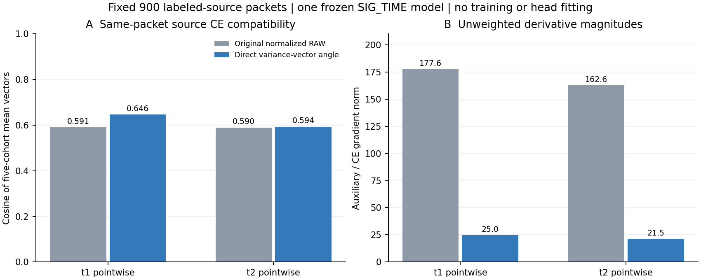

# 900L 方差形状目标：真实骨干导数检验

**预先固定的源资格PASS。** 新RAW方差向量角度目标可向真实t1/t2传递非零二阶梯度；在固定900个L_s样本汇总上，两层与同批身份CE梯度cos均为正。它通过了实现/源身份兼容性检验，尚无新训练、目标性能或泛化收益证据。

run 20261015-phase1-source-backbone-variance-angle-manysig-s2026092701-r01，代码6907495c3c35147a08a5daa5c30f85fce9060ba8，实际执行30047816ba3beaa581a18cc0384ee947413fff6d，状态ANALYZED/VERIFIED。唯一模型为原BF匹配SIG_TIME ZERO源对照seed2026092701/final50，原scratch50/11100更新/默认联合cos头；当前只读eval，不做头拟合或参数更新。按事前固定数据seed2026210712的前5个平衡L180 cohort，900物理样本互不重复，每cohort覆盖6TX×3day×5RX×2包；不是全6300L、多个modelseed或源留一RX泛化实验。

| 层 | 原RAW与CE的cos | ANGLE与CE的cos | 原RAW/CE范数比 | ANGLE/CE范数比 | ANGLE非零cohort |
|---|---:|---:|---:|---:|---:|
| t1 | 0.590588 | 0.646206 | 177.591 | 24.976 | 5/5 |
| t2 | 0.589978 | 0.593616 | 162.628 | 21.514 | 5/5 |

上表先将5个同批导数向量分别求平均，再计算全局cos/范数比；没有把900样本或5个相关cohort视作独立模型。CE参考为真实逐包参数梯度G.mean，和辅助目标使用完全相同L180与原默认W。两目标均未乘新的训练系数，范数比不是实际AdamW累计贡献，也不能直接与原训练不同L128批次的主CE作用比较。两个目标的导数幅度差异明显，未来即便做训练，也须明确比较与幅度控制，不能只据方向cos宣称几何机制更优或选权重。

原RAW目标均值3.270179，ANGLE均值0.459246（不同量纲不作大小优劣比较）；固定900L eval CE约0.097881。实际900包前向、5梯度批/10层记录/30保存向量、10逐包参数梯度矩阵；CPU2主测量26.19s。来源/role与预登记一致，W在辅助图无梯度依赖；全部模型参数/buffers逐值未变，无累积grad/optimizer步骤/新参数或头训练，V前向0、U/query/truth访问0。另2个零IQ真实checkpoint smoke输入独立记账。

单普通账户preflight、单archiveSHA、remotecompile/真实CPnoquery smoke PASS。初次publisher独立进程检查VERIFIED/live，终态原PID已自然退出，5次cohort进度与completion可读、failure0，日志从0增长到695bytes。保存actual_source_gradients.pt后第二独立进程重新计算原/新损失、同批CE向量、900物理覆盖与全部层统计，源资格再次一致，结果VERIFIED。未重跑模型、预测、评分或原训练。

资格只对应这一固定终轮模型/900L子集。按事前PASS后续范围，固定02/03两模型同公式、同前5cohort、每seed900L，来源为对应BF剩余种子SIG_TIME ZERO/final50；下一run 20261015-phase1-source-backbone-variance-angle-manysig-s0203-m2-r01，当前尚未实现/发布。只扩源诊断，不自动训练或访问目标，不改epsilon/判据/样本顺序或选择父模型。若任一后续seed失败，保留负结果，不训练此固定公式。

完整聚合results.json、发布/独立复算证据release_and_completion_evidence.json和固定source_extension_decision.json随Git交付。原实际矩阵/向量PT仅留不可变run/row目录，不上传。现有置信门控SSL训练按原50轮和自动clean评分继续；本源PASS不替代其尚未完成的三seed结果或84%目标。

