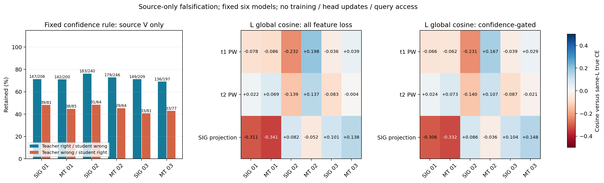

# 固定教师置信度次序：完整源域结果

**ANALYZED / VERIFIED；预定六模型源资格 PASS。** 规则在全部 6 个模型的 V 上更倾向保留“教师对、学生错”代理组：69.04% 至 76.25%，而“教师错、学生对”代理组为 40.74% 至 48.44%。全部组非空。该结果支持后续一个最小训练假设，尚不能证明真实 U 伪标签质量或目标域增益。84% 三种子目标仍未达到，本次没有新增目标预测或训练。

run 20261015-phase1-source-teacher-confidence-manysig-m6-r01；实现 e2eee613b9657d336657012eb33d060072a402d7；发布/预登记 3003478354f9e9d3a45175f8140cae45f1f282eb。唯一规则为 FP32 默认头 max softmax(ownEMAweak) >= max softmax(studentstrong)，相等保留，阈值差固定 0。无温度/阈值/权重扫描，不拟合分类头。源资格事先固定为 6/6 V 有益代理组保留率严格大于有害代理组且各组非空，未因结果修改。完整来源、角色、随机数、命令/环境、不可变 root、停止规则见 report.md/experiment.json；父模型是全部预定义 SIG_TIME/FEATURE_MT 三 seed final50 及各自 EMA，不按目标成绩挑选。

## V 无梯度资格

“有益/有害”只是教师/学生源真值对错组合的简写，不保证每包特征导数的实际作用，也不是已知真实 U 对错。每模型 V27000，无任何拟合、梯度或参数更新。

|模型/seed末两位|教师对、学生错：保留/全组|教师错、学生对：保留/全组|全部 V 保留率|置信度相等数|
|---|---|---|---|---|
|SIG_TIME / 01|147/206（71.36%）|39/81（48.15%）|93.95%|0|
|FEATURE_MT / 01|142/200（71.00%）|38/85（44.71%）|91.23%|0|
|SIG_TIME / 02|183/240（76.25%）|31/64（48.44%）|94.82%|0|
|FEATURE_MT / 02|179/246（72.76%）|29/64（45.31%）|92.41%|0|
|SIG_TIME / 03|149/209（71.29%）|33/81（40.74%）|93.51%|0|
|FEATURE_MT / 03|136/197（69.04%）|33/77（42.86%）|90.74%|1|

合并相关模型的观测计数为 936/1298 与 203/452，仅作核账，不当作六套独立数据或六次独立统计检验。整体 V 保留率 90.74% 至 94.82%；全部 V162000 模型观测中仅 1 次置信度相等，未显示 FP32 概率饱和主导筛选。该语境仅限这些源模型/视图，不推断 U 分布。

## L 同强图导数

|模型/seed末两位|教师对、学生错保留/全组|教师错、学生对保留/全组|全部 L 保留率|t1 / t2 / SIG 投影：原 .1 feature cosine → 门控后|
|---|---|---|---|---|
|SIG_TIME / 01|22/25|4/8|94.70%|-0.0780 → -0.0657 / 0.0223 → 0.0242 / -0.3107 → -0.3058|
|FEATURE_MT / 01|21/23|1/7|92.14%|-0.0864 → -0.0616 / 0.0687 → 0.0728 / -0.3406 → -0.3320|
|SIG_TIME / 02|28/33|2/3|96.00%|-0.2323 → -0.2308 / -0.1394 → -0.1405 / 0.0822 → 0.0864|
|FEATURE_MT / 02|26/32|1/3|92.83%|0.1981 → 0.1668 / 0.1369 → 0.1067 / -0.0520 → -0.0359|
|SIG_TIME / 03|27/32|1/3|94.37%|-0.0365 → -0.0386 / -0.0828 → -0.0870 / 0.1007 → 0.1045|
|FEATURE_MT / 03|28/33|1/4|92.02%|0.0386 → 0.0290 / -0.0044 → -0.0205 / 0.1380 → 0.1476|

梯度对象为实际 t1PW3456、t2PW6912、SIGprojection576，来源是实际部署 joint160；同 L 强图 CE smoothing .01 与固定 .1 feature consistency 比较。所有损失和分组贡献均用 full batch N，不按保留数放大。gated 分组导数对比完整原组 CE，不冒充 retained-only CE。ZERO 臂 .1 只是与 FEATURE_MT 相同的诊断系数，ZERO 的原训练 feature 权重仍为 0。

整体 cosine 仅 11/18 个相关层对象增加，其余降低；跨模型/层仍混合，不能声称普遍改善梯度方向。L 的教师错学生对组只有 3 至 8 包，某些对象门控后可为空或近零，完整 JSON 保留计数和 undefined 值。不能因 seen-L 的符号、组名或筛选效果，解释原均值教师目标下降的因果机制。

## 完整性与成本

6 模型、共享 L6300/V27000：199800 源样本模型观测、399600 forward 包次/1572 forward batch、150 L 梯度 batch/450 层记录/7200 保存向量。原始 PT 另进程重新打开，独立复算所有角色/组/保留/ties、批与完整 L 加权全局向量统计、V 0 梯度及固定资格，全部 VERIFIED；没有新增前向或反传。6 模型计时合计 319.469 秒（不含发布、cache 和第二进程复算；CPU2线程，不作并发 GPU 速度比较）。

新增模型 epochs、optimizer/EMA/头/模型更新均为 0，参数/buffer 前后逐值相等，teacher stopgrad、V no_grad、U IQ/TX/ID 与目标访问均为 0。原父训练各 50 epochs/11100updates，未重训或改变健康任务。源数据与 checkpoint 来源沿用已验证实际契约，没有重新 hash 数据。

单次实际代码/config Git、聚焦负例与真实 checkpoint noquery smoke、一次独立 P0/P1、普通账户 preflight、一个 archive 本地/远端 SHA 比对、remote compile、PID/CWD/argv/CPU/loggrowth 已 VERIFIED；进程自然完成，failure 0。原始 PT/日志保留在不可变运行目录，Git 只交聚合报告/JSON/图。预登记中 artifact 名 source_gradient_recount.json 属描述笔误；实际每 row 文件名是 independent_artifact_recount.json，已保存且由第二进程重新复算，未修改已发布代码或重跑。

下一步最多两个动作：继续完成既有 RAW/TX_DAY_CENTERED Fishr 的固定 02/03 矩阵；以本次纯源 PASS 为依据设计一个固定置信度门控 feature-consistency 训练对照，SIG_TIME/默认联合头/旧门控+EMA+cos、50轮预算和 truth-last不变，不堆叠 Fishr、不扫阈值、不用已暴露目标成绩调参，另行最小实现/预登记后发布。
