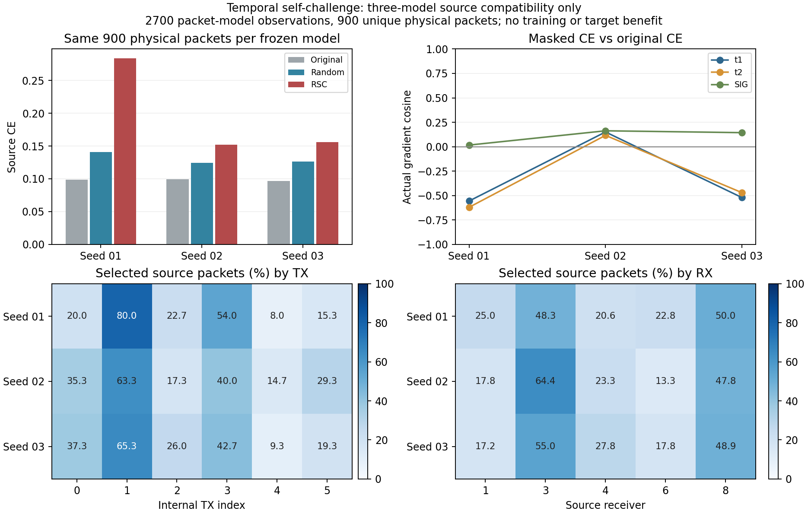

# 中层时序自挑战：完整三个源模型复核

状态：ANALYZED / VERIFIED / source-only。首模型原产物保留，只新增预定义02/03模型诊断；代码`1f5c259e9945913d7bb33fb88b1e270d861275dc`、剩余实际执行`00c7213ac3ce8d2543e9443f5e6dea9ff5772a7b`，源扩展决定`737b65502bc5d9f204a605108b80f430bfe59541`先已上传。源PASS为3/3，仍没有正式RSC训练或新的目标准确率，不能宣称DG/SSL或84%已改善。

| 模型seed | 原始CE | 定向CE | 随机CE | 定向−随机CE | t1梯度cos | t2梯度cos | SIG梯度cos |
|---|---:|---:|---:|---:|---:|---:|---:|
| 2026092701 | 0.098431 | 0.283861 | 0.140787 | 0.143074 | -0.556406 | -0.620389 | 0.016417 |
| 2026092702 | 0.099133 | 0.152144 | 0.124642 | 0.027502 | 0.150474 | 0.115834 | 0.162607 |
| 2026092703 | 0.097007 | 0.155968 | 0.126110 | 0.029858 | -0.520896 | -0.470671 | 0.143616 |

定向遮挡在三模型中均比同物理包/同零数随机控制产生更高CE与更大的真类概率下降，但效果量随种子变化。t1/t2的定向CE梯度在seed01/03与原始CE反向，在seed02同向；SIG在三个模型中接近正交至弱同向。因此，不能把强梯度或当前sourcePASS当成普遍有益学习方向。表中cos是先对同模型5个cohort的实际参数导数取均值，再计算余弦，不是5个余弦的平均。源规则只确认针对性挑战和实际导数接通，没有训练可恢复性或泛化收益承诺。

新两模型共1800包×模型观测/7200源前向包次/10定位张量/40参数层记录120向量；与原首模型合计2700包×模型观测/10800源前向/15定位张量/60层180向量。三个raw PT中的实际物理ID集合独立比对完全相同，唯一物理包总数仍900，不是2700；每模型900个唯一包。每模型选择300包、屏蔽3300包×时间位置，全部与自己的随机控制相同。源父训练是既有三模型50轮/11100各自的成本复用，不产生新骨干更新。

三个实际对象t1PW/t2PW/SIG的增量每模型均5/5cohort非零；原默认W只记录正常CE图导数，无头拟合、优化器步、EMA或参数/buffer更新。源真实t2临时mask不改变SIG_TIME推理结构、195041个特征参数、joint160交付或默认ResidualPhysicalHead。hook已移除，.grad未累计。源样本本身参与父模型训练，只作机制兼容性，不能称源heldout或真正留RX实验。无U IQ/隐藏TX、V前向或梯度、query、目标truth读取。

覆盖模式在三个模型中都有偏向，但不是完全相同：TX内部索引1/3占选中包分别67.0%、51.7%、54.0%；源RX3/8占59.0%、67.3%、62.3%。这只是对当前模型扰动敏感的条件分布，不证明RX捷径或应当删除的证据。同包随机控制继承该选择倾向，隔离的是时间位置选择，不是独立全源随机Dropout。完整TX/RX/day、32位置和实际ID交集/并集计数见three_model_coverage.json。已冻结规则未据这些数据调整。

父来源严格对应原DRO矩阵SIG_TIME02/03控制final50、原执行`a283291279cb01b939325cf5ccba1d0a671b28c4`，原进程自然完成后才发布源复核；没有中途或其他得分父回退。L6300/U56700隐藏TX/V27000及split392005原契约、NoExplicitCFO、物理ID保持。两模型source_proof和一次真实CP synthetic no-query smoke PASS；单归档SHA核对/远端compile/原进程PID-CWD-argv/CPU-only与日志0→2285字节及自然完成产物核实。原DRO训练和自动clean评分未被改动。

原始PT/梯度/logits/mask/日志保留在不可复用run根；独立第二进程重算全部固定cohort、mask、CE和参数向量，状态VERIFIED。13新负例/两native model seed上下文及唯一适配器P0/P1 PASS；数值方法和首模型产物未重跑。Git提交实现、必要聚合结果及图，0额外权限/签名/数据重验。

下一项独立训练假设记录在next_training_hypothesis.json：基于RSC一般方法与三模型源证据，在固定SIG_TIME上比较原监督、匹配随机时间mask与定向RSC，默认头正常联合训练，原旧门控/EMA/cos与33+17/50预算不改。此时尚未读取DRO剩余seed目标数值，设计不是根据新目标错误或分数调整；已暴露基准仍不称盲测。它需要独立完成实际实现、窄验证、一次P0/P1和预登记，sourcePASS不自动启动训练。

