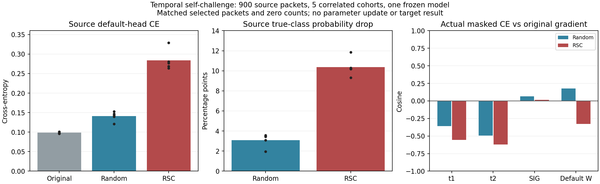

# 中层时序自挑战：首模型源结果

状态：ANALYZED / VERIFIED / source PASS。真实固定900个L物理样本已完成四观测，3600源前向包次、5个定位张量、20参数层记录/60向量；独立第二进程重算mask、真类概率、CE、覆盖及源决定一致。无新增训练、参数/buffer/EMA更新、头拟合或U/V/query前向。代码`50d265cb0e8e48cdc2580c9f7b13e342f26b50c8`，实际执行`2266f50a7be42eaa2a283bd7a6dd561adef548ab`。

实际结果说明，RSC式定向时间遮挡比同物理包/同零数的随机坐标遮挡更强地破坏当前模型的源身份判断。它验证有区别的挑战任务已接通，并没有证明被抑制的是接收机捷径、剩余信息更可迁移或训练后性能提高。完整源规则PASS只允许独立登记02/03源复核，不自动训练或目标测试。

| 观测 | 平均默认头CE | 真类概率平均下降（相对原始） |
|---|---:|---:|
| 原始 | 0.098431 | 0 |
| RSC选择性定向时间遮挡 | 0.283861 | 0.103717 |
| 同包同零数随机时间遮挡 | 0.140787 | 0.030950 |

五批每批180包，其中60包被选择，每个选择包屏蔽11/32个时间位置；总计选择300/900包、屏蔽3300/28800个包×时间位置，两种遮挡完全同预算。特征量化并列规则没有导致异常超额，实际t2均非负。选择预算是source物理包，不能把定位反传或四次前向当新增独立样本。

| 对象 | RSC CE/原始CE梯度范数比 | 与原始CE余弦 | 匹配随机范数比 | 匹配随机余弦 |
|---|---:|---:|---:|---:|
| t1 | 14.1482 | -0.556406 | 2.3391 | -0.357591 |
| t2 | 15.7520 | -0.620389 | 2.5520 | -0.492081 |
| SIG | 25.1650 | 0.016417 | 3.6603 | 0.065849 |
| 原默认W | 24.5597 | -0.328831 | 4.1579 | 0.177902 |

两个骨干层的RSC梯度与原始CE明显反向，SIG梯度近正交；范数也明显更大。随机对照的t1/t2同样反向，强度较小。这是固定终轮eval模型对受遮挡输入的实际参数导数，不是训练中的AdamW步、累计表示更新或泛化方向。原始CE已经很低，所以比值大部分也受小分母影响；不可据此把RSC判为有效、无害或必然有害，也不据这些数值调mask率、系数或挑层。

三个实际fθ对象RSC−原始CE增量5/5cohort非零，默认W导数仅记录既有CE正常联合图，没有任何拟合或参数更新。正常默认头仍是同一个ResidualPhysicalHead，SIG_TIME、实际joint160导出结构和所有权重保持；临时hook最终移除，.grad不累计，mask RNG独立。真类logit只用于合法源定位，没有访问隐藏U标签、目标错误表或新分类器。

数据及父模型：split392005，原L6300的固定前五L180cohort（每TX/RX/day2包）；预定义第一名义seed2026092701 SIG_TIME ERM控制final50，来自`20261015-phase1-receiver-dro-oldgate-cos-e50-clean-manysig-s01-m4-r01`，严格检查原scratchlineage和当前契约。源样本并非独立于该模型训练的数据，只用于机制兼容性，不当验证准确率或未见域证据。现有目标基准已暴露，未因目标排序父权重或调选mask。

检查与执行：13本地负例/真实网络导数检查及唯一P0/P1 PASS；一次普通预检、归档SHA核对、远端编译、真实CP2个synthetic IQ无query smoke通过。实际源进程PID/CWD/argv/CPU-only已核实，日志0→890字节并自然完成；所有source输出和独立复算保留。源3600前向包次之外，远端前置真实初始化检查还有48个synthetic forward包次及CP smoke2个synthetic包，均不是源样本或训练成本。六个固定DRO训练进程继续健康运行，未改动。

下一步只准备原样seed02/03源复核：父来源按各自固定DRO矩阵SIG_TIME控制final50指定，等原训练自然完成后才读取，不换用其他得分模型。完成三模型源结果前不决定正式RSC训练日程或SSL扩展。目标84%仍未达到，此结果无任何新目标准确率。

只读保存mask覆盖补充：TX内部索引1/3占选择包67%，源RX3/8占59%，day分布接近均匀；定向位置零计数16至218、随机90至119，两者总计3300。此源敏感性集中不能当RX捷径或DG收益，固定02/03源复核不改。详见saved_mask_coverage.md/JSON/图；无新增前向或更新。
