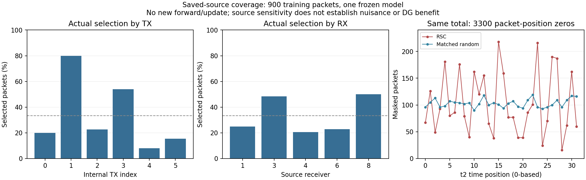

# 保存遮挡的源覆盖补充

状态：VERIFIED，只读首模型原actual_source_gradients.pt；无新网络前向、梯度、权重/EMA/头更新、IQ或checkpoint读取，也不读取U或目标truth。合法L标签用于源分组。仍是同一900L和300个选择包，不是新实验或新的科学门槛。

自挑战并非均匀覆盖身份：TX内部索引1/3分别选择120/150、81/150，合计201/300个选择包（67%）；源RX3/8分别选择87/180、90/180，合计177/300（59%）。day1/2/3分别101/105/94，接近均匀。TX索引只是本运行既有6类标签索引，不能与物理RX编号混用。

| TX内部索引 | 源包数 | 选择包数 | 选择比例 | 定向新增源错误 | 随机新增源错误 |
|---|---:|---:|---:|---:|---:|
| 0 | 150 | 30 | 20.00% | 4 | 1 |
| 1 | 150 | 120 | 80.00% | 49 | 4 |
| 2 | 150 | 34 | 22.67% | 6 | 2 |
| 3 | 150 | 81 | 54.00% | 16 | 8 |
| 4 | 150 | 12 | 8.00% | 1 | 0 |
| 5 | 150 | 23 | 15.33% | 1 | 0 |

原始默认头对这900个训练源包判对899；定向遮挡后822、随机后884。定向新增77个源错误，随机新增15个，均未修正原先错误。这是同一已训练源样本上的受扰动敏感性，不是heldout准确率、训练收益或U伪标签精度。

位置选择也不均匀：32个t2时间位置的定向置零计数为16至218，匹配随机为90至119；两者总数都3300。位置15/23分别218/216，但其他位置也有较高计数，不能把作用全部归于窗口端点。完整32位置和5cohort分布保留在saved_mask_coverage.json。

这些结果说明，当前默认模型对定向时间遮挡的源敏感性集中在部分身份、接收机和位置。不能直接认定这些证据是RX捷径、应该删除，或剩余特征天然更可迁移。相同物理包控制也意味着随机对照继承同样的身份选择倾向；它隔离的是坐标选择，不是全体源样本的独立随机Dropout。

冻结的02/03源复核保持原样，不能凭这一模型的分组表调整mask率、均衡规则、层或父。三模型源结果会区分这一模式是否仅为单个训练种子的现象；source资格仍按原规则解释，额外覆盖统计不作为新的发布阻挡项。

