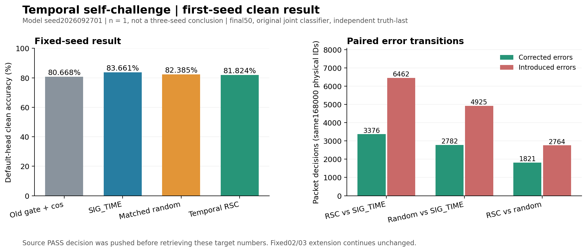
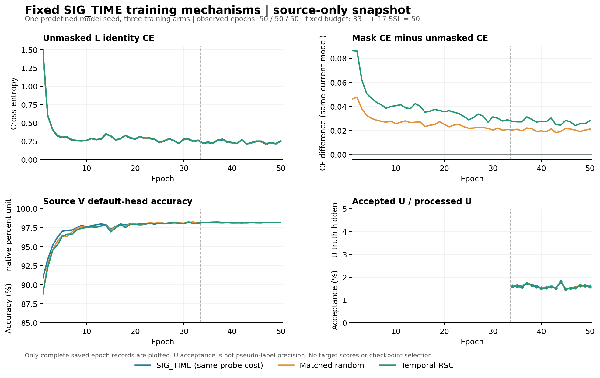

# 固定 SIG_TIME 时序自挑战：首种子完整结果

时序自挑战未带来首种子泛化增益。TEMPORAL_RSC 为 81.823810%，同成本 SIG_TIME 为 83.660714%，配对下降 1.836905 个百分点；匹配随机遮挡为 82.385119%。源资格 PASS、非零骨干梯度和实际部署特征变化均已验证，但没有转成目标收益。n=1 不计算种子样本标准差，不能代替完整三种子目标。

## 结果与比较口径

Run：`20261015-phase1-temporal-rsc-oldgate-cos-e50-clean-manysig-s01-m4-r02`。ManySig 固定 split392005，clean168000/row，旧6 TX×7目标RX×4days；模型种子2026092701。默认头固定final50后预测，全部预测先固定再独立truth-last评分。既有基准已暴露，本轮不声称新的独立盲测。所有整体、RX、day、TX分层的72条指标保存在 [results.json](results.json)，6×6混淆矩阵与标量经独立重算。

| 方法 | clean 准确率（%） | Macro-F1（%） | 最差 RX（%） | 最差 day（%） |
|---|---:|---:|---:|---:|
| OLD_GATE_COS50 | 80.668452 | 80.173353 | 70.616667 | 75.452381 |
| SIG_TIME | 83.660714 | 83.235588 | 71.045833 | 79.128571 |
| MATCHED_RANDOM | 82.385119 | 81.893463 | 65.541667 | 78.023810 |
| TEMPORAL_RSC | 81.823810 | 81.283621 | 64.420833 | 77.538095 |

| 配对 | 差值（百分点） |
|---|---:|
| TEMPORAL_RSC − MATCHED_RANDOM | -0.561310 |
| TEMPORAL_RSC − SIG_TIME | -1.836905 |
| MATCHED_RANDOM − SIG_TIME | -1.275595 |
| TEMPORAL_RSC − OLD_GATE_COS50 | 1.155357 |
| SIG_TIME − OLD_GATE_COS50 | 2.992262 |

RSC相对SIG修正3376个错误、引入6462个错误，净减少3086/168000个正确决策；相对随机修正1821、引入2764、净减少943。随机相对SIG修正2782、引入4925、净减少2143。全部5个预定配对及错误转移计数保存在 [independent_statistics.json](independent_statistics.json)，计数、准确率差和物理ID逐行对齐。RSC相对历史旧门控+cos的+1.155357个百分点不能全部归给训练机制；固定网络、同成本SIG对照是其机制比较。

## 固定网络和真实特征更新

部署特征提取器为原SIG_TIME195041参数，输出joint160；既有6×160、scale30默认cosine分类头随骨干正常联合训练。没有冻结骨干后另训、重训、替换分类头，也没有另拟合TX/RX/day诊断头。t2时间遮挡仅用于L训练，不增加推理结构，不作用于U或教师。

三个新模型从相同seed初态独立scratch50，33label+17pseudo、11100次原生AdamW更新。batch_neighbor、ownEMA0.999、cos、UCE0.16、entropy0.01、smoothing0.01、原L6300/U56700隐藏TX/V27000和NoExplicitCFO保持。源RX1/3/4/6/8、days1/2/3和物理角色不变，源V只作健康诊断。

自挑战用原默认头真类logit对完整t2激活N×96×32的有符号导数定位时间位置，再用固定2/3分位规则选择时间位置和包；以最终遮挡CE替代原L CE。随机在自身当前模型内使用同选择包、同逐包零数，私有随机顺序置换时间位置。训练臂分化后不能声称跨臂选择的是同一批物理包。分位数并列保留既定包含等号规则，不按结果修改遮挡率或层位。

三个新模型195041个特征参数元素中，SIG/随机/RSC实际数值改变193460/193912/193847；原默认W的960元素均正常联合更新。真实源L720上随机/RSC相对SIG的部署特征L2均值3.324663/3.638345。feature-only导出与原模型joint160逐元素一致，最大差0；去除或清零旧W不改变z，归一化、增益和参考变换保留，诊断不改参数或buffers。详细证据见 [source_feature_mechanism.json](source_feature_mechanism.json)。这些是实际fθ学习和接口证据，不证明新TX/Phase2迁移。

## 实际训练梯度和成本

E1/17/33/50每臂每期13个预定间隔批，合计156批、624参数层记录、1872个保存向量。下表是E50各臂自身模型的条件梯度均值，依次为t1PW、t2PW、实际SIG投影。

| 方法 | 所选CE对未遮挡CE梯度余弦 | 梯度差范数 / 未遮挡CE范数 |
|---|---|---|
| MATCHED_RANDOM | 0.801359 / 0.812041 / 0.775929 | 0.751843 / 0.740077 / 0.799284 |
| SIG_TIME | 1.000000 / 1.000000 / 1.000000 | 0.000000 / 0.000000 / 0.000000 |
| TEMPORAL_RSC | 0.815158 / 0.792761 / 0.768744 | 0.615934 / 0.699182 / 0.750591 |

两个遮挡变体E50三个骨干层均13/13批非零差，SIG控制差0。保存向量用float64独立重算；CE、遮挡、原生消费和预算全量复核通过。上述梯度来自clip/AdamW前，不等于累计优化器贡献；仅52个诊断批/模型，不冒充全部11100步的梯度。完整四期几何见 [source_gradient_geometry_final.json](source_gradient_geometry_final.json)。

| 方法 | U接纳 / 实际处理 | 接纳率 | 50个epoch时间之和（秒） |
|---|---:|---:|---:|
| SIG_TIME | 15447 / 963900 | 1.602552% | 2545.986 |
| MATCHED_RANDOM | 15302 / 963900 | 1.587509% | 2530.859 |
| TEMPORAL_RSC | 15268 / 963900 | 1.583982% | 2534.553 |

接纳率不等于伪标签准确率，未解封U TX。原U loss对象直接保留、EMA成功更新逐步核对、非有限损失/梯度或跳过更新计数0。每新模型实际三个L前向/step，即33300个L网络前向，其中22200个额外前向；三新合计99900个L前向、66600额外前向，不声称与无探针历史运行同计算量。150个新model-epochs、33300个新更新，另列历史50轮/11100更新；保留200条完整源轮次记录。秒数是原生epoch时间之和，不含完整发布/源诊断/测试端到端开销。完整全量复核见 [native_recount.json](native_recount.json)。

图中源V是原生日志百分数，U接纳由分数转为百分比。最后5轮未遮挡L CE为SIG0.228233、随机0.233895、RSC0.235278；源健康达标不作为目标收益替代。完整新臂曲线在 [full_source_curves.json](full_source_curves.json)。

## 冻结决定与剩余种子

代码`82cc7f1c24c2e5d0e20572b2654722fdc3e43a47`，实际执行`e7a6215aa5d0a05e71c1c842e78cdfc845d57530`。原规则sourcePASS后，先提交并推送`832485cace509543a7b4e921ac7f5483a2053749`，再于2026-10-14T23:31:38.384Z回收首种子新目标数值；源码、预算和原样扩展决定没有读取这些数值后再选择。

剩余运行`20261015-phase1-temporal-rsc-oldgate-cos-e50-clean-manysig-s0203-m8-r01`已经按该决定启动，6个新模型对应SIG/随机/RSC×02/03，另复用2个历史结果；01不重训。代码`2f99d65f8a594ab1f56d84d1d7ee1011740da52c`、执行`832485cace509543a7b4e921ac7f5483a2053749`，已核实普通N607/真实checkpoint无query smoke/compile/单归档传输比较，以及6个原PID、CWD、argv、GPU和日志增长。首种子负差不改变仍健康训练的配方、排序、预算或自动clean truth-last流程。全部三种子完成后报告配对差、样本标准差和完整缺项；当前84%目标未完成。无卫星部署、新TX或Phase2性能声明。
