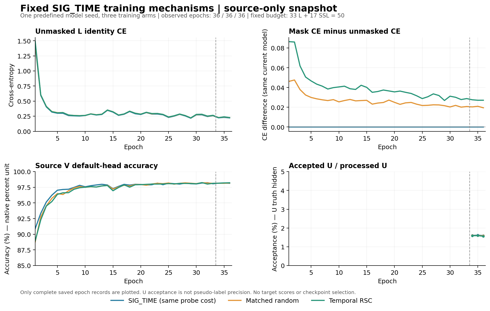

# 固定 SIG_TIME 的时序自挑战训练预登记

当前只检验训练机制。实际部署网络保持 SIG_TIME（195041 个特征参数）及既有 6×160、scale30 默认分类头；分类头随骨干联合训练，不单独拟合、替换或重训。源域三模型的自挑战探针均通过，但它只证明可定位有响应的时间位置，不能证明训练收益或目标域泛化。

- Run：`20261015-phase1-temporal-rsc-oldgate-cos-e50-clean-manysig-s01-m4-r02`。代码：`82cc7f1c24c2e5d0e20572b2654722fdc3e43a47`。固定模型种子 2026092701。
- 三个新训练臂：SIG_TIME、MATCHED_RANDOM、TEMPORAL_RSC；另复用同种子的旧门控＋EMA＋cos 历史结果，不重训。每个新模型从零训练 50 个 epoch（33＋17），11100 次原生优化更新。
- t2 完整激活为 N×96×32。用默认头真类 logit 对 t2 的有符号梯度在通道求均值，遮挡不低于每包 2/3 分位数的位置；依据一次全包遮挡后的真类概率降幅，选择不低于批内 2/3 分位数的样本。随机对照在自身当前模型内保持相同样本集合和每包遮挡数，仅打乱时间位置。不同训练臂的轨迹会不同，不声称跨臂样本集合相同。
- 每次 L 更新均执行原始、全包遮挡观察和最终选择三个前向；原随机状态回放，额外 22200 个 L 前向单独计数。SIG_TIME 同样计算观察，但最终返回原输出图和 CE。每臂合计 33300 个 L 网络前向；不声称与历史实验计算量相同。
- 损失仅以选定遮挡后的原默认头 CE 替代原 L CE（smoothing0.01），无附加系数或优化器。原 U 的 batch_neighbor 门控、ownEMA0.999、0.16 UCE、0.01 熵和 cosine 日程不变。U 真值隐藏；U 和教师不施加本机制的遮挡。

输入复用现有 VALIDATED_ONCE 数据句柄和物理角色：L6300、U56700、V27000，仅用合法源域训练。固定 final50 冻结，每 row 自动完成 clean168000 默认头预测，再独立 truth-last 评分。既有目标测试历史已知，本轮不声称新的独立盲测，目标分数不得用于调参、选模、重跑或扩展决策。

扩展规则在发布前固定：三个新臂最后 5 轮未遮挡 L CE 均不高于 0.5，原更新/U/额外前向预算与默认特征边界完整；两个遮挡变体相对 SIG_TIME 的实际部署特征差均至少为 1e-6，并在 epoch17/33/50 的 t1、t2、SIG 参数上保留非零实际 CE 梯度差。全部满足后，先提交并推送源域决定，再读取本轮新目标数值，并把三个臂原样扩到 02/03；否则不扩展。首种子不能完成三种子 84% 目标。所有固定首种子 row 都继续完成训练和自动评分。

仅对本 run 所属的系统性技术失败停止：数据/隐藏 U/默认头契约不符、非有限损失或梯度、固定遮挡不可辨认、随机回放失败、更新缺失、重复启动失败或输出碰撞。保留部分产物，不自动重试，不触碰其他健康任务。

命令 `python -u -m experiments.cvs_temporal_rsc50.dispatch`；CWD 为 `PROJECT/releases/cvs_temporal_rsc50_20261015_r02`，不可变输出为 `PROJECT/runs/20261015-phase1-temporal-rsc-oldgate-cos-e50-clean-manysig-s01-m4-r02`。普通 N607 现有 CVS-RFFI 环境，FP32、每 worker 两个 CPU 线程；共享容量检查计入所有 owner，每 GPU 最多 3 个实验进程且发布时至少 12000 MiB 空闲。一个发布归档只比对一次本地/远端 SHA，远端编译和真实 checkpoint 无查询 smoke 通过后直接继续训练。

保留每个原生 step 的两种 L CE、遮挡计数、50 轮完整曲线、epoch1/17/33/50 的实际参数梯度与遮挡复核、冻结 checkpoint、默认头预测和独立评分。原始 IQ、权重、PT、预测及日志不入 Git；代码、预登记和完整正负聚合结果提交推送。

技术恢复：r01 在调度登记比较阶段退出，未启动 worker、未进行优化更新，失败远端发布和本地产物均保留。本次 r02 使用新的不可变 run/release，不热改或重启原发布。公开登记保留全部配置字段，只以 PROJECT 表示项目路径；新调度器只对登记文件还原此路径前缀，再进行原有严格配置比较，不补字段或忽略差异。该直接问题的定点复核已通过；方法、数据角色和预算不变。

第 17 轮实际梯度诊断（训练仍在进行）：三个原进程均已核实完成 21 轮，无技术失败。只读分析 E1 和 E17 已保存的全部诊断批，每臂每时期13批，共78批、312参数层记录、936向量；不是全部训练批次，也不是三个独立模型种子。额外模型前向、更新、分类头拟合与query访问均为0。

| 训练臂 | E17 遮挡后对未遮挡 CE 梯度余弦（t1 / t2 / SIG） | E17 梯度差范数 / 未遮挡梯度范数（t1 / t2 / SIG） | E17 未遮挡 CE / 所选 CE |
|---|---|---|---|
| MATCHED_RANDOM | 0.8075 / 0.8162 / 0.7185 | 0.6565 / 0.6385 / 0.8650 | 0.29811 / 0.32478 |
| SIG_TIME | 1.0000 / 1.0000 / 1.0000 | 0.0000 / 0.0000 / 0.0000 | 0.28544 / 0.28544 |
| TEMPORAL_RSC | 0.8446 / 0.8521 / 0.7494 | 0.6128 / 0.5949 / 0.9091 | 0.30387 / 0.34549 |

RSC在 E17 的三个骨干层均13/13批非零梯度差，13批的所选梯度与未遮挡 CE 均无负余弦；其变化并非微弱的百分之一量级。匹配随机也持续改变骨干梯度。不同臂此时已经是不同模型，表中 CE 和条件梯度不能当作同一模型、同一选样的因果差；全程固定的训练对照仍须等终轮测试。此前已训练源模型的只读遮挡探针曾出现反向梯度，而本次从零联合训练的 E1/E17 未观察到同样现象，说明探针响应不能直接替代实际训练方向。上述结果不证明泛化收益、数值权重更新或实际导出特征改善，后两项继续由 final50 的固定 witness 验证。

独立复核当前两条日志流共同可见的13310个原生步骤、26620个额外 L 前向记录及78个保存遮挡批通过；未把尚未共同落盘的尾部计入。原U/EMA/cos和发布配方不变，完整source资格尚未完成，没有本轮新模型目标数值。完整聚合见 `source_gradient_geometry_e1_e17.json`、`source_progress_e17.json`，可复现只读分析入口为 `analysis/temporal_rsc_gradient_geometry_20261015.py`。

半监督阶段实际接线已验证：三个原 PID／CWD／argv／日志增长均一致，当前各40轮，未停止、重启或修改配方。下表为曲线快照截至完整36轮时的可见原生日志前缀，U计数包含其后的部分活动epoch，因此各臂观察窗口不同，不能据此排名或推断伪标签精度。原 batch_neighbor／ownEMA0.999／cos、UCE0.16／entropy0.01及33＋17均核对一致，EMA成功更新数与可见原生步数逐步一致。

| 训练臂 | U 包×模型观察 | U 接纳观察 | 接纳率 | U 真值可用数 |
|---|---:|---:|---:|---:|
| SIG_TIME | 221044 | 3629 | 1.6418% | 0 |
| MATCHED_RANDOM | 224116 | 3655 | 1.6309% | 0 |
| TEMPORAL_RSC | 221812 | 3597 | 1.6216% | 0 |

图中源 V 使用原生日志的百分数单位；U 曲线只画完整 epoch，接纳率不代表精度。源损失、源 V 和各臂运行成本均保留原口径，不依据细小源 V 差异选模。当前源曲线不能证明目标域收益或训练已经收敛。

E33全部固定诊断批也已加入：每臂每时期13批、现有E1／17／33三时期，共117批、468层／1404向量。下表仅是各臂自身当前模型的条件梯度，不能当作同一权重、同一选样的跨臂因果差。

| 训练臂 | E33 所选对未遮挡梯度余弦（t1 / t2 / SIG） | E33 梯度差范数比（t1 / t2 / SIG） |
|---|---|---|
| MATCHED_RANDOM | 0.7886 / 0.7950 / 0.7093 | 0.8281 / 0.8193 / 0.9898 |
| SIG_TIME | 1.0000 / 1.0000 / 1.0000 | 0.0000 / 0.0000 / 0.0000 |
| TEMPORAL_RSC | 0.8722 / 0.8703 / 0.8067 | 0.6024 / 0.6069 / 0.7952 |

保存 logits／标签的 CE 与实际原生步骤逐批对齐，最大误差不超过4.77e-7；诊断批覆盖全部6个编码类别，但只占预定固定间隔子集，不能替代全步骤源损失。源流匹配前缀现已独立复核25974步、51948个额外L前向记录及117个保存遮挡批，包含进入U阶段后的实际L损失消费。分位数并列可改变少量实际选包或置零数量，随机对照在自身模型内的逐包计数匹配仍通过。完整source资格文件尚不存在，final50权重数值变化、真实feature-only导出和新目标指标仍待完成；02/03仅准备、不发布。

终轮源资格 PASS，尚未读取本轮新模型目标准确率。三臂实际50／11100、原U963900与额外L前向22200完整；最后5轮未遮挡L CE为SIG0.228233、随机0.233895、RSC0.235278。195041个实际f_theta参数中分别有193460／193912／193847个元素数值改变，原默认W的960元素也正常联合更新；不另拟合分类头。真实L720上feature-only与原joint160逐元素一致、最大差0，删除／清零旧W不改变z，归一化／增益／参考等变换保留且诊断不改参数或buffers。随机／RSC相对SIG的部署特征L2均值为3.324663／3.638345，原required17／33／50骨干增量条件通过。按发布前原规则冻结：先推送源决定，再读新目标数值，原样扩全部三臂02/03；不据目标取消或改序。这是源和接口证据，不是目标泛化或84%达成。

首种子已完成训练、默认预测、独立truth-last评分及全量复算。RSC81.823810%、随机82.385119%、SIG83.660714%，RSC−SIG−1.836905个百分点；n=1、84%未达。实际特征更新与导出边界通过，但不代表DG提升。源决定先推送后取目标，02/03六新按冻结方案继续；完整结果、梯度、成本和限制见 [final_analysis.md](final_analysis.md)。
