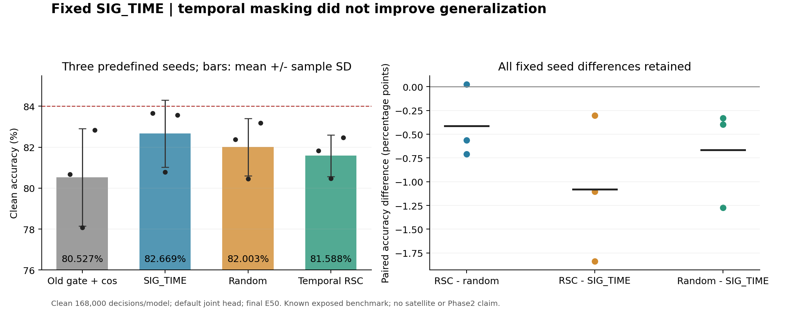
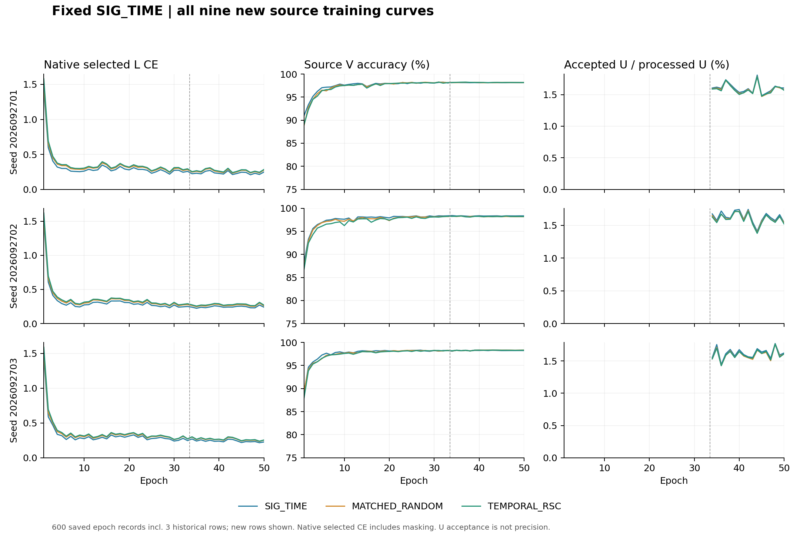

# 固定 SIG_TIME 时序自挑战：完整三种子结果

时序自挑战未提升泛化。TEMPORAL_RSC 的 clean 三种子均值为 **81.588095%**，同成本 SIG_TIME 为 **82.669048%**，配对下降 **1.080952 个百分点**，3 个种子均为负；匹配随机遮挡为 82.002579%，也全部低于同种子 SIG_TIME。84% 目标未达到。本固定方案不再扩展或按目标结果调整遮挡率、层位及强度。

## 固定矩阵与独立评分

完整矩阵由首运行`20261015-phase1-temporal-rsc-oldgate-cos-e50-clean-manysig-s01-m4-r02`和剩余运行`20261015-phase1-temporal-rsc-oldgate-cos-e50-clean-manysig-s0203-m8-r01`组成。预定种子为 2026092701/02/03；4 臂×3 种子，共 12 模型，其中 9 次新 scratch50 训练、3 份既有旧门控+cos结果复用。01 未重训，所有健康训练自然结束。每行固定 final50，再用 checkpoint 内默认头生成 clean168000 决策，全部预测固定后由独立 truth-last scorer 连接真值。216 条整体/RX/TX/day 指标及 6×6 混淆矩阵完整保存在 [results.json](results.json)，全部 2016000 个模型决策均已完成。

数据为 ManySig、固定 split392005、旧 6 TX×7 目标 RX×4 days，clean-only。既有目标基准已暴露，本轮不声称新的独立盲测。源 L6300/U56700（TX 真值隐藏）/V27000、源 RX1/3/4/6/8、days1/2/3和物理角色保持原约定。

| 方法 | seed01（%） | seed02（%） | seed03（%） | 均值 ± 样本 SD（%） | Macro-F1 均值（%） | 最差 RX 均值（%） | 最差 day 均值（%） |
|---|---:|---:|---:|---:|---:|---:|---:|
| OLD_GATE_COS50 | 80.668452 | 78.081548 | 82.830357 | 80.526786 ± 2.377572 | 80.002386 | 67.970833 | 76.055556 |
| SIG_TIME | 83.660714 | 80.776190 | 83.570238 | 82.669048 ± 1.639886 | 82.127800 | 70.337500 | 78.479365 |
| MATCHED_RANDOM | 82.385119 | 80.447619 | 83.175000 | 82.002579 ± 1.403355 | 81.495174 | 67.777778 | 77.624603 |
| TEMPORAL_RSC | 81.823810 | 80.472619 | 82.467857 | 81.588095 ± 1.018290 | 81.056529 | 66.706944 | 76.689683 |

| 配对 | seed01/02/03 差值（百分点） | 均值 ± 样本 SD（百分点） | 正差种子 |
|---|---|---:|---:|
| TEMPORAL_RSC − MATCHED_RANDOM | -0.561310 / 0.025000 / -0.707143 | -0.414484 ± 0.387526 | 1/3 |
| TEMPORAL_RSC − SIG_TIME | -1.836905 / -0.303571 / -1.102381 | -1.080952 ± 0.766891 | 0/3 |
| MATCHED_RANDOM − SIG_TIME | -1.275595 / -0.328571 / -0.395238 | -0.666468 ± 0.528572 | 0/3 |
| TEMPORAL_RSC − OLD_GATE_COS50 | 1.155357 / 2.391071 / -0.362500 | 1.061310 ± 1.379193 | 2/3 |
| SIG_TIME − OLD_GATE_COS50 | 2.992262 / 2.694643 / 0.739881 | 2.142262 ± 1.223580 | 3/3 |

RSC 相对 SIG 修正 11229 个错误、引入 16677 个错误，净减少 5448/504000 个正确决策；相对随机修正 5633、引入 7722，净减少 2089。随机相对 SIG 修正 9496、引入 12855，净减少 3359。各种子物理 ID 对齐的错误转移、准确率差和混淆矩阵独立重算一致，见 [independent_statistics.json](independent_statistics.json)。RSC 相对旧门控+cos的 +1.061310 个百分点包含网络差异，不能归为训练机制增益；机制结论以固定 SIG_TIME 对照为准。3 个种子的样本 SD 为描述性统计，不作显著性或普遍无效声明。

## 网络、训练和实际特征证据

SIG_TIME 特征提取器 195041 参数、joint160，以及既有 6×160/scale30 默认 cosine 头保持。所有头随骨干按原生流程联合训练，没有冻结骨干后单训、重训或换头，没有新拟合的 TX/RX/day 诊断头。

原 batch_neighbor 门控、ownEMA0.999、cos、lr0.0002、weight_decay0.0001、33label+17pseudo、11100 更新、UCE0.16、entropy0.01、smoothing0.01、NoExplicitCFO 和无卫星训练保持。t2 的 N×96×32 时间遮挡只替代 L CE，不作用于 U 和教师。RSC 使用原默认头真类 logit 的有符号梯度定位时间，再按两次固定 2/3 分位规则选时间和包；随机对照在自身当前模型内匹配选包和逐包零数，仅置换位置。臂间分化后不声称选择了相同物理包。三新臂都执行同样的三次 L 前向，SIG 控制返回原始 CE 图并复原随机状态。

全部 9 个新模型的实际 fθ 参数均更新，原 W 的 960 元素均正常联合更新。每种子初态对齐；真实 L720 上 feature-only 导出与完整模型 joint160 最大差为 0，删除或清零 W 不影响特征；归一化、增益和参考变换保留，诊断不改变参数或 buffers。全部首次与剩余种子证据保存在 [source_feature_mechanism.json](source_feature_mechanism.json)。这证明训练作用进入实际部署特征，不证明 Phase2 少样本迁移或新 TX 性能。

E1/17/33/50 每模型每期 13 批，共 468 批、1872 层记录、5616 个保存的梯度向量，涵盖真实 t1PW/t2PW/SIG 投影/默认 W。全量原生 CE、mask、11100 步预算和保存向量已独立复核：[native_recount.json](native_recount.json)。梯度诊断只覆盖每模型 52 批，不冒充全部步骤或累计优化器贡献。首种子四期完整梯度几何保留在首报告；剩余 6 模型的实际梯度和原生消费证据均随全量复核保存。

## 完整源训练和成本

| 新模型 | 原生 epoch 秒数之和 | 实际 U 接纳 / 处理 | 最后 5 轮原生所选 L CE |
|---|---:|---:|---:|
| SIG_TIME-s2026092701 | 2545.986 | 15447 / 963900 | 0.228233 |
| MATCHED_RANDOM-s2026092701 | 2530.859 | 15302 / 963900 | 0.254213 |
| TEMPORAL_RSC-s2026092701 | 2534.553 | 15268 / 963900 | 0.261342 |
| SIG_TIME-s2026092702 | 2628.331 | 15651 / 963900 | 0.244288 |
| MATCHED_RANDOM-s2026092702 | 2545.209 | 15440 / 963900 | 0.267878 |
| TEMPORAL_RSC-s2026092702 | 2545.180 | 15363 / 963900 | 0.278683 |
| SIG_TIME-s2026092703 | 2539.881 | 15614 / 963900 | 0.227501 |
| MATCHED_RANDOM-s2026092703 | 2579.985 | 15388 / 963900 | 0.248947 |
| TEMPORAL_RSC-s2026092703 | 2740.239 | 15409 / 963900 | 0.253614 |

9 个新模型共 450 model-epochs、99900 次更新、299700 次 L 网络前向，其中 199800 次为额外前向；另列复用历史 150 epochs/33300 更新。U 合计 8675100 个包-模型观测，U 真值读取 0。原 U loss 对象保留，ownEMA 更新和数值健康已验证。与历史无探针旧门控运行不声称同计算量。秒数仅为 epoch 时间之和，不包含整个发布、源诊断和评分流程；U 接纳率约 1.6%，不能当作伪标签准确率。

完整 600 轮记录见 [full_source_curves.json](full_source_curves.json)。下图展示全部 9 个新模型；此处 L CE 是原生实际消费的所选 CE，遮挡臂不等于其未遮挡 CE。源 V 仅作健康诊断，没有追逐 V 微小涨分或据此选择 final checkpoint。

## 冻结、交付与研究边界

首代码 `82cc7f1c24c2e5d0e20572b2654722fdc3e43a47`，剩余代码 `2f99d65f8a594ab1f56d84d1d7ee1011740da52c`。源资格及原样扩种子的决定 `832485cace509543a7b4e921ac7f5483a2053749` 已提交、推送并独立比较远端 OID；其后才回收首模型新目标分数。剩余 02/03 数值于 2026-10-15T00:20:27.595Z 回收，全部配方和预算均已先固定；负结果未触发热改、提前停止、重排、重训或选择性漏报。

先前两个技术失败的发布尝试在训练前终止，产物保留；本报告来自实际自然完成的固定运行。完成状态与无存活工作进程证据见 [completion_verified.json](completion_verified.json)。无卫星部署、Phase2、新 TX 或 84% 已达成声明。

下一项 Sinc 优化器单位实验的完整实现提交 `00132f7d54aff45b6e52fc41f89d7705a043bc71` 早于本轮剩余 RSC 目标数值回收；其假设来自真实旧源 checkpoint 的 Sinc/AdamW 状态，不来自这里的目标差值。网络、参数化、默认头与半监督主流程保持；该项尚未发布，不能写为已验证有效。
