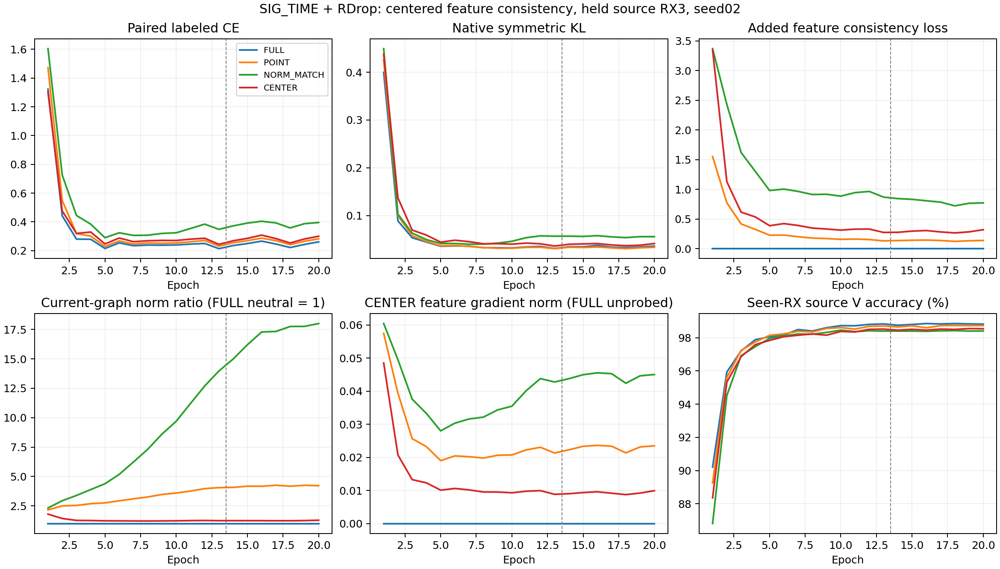

# SIG_TIME＋RDrop：批次中心化方向一致性完整源域结果

**主CENTER：FAIL，关闭本固定CENTER配方，不扫系数/层/轮次/种子救援。** 独立POINT确认：FAIL，旧RX1正迹象在本RX3折未达到固定确认条件，保留正负结果。四组固定E20全部完成，完整核验VERIFIED，无技术失败/重训/选择性重跑。以下仅一个模型seed2026092702、held source RX3的开发证据，不能与全源目标三种子分数混合。

| 条件 | RX3 错误 /1260 | 准确率 | mean CE | Macro-F1 | final L CE |
|---|---:|---:|---:|---:|---:|
| FULL | 643 | 48.9683% | 1.441194 | 47.6728% | 0.260200 |
| POINT | 644 | 48.8889% | 1.292150 | 46.8817% | 0.281636 |
| NORM_MATCH | 619 | 50.8730% | 1.207445 | 50.1688% | 0.395667 |
| CENTER | 650 | 48.4127% | 1.325432 | 47.9075% | 0.300141 |

| CENTER 相对对照 | 准确率差（百分点） | 修正 / 新增错误 | mean CE 差 |
|---|---:|---:|---:|---:|
| FULL | -0.5556 | 63 / 70 | -0.115761 |
| POINT | -0.4762 | 64 / 70 | +0.033282 |
| NORM_MATCH | -2.4603 | 92 / 123 | +0.117988 |

主判据在发布前固定：四行finalLCE≤.5健康=True；CENTER辅助项至少90%步骤为正=True；相对FULL/POINT/NORM_MATCH全部严格少错且meanCE不高=False。不以某个次要指标替换固定资格。

旧全空间POINT相对FULL：修正55、新增56、净错误差+1，准确率差-0.0794个百分点，meanCE差-0.149044。它是预先独立登记的确认轨道，不替代CENTER主候选、不救活已关闭NULL。此前RX1全空间+18净少错和特征关系正迹象保持原记录，本RX3折实际结果同样保留。

**探索性正迹象保留**：NORM_MATCH对FULL修正118、新增94，净少24错（+1.9048个百分点），CE差-0.233749；对POINT净少25错、CE差-0.084705。它只改变全空间辅助项在当前图中的梯度力度，没有采用CENTER方向。此结果支持下一步独立检验“按特征梯度自调一致性强度”的具体路线，不能证明力度是唯一因果，也不能把本控制事后升格为本批合格主候选。单源折/单seed尚未确认；若后续研究此算子，必须另行预登记相同固定公式的源折证伪，不按本分数改系数/阈值，也不直接进入目标测试。完整配对证据在norm_route_exploratory.json，补充读取只消费已固定源决定，0新IQ/前向/CP/优化更新。

| 条件 | final paired CE | 原 KL | 附加项 | norm ratio | 循环 U 接受数 /396368 |
|---|---:|---:|---:|---:|---:|
| FULL | 0.260730 | 0.036163 | 0.000000 | 1.000000 | 7699 |
| POINT | 0.281805 | 0.033786 | 0.138152 | 4.219265 | 7052 |
| NORM_MATCH | 0.395489 | 0.055965 | 0.770612 | 18.000452 | 1822 |
| CENTER | 0.299772 | 0.041594 | 0.319032 | 1.281711 | 6615 |

<!-- NORM_ROUTE_LIMITS_20261016 -->
NORM_MATCH的正迹象存在明显分层差异：day1/2/3净少错依次6/−3/21，2/3天改善；六TX只有2/6准确率改善，四类下降，其中一类下降10.4762个百分点。不能据此对特定TX设置权重、例外或补训。其final epoch平均自调比为18.00045（实际逐步比最大23.66333），不是预先设置alpha18，更不代表自适应性已胜过简单加大辅助权重。若另行研究此正路线，下一源折应保留固定原公式并增加一个预先固定强度对照，检验动态校准的独立作用；本批主FAIL保持，0直接目标晋级。此前RX1正迹象、当前RX3反例和控制正迹象均完整保留。

曲线覆盖全部20轮及13L＋7旧U。FULL的normratio1是未做附加梯度探测的中性占位，CENTER边界范数0同理；其余三臂每实际L步对POINT和CENTER各求一次特征边界梯度。ratio是同一当前图中CENTER/POINT辅助梯度L2比，不匹配不同轨迹的梯度、模型参数/clip/AdamW。完整17760步、80 model-epoch、4份stdout、8份初末CP及5040份源默认头决定已核验。重构原closed_loss＋.5(CE2−CE1)＋nativeKL＋aux的最大误差4.77e-07；原U和加权U熵贡献保留。FULL逐步辅助0、原KL不变，POINT/CENTER/NORM_MATCH逐步与登记公式一致。

真实训练数值审计：梯度范数匹配相对误差最大6.29e-08，CENTER共同平移梯度比例最大2.14e-08；调用数/包次/正信号、逐步Fisher迹、point/center/ratio/梯度范数累计与进度审计全部对齐。条件是固定detach的T；完整目标、T值、编码器中心和实际优化器不具备辅助项的共同平移不变保证。不能用本实验声称接收机干扰已分离、完整抗坍塌或全球方法新颖。

四臂198初态张量逐位相同，t1/t2/SIG_TIME投影和默认W均有实际非零更新。固定合成包初末joint160改变，feature-only导出与实际前向逐位一致，临时扰动W不改变z。此检查证明部署特征路径存在且参与训练，不把全部性能差异因果归于某层。默认分类头从始至终联合训练，无冻结骨干、换头、重训头或拟合诊断分类器。

实际fit RX1/4/6/8、day1/2/3、六TX；RX3在五loader、EMA、校准、统计和继承路径全排除。L5040/U45360hidden/V21600，各scratch20、自身EMA、固定final20学生。共2273280额外L身份包次、1585472循环U观察、5040held决定；另每行144fitL anchor读取但无训练/拟合。训练首步各2合成包自己的真实CP smoke。分析0新增真实IQ/源或目标前向/头拟合/优化更新/CP写入，另32合成包导出边界验证。U接受计数是重复观察，无U真值，不能推断伪标签正确率。物理ID首列eq_i而非TX，TX分层来自实际标签及native tx_i约定。

执行代码 `5c60deca3f42c02ebf82f5402a205bd9db81c89f`；全部所属进程已终态，默认头源读出与完整CP身份/角色/旧配方对齐。各arm day/TX、CM、MacroF1、配对CE转移、完整loss统计、参数更新和walltime见本目录CSV及results_analysis.json。源V为已见RX健康数据，不代替heldRX3；CE分组只作描述，不作因果或类别专属规则依据。模型seed仅1个，不声明统计显著、新盲测、新TX或卫星部署收益。原版SIG_TIME＋RDrop E20/E50三种子83.942857%/84.340079%以及所有关闭路线保持不变。本次仅源域证伪，无目标测试队列；goal ACTIVE。

以下保留发布前和启动时的固定方案，终态以本页开头为准。

# SIG_TIME＋RDrop：批次中心化方向一致性源域预登记

状态 PLANNED。本批仅优化 SIG_TIME＋RDrop 的训练机制，SIG_TIME 和默认分类头保持原联合训练。原版 RDrop E20/E50 三种子 clean 均值83.942857%/84.340079%的已验证收益保留；互补掩码、跨RX证据、差分梯度、教师包络和NULL余空间固定配方的失败不重启。本批不是这些失败配方的参数救跑。

## 依据与可证伪假设

上一[源训练](../20261016-phase1-SIGTIME-rdrop-curvature-completion-sourcefold-s2026092702-m4-r01/report.md)中，全空间ISOTROPIC对原FULL修正45/新增27错，净少18错，CE从.766282降至.715820；主NULL未胜过ISOTROPIC，按原规则FAIL关闭。之后[冻结特征诊断](../20261016-phase1-SIGTIME-rdrop-feature-geometry-source-s2026092702-m4-r01/report.md)给出默认W之外的特征正迹象：whole-feature关系满足率92.4757%→93.1034%，但只有4/6TX改善；平均特征范数10.08→19.10，共同均值能量比例84.53%→90.45%。类间绝对距离间隔反而变小，不能把距离收缩当作身份几何全面改善，也不能断定共同分量就是RX噪声。

新假设：保留有效的完整预测KL，同时对去除当前训练批次共同分量后的方向施加同包双mask一致性，能否产生更好的身份学习信号。中心只在训练当前L批次瞬时计算，没有持久中心、额外网络、额外头或推理状态。它与旧每包差分梯度投影不同。

## 固定机制与对照

实际部署joint160为z1,z2，复用同一实际增强后L128输入，原生独立dropout。mu=.5×mean_i(z1_i+z2_i)，**mu参与反向传播**。normalize均使用eps1e−4。T_i=900×[sum_k pbar_ik ||A_k||²−||pbar_i A||²]，A=normalize(默认W)，pbar=(softmax(logits1)+softmax(logits2))/2；T double计算后转FP32并停止梯度。T是环境归一化特征坐标中的默认softmax Fisher迹，不是编码器参数中的Fisher。

记P=.5×mean_i[T_i ||normalize(z1_i)−normalize(z2_i)||²/160]，C=.5×mean_i[T_i ||normalize(z1_i−mu)−normalize(z2_i−mu)||²/160]。每组总目标都包含原paired smoothedCE＋原full symmetricKL＋原hiddenU；固定alpha1，附加项如下：

| 条件 | 附加项 | 用途 |
|---|---|---|
| FULL | 0 | 原版RDrop |
| POINT | P | 原ISOTROPIC正路线，独立源折确认 |
| NORM_MATCH | stop(||g_C||/||g_P||)×P | 区分方向改变与特征边界梯度力度 |
| CENTER（主候选） | C | 当前批次共同平移不敏感的方向一致性 |

g_P/g_C只对当前图中的原始joint160对(z1,z2)求导；两次autograd遍历在此停止，不累积参数grad、不更新优化器，不增加模型前向。范数匹配只在当前图中成立，不等于跨独立轨迹、模型参数、clip或AdamW位移匹配。ratio停止梯度且不截断；两范数都为0时ratio1，POINT为0而CENTER非0则技术失败。匹配相对误差≤2e−5，CENTER共同平移梯度比例≤1e−5，实际逐步记录。

在固定停止梯度T条件下，给全部z1/z2加相同向量不会改变C，两视图全部样本特征梯度之和为0。这只描述辅助项；完整CE/KL和T取值、编码器中心、共享参数Jacobian、实际AdamW步及接收机不变性均无此保证。当前batch是随机L采样，无跨RX身份配对或类专属权重。

## 数据、预算与预定判据

固定seed2026092702，四组各scratchE20=13L＋7旧U，每轮222步、各4440步。RAW_HZ、普通增强、LS.01、默认6×160 cosine头scale30/eps1e−4、AdamW lr.0002/wd.0001、cosine及自身EMA/旧U门控不变，无星地训练。无冻结骨干、换头、单独重训或拟合诊断头。辅助项对默认W没有直接梯度，CE和原KL继续联合更新W。

本批真实留出源RX3，fit RX1/4/6/8、day1/2/3、六TX。原source carrier合法元数据核对后，在模型/EMA创建前过滤训练L、probeL、U、V、calibration五loader，保留原15个RX×day静态域ID不重编号。有效L5040/U45360隐藏TX/V21600。U只看RX过滤，不读TX；V只健康监测。自己的随机初始真实checkpoint严格加载2合成包noquery smoke为worker首步，PASS立即继续。没有trained checkpoint/teacher/EMA/optimizer祖先；远端release仅为代码依赖。

固定final20学生checkpoint直接用默认头预测1260原可见RX3 L，保存逐包opaque物理ID、标签、预测、CE、margin、真类概率，独立复核完整日志/决定，不另拟合头。全部是开发源域，不能声称独立盲测、目标接收机、新TX或卫星泛化。共用helper另读取144fitL anchor但不参与拟合或训练，计入成本。

**主判据**：四行finalLCE≤.5，CENTER辅助项≥90%步骤为正；CENTER必须相对FULL/POINT/NORM_MATCH全部严格少错且meanCE不高。技术数值及过滤检查必须通过。PASS只允许另行预登记同四臂/seed/E20的RX1源折确认；FAIL关闭此固定CENTER配方，不扫alpha/seed/temperature/epoch/layer救援。

**独立预登记正路线确认**：POINT相对FULL严格少错且meanCE不高，四行健康且POINT辅助项≥90%步骤为正。此前RX1的+18错及特征证据保留，本批RX3结果作为第二开发源折确认。POINT结果不替代CENTER主判据、不救活NULL；PASS仅支持另行预登记后续工作，FAIL如实记跨折未确认。此批没有target队列，不能据某一臂源结果临时改主候选。未来正式E20/E50三模型seed须另行登记并保留同预算原版RDrop对照，冻结后自动clean预测及独立truth-last评分。

总4scratch20=80 model-epoch/17760更新。每行额外568320 L身份包次、396368循环U观察、1260heldL、1404额外L读取（含144unusedfit），四行各项合计2273280/1585472/5040/5616；另首步2合成包/行。POINT/CENTER/NORM_MATCH各有2次特征边界autograd/步，FULL没有此附加遍历；实际walltime单列，不承诺同计算成本。

## 执行与验证

CPU/CUDA各59协议负例、主资格与POINT独立判定、198同初态、实际CE/logits/nativeRNG一致、FULL原版梯度对齐PASS。解析Fisher迹、共享平移loss/梯度、norm匹配、类置换/样本置换/视图互换、同视图零loss/梯度均通过；辅助梯度进入t1/t2/SIG且对默认W直接梯度None。各1280合成包次，0真实IQ/CP加载/优化步/头拟合。源RX3元数据过滤覆盖L/U/V；U模拟项根本无TX字段。具体证据见local_verification.json。唯一一次独立P0/P1下一运行审查记录review.json，未完成前不发布。

唯一owner `codex/root/SIGTIME-RDrop-batch-center-20261016`。ordinary N607 CVS-RFFI，CPU2/loader0；每GPU计全部owner及preCUDA总实验进程≤3。CWD `PROJECT/releases/cvs_SIGTIME_rdrop_batch_center_RX3_source20_20261016_r01`；命令 `CVS-RFFI/bin/python -u experiments/cvs_sigtime_rdrop_center20/runner.py experiments/cvs_sigtime_rdrop_center20/configs/matrix.json`；不可覆盖root `PROJECT/runs/20261016-phase1-SIGTIME-rdrop-batch-center-RX3-sourcefold-s2026092702-m4-r01`。代码身份为一次Git提交，实际commit见release_commit.txt；模型代码依赖b3ac442e2d33a5b315fb3251c30e0ad7083566bc，runner显式加载default-head-only FOLD trainer。逐row预期初末CP/实际args/角色/冻结/完整日志/rdrop_center_progress/result/source_readouts与全矩阵completion/qualification，详见experiment.json。一次普通账户preflight、一个release archive本地远端SHA比较、remote compile；独立读回PID/CWD/argv/GPU/日志增长。技术错误保留产物并停止pending，不重发、不停止健康/无关进程。本source-only批不访问目标/卫星/Phase2。

文献边界：[R-Drop](https://arxiv.org/abs/2106.14448)已有同包双向KL；[LR-Drop](https://aclanthology.org/2024.lrec-main.891/)已有隐藏状态一致性；[Barlow Twins](https://arxiv.org/abs/2103.03230)和[VICReg](https://arxiv.org/abs/2105.04906)已有表征一致性及中心化/方差/协方差学习背景。仅“加feature consistency”或“减均值”不能声称全球创新，本候选也不继承VICReg防坍塌保证。待证点是当前SIG_TIME上保留有效KL，使用可微共同中心约束方向，并以边界梯度范数对照区分作用；有效性尚待本批及独立后续验证。

REJECTED_EXTRA_GATE：通用brainstorming中的额外设计/spec审批不在用户最小流程白名单，NONBLOCKING不执行。固定方案/矩阵/判据在此，0额外审批/签名/重复审查。goal ACTIVE。

## 启动独立核实

VERIFIED / RUNNING。实际代码提交 `5c60deca3f42c02ebf82f5402a205bd9db81c89f` 已push并独立核对远端OID；一次release archive SHA比较和remote compile均VERIFIED。四行均已通过自己的真实初始checkpoint noquery smoke并完成首轮，独立PID/CWD/argv/GPU及实际compute app匹配，日志均增长，无技术异常。实际RX3全部五loader排除，fit1/4/6/8、L5040/U45360hidden/V21600；旧13L＋7U/LS.01/普通增强等实际args一致。新增信号与梯度数值审计在真实训练通过。全部owner当前GPU compute app数量≤3，preCUDA容量在每次launch前计入。详见launch_verification.json；原始进程/命令/日志与私有运行细节只留local_artifacts。尚无final20结果或目标预测，不能宣称机制有效。
