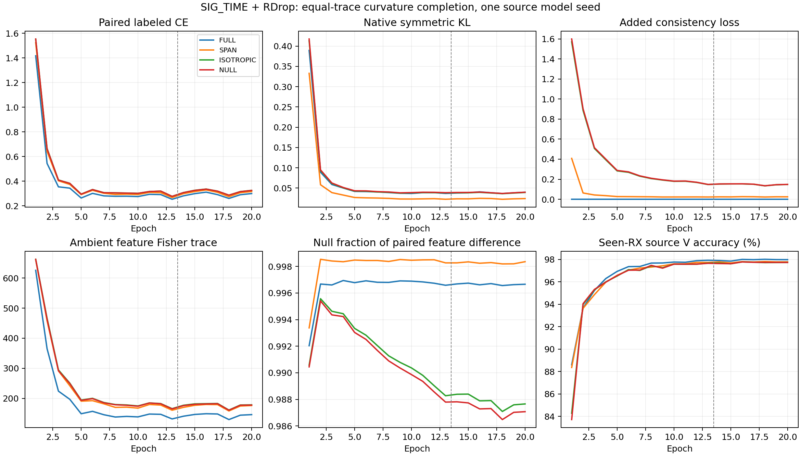

# SIG_TIME＋RDrop：特征余空间曲率补全完整源域结果

**FAIL：未达到固定源域条件，关闭本次配方，不扩种子或访问目标测试。** 四个固定 E20 模型全部完成，独立完整核验 VERIFIED。原版 full KL 在全部条件中保留，仅附加特征一致性二次型的方向不同。以下为一个预定义模型 seed2026092702、1260 包 held source RX1 的开发证据，不是目标三种子或新 TX 结论。

| 条件 | RX1 错误 /1260 | 准确率 | mean CE | Macro-F1 | final L CE |
|---|---:|---:|---:|---:|---:|
| FULL | 281 | 77.6984% | 0.766282 | 77.5745% | 0.299493 |
| SPAN | 283 | 77.5397% | 0.848411 | 77.1717% | 0.315624 |
| ISOTROPIC | 263 | 79.1270% | 0.715820 | 79.1436% | 0.325134 |
| NULL | 273 | 78.3333% | 0.737911 | 78.2077% | 0.324671 |

| NULL 相对对照 | 准确率差（百分点） | 修正 / 新增错误 | mean CE 差 |
|---|---:|---:|---:|
| FULL | +0.6349 | 45 / 37 | -0.028371 |
| SPAN | +0.7937 | 75 / 65 | -0.110500 |
| ISOTROPIC | -0.7937 | 5 / 15 | +0.022090 |

<!-- SOURCE_CONTROL_POSITIVE -->
本轮有两项必须分开保留的观察。第一，主候选 NULL 相对 FULL 净少错8包，但相对普通全空间 ISOTROPIC 净多错10包、CE增加0.022090，未证明余空间定向优于简单全空间约束，按固定规则关闭，不启动 RX3 确认或主目标实验。第二，全空间对照相对原版 FULL 修正45包、引入27包，净少错18包，准确率+1.428571个百分点、mean CE−0.050462，是一个单模型seed的合法源域正迹象。它保留为未独立确认的对照结果，不替换本批主条件，也不据此把失败批次判为通过。

全空间与余空间的 final 原生 KL 都约0.039至0.040，SPAN虽把KL进一步降低到0.024212，留出错误却更多。全空间源V和LCE也未优于FULL，而留出RX1指标更好。这些观察支持继续区分“降低输出分歧”和“有用的特征稳定性”，不能从某个loss或已见RX的V单独判定泛化。全空间特征一致性已有文献先例，此结果也没有证明解析Fisher权重本身的独立作用或新颖性。

后续最多两个动作：保留原版RDrop作为性能参照，完成本批负结果和全空间正迹象归档；若继续机制诊断，仅对本批四个冻结模型进行无拟合参数的跨RX特征关系分析，检查实际joint160的源端几何是否与默认头结果一致。不训练/更换诊断头、不调整本批参数、不扩种子或追加目标测试；新训练假设需要独立方案及对照。全部6个同批配对见all_pairwise_source.csv，额外核对只读取已有源预测JSON，0新增IQ、模型前向或target。

预登记判据：四行 final L CE≤.5 健康=True；NULL 辅助信号至少90%步骤为正=True；NULL 相对三个对照同时严格少错且 mean CE 不高的最终资格=False。不把次要对照的较好分数改成主条件，也不按结果扫描系数或种子救跑。

| 条件 | final paired CE | 原版 KL | 新增辅助 loss | Fisher 迹均值 | 特征差余空间比例 | 已见 RX 的源 V |
|---|---:|---:|---:|---:|---:|---:|
| FULL | 0.299858 | 0.039824 | 0.000000 | 145.694264 | 99.6656% | 97.9769% |
| SPAN | 0.316189 | 0.024212 | 0.024488 | 176.000262 | 99.8351% | 97.7778% |
| ISOTROPIC | 0.325451 | 0.039279 | 0.147534 | 178.286382 | 98.7661% | 97.7361% |
| NULL | 0.325035 | 0.039831 | 0.148262 | 177.505692 | 98.7078% | 97.7269% |

上述梯度相关统计为各自训练轨迹上的完整 final epoch 均值；同迹条件只在相同权重/输入上对三个附加度量成立，不保证独立训练后的 Fisher 迹、实际 loss、梯度范数或 AdamW 位移相同。原版 KL 和附加项均已逐步核对，不能把总一致性 loss 的大小当作泛化效果的直接原因。余空间比例针对归一化 joint160 的两视图差，不代表这些方向都是接收机噪声。源 V 为已见 RX，不代替真正留出的 RX1；U 接受量见 same_metric_diagnostics.csv，均为循环观察计数，U 真值未读取，无法据此报告伪标签正确率。

- FULL：实际 4440 步，数值秩始终 5 至 5；辅助项为正 0/4440；投影残差最大 1.21e-14，附加度量迹相对误差最大 0，独立逐步 Fisher 迹汇总与审计差 0。
- SPAN：实际 4440 步，数值秩始终 5 至 5；辅助项为正 4440/4440；投影残差最大 1.07e-14，附加度量迹相对误差最大 1.14e-08，独立逐步 Fisher 迹汇总与审计差 0。
- ISOTROPIC：实际 4440 步，数值秩始终 5 至 5；辅助项为正 4440/4440；投影残差最大 1.2e-14，附加度量迹相对误差最大 0，独立逐步 Fisher 迹汇总与审计差 0。
- NULL：实际 4440 步，数值秩始终 5 至 5；辅助项为正 4440/4440；投影残差最大 1.12e-14，附加度量迹相对误差最大 3.53e-10，独立逐步 Fisher 迹汇总与审计差 0。

曲线覆盖全部20轮，虚线区分13L＋7原U日程，无最高V选模。共17760步、80 model-epoch、4份完整stdout、8份初末CP和5040份源默认头决定已核验。实际目标 closed_loss＋.5×(CE2−CE1)＋native_KL＋aux 的逐步重构最大误差 3.58e-07。所有记录均为有限值，rank5/投影/迹与实际调用数审计通过；FULL 辅助项逐步为0且与原版KL一致。原本的U损失与未单独暴露的加权U熵贡献也已从closed_loss重构，未替换半监督机制。

四臂 198 个初始张量逐位相同，实际t1、t2、SIG_TIME投影和默认W均有非零更新。初末实际joint160在固定合成包上改变，feature-only导出与原前向逐位一致，临时扰动W不改变z。它证明新损失训练接线与部署特征边界，不等同全部性能差异已归因于特征，也不证明新身份迁移。没有拟合、重训、替换或冻结分类头。

各行有效L5040/U45360hidden/V21600，fit RX3/4/6/8、day1/2/3、六TX；RX1在全部训练/教师/统计/缓存和继承来源排除，全部从零、自己EMA、固定final20。总计2273280次额外L身份前向、1585472次循环U观察、5040次held决定；每行另144fit L anchor读取但未拟合。训练自己的初始CP每行2合成smoke包。分析0新增真实IQ/源或目标前向/头拟合/optimizer更新/CP写入；另32合成包检查实际导出边界。物理ID首列为eq_i而非TX，TX分层采用实际标签及native tx_i约定。

真实执行提交 `78ad998e9dcb5653573fa801538e914189833d20`，所有所属worker和调度器均已终态，无技术失败或选择性重训。各arm的Macro-F1、day/TX、CM、配对CE转移、完整loss统计、参数更新与成本见同目录CSV/results_analysis.json。CE转移按全1260归一化并与整体CE差核对，不把描述性分组当作因果。

若科学资格PASS，只按已固定规则另行登记RX3排除源确认；若FAIL，本余空间曲率补全配方关闭，不做主目标测试、扩种子或扫alpha/rank/层/温度/轮次。先前原版SIG_TIME＋RDrop完整E20/E50三种子clean均值83.942857%/84.340079%及所有负结果保留；不同源折和目标口径不混合汇总。既有RDrop、FD、LR-Drop已有一致性先例，本实验不宣称全球首创、统计显著、独立盲测、新TX或卫星部署有效。总目标ACTIVE。

近期 RDrop 证据台账如下；历史部分仅复用已核实公开结果，本轮不冒称重新审计全部原始产物。完整数据/代码/成本边界见所链接报告及 related_routes_ledger.json/csv。

| 路线 | 范围与 seed | 相对匹配控制准确率差（百分点） | 固定结论 |
|---|---|---:|---|
| [Original SIG_TIME + standard RDrop](../20261015-phase1-originalSIGTIME-rdrop-e20e50-clean-manysig-m18-r01/report.md) | full-source/fixed exposed clean target168000,three model seeds；n=3 | +0.827183 | POSITIVE_MATCHED_TARGET_EVIDENCE |
| [Original SIG_TIME + standard RDrop](../20261015-phase1-originalSIGTIME-rdrop-e20e50-clean-manysig-m18-r01/report.md) | full-source/fixed exposed clean target168000,three model seeds；n=3 | +1.418056 | POSITIVE_MATCHED_TARGET_EVIDENCE |
| [Difference-gradient RDrop](../20261015-phase1-SIGTIME-rdrop-difference-gradient-sourcefold-s2026092702-m4-r01/report.md) | true held source RX1,1260 legalL;not target；n=1 | +2.936508 | SOURCE_FAIL_FIXED_RECIPE_CLOSED |
| [Cross-RX conditional-evidence RDrop](../20261015-phase1-SIGTIME-rdrop-RX-evidence-sourcefold-s2026092703-m4-r01/report.md) | true held source RX1,1260 legalL;not target；n=1 | -2.301587 | SOURCE_FAIL_FIXED_RECIPE_CLOSED |
| [Paired masks RDrop source screen](../20261015-phase1-SIGTIME-rdrop-paired-masks-sourcefold-s2026092701-m4-r01/report.md) | true held source RX1,1260 legalL;not target；n=1 | +0.396825 | SOURCE_PASS |
| [Paired masks RDrop full-source E20](../20261015-phase1-SIGTIME-rdrop-paired-masks-e20e50-clean-manysig-m12-r01/report.md) | fixed exposed clean target168000,three model seeds；n=3 | -0.350595 | NEGATIVE_VS_STANDARD_RDROP |
| [Paired masks RDrop full-source E50](../20261015-phase1-SIGTIME-rdrop-paired-masks-e20e50-clean-manysig-m12-r01/report.md) | fixed exposed clean target168000,three model seeds；n=3 | -0.045040 | MAIN_PRIMARY_FAIL_FIXED_RECIPE_CLOSED |
| [Margin-envelope teacher RDrop](../20261016-phase1-SIGTIME-rdrop-margin-envelope-sourcefold-s2026092701-m4-r01/report.md) | true held source RX1,1260 legalL;not target；n=1 | -7.222222 | SOURCE_FAIL_FIXED_RECIPE_CLOSED |
| [Classifier-complement curvature RDrop](../20261016-phase1-SIGTIME-rdrop-curvature-completion-sourcefold-s2026092702-m4-r01/report.md) | true held source RX1,1260 legalL;not target；n=1 | +0.634921 | SOURCE_FAIL_FIXED_RECIPE_CLOSED |

以下保留发布前和启动时固定方案，历史状态以本页开头终态为准。

# SIG_TIME＋RDrop：特征余空间曲率补全源域预登记

状态 RUNNING，四行启动 VERIFIED。只优化 SIG_TIME＋RDrop，固定原 SIG_TIME 与默认头联合训练。原版 RDrop E20/E50 三种子 clean 均值83.942857%/84.340079%的正收益保留；差分梯度、跨 RX 证据、互补掩码和包络的失败配方保持关闭。本轮新增的是原版预测一致性之外的特征学习信号，不救跑既有失败算子。

最新[同图梯度诊断](../20261016-phase1-SIGTIME-rdrop-operator-gradient-source-s2026092701-r01/report.md)证实，MEAN/CONFIDENCE/ENVELOPE同时改变强度和方向，不能把损失系数相同当作同样优化力度。本候选完整保留原双向 KL，不把它替换成教师目标。其假设是：默认六类头只观测160维归一化特征中的至多5个类间对比方向，双向 KL 对其余方向的同包 dropout 差异没有直接的类间约束。补充这些方向的稳定性可能减少部署特征中的随机依赖，也可能损害有用变化，须用公平源训练证伪。

令 u_v=normalize(z_v,eps1e−4)，其中 z 是实际部署 joint160；A=normalize(默认W,eps1e−4)，C=A−mean_rows(A)，以C的右奇异向量（sigma>sigma_max×1e−6）构造B，P=B Bᵀ，数值rank固定为5。W、B及以下曲率系数仅在辅助项中停止梯度，默认W仍由原CE和原双向KL更新，无冻结骨干、换头、重训头或拟合诊断分类器。新增项没有参数。

同一对随机前向得到 pbar=(softmax(logits1)+softmax(logits2))/2，计算停止梯度的 t_i=900×[sum_k pbar_ik ||A_k||²−||pbar_i A||²]。这是在环境归一化特征坐标u中的默认softmax Fisher矩阵迹，不是原始z或共享编码器参数中的Fisher迹。用 d_i=u1_i−u2_i，四个固定条件如下：

| 条件 | 在原 paired CE＋原 full KL＋原 U 上加入 |
|---|---|
| FULL | 0；原版 RDrop 控制 |
| SPAN | .5×mean_i[t_i ||d_i P||²/5] |
| ISOTROPIC | .5×mean_i[t_i ||d_i||²/160] |
| NULL（主候选） | .5×mean_i[t_i ||d_i(I−P)||²/155] |

三种新增度量的总迹都为t_i；它们在同一模型同一图上具有相同曲率总量。不同训练轨迹的W、概率与t会变化；本对照不匹配实际loss、参数梯度范数、clip或AdamW位移，也不声称优化强度相同。新增系数固定1，不扫alpha/rank/温度/层位。全空间对照检验普通特征一致性解释，SPAN检验继续加强已有判别方向的解释。

NULL指环境u坐标中centered-A的核；它对类间logit差异不敏感。u由归一化z得到，两视图及共享参数Jacobian不同，因此不保证原始特征中心、编码器中心或实际AdamW步不变。这个核也不是已识别的接收机干扰空间，不能把全部155维当作域噪声或声称已保留新TX信息。默认头推理、部署特征和网络架构不变。

四行固定下一预定义模型seed2026092702，从零E20=13L＋7原U，每轮222步、共4440步。旧RAW_HZ、普通增强use_aug=True、LS.01、scale30/eps1e−4默认cosine头、AdamW lr.0002/wd.0001、cosine日程、自身EMA与旧U门控保持。原生独立dropout、两次前向复用实际增强后的同L128输入，不重抽增强，无额外前向、步数或星地增强。

真实源RX1在训练/U/teacher/calibration/cache/继承路径全排除，fit RX3/4/6/8、day1/2/3、六TX。有效L5040/U45360hidden/V21600，U真值不可读，V只监测。固定final20用checkpoint默认头预测1260合法held L；保存逐包CE、margin、真类概率、day/TX和paired修正/新增错误。RX1此前已用作开发，不能称新盲测。共用helper另读取144fit L anchor但未拟合或参与训练，计入成本。0target。

科学资格预先固定：四行finalLCE≤.5；主NULL相对FULL、SPAN、ISOTROPIC同时严格少错且meanCE不高；NULL辅助项在至少90%实际L步骤为正。数学/协议错误按技术失败处理；同一科学条件失败就关闭本配方，不扫alpha、rank、layer、seed、temperature或epoch救援。PASS只进入另行预登记的固定RX3排除源确认，四臂/seed/E20不变；确认前不发布主目标测试。之后若确认通过，另行登记E20/E50三模型seed完整验证，逐row冻结后自动clean预测与独立truth-last评分，不以目标分数选方案。

本批4×scratch20=80 model-epoch/17760更新；每行568320额外L身份前向、396368循环U观察、1260held决定，四行合计2273280/1585472/5040。每行首步自己的随机初始真实CP用2合成包no-query smoke，PASS后立即继续。无任何trained CP/teacher/EMA/optimizer祖先，代码依赖不等于权重继承。

CPU/CUDA各53协议负例、7科学否决、实际198同初态、CE/logits/native RNG一致、FULL原梯度一致检查PASS。核/投影、直接Fisher迹对齐、附加metric迹、类标签置换/两视图互换、相同视图零损失和梯度通过；辅助项实际进入t1/t2/SIG且对默认W无直接梯度，CE+KL对W梯度保留。各1280合成身份前向包次，0真实IQ/CP加载/optimizer/headfit。source进度记录形状已无数据检查。一次独立下一运行P0/P1审查PASS，无P0/P1，记录在review.json。

唯一owner `codex/root/SIGTIME-RDrop-curvature-completion-20261016`，ordinary N607 CVS-RFFI，CPU2/loader0。CWD PROJECT/releases/cvs_SIGTIME_rdrop_curvature_completion_source20_20261016_r01；命令 `CVS-RFFI/bin/python -u experiments/cvs_sigtime_rdrop_completion20/runner.py experiments/cvs_sigtime_rdrop_completion20/configs/matrix.json`；不可覆盖root PROJECT/runs/20261016-phase1-SIGTIME-rdrop-curvature-completion-sourcefold-s2026092702-m4-r01；实际Git身份写release_commit.txt，原代码依赖b3ac442e2d33a5b315fb3251c30e0ad7083566bc，FOLD显式提供default-head-only trainer。预期逐row初末CP/源角色/freeze/完整日志/rdrop_completion_progress/result/source_readouts和全matrix completion/qualification，见experiment.json。一次ordinary preflight、一个release archive SHA本地/远端比较、remote compile；独立回读PID/CWD/argv/GPU/日志增长。所有owner和preCUDA总进程计入每GPU≤3。技术错误保留所有产物、停止pending、不重发或停止健康/无关进程。source-only例外不测目标/卫星。

文献：[R-Drop](https://arxiv.org/abs/2106.14448)已有同包双向KL；[Fraternal Dropout](https://arxiv.org/abs/1711.00066)已有两mask预测差异正则；[LR-Drop](https://aclanthology.org/2024.lrec-main.891/)已对hidden states、attention及output做分层一致性。因此“额外加特征一致性”不能单独声称创新。本候选待证点是保留有效KL，按当前默认头的可见/余空间与解析等迹预算补充信号，并通过方向对照检验独立作用。有限检索不能证明全球新颖，更不能证明泛化收益。

REJECTED_EXTRA_GATE：通用brainstorming技能中的额外设计审批/书面spec审批不在用户Exclusive Minimal Experiment Workflow白名单内，作为NONBLOCKING不执行；意图、固定方案及停止规则均在本最小报告，不增加审批/签名/重复审查。goal ACTIVE。

<!-- LAUNCH_VERIFIED -->
执行提交 `78ad998e9dcb5653573fa801538e914189833d20` 已推送且远端OID匹配。单次archive SHA比较、remote compile均VERIFIED。四行own初始CP smoke、独立PID/CWD/argv/GPU/CPU与日志增长、实际源角色/RX1排除及初轮rank5/Fisher/等迹审计已核实。训练和最终源评价尚未完成，未访问target。见launch_verification.json。
